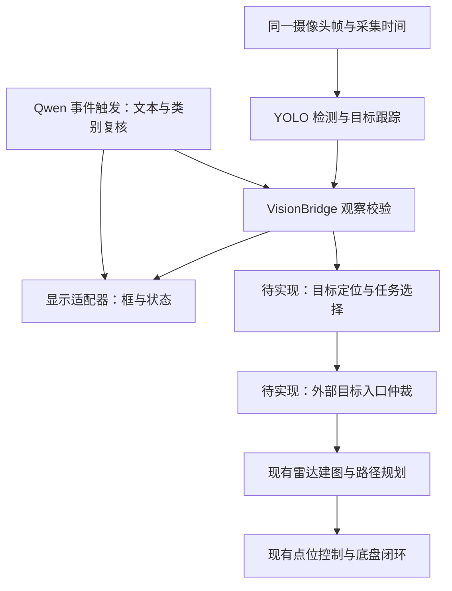

# AI 与整车联调开发指南

日期：2026-10-23。整车接口核对基线：`5702f28`。本文的“已实现”只表示源码/所列验证范围，实车状态以主 README 和现场记录为准。

交付状态：**离线回放可运行，板端部署与整车联动待验证（replayable with constraints）。**

## 1. 目标与当前边界

用户目标：摄像头画面叠加识别框；屏幕显示 Qwen 的简短文字；选择目标物体后，由现有导航系统带车靠近并停车。



当前 main 已有 `radar_navigation`、`nav_point_ctrl` 和底盘自动端口选择。**旧资料中“自动三端口接零”不再适用。**本开发包新增观察桥、显示数据适配、独立 UART 接收模块和测试，没有把 AI 连接到生产顶层；没有新增引脚约束、摄像头传输或外部导航目标协议。

## 2. 分工与最小验收

| 负责模块 | 开发任务 | 最小验收 |
| --- | --- | --- |
| 摄像头/AI | 获取图像，写采集时刻、帧号、原图尺寸；YOLO 输出类别/置信度/原图框 | 同一帧保存原图、输出和耗时；确认 RGB/BGR、letterbox 还原和四类映射 |
| 屏幕/UI | 根据 display packet 画框、类别、状态和纯文本 | 车静止，框跟物体一致；旧帧/超时不残留；画面与文字分开更新 |
| Qwen | 事件触发复核/文本说明；解析任务只允许固定类别 | 真正调用与模板文字明确区分；超时/未知/冲突可显示，不能确认目标 |
| 通信/FPGA | 先接独立观察接收器，显示类别/有效位/链路状态 | 实测 CRC 错帧、断线、序号重放撤销目标；保持电机观察模式 |
| 定位/导航 | 标定相机，估计目标位置，选目标附近可通行停车点；接现有导航入口 | 坐标单位/原点一致，格号正确；无路可报告；取消与手动接管有效 |

推荐联调顺序：静止显示 → 观察串口 → 固定目标位置验证导航 → 感知定位接入 → 低速接近。首次可以用明确标为人工输入的目标坐标验证导航，不能把它算作视觉定位成功。

## 3. 摄像头与显示路径先选一种

现有已验证链路是 OV5640→FPGA DDR3→FPGA HDMI。模型在 RK3588，必须有图像传入 RK3588 才能检测。

- RK3588 能直接采集时：由其完成采集、检测、叠框及 HDMI 显示，FPGA 保持底盘职责。摄像头驱动与接口需实际确认，不能默认 OV5640 可直接插到 RK3588。
- 保留 FPGA 显示时：另行实现图像传输/共享、帧号关联、检测结果回传和显示叠加。19 字节观察帧不携带图像、帧号、摄像头 ID 或时间戳，不能单靠它完成精确视频同步。
- 两摄像头的框不能直接互画。缩放/裁剪/letterbox 后显示必须做对应坐标变换。

`display_adapter.py` 输出的是原图像素框，未调用 OpenCV/Qt、未打开 HDMI 或实际摄像头。Qt 请用纯文本控件显示 `semantic_text`，HTML 页面须转义；该字段不进入运动控制。

## 4. AI 输出与 Qwen 接入

输入 schema-v2 与样例见 `host/vision_bridge/examples/schema2_sample.jsonl`。

| 字段 | 约定 |
| --- | --- |
| `schema_version` | 整数 2 |
| `frame_id` | 流/启动会话/序号组成的唯一 ID |
| `yolo.class` | `tape/screwdriver/ad_calcium_milk/nutri_express` |
| `yolo.confidence` | 有限浮点，0～1 |
| `yolo.bbox_xyxy` | `[x1,y1,x2,y2]`，原图像素，非 640 输入坐标的默认假设 |
| `fusion` | `status/action/target/target_valid/reason` |
| `qwen` | 不调用时 null；调用时有 `class/elapsed_ms/error` |

允许有效观察的组合只有 `TRACKING/accept` 与 `VERIFIED/target_confirmed`。`TRACKING` 不表示 Qwen 已复核；`VERIFIED` 必须有成功且同类别的 Qwen 结果。状态 `VERIFY_PENDING/UNCERTAIN/TIMEOUT` 撤销目标。

bridge 是**单个已选目标观察**接口，并非多框检测总线。前端可以画多框，但行为层须锁定一个目标，并由跟踪层维护目标身份；不应每帧跳到同类的另一物体。当前包未实现跟踪 ID/任务队列。

Qwen 可以解析“去营养快线旁边”为受限任务提案，但只接受白名单类别，不能执行自由文本中的速度/代码。RKLLM 文字生成和视觉理解是不同接入工作；视觉复核还需验证图像编码器。当前包不包含板端 Qwen 推理实现，也不保证多模型共驻内存或 NPU 并发性能。

耗时较长的语义输出在独立文本区显示其来源帧/时间；当前框仍依据新鲜的 YOLO/跟踪结果。旧的 Qwen 结论不能通过重新编号/打时间戳变成当前有效观察。

## 5. 观察 UART 协议（已实现，尚未接生产顶层）

接收 RTL：`rtl/ai/ai_vision_link.v`，依赖现有 `uart_byte_rx.v`。默认 50 MHz、115200、8N1、低有效复位，watchdog 为 300 ms。

```text
AA 55 | LEN=0E | seq:u16 flags:u8 class:u8 status:u8 conf:u8
                 x1:u16 y1:u16 x2:u16 y2:u16 | CRC16:u16
```

总长 19 字节；多字节大端；CRC16-CCITT-FALSE（poly=0x1021/init=0xFFFF），覆盖 LEN+14 字节载荷。flags bit0=目标有效声明，bit1=心跳；class 0～3 顺序同上，撤销用 FF；status 0 TRACKING / 1 VERIFY_PENDING / 2 VERIFIED / 3 UNCERTAIN / 4 TIMEOUT；conf=round(confidence×255)，接收最低 77。

主机由 `serial_export.encode_observation()` 编码，异常或量化后退化的框只能撤销。FPGA 复核 CRC/长度/类别/状态/置信度/序号；错误与超时撤销目标。序号 uint16 回绕，接收器以半区间规则判新旧；单次前跳必须小于 32768，连续发送，链路超时后允许新会话。消费者同时检查 `o_target_valid && o_link_alive`。

注意：RTL 接收器本身不掌握原图尺寸，不能替代主机边界校验；协议也没有源采集时间，不能仅凭“串口仍在发旧图结果”证明图像新鲜。实时生产者必须在发帧前检查源年龄，模型停止时撤销，不得循环发送陈旧文件。

现有串口已用于调参/CSV，不能直接将两种协议接到同一 RX 后假设互不影响。FPGA 队友先选独立 UART 或实现显式分流，再查官方资料分配引脚。本包没有更改 `.cst`、生产构建列表或电机使能。

## 6. AI 如何接现有导航

核对 `rtl/top/falcons_top.v`：

- `u_nav_obstacle_ui` 产生 `obs_goal_valid/obs_goal_x/obs_goal_y`；
- `u_radar_navigation` 接收 `goal_valid/goal_x_cell/goal_y_cell`，规划输出任务；
- `u_nav_point_ctrl` 接收 `planner_target_x/y`，通过现有握手给底盘自动控制；
- `navigation_motion_enable` 仍受页面运行、手动状态、遥控有效、急停与控制故障约束。

**接入位置应在用户目标来源选择处增加 AI/人工目标仲裁**，复用现有规划与控制，不把 AI 速度直接并接底盘、不改写 `planner_target_x/y`。现有人工目标输入与运行授权保持优先；外部目标的正式传输/确认/取消协议仍需实现。

导航地图 256×256、50 mm/格、范围 [-6400,6400) mm；(128,128) 格中心是 (25,25) mm。目标毫米坐标转格号：

```text
cell_x = floor((goal_x_mm + 6400) / 50)
cell_y = floor((goal_y_mm + 6400) / 50)
```

超出范围拒绝，不能截断到边缘。目标必须在与 `navigation_x_mm/navigation_y_mm/navigation_yaw_cdeg` 一致的定位原点和轴向下表达。清零/重定位使旧目标失效，不额外建立一个未经变换的“视觉世界系”。采集时位姿、相机外参及时间对应关系都要保留。

下列是**待实现的任务提案格式**，不是已有 UART 协议或可发送命令：

```json
{
  "schema_version": 1,
  "type": "ai_navigation_goal_proposal",
  "task_id": "demo-001",
  "target_class": "nutri_express",
  "target_track_id": null,
  "source_frame_id": "front:session42:123",
  "frame": "navigation_origin",
  "localization_epoch": null,
  "goal_valid": false,
  "goal_x_mm": null,
  "goal_y_mm": null,
  "goal_x_cell": null,
  "goal_y_cell": null,
  "reason": "target_position_not_estimated"
}
```

位置未知时保持 null/false，不能填 0 当有效目标。bbox 只提供方向和像素范围；目标定位可用标定后的地面投影或经关联验证的深度/测距。M10 扫描面可能扫不到低矮物体，正前方 ToF 测量也不等于框内目标距离。

规划终点是**物体旁可通行的停车点**，要考虑车体尺寸、目标范围和制动余量，不能让车心走到物体中心。停车间距、最高速度需现场确定，本包没有硬编码所谓安全距离。无路、定位失效、目标丢失或取消均不自动授权继续靠近；手动接管/急停仍优先。

建议任务阶段（设计建议，当前未实现）：搜索→发现候选→确认/定位→生成接近点→导航→到达；失败进入等待或取消。地图规划可以在移动中正常更新，目标点不应因每帧框抖动被反复撤销重建。

## 7. 验证与队友接手

从根目录运行 `python host/vision_bridge/verify_handoff.py`；命令、结果、工具要求见 [包说明](../host/vision_bridge/README.md)。本次验证记录见 [AI联调交付验证](AI联调交付验证_20261023.md)。

本包未携带 PT/ONNX/RKNN 权重，避免把开发候选当比赛默认模型。RKNN 另行交接权重哈希、类别顺序、输入归一化/颜色、输出解码契约、SDK/runtime 兼容版本及同一数据集上的精度/延迟。CPU ONNX 分数不能当 NPU 精度，纯推理耗时不能当相机 FPS。

不恢复已取消的自动任务，不启动训练，不升级板端包，不修改比赛环境。演示只在本地写文件，后续真实串口/摄像头/导航各自完成验收再联车。
