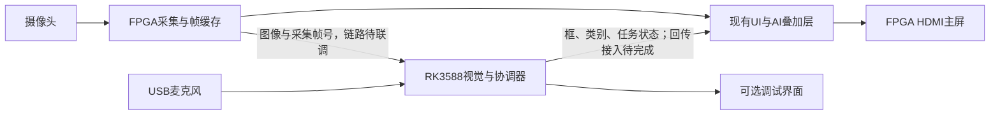

# AI显示接入现有UI方案

2026-10-24。依据只读核对的GitHub版本 `ec759b161f378fcf545a836fe8bed63295efe1a2`。本文是接入方案，不代表生产顶层已连接、已综合或已上板。

## 选择

比赛主屏沿用FPGA的HDMI输出与现有菜单。摄像头仍接FPGA，图像送RK3588推理，RK回传小体积结果，由FPGA绘制。RK自身的HDMI或网页用于开发调试，显示完整语音转写、日志和性能数据，可作为辅助屏。

不要为了显示识别框，将RK渲染后的整幅视频再送回FPGA。以1024×600、RGB565、30fps举例，仅未压缩像素约36.9MB/s，还未计协议开销；小型状态与框数据的带宽低得多，也不额外占用视频缓存。此数字是格式计算，不是现有USB链路实测。

## 页面分工

| 位置 | 建议显示 | 数据依据 |
| --- | --- | --- |
| 摄像头页 | 检测框、螺丝刀/胶带等名称、置信度、检测中/已复核 | 带采集帧号和时效的视觉结果 |
| 摄像头页新增状态带 | 巡航中、等待暂停、靠近目标、等待人工拾取、恢复巡航、失败 | 协调器任务阶段与FPGA执行回执 |
| 原导航页 | 原地图、路线和车辆位置，增加简短AI任务提示 | 保留既有导航显示源 |
| 原急停提示 | 遥控/硬件急停与故障提示始终优先 | FPGA实际安全状态 |
| RK辅助界面 | 完整语音转写、拒识原因、模型耗时、日志 | 主机诊断数据 |

首版主屏显示“指令：寻找胶带”等标准化短句。完整任意中文转写需要扩充动态文字通路；当前固定字库并不能直接绘制所有UTF-8中文。新增固定词汇应修改 `tools/gen_font_rom.py` 的文案来源并重新生成字库与索引，不手改生成的 `ui_text_index.vh`。

“已找到”与“已到达”分开：识别框表示视觉观测；到达/停止/完成依据执行层回执。没有机械执行器时显示“等待人工拾取”，人工确认之后显示“继续巡航”。

## 当前代码的确切接入位置

1. `rtl/ui/ui_render.v`：1024×600界面，菜单宽208，摄像头页ID为1；使用24×24中文固定字库。
2. `rtl/cam/cam_overlay.v`：当前为 `show_cam && pixel_x >= MENU_W` 时输出摄像头像素，其余输出UI。它在UI之后覆盖右侧，所以只在 `ui_render` 增加摄像头页文字，文字仍会被相机覆盖。
3. 建议合成顺序：背景/相机 → AI框 → AI文字及状态带 → 保留菜单/急停提示。可扩展现有合成层，也可新增独立显示叠加模块；不得改DDR连续读使能来空出菜单或状态带。
4. `host/vision_bridge/display_adapter.py` 已有同帧、原图坐标、中文标签的主机输出接口；`rtl/ai/ai_vision_link.v` 是独立观察协议接收器。两者存在不代表生产屏幕已经接通。

当前相机配置为1024×600，DDR按全幅连续读取，菜单只遮住左侧208列，并未把整幅图缩放进右侧816像素。因此源图与显示格式一致时，原图x坐标直接对应屏幕x坐标，按可见区域裁剪，不能额外加208。若后续需要看见完整图幅，应明确实现缩放/信箱显示，并同步改变坐标映射。RK输入模型前的缩放与补边须先反算回采集原图坐标。

## 回传与时序合同

推荐把显示分成两类逻辑消息；字段属于待实现合同，不能直接当作已有线协议发送：

- 视觉快照：协议版本、会话/序号、采集帧号、原图宽高、类别ID、置信度、框、结果有效性和时效。
- 任务快照：任务ID、任务阶段、规范化指令ID、目标类别、连接状态、执行回执状态与时效。它不需要依附某一幅视频帧。

既有AA55 19字节观察帧没有采集帧号、图像尺寸或完整任务状态，不能直接承担全部显示需求。既有串口还承担整定/日志，须选择明确的独立链路或实现有版本和类型的复用解析；不能直接混写数据。FX2反向USB通道是否能用，必须以实际固件和端点为依据。

RK推理结果通常比相机画面滞后。叠框需对应当前显示的采集帧；否则隐藏框并可单独保留带时效的“最近识别结果”。若要求严格同步，应保存并选择对应帧，或另行实现并验证跟踪补偿。不能将旧框无标记地叠在更新的运动画面上。当前DDR显示代码尚无完整采集帧身份合同，此项仍需实现。

系统时钟域收到的数据先完成整包校验，再通过快照握手或异步FIFO跨到像素域，在帧边界整体更新。不能对框各位分别两级同步，否则可能拼出不一致坐标。超时、断线、CRC错误与过期观测应撤销对应框；任务状态显示通信异常，不把断线推断为任务完成。

## 验收顺序与当前边界

先用固定测试快照验证框的位置、文字、菜单和急停优先级；再验证包损坏、超时、断线、跨时钟一致性；接真实图像帧号后检查推理延迟和框对齐；最后接协调器及执行回执，逐段检查巡航/靠近/人工确认/恢复显示。

本轮仅核对代码并形成方案，未修改生产RTL、控制行为或引脚，未烧录。板端物理ADB连接仍待恢复；不能报告板端与现有UI已联通。
