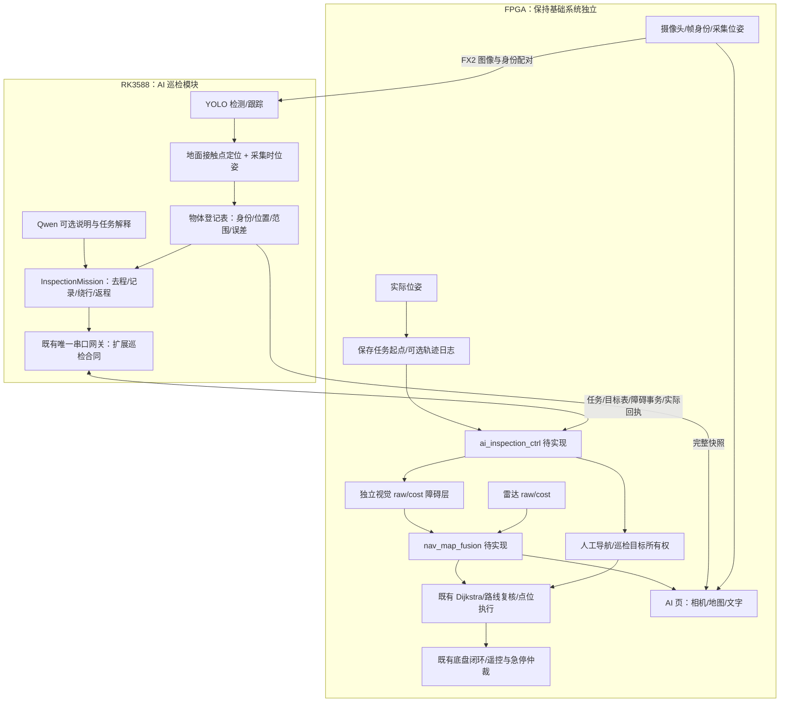
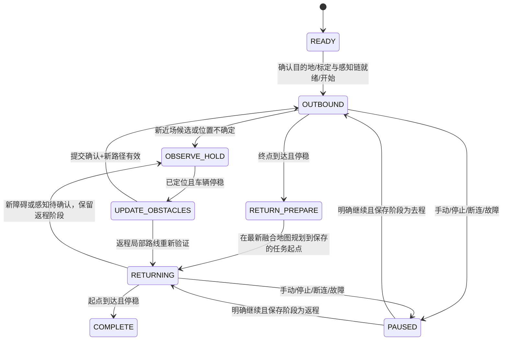

# AI 自主巡检：方案、架构与接手入口

日期：2026-10-26，R3。核对基线：规范仓库 main `437b48d11365fd9943988fa33efa72856560578c`，本轮成功fetch并核对。**交付为架构、接口草案、离线规划/文件接口及独立RTL任意角度线段检查器；完整巡检控制器尚未接车。**

本文的模块名与缺口表是该日期的设计草案，部分名字未落地，不能当成当前源码目录。当前生产接入见[视觉巡检](../AI视觉巡检.md)；本目录保留独立规划参考，不据此改动生产导航。

用户最新修订：不要求严格原路返回。当前方案改为在最新融合地图上重新规划回任务起点，允许选择不同路线；旧的去程走廊锁定及轨迹容量硬依赖已撤销。

## 1. 本次要实现的行为

| ID | 用户要求 | 设计落点 |
| --- | --- | --- |
| R1 | 在 AI 任务界面用 select 切换摄像头、地图、文字 | AI 页内新增“自主巡检”功能及三个视图；不修改其他页面的交互 |
| R2 | 开始前在雷达地图选择终点 | 保存一个目的地与任务开始时的车辆位姿，地图/定位不清零 |
| R3 | 自动前往终点，途中识别并标框 | RK 检测；FPGA 继续采集、显示、导航和底盘闭环 |
| R4 | 记录目标位置，地图用红点标记，文字列坐标 | 标定后的地面定位、同一定位原点下的物体登记表与 UI 快照 |
| R5 | 自动绕开雷达扫不到的低矮目标 | 独立视觉障碍层进入规划、路线复核与前探；不能仅画红点 |
| R6 | 巡检完自主返回起点，允许改变路线 | 保存任务起点，在最新融合地图上重新规划；去程轨迹仅作可选显示/诊断 |
| R7 | 尽量与其他功能独立 | 新巡检协调器/页面/任务入口，最小扩展既有导航查询与所有权接口 |
| R8 | 基础功能可脱离 RK 运行 | RK 断连只停止 AI 巡检，原手动、基础导航、相机与本地菜单仍可用 |

首版场地假设：平整地面、相机刚性固定、四类已支持目标、可验证的摄像头覆盖和制动余量，通道留足转向空间。目标不被主动拾取，地面坐标持续记录。该假设不覆盖坡道、悬空目标或任意高度障碍。

**不等待人工捡走作为正常流程。** 对无法可靠定位或无可行绕行路径的目标，允许停车显示原因；这是失败处理，不伪装成自动绕行成功。

## 2. 仓库现状与复用边界

以下以代码为依据；旧 README 中仍有 2026-10-23 的历史状态块，不能覆盖新源码事实。

| 路径 | 已有能力 | 本需求仍缺什么 |
| --- | --- | --- |
| `rtl/top/falcons_top.v` | PAGE_AI=6；雷达导航、目标来源与底盘自动输出；共享 UART、AI 页面与运动桥 | 巡检任务入口/所有权、视觉障碍接口、AI 页摄像头/地图路由 |
| `rtl/ai/ai_rc_control.v` | mode 0语义/1识别/2聊天，2位编码；select 选择功能、确认激活 | mode=3 巡检；进入后 select 改为切换视图，不能仍切换顶层功能 |
| `rtl/ai/ai_display_link.v` | CRC校验、双缓冲动态文本与字模，主机保活 | 框/红点/任务结构化快照；现有文本事务不包含这些结构 |
| `rtl/cam/cam_overlay.v` | 相机→DDR→HDMI，连续读缓存 | 当前 show_cam 只在相机页打开；巡检相机视图及同帧叠框 |
| `rtl/ui/nav_map_view.v` | 地图/路线双缓冲及位姿显示 | 巡检红点表、视觉障碍显示、返程路线标识 |
| `host/ai_coordinator/patrol.py` | 巡航→靠近→等待人工拾取；模拟回执支持 | 正常流程不同，保留旧类，新增 `InspectionMission`；不把 confirm_pickup 改名当绕行 |
| `host/ai_coordinator/ground_target.py` | 去畸变像素射线与地平面求交，车体→定位原点坐标 | 真实标定、接触点提取、误差验证、采集时位姿配对 |
| `host/ai_coordinator/navigation_goal.py` | 栅格转换与停车提案，默认不授权 | 停车提案不是物体障碍层；不能把停车点当物体坐标 |
| `host/ai_coordinator/gateway.py` | 唯一串口所有者、整帧调度、FAM1合同及MOT1运动支路 | 巡检结构化收发与设备确认；FAM1任务参考不等于FPGA已经实现 |
| `host/ai_coordinator/frames.py` | FIMG v1/v2，序号/CRC，源时间未核验 | `source_timestamp_verified=False` 不能直接升级成可用于移动定位的源时间 |
| `vendor/.../auto_navigation/rtl/nav_planner.v` | 最新八方向、2/3权重四桶Dijkstra及航点后处理 | 复用；不按旧文档重新实现四方向BFS |
| `vendor/.../auto_navigation/rtl/nav_top.v` | 地图读仲裁、规划、路线复核与raw前探 | 视觉raw/cost融合、视觉版本变动触发路线失效与重规划 |

核对完整路径及内容SHA256见 `核对与验证.json`，对应模块位置不凭文件名猜测。

## 3. 推荐架构



感知/语义计算在RK，基础规划和执行在FPGA。Qwen不负责几何定位、不逐帧决定绕行，也不直接输出电机指令。即使Qwen不可用，检测、记录和绕行的确定性流程仍可运行。

建议新增文件（**以下尚未实现**）：RK `inspection.py/inspection_registry.py/inspection_geometry.py`；FPGA `rtl/ai/ai_inspection_ctrl.v`、`ai_inspection_link.v`、`ai_inspection_overlay.v`；导航库 `nav_visual_layer.v/nav_map_fusion.v`。轨迹日志可选，不再要求专用返程轨迹存储器。优先复用已有模块，不引入ROS2或新的控制框架。

### 3.1 斜线与任意角度的区别，以及本轮算法推进

当前正式RTL已经是**八方向Dijkstra**，可走45°斜线。`nav_segments.v`、路线校验、前探和段方向元数据仍按八方向设计；它不能直接接收17°、31°等任意角度长线段。

新增可运行的 `host/inspection_reference/`：三组相同障碍图的软件参考——2/3权重八方向Dijkstra、欧氏八方向A*、保守格中心Theta*。Theta*通过检查祖先到邻居的整段视线产生任意角度路径；每段supercover检查全部触及格，并拒绝从障碍角挤过。障碍输入必须已包含车体包络/定位误差，不能拿裸物体像素直接执行。

Theta*是成熟算法，不以“最新”作为选择理由，也不保证全局最优。方法依据：[Daniel/Nash/Koenig/Felner，JAIR 2010](https://idm-lab.org/bib/abstracts/Koen10r.html)。本实现采用格中心、闭合障碍边界，碰角即阻挡，比论文网格顶点模型保守；不声称逐项复现原论文。

当前软件基准：26张固定合成地图，三算法可达性一致，23张共同可达；Theta*相比软件八方向A*逐图平均路长减少约5.02%，平均转折11.22→4。它没有比较正式RTL的居中/航点后处理流水，不能据此宣称生产路径缩短5%或NPU/FPGA提速。完整输入哈希、每图路径、反例及边界见 [算法包](../../host/inspection_reference/README.md)。

落地分两步：先复用现有八方向执行链完成融合避障和自由返航；任意角度候选保持shadow，扩展段方向/任意斜率整段检查/前探和点位执行验收后再选择。禁止将Theta*节点直接送入当前八方向校验器。路径直线更少不等于连续曲率；后续若接Pure Pursuit类前视跟踪和曲率/制动限速，还须验证跟踪偏差扫掠区，不能用未经碰撞检查的样条切角。

## 4. 视觉坐标：相机图像不是地图

首版采用**固定相机+平地标定**。检测框中心只能给一条视线，不能单独确定距离；盒装饮料的中心也不在地面上。使用经验证的地面接触点/足迹，或在已限定平面场景下的标定单应变换。没有经验证的接触点，不输出可信地图坐标。

几何路径：原始图像像素变换还原→去畸变→相机射线→车体地面交点→采集时车辆位姿→导航原点坐标。

```text
r_c = inverse(K) * [u, v, 1]^T
相机中心 o_b、方向 d_b = R_base_camera * r_c
λ = -o_b.z / d_b.z，要求 λ>0 且远离地平线
p_b = o_b + λ*d_b
[x_n,y_n] = [x_pose,y_pose] + Rot(yaw_at_capture)*[p_b.x,p_b.y]
cell = floor((coordinate_mm + 6400)/50)，有效范围[-6400,6400)，禁止钳位到边缘
```

`ground_target.py` 已实现部分几何，继续使用，不另造近似焦距/安装高度。相机180°旋转、抽样网格、裁剪、模型letterbox与屏幕左侧208列遮挡都必须纳入坐标合同；传到RK的是哪一种图像，就用对应的标定与已知变换。当前屏幕并非将全图缩到右侧，不能无条件给框坐标加208。

**帧与位姿同步是新增硬缺口。** FIMG序号+USB到达时刻不能等价于曝光时刻。推荐由FPGA在帧基准时刻锁存同一frame_id的位姿与采集tick，旁带回传，RK按frame_id配对；逐帧曝光/滚动快门与运动误差纳入标定。跨板不直接相减两个monotonic时钟。起步验收可以停车采图验证几何，但不能把它称为移动巡检验证。

标定验收须分距离、画面位置和车体姿态统计误差，保存尺量真值与未参与拟合的验证点。记录位置误差上界/置信范围，禁止写死“厘米级”。未知、地平线附近、被遮挡或超标定范围的目标显示“位置待确认”。

## 5. 物体登记表和视觉障碍：两个用途，共同坐标

登记表记录稳定 `object_id`、类别、源帧、坐标、估计占地范围、定位误差、首次/末次观测、处理状态与定位epoch。初版容量建议32个，是设计预算，不是现有硬件能力结论。

跨帧合并依据同类+世界位置/误差门限+跟踪证据；不能按类别只保留一个物体，也不能每帧增加新条目。两个螺丝刀必须能分别记录。确认策略、关联门限由实拍验证确定，Qwen类别置信度不能替代位置误差。

物体坐标/红点表示登记位置；避障需要**物体完整足迹及保守包络**，不能只禁止红点所在一格。首版根据实测物体最大占地或可靠足迹，加定位误差与车辆包络形成障碍。所有巡检目标默认需绕开；胶带是否可碾压不在首版自动分类。

### 5.1 雷达清空不能删除视觉障碍

```text
fused_raw(address)  = lidar_raw(address)  OR visual_raw(address)
fused_cost(address) = lidar_cost(address) OR visual_cost(address)
```

视觉层独立保存，雷达射线穿过低矮目标格时只更新雷达层。规划、居中/线段检查、路线复核和**raw近场前探**都必须使用融合结果；只合cost会遗漏当前行驶方向上的安全检查。

视觉raw为对象足迹+定位误差，visual_cost再加车辆保守包络；转向时考虑车体长度及外伸件扫掠，不能只按轮距。避免把已有雷达cost再次整体膨胀。网格边缘按占用处理；重叠物体删除一个后不能清掉另一个的区域。

### 5.2 接入导航读口与更新事务

在 `nav_top` 内 `u_map` 与 `u_arb` 的地图读响应之间加入融合适配器，锁存实际成交的地址/版本，匹配两层响应后返回同一份raw/cost；不能把迟到数据与新地址拼接。既有读仲裁owner和超时机制保留。

更新采用完整BEGIN→条目/位图→COMMIT事务，校验序号、epoch、长度与CRC，整包成功才切换视觉层。单条对象更新先更新后备登记表，再重建有限足迹层，避免更新半幅地图时规划穿越。可用双缓冲raw/cost位图：256²×4bit=32KiB理论位容量；实际BSRAM、读口与时序必须综合/PnR确认，不能承诺免费扩展。

视觉提交增加独立revision；规划及验证同时感知雷达与视觉版本变化，不能仅监听当前 `st_map_version`，也不能用两个版本按位OR/XOR当唯一版本。近场新增障碍先触发本地停行再复核；远端变化可后台重规划。未提交/损坏事务不替换当前层，超时也不能直接清视觉障碍后放车通过。

首版静态场地里，已确认物体保持阻挡至任务结束/明确移除；暂时看不见不代表被拿走。位姿重置使全部视觉坐标及轨迹失效，任务停止，表保留为历史且标记失效。

### 5.3 必须来得及看见并停车

```text
最小可靠发现距离 >= 车体前伸量 + v*全链路最坏反应时间
                    + v²/(2*实测可保证减速度) + 定位误差余量 + 裕量
```

反应时间包括采集/USB缓存、排队、YOLO、回传、地图提交和控制响应；使用实测最坏界，不能用NPU平均耗时替代。测不到可靠界先限制为低速、停车确认。当前前探默认4格/200mm从定位中心起算，不自动等于足够的物理停车距离。

当前视野能可靠观察的地面区域也要覆盖下一段可达空间，尤其转弯后的新区域；雷达未命中不代表可绕过低矮物体。侧方视觉未知时停车调整观察或转向后重观测，不能仅靠一张正前方图就授权盲绕。无法定位但可能进入行驶走廊的候选先暂停，不因低置信而继续撞过去。

## 6. 任务状态与自主返航



所有活动子阶段都可被暂停/取消/急停抢占，上图只画主要分支。暂停保留记录与阶段，解除后不自动恢复；必须确认当前地图、感知和定位仍有效。到达/停稳依据FPGA执行回执，不能用串口写成功或计时结束代替。

**返航目标是任务开始时保存的车辆位姿位置，路线由当前融合地图重新规划，可以与去程不同。**去程轨迹只用于屏幕显示和调试，既不是返程走廊约束，也不是规划必需输入。返程期间视觉障碍继续有效；路段新增障碍后重规划，不能为返回更短而忽略已登记物体。完全无路时停车等待，不强行返回。

初版在安全空间掉头，保持摄像头朝行驶方向；掉头空间不足则停车。确认到达起点还须实际位置容差、停稳及对应执行回执。任务起点、物体表与地图必须共享同一定位epoch，定位清零/重启后停止旧任务；不能把旧起点当新坐标继续运行。

手动移动只暂停，不丢任务起点。重新确认且定位/感知有效后，可从当前位置重新规划去程目标或任务起点，无需先接回旧轨迹。可选轨迹日志容量满不触发强制返航，可限长或降采样；日志不得覆盖保存的起点。现有编码器/IMU航位推算有累计漂移，仍需短路线实测闭合误差及到达容差，不能把自由规划误认为解决了定位漂移。

## 7. AI 页内交互与显示

保持原PAGE_AI=6，新增mode=3“自主巡检”，mode0/1/2原样保留。现有2位编码可表达3，但循环边界、标签、主机解析及采集使能都要同步扩展；不能只加一条字。

| 状态/动作 | 行为 |
| --- | --- |
| AI 根菜单选择巡检并确认 | 进入巡检，默认地图选终点；该任务不改原导航点表 |
| 巡检内 CH8/select 上/下 | 相机→地图→记录循环；仅换视图，任务与感知连续运行 |
| 地图准备态摇杆 | 移动准心；确认终点后再选“开始巡检”明确启动 |
| 运行中确认/返回、切手动 | 先暂停；确认继续前重新核验；手动优先于所有AI输出 |
| 暂停时返回 | 取消本次任务、保留物体记录，再回AI根菜单；不重置地图/定位 |
| 完成后 | 记录视图展示结果，确认新任务时再明确清理/归档旧记录 |

三个视图：相机为同帧框/名称/状态；地图为雷达底图、融合阻挡、路线、车、起终点、目标红点；记录为编号/类别/x/y/位置有效性/已绕过状态。显示“已记录/已绕过”不能仅因看到框就置位，绕过状态根据实际轨迹通过与间距确认。

坐标统一标注“导航起点坐标，m”，例如 `(1.20,-0.35)` 只是格式，误差另列；两位小数不是厘米精度证明。这里的原点是定位初始化/清零点，不一定等于本次任务开始点；任务起点另行保存，不为开始巡检重新清零。相机视图未知位置显示“待定位”。红点旁可加编号，定位误差显示淡红区域，与实际障碍膨胀区区分。

当前地图显示使能仅PAGE_RADAR/PAGE_NAV_OBS、相机show_cam仅PAGE_CAMERA，均需为巡检视图扩展。**地图更新/感知任务使能不能绑定当前显示的视图**，切到记录页不能停止避障或YOLO。

动态图层顺序：相机/地图背景→路径/目标红点或识别框→任务文字→本地急停/手动提示；菜单保持既有冻结行为。DDR全幅连续读保持不变。框、坐标、红点表通过完整快照CDC，在帧边界切换，不能逐位两级同步。

严格叠框需要上传帧与显示帧身份一致；目前frame_id与DDR显示缓冲的绑定仍缺。设计上给捕获缓冲/上传帧增加相同身份，丢弃过期结果。若需要显示对应延迟帧，应实现可选择的带身份帧缓冲并核对DDR资源/带宽；未完成时只显示带时间的最近识别文字，不能把旧框当成当前帧。该暂态不算R3最终验收完成。

示意图：`三视图示意.png`。它是静态设计稿，坐标/图像/物体都为合成示例。

## 8. 通信合同与最小共享改动

复用 `Gateway.SerialPort` 唯一发送者。既有MOT1运动与文本事务保留，不新增第二个进程抢串口。逻辑消息草案见 `接口草案.json`，**没有分配新操作码，没有声称FPGA已能解析JSON/FAM1巡检任务**。

需要的逻辑消息：采集帧位姿配对；巡检开始/暂停/继续/取消；已确认对象表及视觉障碍事务；执行状态/停稳/任务进度；给UI的完整快照。每条带协议版本、设备启动/会话、任务ID、递增序号，运动与地图消息还带定位epoch和revision；接收回执必须匹配同一动作。

新链路须先协商巡检能力，未知能力保持只观察。停止/保活优先于字模/长文本；大表按有界短帧切片，不能让4KiB JSON占住115200链路约0.36s后才有机会发停止。半帧不可打断，清理未发旧显示事务即可。TTL按采集来源判断，不能队列出站时换新时间戳。

FPGA的本地任务授权继续受遥控有效、手动接管、急停、定位有效、感知新鲜与图层提交状态限制。当前语音运动桥只在AI mode0授权；mode3应走巡检导航所有权，不能简单放开mode3直通MOT1电机控制。

基础功能独立：未开巡检时视觉层默认不参与基础导航；退出巡检先停稳并撤销其所有权，明确开始本地导航后交还。物体表作为结果保留，不因退出而污染其他任务地图，也不因断连就自动暴露先前的基础导航命令。

## 9. 实施顺序、接手分工与门禁

| 阶段 | 交付 | 通过条件 | 不应做的提前动作 |
| --- | --- | --- | --- |
| P0 本轮 | 架构、源码核对、接口草案、UI示意、几何检查及离线任意角度对照 | 需求R1～R8均有落点；原型和生产能力区分 | 不烧板，不改引脚，不声称已经绕行 |
| P1 视觉定位 | 真实相机稳定、帧/位姿配对、标定与物体登记 | 独立尺量验证点误差、同类多物体与重复观测测试 | 无标定不输出假坐标，不运动 |
| P2 融合地图 | FPGA视觉层/事务/读响应/版本变化 | 雷达清空不删视觉；raw和cost都有效；重叠删除、半包、断连、重置、边界测试 | 只画红点不能进入车辆测试 |
| P3 巡检去程 | 独立任务入口、选择终点、定位记录、低速绕行 | 软件回放→RTL/运动模型→综合/PnR→架空与低速实车；无路停 | 不能把回放或综合成功当实车通过 |
| P4 自主返航 | 保存任务起点、最新地图重新规划、实际到达确认 | 旧路封堵可走新路、完全无路停车、手动移动后重规划、定位重置失效 | 不能删视觉障碍或把指令已发当到达 |
| P5 完整UI | AI页三视图、同帧框、红点/坐标列表及状态 | select不改任务；切视图不切感知；断RK基础功能可用 | 演示图不能当板上截图 |

可分工：AI同学接P1与登记表；FPGA导航同学接P2/P4；UI同学接P5；协调器同学接任务生命周期与协议适配。**不派生或联系其他Agent**，本表只是队友接手职责建议。

先完成P1静止定位和P2纯仿真，再联动底盘。暂停确认策略首版允许为可靠定位短暂停车；连续丝滑绕行属于延迟/视野/制动验证通过后的优化，不用删安全停行来换观感。

## 10. 本轮验证与交付边界

运行 `python doc/AI自主巡检_20261026/verify_design.py`，仅标准库，检查合同/文档完整性并对现有地面投影/栅格函数做合成几何测试，生成 `核对与验证.json`。测试的是数学边界，不是相机标定或新巡检功能。

R3实现及可复现入口：

- [规划模块与文件接口](../../host/inspection_reference/README.md)：八方向Dijkstra、A*、任意角度Theta*，融合cost地图，按当前地图返回home。14项软件测试与26图固定对照；相对软件A*的5.02%仅为此合成集合的路长统计。
- [独立RTL线段检查](../../rtl/inspection/README.md)：逐格supercover，不切障碍角；读图握手、取消排空、版本失效；461例仿真、8,771次地图读通过。仍须扩展生产八方向段格式与跟踪链，不能直接授权任意角度实车运动。
- 三视图与物体登记/视觉定位/事务融合/巡检任务通信仍按上文阶段接入，本轮没有将它们冒充成已完成功能。

本轮按用户要求将这些新增代码及设计提交至规范仓库；原生产RTL/host实现未改行为。未连接RK/FPGA、未启动模型、未升级环境。图示与示例均合成，无新的NPU精度、相机帧率、综合资源/时序或实车结论。现有两套验证脚本分别记录各自边界，软件/RTL仿真不能充当上车验收。

下一位开发者优先读本文第2/4/5节，再读现有 `host/ai_coordinator/FULLSTACK.md`、[导航操作与控制架构](../导航控制方案.md) 和 `vendor/verilog-reusable-modules/modules/radar_navigation/docs/delivery_handoff.md`。开始写代码时沿用本轮基线检查新上游改动，保留其他工作区未提交内容。
