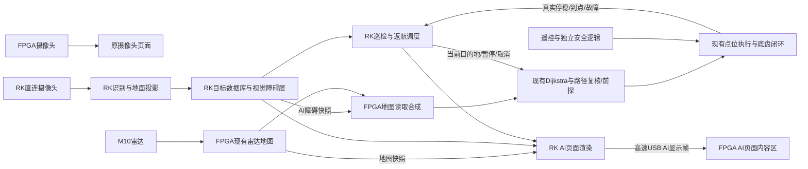

# AI视觉巡检、地面物体定位与返航设计

2026-10-26用户修订：返航允许在最新地图上换路回到本次任务的实际起点。下文返航规则已同步，不再强制去程通道或倒序检查点。文件名保留以兼容已有文档链接，历史阶段记录中的“原路返航”不再作为当前要求。

初版日期：2026-10-25，设计基线为主分支 `437b48d`。初版为纯设计；后续实现与部署分别见[实施进度](AI视觉巡检实施进度_20261025.md)和[阶段4C交付](AI巡检阶段4C_现场接入与标定准备_20261026.md)，不能用初版描述推断当前硬件状态。仍未解除实测标定门禁。

## 1. 架构决定与用户要求

**采用复用FPGA导航的方案。** 保留现有雷达建图、八方向Dijkstra、路径复核、近场检查、点位执行器和底盘闭环。RK负责视觉识别与坐标计算、视觉障碍层、巡检调度、返程轨迹管理及AI页面渲染，通过明确接口参与现有导航，不在RK重新实现一套完整的雷达导航。

这一决定是在读取最新导航更新后作出的。此前讨论中偏向RK完成更多导航计算，本方案收敛为：**RK决定巡检什么、去哪里、哪些地面区域不能走；FPGA决定当前怎样沿可通行路线执行并可靠停车。** 新增的视觉计算与任务逻辑尽量留在RK，已存在且已经占用资源的导航逻辑直接复用。

本轮已明确的要求：

- FPGA摄像头只用于原有“摄像头画面”页面；其图像不再上传RK。历史FPGA→RK相机实验代码不进入本次产品数据链。
- AI识别使用另一只直接接RK的摄像头；AI巡检摄像头视图也来自这只摄像头。
- 雷达只承担能够测得的墙面、较高障碍和道路结构。剪刀、胶带等贴地物体的位置及占地范围由摄像头计算，不假定雷达能提供它们的距离，也不把无回波当作地面无障碍。
- 巡检全部位于AI模块子页面，CH8/select切换摄像头、地图、目标清单；不占用原有雷达/避障导航页面的点表和交互状态。
- 先在巡检地图选一个目的地，确认开始后边导航边巡检，到达后按最新雷达与视觉障碍合成地图规划返回实际起点，允许换路；停车后保留目标坐标和巡检报告。
- SWC切手动始终由FPGA最高优先处理：先停车再交手柄，保留AI总开关、当前任务页和已记录结果；切回光标档不自动恢复。
- 原有功能及其必需字形继续由FPGA独立完成，RK断连不能使原有页面、雷达导航或手动驾驶失效。

## 2. 为什么复用，而不让RK发出全部运动指令

| 比较项 | 复用FPGA导航，本方案 | RK重做建图、规划、跟踪 |
| --- | --- | --- |
| 已有代码 | 复用现有雷达、八方向搜索、居中、前探、停稳握手 | 保留原FPGA功能的同时，还需维护另一套同类算法 |
| FPGA资源 | 增加障碍层、任务接入和显示接收；不再实例化导航器 | 原功能必须保留，因此搬到RK并不能直接删除现有导航资源；仍需显示和运动接口 |
| RK资源 | YOLO、投影、障碍栅格、任务与渲染；无需新SLAM/全局规划进程 | 额外接收雷达原始扫描，维护建图、规划、定位修正及跟踪周期 |
| 通信 | 小体积目标、障碍层、位姿/回执，加AI显示帧 | 连续雷达数据、位姿和运动控制；必须重新验证通信延迟对控制的影响 |
| 调试 | 能分别回放识别、检查障碍层、复用既有导航仿真 | 地图、坐标、控制两套结果都需对照，问题归因更复杂 |
| 适用阶段 | 当前短程、平地、结构化道路巡检 | 将来明确需要大地图SLAM、复杂探索或更高级轨迹控制时再评估 |

最新存储优化记录中，完整布局布线的BSRAM为204/340，约60%，系统Fmax为50.036 MHz、像素49.093 MHz；这些数字对应 `5683bfa` 的构建，**不能冒充后续前探配置、UI或未来AI改动的资源/时序结果**。其系统余量仍薄，新增逻辑必须寄存和分拍。详见[存储优化验证](Dijkstra存储优化验证_20261025.md)。

只让RK发“左绕/右绕”或几个中间点，不足以实现可靠绕障。若导航地图没有物体，原规划、居中或路线更新仍可能穿过它。因此必须将视觉障碍正式并入规划和近场检查所读的地图，而不是把两套运动指令抢着送到底盘。

## 3. 数据与控制结构



新增 `ai_inspection` 任务管理器，独立保存本次目的地、去程轨迹、目标记录与任务状态。复用现有串口唯一所有者、模型worker和AI主开关，不复制模型服务，也不把巡检塞入聊天状态机。

原有 `patrol.py` 是巡航找物/靠近/人工确认的任务合同，不能直接当成本次“记录所有目标、绕过、返航”的已实现任务。

### 3.1 职责边界

| RK完成 | FPGA完成 |
| --- | --- |
| UVC采集、图像时间与内外参、YOLO推理、地面定位 | 原摄像头采显、雷达解析建图、IMU/编码器与位姿 |
| 目标编号、去重、坐标误差、视觉占地轮廓与膨胀栅格 | 原导航器、路径居中/复核/前探、点位控制及四轮PID |
| 去程/返程任务、实际起点、视觉障碍与报告 | 任务控制权选择、最新合成地图重规划、超时撤权、真实动作状态回传 |
| 视频框、AI地图红点、清单、中文报告和导出 | 高速接收、DDR缓存、帧边界换图及最终HDMI合成 |
| 推理与任务日志、离线回放 | SWC、急停、遥控失联、原功能独立运行 |

FPGA不计算相机投影、目标类别或任意中文排版，不新增第二套搜索器。RK也不通过“前进若干秒、再左转若干秒”拼出导航。

## 4. 摄像头定位贴地物体

### 4.1 单目可以做，但必须有地面几何约束

二维框中心只确定一条方向射线，不能单独确定距离。对于已知平整地面、固定安装相机，可用标定后的射线与地面求交得到米制坐标。需要实测：

1. RK摄像头的内参和畸变参数，绑定实际分辨率、裁剪及对焦状态。
2. 相机相对底盘定位参考点的外参，含高度、俯仰、偏航和安装平移。
3. 物体在地面的有效锚点或轮廓，以及投影可用的距离/视野范围。
4. 摄像头和FPGA位姿的时间关系及端到端延迟。

对去畸变像素 `(u,v)`，有相机射线 `d_c = K^-1 [u,v,1]^T`。转到车体坐标得到方向 `d_b` 和相机中心 `C_b`；地面为 `z=0` 时：

```text
lambda = -C_b.z / d_b.z
P_base = C_b + lambda * d_b
P_map.xy = [car_x, car_y] + R(car_yaw) * P_base.xy
```

拒绝近地平线、地面不平、锚点被遮挡或超出标定范围的结果；不能给这些结果填一个看似精确的坐标。相机旋转、裁剪、缩放必须与标定一致。原FPGA摄像头的180°翻转不能套用到RK摄像头。

可复用 [ground_target.py](../host/ai_coordinator/ground_target.py) 的地面求交和坐标变换，但它要求调用方证明地面像素有效，当前并未自动完成锚点选择和标定。针孔模型及畸变处理依据[OpenCV官方文档](https://docs.opencv.org/4.x/d9/d0c/group__calib3d.html)。

### 4.2 剪刀与胶带不能使用同一种锚点假设

| 物体情况 | 建议处理 |
| --- | --- |
| 平放的剪刀、螺丝刀等薄物体 | 地面轮廓/分割区域投影，取占地中心作为报告坐标 |
| 胶带卷等有一定高度的物体 | 使用已验证的地面接触锚点，或类别几何约束；不能直接将顶部/框中心当作地面 |
| 仅有检测框的首版 | 可先用人工验证的类别锚点，加实测最大占地范围与保守误差；达不到误差要求就显示“已识别，位置待确认”并停车复核 |

现有模型侧的类别映射包含 `tape/screwdriver/ad_calcium_milk/nutri_express`，尚未看到剪刀类别。要把剪刀纳入正式验收，需补充训练和板端实拍检出验证；聊天模型说出“剪刀”不代表检测模型具备该能力。

识别框用于分类；避让使用物体占地区域加误差，不使用红点本身。首版优先在发现新物体后停稳复核、连续多帧确认，再提交障碍层，降低运动模糊和时间配准误差。

### 4.3 时间、坐标和去重

沿用 `navigation_origin`：起点 `(0,0)`，初始车头为+x、车左为+y；线协议用毫米及0.01°，RK内部用米和弧度。保持256×256、50 mm/格、范围 `[-6400,6400)`，不将屏幕坐标当地图坐标。

新增位姿快照包含采样序号、FPGA单调时间和定位代次；RK保存位姿历史，将图像与采集时刻的位姿对应。现有OpenCV入口只返回主机收帧时间，不能视为已验证的曝光时间。应读取/核对V4L2时间戳标志，并测量驱动与相机延迟；说明依据[Linux V4L2官方文档](https://docs.kernel.org/userspace-api/media/v4l/buffer.html)。停稳拍摄减少误差，但不能把未核验时间戳改成“已验证”。

记录建议字段：`object_id/class/xy/footprint/uncertainty/source_frame/captured_at/localization_epoch/first_seen/last_seen/evidence`。同类物体按空间距离、误差范围和跟踪连续性去重，不能仅按类别合并。返程重见同一物体只补充证据；物体移动时记录变更，不能把新位置悄悄覆盖旧位置。

清零或重启导致定位代次改变时，旧任务、轨迹和目标坐标退出本次运动使用，历史报告保留并注明原坐标系。现有导航是基于编码器/IMU位姿的雷达建图，不因此宣称具备完整SLAM或闭环纠偏。

## 5. 视觉障碍怎样进入现有导航

### 5.1 雷达地图与AI障碍层分开保存

不直接将视觉占用写入雷达 `nav_map.raw`。雷达后续更新可能清掉它，也无法区分雷达障碍与视觉障碍。新增独立的AI图层，仅当AI巡检取得控制权时启用：

```text
effective_raw  = radar_raw  OR ai_visual_raw
effective_cost = radar_cost OR ai_navigation_cost
```

`ai_visual_raw` 是物体实际占地加定位误差；`ai_navigation_cost` 是供车心规划使用的禁行区，包含适当膨胀及必要的返程通道限制。膨胀由RK计算，FPGA直接读位图，不重复膨胀。

原雷达地图的raw/cost及更新规则保持不变。AI关闭或退出后，原避障导航读取原雷达地图；AI目标红点和历史记录不会污染原导航任务。

### 5.2 合成位置与地图版本必须完整处理

在 [nav_top.v](../vendor/verilog-reusable-modules/modules/auto_navigation/rtl/nav_top.v) 的共享地图读取响应进入 `nav_map_arb` 前加入有寄存器的合成层，保持完整的请求/响应握手。让搜索、局部接出、路线/居中复核及近场 `nav_drive` 都看到同一份有效地图，不能只改显示或只改搜索入口。

AI层采用后台写入、CRC和完整长度验证、事务提交后切换前后台。一次提交包含地图原点/尺寸/分辨率、定位代次、图层版本和两张位图，不允许导航读半张新图。雷达无回波不能清除AI层；目标暂时离开相机视野，也不能自动将其从障碍层删除。

现有重规划逻辑会依赖 `map_version` 和最近更新格位置。**不能只把两路地图OR起来而不接更新通知。** 首版采取简单流程：新物体确认→请求停车→取得真实停稳→原子提交AI层→使当前规划/复核作废并重新规划→只在对应版本路线通过后继续本次自动巡检。暂不新增运动中修改整层的并发路径；常规雷达实时避障仍沿用原实现。

### 5.3 容量与清障策略

256×256的一位图为8 KiB，raw和cost每个bank共16 KiB，双bank逻辑容量共32 KiB。实际BSRAM及流水资源以综合为准，不把容量换算当成已验证资源报告。无需添加浮点、神经网络或第二套导航存储。

对象列表和完整历史保存在RK，不在FPGA逐对象做坐标比较。新障碍加入和删除都由RK生成快照；删除要求再次观察确认或显式人工清除，不能仅按超时删除静态贴地障碍。

原导航 `nav_map` 会把未发现障碍的格初始化为可通行。本次不改变原功能语义，但AI首版限定在人工确认、平整、足够宽的短道路内，不把它扩展为未知场地自主探索。视觉检测器漏检未训练物体的风险必须通过验收范围约束，而非声称雷达可以兜底。

## 6. 目的地、巡检与最新地图返航

### 6.1 复用一个导航核心，任务入口独立

新增AI导航请求入口，在导航器的目的地/运动许可入口选择“原避障页”或“AI巡检”。原 `nav_obstacle_ui` 的16点表和状态不被AI写入；AI只提交当前任务目的地/返程检查点。

控制权在停车、旧目标撤销及完成反馈归零后切换。退出或暂时没有有效AI命令时，不得意外暴露旧导航命令；沿用 [voice_nav_arbiter.v](../rtl/motor/voice_nav_arbiter.v) 中按所有权选择的原则。语义MOT1运动与AI巡检导航互斥，聊天和显示数据没有运动权限。

当前语音运动桥只在语义导航模式放行，主机也会拒绝其他模式的语音运动。新增巡检应建立独立的“目标识别模式且巡检已明确启动”授权入口，接现有导航器；不能简单放宽这些旧门禁，让目标识别页面收到任意语音MOT1后就行驶。

现有MOT1写串口成功不是实际到点回执。AI接入必须回传真实的受理、停稳、目的地到达、无路和故障；主机不能自造完成。现有FAM1主机合同也不等于FPGA已经实现对应接口。

### 6.2 去程

选定单一终点并确认开始，FPGA自主规划与执行。RK持续识别：确认目标后记入数据库，提交视觉障碍，FPGA绕行。检测结果不确定且进入预定行驶区域时停车复核；无路保留当前目标等待，不跳过目标、不强行挤过。

本任务的“巡检完成”定义为选定道路去程到终点、沿途有效观察完成、随后返回起点；不是对整个房间做覆盖巡检。首版不加入探索、机械拾取或追踪移动物体。

### 6.3 最新地图返航（2026-10-26修订）

开始任务时锁存本次实际位姿作为返航起点，不能用选点时的旧位姿、全局坐标原点或初始规划点替代。RK继续记录实际去程轨迹供报告和调试，轨迹不再限制返航可通行区域。

到达终点并收到真实停稳后，调度器先更新并原子提交当前视觉障碍层，再向现有FPGA导航器提交实际起点。导航器在最新雷达/视觉合成地图上规划，允许选择不同道路绕开新障碍。不生成去程通道外禁行图层，不倒序下发去程检查点，也不使用旧路线绕过最新障碍检查。

默认在有足够空间的终点掉头，以车头朝前的方式返航，避免全程倒车造成前向相机无法观察行驶方向。转弯位置需满足实测车体扫掠范围；终点应预留掉头区。不存在安全路线时停稳等待，不强行穿越障碍。

返航途中地图更新可触发原导航器重规划，目标始终保持本次实际起点。无路时保留返航阶段和目标，等待地图恢复、手动接管或取消。切手动后即使车辆移到其他位置，回光标档也不自动续跑；必须显式确认，并用新位姿和最新有效障碍层重新向同一起点规划。定位纪元重置则旧任务失效，禁止把旧起点直接解释为新坐标系中的点。

回起点并停稳后进入只读完成页。保存起点、终点、实际去/返程、目标清单、观测证据、定位代次与失败/暂停原因。目标坐标定义为地面占地中心或该类别已约定的接地点，报告中注明方法和误差，避免混用。

### 6.4 车宽、前探和速度

读取最新参数页的 `vehicle_width_mm` 与 `forward_check_cells`，不再沿用被删除的 `FRONT_OFFSET_MM/LATERAL_MARGIN_MM`。当前默认分别180 mm、4格即200 mm；这只是配置默认，不是本任务的安全测量结果。前探从定位中心开始，规划膨胀仍是独立参数，二者不能混为一谈。

RK膨胀还需考虑车长、原地转向扫掠范围和坐标误差，不能只使用车宽。可以先用包络车体的外接圆做保守规划。可通行净间隙及终点掉头区按车体实测尺寸验收。

延续RK前进/后退速度码30的要求。新导航入口也不得绕开这一要求使用另一套更快的巡航默认：实施前明确速度码30与现有点位控制器速度单位的映射，并在FPGA接收端限定允许范围。速度码30不是30 cm/s；缺少单位映射/实测时保持候选任务，不执行实车导航。

视野可用距离需大于延迟和制动距离之和：`d_need = v_max * total_latency + v_max²/(2*a_brake) + margin`。其中速度、制动减速度、识别周期和通信/停机延迟均要实测。默认200 mm前探不自动证明足够避开视觉盲区里的小物体。

## 7. AI巡检页交互

### 7.1 页面层级

```text
AI模块总页：语义导航 / 目标识别 / 聊天机器人
  └─ 目标识别：进入“视觉巡检”任务页
       ├─ 摄像头：RK摄像头、同帧框、类别/编号
       ├─ 地图：雷达底图、视觉红点、路线、车、起点与终点
       └─ 清单：目标名称、编号、坐标、定位状态及任务说明
```

进入任务后，CH8上下循环三个视图，**不再同时切换总页三个功能**。需在FPGA `ai_rc_control` 增加交互层级，独立传送子视图及必要摇杆事件；不能只改RK显示而保留当前CH8切顶层功能的行为。

沿用冻结左侧菜单的样式及蓝底黄字高亮。建议沿用右侧内容区 `x=208..1023,y=120..539`，尺寸816×420；上方显示本地任务标题/三个视图标签，下方保留状态。原有非AI页面布局和字形来源不变。

| 视图 | 内容与操作 |
| --- | --- |
| 摄像头 | 显示RK摄像头完整视野，等比例留黑边；RK在对应帧上画框，避免旧框叠到新帧。推理率不足时显示最近完成的带框帧并标注年龄，不承诺30次/秒识别 |
| 地图 | 雷达障碍底图、视觉障碍轮廓、去/返程和车辆方向。已定位目标用编号红点，可显示误差圈；位置待确认的结果不用假红点。选点准心只在编辑态出现 |
| 清单 | 按编号列出类别、x/y、定位方法/误差和首次/最近发现；长列表用摇杆滚动。完成后保留只读结果 |

不同视图只改变显示，不取消任务、不卸载相机或中断导航。按视图隐藏不需要的渲染，不把地图数据更新绑定到当前是否显示地图。

### 7.2 按键与状态

沿用最新避障导航“运行确认/返回均暂停，暂停确认继续，暂停返回取消，完成返回编辑”的习惯。CH8在巡检页专用于切视图，目标编辑采用一次确认目标、第二次确认开始，避免与原辅助菜单竞争。

| 当前状态 | SWA下拨确认 | SWA上拨返回 | 摇杆 |
| --- | --- | --- | --- |
| 编辑，无目标 | 地图中确认当前点；其他视图提示用CH8切地图，不自动切视图 | 返回AI功能总页 | 地图移动准心，清单滚动 |
| 待开始 | 校验通过后开始巡检 | 撤销候选目标，回编辑 | 不改已确认目标 |
| 去程/返程/自动处理障碍 | 暂停任务 | 暂停任务，留在当前视图 | 只用于查看，不驱动车、不改目标 |
| 暂停 | 条件满足后明确继续；停稳并提交最新视觉层后重新规划 | 取消并保存报告，收到匹配的停稳回执后回AI总页 | 清单可滚动 |
| 手动暂停 | 手动档不受理继续 | 不抢手柄控制 | 由底盘接管；回光标后等待确认 |
| 故障 | 原因解除后明确重试当前未完成目标 | 取消，保留报告 | 只查看 |
| 完成 | 不重跑旧任务 | 新建任务进入编辑，旧报告归档 | 只查看 |

无路属于当前任务中的等待状态，继续显示原因；不能当作已到达。完成返回编辑时清旧目的地和提交阶段、准心回当前车位，避免再次选点误跑旧目标。

AI功能总页返回才关闭总开关并解冻左侧菜单；子任务返回按上表处理。板载强制切页、清零、AI总关均撤销本次运动授权。手动切换不关闭AI总开关。

SWB继续保持下拨录音、上拨结束。首版巡检只在编辑/暂停/完成等静止状态受理录音；运行中下拨先暂停并提示重新上拨再下拨，避免一边行驶一边开始新语音任务。录音或模式切换不得自动恢复旧导航，移动任务开始/恢复仍要求明确确认。

### 7.3 手动与掉线

SWC由FPGA本地立即撤销自动输出并走原有制动/停稳/摇杆回中接管流程，不等待RK回应。RK取消录音、播报和在途任务计算，保留页面、目标记录、去程轨迹与当前阶段。重新进入光标档后刷新地图/位姿，等待确认继续或取消；SWB同样要求新的上拨→下拨。

RK或控制链路断开时撤销AI运动授权，FPGA显示本地离线提示；连接恢复不自动开AI或续跑。沿用现有RK掉线总开关关闭规则，不将“手动保留总开关”扩展为“掉线仍继续任务”。RK以新会话重建连接，旧任务失效并保留报告，即使FPGA重启后纪元数值恰好相同，也不复用旧坐标。纯SWC手动切换仍可在定位连续、条件满足后显式恢复。用户退出AI后可独立使用原导航，AI旧命令不能遗留生效。

实际去程、返程及任务期间手动绕行均记录在轨迹中；路线导出展示的是FPGA当前发布的最多64个路径点前缀，不假称整条最终路线。报告保存实际起点、目的地、四类目标、定位依据和误差、回执、地图/路线版本及关键帧/障碍层证据。轨迹或证据容量耗尽会暂停任务，不静默截断后继续行驶。

## 8. 高速显示与任务通信

### 8.1 双向链路，不传FPGA摄像头

| 链路 | 内容 |
| --- | --- |
| RK→FPGA高速USB OUT | AI内容区显示帧；AI障碍层完整快照/更新 |
| FPGA→RK高速USB IN | 雷达地图快照、导航路线、位姿/执行状态，可用于日志；没有FPGA摄像头图像 |
| 现有UART | 继续使用唯一发送者承载遥控/任务控制、STOP、心跳及关键回执；不塞完整视频或频繁全图 |

本方案**不要求把雷达原始点云上传RK并重新建图**。首版读取现有雷达地图即可。现有 `map_disp_*` 在AI任务需要地图导出时也应得到服务，不再只由雷达/导航页面可见性使能；导出只是旁路，不反压导航。原始雷达数据的未来调试导出不是主链路前提。

现有FX2实验模块是FPGA→RK发送方向，`SLRD/SLOE`保持无效，不能直接反用作接收器。RK→FPGA需要匹配的Bulk-OUT固件、可读端点、双向数据总线方向控制和新的接收逻辑。[Infineon AN61345](https://www.infineon.com/assets/row/public/documents/24/42/infineon-an61345-designing-with-ez-usb-fx2lp-slave-fifo-interface-applicationnotes-en.pdf)展示了OUT/IN配置例子，但实际板卡端点、固件和引脚仍须只读探测及核对；不能照抄示例端点号或宣称现有硬件已打通。

### 8.2 图像预算

RK将当前视图渲染为816×420 RGB565，连同框/红点/中文一起发送，FPGA只负责按指定内容区显示，不新增JPEG/H.264解码器或复杂缩放器。

| 项目 | 纯像素理论值，不含协议 |
| --- | ---: |
| 一帧 | 685440 B |
| 10 fps | 6.8544 MB/s |
| 15 fps | 10.2816 MB/s |
| 双帧缓存 | 1370880 B，约1.31 MiB |

首版以完整AI视图10 fps为验收目标，再按实测带宽与模型延迟决定是否提高。地图/清单可以更低帧率。USB 480 Mbit/s是信号速率，不能当成实测吞吐。IN/OUT共享带宽，优先处理地图/控制状态和障碍更新，再处理视频；显示积压丢旧整帧，不能挤占停止或心跳。

两个AI帧缓存放DDR，不能放满幅BSRAM。现有 `cam_overlay` 使用 `ddr3_ctrl_2port`、一个摄像头写侧和连续读侧，**不是现成多源帧缓存**。实施需在同一DDR控制器上分配独立地址区，加入异步FIFO、写读仲裁及帧所有权；禁止直接组合切换摄像头时钟/FX2时钟，禁止实例化第二套DDR物理控制器争用引脚。切回原摄像头页先等有效完整帧，显示切换不能把两种像素流混在一帧。

高速接收与DDR多源显示是两种导航架构都需要的新工作，也是本次FPGA侧主要工程量。把导航搬到RK并不能省掉这部分；首版应分别测量显示通路与导航图层的资源/时序增量，避免误把显示开销归给导航复用。

合成顺序为内容帧→本地AI标题/标签→菜单/状态→本地急停与离线提示。外部内容仅允许写AI内容区，不能覆盖其他页面和本地安全提示。

### 8.3 协议需要先冻结的内容

在现有唯一UART所有者与解析路由下扩展有版本、有长度、有CRC的类型化合同；不往ASCII整定流里混写任意JSON，也不把新任务消息冒充MOT1动作。建议先冻结逻辑类型，再实现线协议：

- 能力协商：支持AI导航、图层尺寸、显示格式及固件版本。
- 任务：会话/任务/定位代次、目的地、开始、暂停、继续、取消、运动租约。
- 图层：版本、bank、raw/cost长度、分块编号、整包CRC、提交确认及生效版本。
- 执行状态：受理、运行、实际停稳、目的地完成、无路、故障，绑定任务和目标编号。
- 遥控与视图：交互层级、CH8子视图、确认/返回事件序号和摇杆。
- 显示：会话、任务、子视图代次、帧号、尺寸/stride/格式、payload长度及CRC。
- 地图与位姿：各自序号/时间/定位代次；分块地图完整后发布，不能混合两版地图。

图层包不直接驱动车，显示包绝不能驱动车。旧任务/旧会话/旧子视图帧丢弃。FPGA只接受与已生效图层及当前任务匹配的导航授权；心跳超时本地停车。现有语音MOT1、AI显示和新导航接入在整车仲裁处明确互斥。

高速线未接、端点能力不匹配或显示未验收时，巡检提示条件缺失；语义导航、聊天和原有FPGA功能仍可使用。任务中高速链路全断导致视觉障碍/状态无法更新时暂停巡检，恢复后明确确认；不能继续盲行。

## 9. 资源与调试安排

RK复用现有YOLO、ASR和模型环境，不升级驱动或系统Python。巡检主循环不依赖Qwen逐帧解释或连续聊天，检测、图层、任务和显示分别计时；模型推理与显示发送不阻塞控制心跳。已有6 GiB服务上限下评估RSS、缓存和NPU占用，再确定并发策略，不按“模型已加载”推断有足够余量。

采集只保留最新帧和有限证据，不继续让实时环每帧写PNG再从磁盘读取。原接口可保留给离线回放；新增实时通路优先内存传帧。检测和显示帧率分别统计，清楚标注框对应的图像与年龄。

调试数据至少同时保存：原图/关键帧、标定版本、采集与推理时间、配对位姿、目标投影、raw/cost层、图层提交/生效版本、FPGA路线、到点/停稳回执、SWC状态及取消原因。这样可以分别定位“认错/投影错/图层错/规划错/执行错”，不把它们混成一次实车结果。

## 10. 分阶段实施与验收

| 阶段 | 实施内容 | 通过条件 |
| --- | --- | --- |
| A：静止识别定位 | RK相机稳定入口、标定、地面锚点/轮廓、现有模型实拍 | 不运动；用人工量测点对照坐标误差，覆盖不同距离/方向/光照，先胶带/螺丝刀，再增加剪刀 |
| B：接入导航的视觉层 | 导航入口选择、独立raw/cost图层、版本/停车/重规划回执 | 仿真中雷达完全看不到物体，视觉障碍仍使搜索、居中、前探和近障停车一致；雷达清格不能抹掉视觉障碍 |
| C：AI显示与交互 | 高速OUT测试图、DDR、三个视图、遥控层级、掉线提示 | 实测连续帧、CRC/断流/半帧/换视图，不覆盖原页面；地图与清单不依赖正在显示的视图 |
| D：短路巡检 | 单目标、遇物停车确认、图层提交后绕行 | 平地、宽通道、速度码30对应速度已标定；检出距离满足制动预算；沿途目标编号/坐标正确 |
| E：最新地图返航 | 实际起点、历史轨迹、合成地图重规划与完成报告 | 能换路返回实际起点停稳，无路等待，回程新障碍不强行通过；同一物体不重复计数 |
| F：接管与原功能回归 | SWC各阶段切换、RK/高速断连、取消/重启/清零 | 本地最高优先停车；保留AI页；回光标不自动续跑；离线后原摄像头/雷达/导航/整定/手动功能全部独立正常 |

将最新主线的52台应用回归作为参考集，新增视觉图层、导航接入、任务与DDR显示测试；重新完整综合/布局布线后才评价资源和时序，不沿用旧报告签核新逻辑。现场先架空验证接管与方向，再在满足场地和急停条件下进行受控短程巡检，分别记录软件、仿真、板端与实车结论。

定位与返航精度在A阶段实测后冻结阈值，不能在相机安装、速度和制动数据尚未确定时承诺厘米级。优先完成A/B两个闭环，尽早验证“识别到的地面物体能真正改变导航路线”，再接完整视频展示。

## 11. 已核对的本地主线与参考资料

- [避障导航操作指南](避障导航操作指南.md)、[交互重构验证](避障导航UI交互重构验证_20261025.md)：完成只读、返回再编辑、暂停保留进度、明确恢复。
- [Dijkstra导航验证](Dijkstra导航验证_20261025.md)、[存储优化验证](Dijkstra存储优化验证_20261025.md)：八方向、直步2斜步3；少转弯为偏好，不宣称全局转弯最少。
- [前探运行时配置](前探配置运行时化验证_20261025.md)：前探/车宽接口及配置范围。
- `rtl/ui/nav_obstacle_states.vh`、`nav_obstacle_ui.v`、`rtl/top/falcons_top.v`：已核对状态转换和当前生产连接；部分旧交付文档开头仍有横纵四方向的历史描述，本方案按新RTL及对应新验证记录使用八方向。
- [相机显示](../rtl/cam/cam_overlay.v)、[AI交互](../rtl/ai/ai_rc_control.v)、[共享串口网关](../host/ai_coordinator/gateway.py)：现有边界与待增加接口。
- [OpenCV相机模型](https://docs.opencv.org/4.x/d9/d0c/group__calib3d.html)、[Linux V4L2时间戳](https://docs.kernel.org/userspace-api/media/v4l/buffer.html)、[Infineon FX2 Slave FIFO](https://www.infineon.com/assets/row/public/documents/24/42/infineon-an61345-designing-with-ez-usb-fx2lp-slave-fifo-interface-applicationnotes-en.pdf)：分别支持标定、时效与双向接口设计；不代表本车已完成实物验收。
