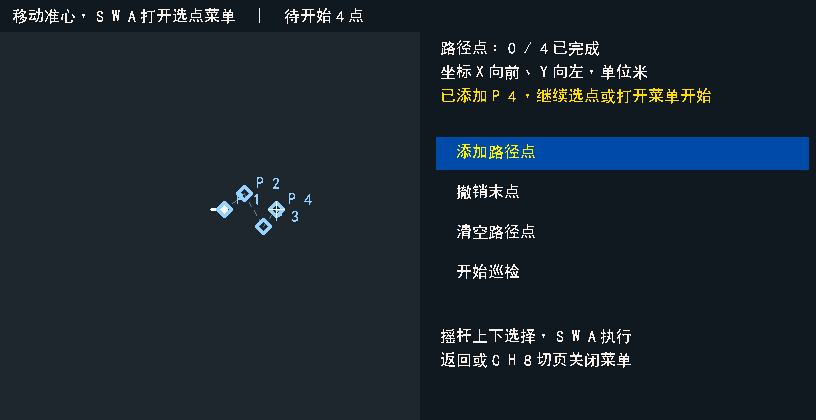
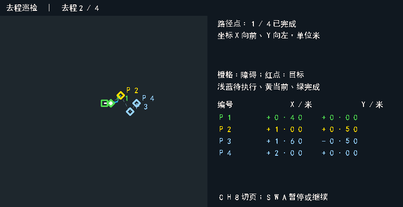

# AI视觉巡检多路径点（2026-10-28）

视觉巡检由单终点改为有序路径点队列：任务起点 → P1 → P2 → … → Pn → 按最新地图返航。所有队列、页面和报告处理都在RK侧；FPGA继续使用原有单目标避障导航，速度码30。基础导航菜单、语义导航、独立目标识别、聊天机器人及FPGA基础功能不变。

## 遥控操作

1. 光标挡进入AI模块，CH8选择“视觉巡检”，SWA确认进入。
2. CH8继续切换摄像头、地图、文字三视图。选点和路线编辑在地图页进行。
3. 默认用摇杆移动地图准心。SWA打开右侧操作面板，默认高亮“添加路径点”。
4. 面板打开时，摇杆上下选择“添加路径点 / 撤销末点 / 清空路径点 / 开始巡检”，SWA执行。每次选择需先回中再拨动；面板打开时不移动地图准心。
5. 添加、撤销、清空后回到准心操作。重复添加即可建立P1、P2等访问顺序。准心位于雷达障碍格时不添加该点。
6. 选择“开始巡检”后进入路线确认，显示点数及完成后自动返航；再次SWA才真正启动。无路径点不能开始。
7. 路线确认时按返回，保留全部点位并继续编辑。面板打开时返回只关闭面板；CH8切页也关闭面板，不执行选中操作。
8. 执行中SWA或返回可暂停；暂停后SWA确认继续，返回取消。运行、暂停、手动接管期间不能编辑路线。修改路线需取消后新建任务。

SWB仍用于语音录音，不承担路径点编辑。SWC手动挡仍由FPGA最高优先接管；AI总开关、任务页、点位和完成进度保留。回光标挡不自动续跑，确认后从当前位置前往当前未完成点。

## 调度规则

- 任务启动时保存实际位置为返航起点；整个多点过程使用同一任务号。
- RK每次向FPGA发送当前一个路径点。收到当前命令的“到达且已停车”回执后，记录完成时间、当时位姿，推进至下一点。
- 中间点到达后自动继续，不要求额外确认。最后一点到达后更新视觉障碍层，向FPGA发送任务起点作为返航目标；允许按最新地图换路，不强制倒序访问路径点。
- 点间线路由FPGA规划，地图上的虚线仅表示访问顺序，不是要求严格跟随的直线轨迹。
- 无路时保留当前点，不跳过；可等待现有导航恢复，或人工暂停、取消。
- 途中识别新目标，沿用[演示级停车三帧定位](AI巡检演示级停车定位_20261028.md)：停车回执后等0.5秒，三帧平均定位，提交障碍层，再继续当前点。观察或暂停期间不以到达事件推进队列。
- 通过原有任务、定位纪元和命令号匹配回执。重复的上一点到达回执不会跳过下一点。
- 取消后不自动返航。定位重置、控制断连等沿用原有任务失效和录像收尾处理；未启动的选点在控制连接重建后清空。

没有新增传感器时效判断、停稳证明模块、对时验收门槛或另一套单点运行分支。单个点直接作为长度为1的队列执行。

## 显示与记录

- 路径点以P1、P2等编号；浅蓝表示待执行，黄色表示当前点，绿色表示已完成。已识别目标继续使用红点及原有数字编号，导航障碍继续使用橙色。
- 各视图顶部显示当前点进度或返航状态。地图侧栏显示点位坐标；编辑阶段显示最近添加的点，运行阶段显示当前点附近的列表。
- 文字页合并列出路径点状态、坐标及已确认物体，可用摇杆上下滚动。
- 两路10Hz录像继续使用同一时间基准，跨点、观察、暂停、手动接管、返航都不拆成新会话。显示和录像使用同一份页面状态及渲染器。
- 任务报告的`mission`增加`waypoints_m`、`waypoint_count`、`waypoint_index`、`waypoints_completed`、`waypoint_arrivals`和`started_at_s`。`waypoint_index`从0开始，去程全部到达后等于点数。
- 每个到达记录包含从1开始的`number`、目标坐标`xy_m`、到达时位姿`pose`、单调时钟`at_s`及相对任务启动的`elapsed_s`。单调时钟通过录像`manifest.json`中的起始单调时间与UTC时间对应。
- `frames.jsonl`逐帧增加当前路径点序号、总点数、完成数和当前导航目标。取消时保留已完成点和未完成点，便于检查部分完成的任务。

## 实现及验证

主要改动为`host/ai_coordinator/inspection/mission.py`、`controller.py`、`render.py`、`recording.py`及对应测试。无FPGA RTL、引脚或协议改动，不增加FPGA逻辑和组合路径，不需要重新综合或烧录。

- 本地协调服务全套343项测试，11项按平台跳过；其余通过。最终受影响的任务、交互、页面和录像74项复核通过。
- RK同套343项全部通过，另有FX2工具36项、语义工具12项通过。
- 原有FPGA控制台增加多点连续GOTO用例，共24项检查通过，验证同一授权任务可以复用确认令牌逐点导航，手动接管仍撤销授权。这属于接口仿真，不是整车实测。
- 覆盖三点顺序执行、旧回执不重复推进、第二点手动后继续、第二点停车观察后继续、无路不跳点、取消保存部分进度、编辑菜单与切页、地图障碍格拒绝添加，以及单段双路录像覆盖跨点/手动/返航。
- 页面预览已检查蓝底黄字操作面板、点位颜色和文字对齐；下方示例使用模拟任务数据，并非现场画面。

## RK部署

发布目录：`/home/orangepi/workspace/falcons_ai_interactive_20261024/releases/inspection_src_ec4f025785d1`。

源码包245份文件，SHA256为`a15498943b258750cb51f84003a3194bf064e4f8489afa89945d6d4425f98aa0`。板端另编译原有原生采图工具，246份部署清单内容全部匹配。服务active、NRestarts=0，原有ASR、语义模型、Qwen3.5 0.8B、Kokoro及视觉模型均已加载；原有地面H、相机focus=260及关闭自动对焦配置保留。

部署备份：`/home/orangepi/workspace/falcons_ai_coordinator_20261024_r1/autostart_backups/20261028_113707_99315a52`。

用户暂不接回FX2，USB扬声器也未枚举；本轮未进行真实页面操作、多点整车巡检或播报实测。部署后任务号和FPGA命令号均为0，没有启动自动运动。详细证据见[evidence/inspection_waypoints_20261028/VALIDATION.json](evidence/inspection_waypoints_20261028/VALIDATION.json)。
