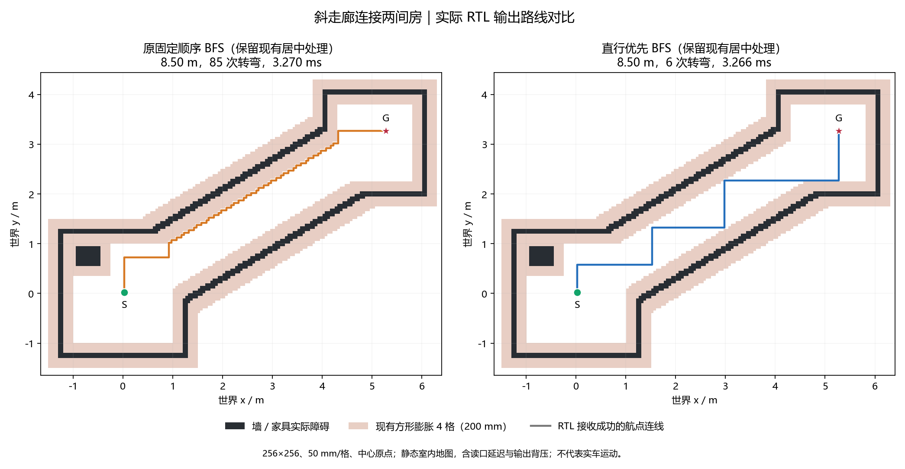

# 直行优先 BFS 实现与验证（2026-10-22）

本次面向室内演示：在房间、门洞、通道和家具地图中，减少斜墙栅格化后的频繁小转弯。只修改生产 `nav_planner.v`，不改变公开接口、地图规则、分段锁定、后台调度或控制器握手。基线为 `b221b9a`；代码、测试、文档同一中文提交，编号以本文件所在提交为准。

## 实现

仍然从目标向起点做四邻接 FIFO BFS，每格首次访问时记录父方向。队列项由 16 位格号改成 `{2 位搜索方向, 16 位格号}`，出队时一起锁存。对每个节点，按直行、左、右、反向扩展；目标根节点没有进入方向，固定从 +x 开始。方向指的是反向搜索方向，不是小车朝向。

实际选中的方向同时用于邻格计算、父方向和后续入队，避免枚举序号和方向不一致。只需 2 位组合选择和 2 位寄存器，没有增加状态、父方向存储读口或每节点固定周期。8192 项队列增加逻辑容量 16384 bit，即 2 KiB；物理存储与时序以本轮实际报告为准。

FIFO 层次不变，因此 BFS 仍求最短栅格距离。这是同距离下的搜索偏好，**不保证全局最少转弯，也不保证任意地图都减少转弯**。现有居中处理仍可能在预算内增加最终路线长度，不能把最终长度与未经居中的软件最短路直接混比。本次不引入方向状态最短路、优先队列或额外兼容参数。

## 地图与自检

地图为 12.8×12.8 m、256×256 格、每格 50 mm、中心原点。车宽 180 mm；障碍横纵每侧膨胀 4 格（200 mm），与当前 RTL 一致。场景按室内尺寸搭建，包含 100 mm 墙、约 1.3 m 门洞和家具；不是实测场地图。正式生成器产出的三个主要 raw / cost 地图，与此前演示的软件地图逐格相同。

`sim/bfs_indoor.py` 用标准库生成地图和独立 FIFO 参考；不直接调用 RTL 的方向选择。`nav_planner_tb` 同时验证关闭和开启居中的规划器，28 个请求共 434 项检查：

- 三个主要室内场景：错位门房间、约 31° / 1.4 m 斜走廊、带门斜隔墙与斜放长桌。
- ±15° / ±30° / ±45° × 净宽 1.2 / 1.5 / 2.0 m，共 18 个通道。
- 同格起终点、起点实障碍、终点实障碍、封路无解、局部接出关闭 / 开启及地图边界。
- 原始 BFS 每个路径格与独立参考一致，距离和转弯数均一致；开启居中后逐格检查所有输出线段、边界和额外路长预算。
- 地图读口变化延迟与航点背压；房间累计入队超过 8192，验证环队列回绕。封路和障碍起终点不输出路线。

修改前真实 RTL 在独立库跑相同地图、延迟和背压，434 项通过；修改后也全部通过。测试台总周期为基线 5025880 → 新版 5026192，两组居中配置并行运行，该总数不是单次规划延迟。新 RTL 整车完整回归 **32 台 / 3089 项通过**；运动回归仍为 98000033 周期、22 轮规划，包含暂停恢复、前方 raw 障碍停车、清除后继续及第二目的地。

## 实际 RTL 输出对比

以下均为开启现有居中处理后的接收成功航点；转弯按连续线段的方向变化计数，同向中继不重复算。不是软件参考路线，也不是实车测量。周期包含地图清理、搜索、居中复核和发射等待；毫秒按标称 50 MHz 折算，不代表约束已经通过。

专项台 `wp_limit=512`，足够覆盖所有场景，两版均输出到相同终点的完整路线。整车 `MAX_WP=1024` 和前缀发布策略没有修改；这里的转弯数不是实车累计停车次数，实际任务仍由原有协调器和控制器执行。

| 室内场景 | 最终路长，前 / 后 | 转弯，前 / 后 | 周期，前 / 后 | 新版标称时间 |
| --- | --- | --- | --- | --- |
| 房间与错位门洞 | 10.20 / 10.20 m | 5 / 4 | 409753 / 410246 | 8.20492 ms |
| 斜走廊连接两间房 | 8.50 / 8.50 m | 85 / 6 | 163499 / 163279 | 3.26558 ms |
| 斜隔墙、门洞与长桌 | 8.10 / 8.10 m | 19 / 2 | 451753 / 452730 | 9.05460 ms |

关闭居中时，三个场景路长仍分别为 9.70 / 8.50 / 8.10 m，前后完全相同；房间最终多出的 0.50 m 来自已有居中策略，两版均如此。未居中周期分别为 406977→407667、163157→160755、450871→450370。读取和接收的周期性背压也会受各轮起始相位影响，不能把全部周期差解释成固定逻辑开销。

额外 18 组斜通道在两种居中配置下均减少转弯，总数 **1404→92**，最短格距不变。队列全套最大占用 233 / 8192，未溢出。它们支持室内演示效果，不构成任意复杂地图的保证。

图像由 `sim/plot_bfs_indoor.py` 读取 RTL CSV 重建：



其他图：[房间与错位门](img/bfs_rooms_doors_20261022.png)、[斜隔墙与长桌](img/bfs_slanted_wall_furniture_20261022.png)。仅保留这三张报告插图；地图、CSV、库和日志按仓库规则不提交，可用脚本重建，不纳入交付 RTL。

## 综合与布局布线

基线来自 `b221b9a` 对应的 2026-10-21 22:31 报告。基线已未达 50 / 49 MHz，比较不使用更早的 50.018 / 49.106 MHz 版本。93 个生产输入中只有规划器 RTL 改变，没有改约束。

| 综合资源（整车） | 基线 | 新版 | 差值 |
| --- | --- | --- | --- |
| Logic | 36753 | 36607 | -146 |
| LUT | 29882 | 29732 | -150 |
| ALU | 6871 | 6875 | +4 |
| Register | 17245 | 17270 | +25 |
| BSRAM | 122 | 123 | +1 |

综合依据 `impl/gwsynthesis/falcons_syn.rpt.html`。实际网表队列为 9 个 8192×2 的 SDPB，基线 8 个，符合增加 2 KiB 的容量变化；未增加父方向存储读口。整车逻辑和寄存器差值包含综合器重新映射的影响，不能只按新增 2 位寄存器推算全设计差值。

完整构建于 11:19 结束，耗时 1548.5 s（25m48s），其中 PnR 20m50s，路由 16m27s。以下资源来自新 `impl/pnr/falcons.rpt.txt`，Fmax 与违例来自 11:19:39 更新的 `falcons_tr_content.html`，没有采用构建过程中残留的昨日时序报告。

| 布线后资源（整车） | 基线 | 新版 | 差值 |
| --- | --- | --- | --- |
| Logic | 37106 | 36949 | -157 |
| LUT / ALU | 29864 / 7242 | 29714 / 7235 | -150 / -7 |
| Register | 17245 | 17270 | +25 |
| BSRAM | 143 | 144 / 340 | +1 |
| DSP | 221 | 221 / 298 | 0 |

| 时钟 | 约束 | 基线 Fmax | 新版 Fmax | 同域 setup 违例，前 / 后 | 新版 hold |
| --- | --- | --- | --- | --- | --- |
| i_clk_50m | 50 MHz | 47.167 MHz | **50.000 MHz** | 241 / 0 | 0 |
| clk_pixel | 49 MHz | 46.768 MHz | **50.045 MHz** | 13 / 0 | 0 |

两个主时钟同域的 setup / hold 均无违例，但**系统最差余量只显示 0.000 ns，余量很薄**。最差列出系统路径为 `u_odom/y_q10_16_s3/Q` → `odom_y_cm_r_12_s0/D`，不是新增的搜索方向选择。全设计 setup 312→58、hold 仍为 18，原 DDR 相关时钟问题未解决，不能称为全工程时序收敛。本次不扩大修改无关模块或约束。

本轮全设计 Fmax 回升是实际综合和布线结果，不能据此推断“优先直行”算法本身必然提频。输入变更导致的映射和布线调整也会影响其他路径；代码层面没有新增每节点状态或父方向读口。

位流为 38792615 字节，SHA256 `6EF6D643A57D9D8D62EEE2D0938052C813C80BDD71D3D9856F4D4FDB8944070A`。93 个实际构建输入在开始和结束后逐项一致。最终摘要为 `logs/bfs_straight/build_result.json`，实际输入指纹为 `production_inputs.json`。

## 复核与范围

```powershell
powershell -NoProfile -ExecutionPolicy Bypass -File sim/run_sim.ps1 -ModelSim D:/apps/modelsim/win64 -Only nav_planner
powershell -NoProfile -ExecutionPolicy Bypass -File sim/run_sim.ps1 -ModelSim D:/apps/modelsim/win64
powershell -NoProfile -ExecutionPolicy Bypass -File tools/build.ps1 -Tcl build.tcl -GowinSh D:/Apps/Gowin/Gowin_V1.9.12.03_x64/IDE/bin/gw_sh.exe
python sim/plot_bfs_indoor.py
```

`logs/bfs_straight/` 保存 baseline / fixtures 两组地图、参考、RTL 周期与航点、完整回归和构建日志、构建前报告及输入指纹。本次不修改其他生产模块或约束，不自动推送，不下载 SRAM / Flash；板上仍为 `11114a2` 雷达修复版。提交前再次拉取并核对受影响项，只提交本任务文件，保留两个 RC 示例脚本原有行尾改动。
