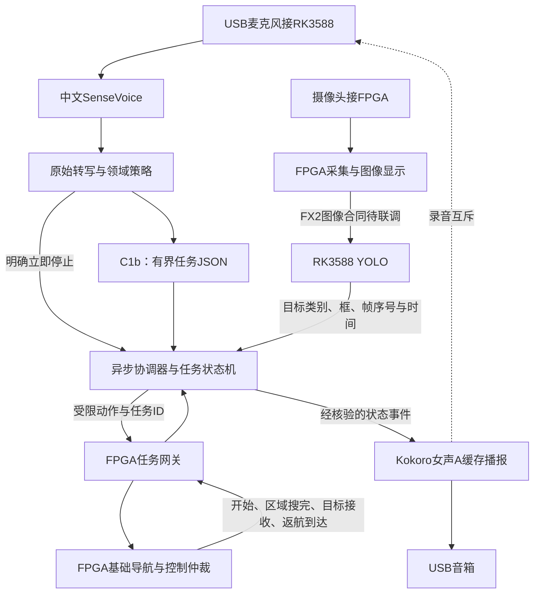

# AI整合与模型对照_20261023-24

归档：2026-11-09；来源基线`dd62de7`。本册合并同主题历史报告，保留当时的数值、未完成项及验证边界。旧命令/路径按当时语境阅读；原始证据未搬动，来源路径和SHA见[目录映射](../目录映射.json)。现行操作从[文档首页](../../README.md)进入。

## 本册来源

- [AI联调交付验证_20261023.md](#report-01)
- [AI总协调器板端部署与验证_20261024.md](#report-02)
- [Claude进展复核与接口接手_20261024.md](#report-03)
- [全栈整合与巡航找物交付_20261024.md](#report-04)
- [多模态任务链路论文核验与整合方案_20261024.md](#report-05)
- [YOLO头部修正对照_20261024.md](#report-06)

---

<a id="report-01"></a>

来源：`doc/AI联调交付验证_20261023.md`；原始正文见`git show dd62de7:doc/AI联调交付验证_20261023.md`。

<a id="report-01--ai-联调交付验证"></a>
## AI 联调交付验证

日期：2026-10-23。整车接口核对基线 `5702f28`。本任务只发布代码/协议/开发说明，不发布新的模型精度或实车结论。

交付状态：**离线回放可运行，实物接入待验证（replayable with constraints）。**

<a id="report-01--复现入口"></a>
### 复现入口

仓库根目录运行：

```text
python host/vision_bridge/verify_handoff.py
```

Python 3.10+ 标准库，Icarus `iverilog/vvp` 在 PATH。结果默认写 `host/vision_bridge/build/verification/`，失败返回非零。无需历史 feature 分支、外部图片、模型权重、板端登录或摄像头。

本次环境：Windows，Python 3.14.0，Icarus Verilog 12.0 devel（s20150603-1539-g2693dd32b）。没有安装或升级依赖。详细源码/输入/演示输出哈希在 [验证 JSON](../../AI联调交付验证_20261023.json)，重新运行可比较 `source_sha256` 和 `demo.files_sha256`。

<a id="report-01--结果"></a>
### 结果

| 验证 | 结果 | 范围 |
| --- | --- | --- |
| Python unittest | 53 项通过 | 类别/状态冲突、NaN、源年龄、序号、TTL、协议布局与 CRC、显示帧关联、实验伺服默认禁用 |
| `ai_vision_link_tb` | PASS | 合法观察、CRC 错误撤销、重复序号、非法声明、心跳与超时 |
| `vision_serial_bridge_tb` | 54 项检查，0 失败 | Python 编码→50 MHz/115200 8N1 UART 位级接收；8 帧/4 有效目标；旧帧重放拒绝、CRC 错帧、EOF 撤销、超时后新会话、有效目标静默超时清零 |
| 固定演示 | PASS | 7 条明确标为 synthetic 的输入，附 EOF 撤销共 8 个事件；HTML/JSONL/HEX 可重复产生相同内容哈希 |
| 干净交付目录 | PASS | 从暂存区导出 22 个交付文件及 1 个既有 UART 依赖，不带 Git 历史，重复自检通过，源码与演示内容哈希一致 |
| 实际设备 | 未执行 | 串口发送 0 字节；摄像头未打开；未下载位流；未控制电机 |

编译有既有 UART 模块继承 timescale 的提示，未修改 vendor 时标；仿真时钟/串口位宽由测试台明确指定。没有用屏蔽错误或忽略进程返回码换取通过。

<a id="report-01--本轮发现并处理"></a>
### 本轮发现并处理

- 旧桥源码注释声称生产自动端口为零，已按最新导航接线更正；桥仍保持观察模式。
- 旧 UART 回放测试预期“接收器接受重复序号”，与后来已修复的解析器不一致，现改为检查拒绝并撤销。
- Windows 原生 Icarus 的 `$fopen/$readmemh` 无法可靠处理中文绝对路径参数，运行器改为在结果目录使用 ASCII 相对文件名。
- 自检脚本明确区分 `FAILURES=0` 汇总与真正 FAIL 行，同时仍检查返回码和 PASS 标志。
- 单独补测“有效目标静默后过期”，避免只验证已撤销目标的超时状态。

<a id="report-01--尚未验证"></a>
### 尚未验证

实时 YOLO/RKNN、Qwen/RKLLM 及视觉编码器、真实相机/HDMI、跨流跟踪、目标测距与坐标标定、AI 导航目标入口、实际串口、整车时序及实车接近停车均不在本轮通过范围。独立接收器未加入生产构建列表，故本轮未重建整车。

`motion.py` 仅为历史视觉伺服参考，框面积不是可靠距离，输出不是现有导航入口，不得据此直接上车。所有离线样例的时间轴是合成的，不提供实时延迟或源新鲜度证据。

---

<a id="report-02"></a>

来源：`doc/AI总协调器板端部署与验证_20261024.md`；原始正文见`git show dd62de7:doc/AI总协调器板端部署与验证_20261024.md`。

<a id="report-02--ai总协调器板端部署与验证"></a>
## AI总协调器板端部署与验证

日期：2026-10-24。状态：**代码已部署，单项与小规模模型链路通过；持续联测因板子再次重启中断，尚未完成稳定性验收。**

<a id="report-02--模块与研究依据"></a>
### 模块与研究依据

实现位于 `host/ai_coordinator/`，入口与接口合同见其[README](../../../host/ai_coordinator/README.md)，论文原始链接、成熟模块与实现差异见[研究记录](../../../host/ai_coordinator/RESEARCH.md)。采用SayCan/SayPlan的高低层分离与反馈原则，以及异步动作、可取消任务的工程方式；没有声称复现原论文的完整算法。

RK3588统一协调音频、中文ASR、领域语言模型、视觉及FPGA任务网关。摄像头采集、基础导航、闭环控制和最终执行仲裁仍由FPGA承担。模型放在独立进程中，协调循环不等待推理；有超时、旧结果拒收、任务/动作ID、连续视觉确认与设备回执。

现有FPGA尚不支持本轮新设计的FAM1任务合同；既有AA55视觉观察协议保持原样。本轮未修改RTL或下发运动。FX2图像worker和FIMG解析器已提供，但真实固件/USB图像流及源时间验证未完成。不能把这些软件接口视为硬件已接通。

<a id="report-02--板端部署"></a>
### 板端部署

- 独立根目录：`/home/orangepi/workspace/falcons_ai_coordinator_20261024_r1/`。
- 用户服务：`falcons-ai-coordinator.service`；API仅回环18765，私有llama-server仅回环18081。
- 默认shadow：不打开FPGA串口、不发送车辆动作。空闲不加载模型；完成冒烟后已卸载本轮模型。
- 模型：SenseVoiceSmall INT8 CPU两线程；专项 `domain-Q8_0.gguf` llama.cpp CPU四线程，关闭思考，最大80输出token；既有v17 640 FP16 RKNN核心0。
- 新ASR依赖仅安装在自己的 `python/` 目录，通过PYTHONPATH引入；未升级系统Python、系统包、NPU驱动或RKNN/RKLLM环境。
- `active_release.json`记录代码快照与SHA256。模型811,842,976字节，SHA256为 `ed2a527d19307d26f57e1d9aed6ab00980face2f507f47931e904b3402aafbfb`，第二次重启后复核一致。

用户级服务已在本次登录环境中自动恢复。没有设置系统级服务或修改用户linger；不能据此保证无人登录时开机自动启动。

<a id="report-02--实际结果与证据范围"></a>
### 实际结果与证据范围

| 验证项 | 结果 | 实际范围 |
| --- | --- | --- |
| Windows自动测试 | 34通过，5跳过 | Linux串口伪终端项跳过 |
| RK3588自动测试 | 39/39通过 | 含真实私有进程回收及5项Linux伪终端；不是实物FPGA |
| 中文ASR单项 | 通过 | 合成WAV，真实CPU推理；单项首次加载6.68秒，所测6秒音频解码0.85秒 |
| 专项语言模型单项 | 正确输出胶带搜索JSON | 实际CPU请求2.49秒，无思考内容；单例不能代表总体能力 |
| 视觉图片回放 | 8/8图片包含对应目标检测 | 四类各两张旧开发图片；NPU API调用中位127.7毫秒，范围80.1–145.0毫秒 |
| 综合冒烟 | 3/3任务解析及模拟结果匹配 | 两条条件搜索/返回、一条确认；真实ASR/LLM/YOLO，FPGA回执模拟 |
| 综合冒烟延迟 | 中位3.05秒 | 从已录好的音频文件到任务解析，不含录音、行驶、播报；仅3条 |
| 协调循环 | 冒烟最大tick间隔30.2毫秒 | 本次小规模观测，不是硬实时保证 |
| 完整32条回放 | **未完成** | SSH控制台输出前5条均匹配，随后板子重启；整轮目录未落盘，无完整汇总 |
| 麦克风/FX2/车辆 | 未验证 | USB麦克风未到，FPGA/FX2未连接，不宣称实车闭环 |

视觉最初发现两处适配错误，均保留失败证据后修复：旧Pillow无Resampling接口，改为复用既有OpenCV；实际v17原图输出是 `[1,8,8400]`，修正误设的双输出合同，并增加几何、类别和异常输出测试。没有更换模型来迁就代码。

同一数据集曾用于开发，所有回放均为合成语音与旧图，不是独立真人盲测。没有把专项GGUF结果当作原版Qwen的RKLLM W8A8指标。

<a id="report-02--重启与双方协作"></a>
### 重启与双方协作

用户授权直接联系Claude Code。双方已通过当前Claude会话和工作区 `ai部分/AI_板端协同_20261024.md` 确认：独立目录/端口，先由Codex联测，再交接C1b，共用 `/tmp/falcons-ai-model-test.lock` 的flock，持锁时不启动另一组模型、不主动重启。

此前02:19重启导致部分近期写入丢失。根ext4配置 `commit=600`；此次对自己的模型、代码、配置、目录及service显式fsync，没有修改挂载参数。恢复后39项测试和3条综合冒烟成功。

随后约02:37再次重启。boot_id从 `70de1613-f775-450a-ac0e-5749229f39f1` 变为 `2e455f07-3763-4ef0-8163-826154e8e303`。Codex没有发送系统重启命令；Claude确认其期间没有模型负载，也没有重启。**不能把重启归因于并发冲突、过热、OOM或供电，现有证据不足。** 重启后温度约38–40°C，不能用它代表重启前温度；历史journal未覆盖故障窗口，无法据此排除故障。

第二次重启后：代码、配置、服务及GGUF哈希保住，服务active、shadow、idle，约15MiB，自己的模型进程为空；共同锁可获取。完整回放尚未完成的资源样本也未落盘，不能给出峰值内存/温度。本轮已改进回放工具：启动标记、每张图、每条结果及完成标记分别fsync，便于后续中断诊断；**没有为了验证此改动再次启动模型负载**。

Claude已同意暂停C1b，双方不再重复重负载。下一阶段先核对供电线/电源余量、系统复位或watchdog原因及故障日志，再串行恢复验收；本轮没有停用系统watchdog或更改比赛系统配置。

本机证据：`D:/FALCONS_workspace/ai部分/runtime_integration_20261024/acceptance_evidence.zip`；解包目录 `board_evidence/`，含通过的逐例结果、模型日志、失败记录、39项测试输出、配置/清单、重启诊断及最终空闲状态。完整回放前5条只存在工具输出，不能与已落盘完整试验混合计数。

<a id="report-02--语音播报扩展建议初轮记录"></a>
### 语音播报扩展建议（初轮记录）

用户新增扬声器想法。建议USB有源音箱接RK3588，选支持Linux免驱播放的型号。固定物体/状态短句可预生成中文WAV，按任务事件播放，避免增加语言模型推理负担。

“开始寻找”在任务准入后播；“已找到”需视觉确认与FPGA接收；“任务完成”需最终动作回执，返回类任务还须home_arrived。失败/停止可抢占普通播报，旧任务语音应撤销。第一版可用短句半双工减少自激识别，遥控/硬件急停保持独立；真正边播边听需实测AEC。当前仅记录设计建议，没有已连接音箱或通过TTS播放的结论。

本轮未提交、推送或烧录。

<a id="report-02--后续用户确认继续已实现缓存中文播报"></a>
### 后续：用户确认继续，已实现缓存中文播报

新增 `announcements.py`、`speech_assets.py`、Windows缓存生成器及播报测试；细节见[中文任务播报](../../../host/ai_coordinator/SPEECH.md)。找到/完成由设备回执驱动，停止短句仅为“已请求停止”；shadow与simulation带“模拟任务”前缀。异步限长队列支持新任务/停止抢占、重复和过期丢弃，半双工协调录音，声音不可用时保留任务核心。

电脑已有中文语音生成36段PCM16/16kHz WAV，合计4,028,536字节、125.84秒；已复制到板端独立部署的 `speech/` 并核验SHA256/fsync。未加载板端TTS或其他模型。板端默认 `announcements.mode=log`、device=null，只记日志；未打开声卡。

加入12项播报及集成检查后，Windows46通过/5跳过，RK3588共51项通过；私有播放子进程测试使用受控进程替代aplay，没有声卡输出。示例音频由真实任务状态机与模拟检测/回执生成，带模拟前缀；不是实车完成或实际声学闭环。实物音箱及AEC仍未验收，模型长测仍暂停。

本轮证据另存在 `D:/FALCONS_workspace/ai部分/voice_announcements_20261024/`，避免覆盖初轮39项/3条模型冒烟原始记录。本次低负载部署后boot_id仍为 `2e455f07-3763-4ef0-8163-826154e8e303`。没有重启系统、升级环境、提交、推送或烧录。

用户后续试听并选定Kokoro女声A（zf_001/sid3）。当前assets已切到独立的 `speech_kokoro_zf001_20261024/`：36段、2,899,282字节，源模型在电脑生成，未安装到板端。仍为log、无声卡输出、无新的板端推理成绩；旧微软音频保留。生成器、专名发音、来源与校验见[语音说明](../../../host/ai_coordinator/SPEECH.md)。

---

<a id="report-03"></a>

来源：`doc/Claude进展复核与接口接手_20261024.md`；原始正文见`git show dd62de7:doc/Claude进展复核与接口接手_20261024.md`。

<a id="report-03--claude进展复核与接口接手"></a>
## Claude进展复核与接口接手

日期：2026-10-24。最初为只读复核，随后已完成v5激活及v6独立暂存。当前服务v5、FIMG v2已同步；v6新增USB/UVC入口且Linux99/99+36/36通过。下方旧版本发现保留为历史证据，后续实况见文末。全程未录音、加载模型、重启板子、升级或烧录FPGA。

<a id="report-03--已确认的进展"></a>
### 已确认的进展

1. C1b专项模型、中文策略与SenseVoice链路已经形成可用基线。现阶段没有证据支持继续盲目微调会比补齐系统接口更有收益。
2. Claude已将 `fullstack_release_v3_camera.zip` 部署并激活，release为 `fullstack_20261024_133452_e166e1`。留存日志证明板端77项协调器测试、21项相机软件测试通过；相机软件测试不是实际USB收图。
3. USB麦克风已识别真人“请帮我寻找螺丝刀”；协调器 `/audio` 合成WAV正例输出search/screwdriver，约2.73秒；`/capture`真人聊天负例输出unknown。**尚缺同一个 `/capture` job中的真人正例**，不把分段证据写成同一次真人全链路通过。
4. 新增的 `camera_fx2_direct` 使用FIMG v2，已有640×375、FIFO、坏帧恢复、综合和隔离整车候选。尚无实物FX2传图结果。
5. 本轮通过网络ADB实际确认 `Linux aarch64`、uptime约12小时40分、协调器运行。当前为shadow、模型HOLD、所有模型worker空、麦克风已配置、相机未配置、未验证源时间、无运动授权。USB ADB未枚举不再等于板子完全不可达。

主要证据：`交付/FALCONS_全栈巡航_20261024/board_test_20261024/板端测试记录_20261024.md` 和 `board_test_receipt.json`；本轮证据目录为 `ai部分/claude_integration_review_20261024/`。

<a id="report-03--发现一新旧图像协议尚未部署同步"></a>
### 发现一：新旧图像协议尚未部署同步

板上当前激活release的 `host/ai_coordinator/frames.py` SHA256：

`2e021b44f4ff439a795e932334407cf97a1388d109f5edf1294c2d8745865090`

本机支持FIMG v1/v2的解析器SHA256：

`025555bed8540e298c6896f6a670957edfa990b322be2cc76de4832b593a8f76`

只读取回板端解析器后，用同一640×375合成红色RGB565完整帧复现：

| 输入 | 激活release解析器 | 当前本机解析器 |
| --- | --- | --- |
| FIMG v1 | 1完整帧，像素一致 | 1完整帧，像素一致 |
| FIMG v2 | **0帧，1错误** | **1完整帧，像素一致** |

这意味着即使FPGA直传成功，现有板端release仍会拒绝v2。已有v3部署成功不能代替后续图像协议升级。新增 `host/fx2_camera/review_contract.py` 可复核保存的板端解析器；`parser_contract.json`保留本次结果。没有接真实FX2，该检查只证明格式兼容性。

正式对接以已经实现的 **FIMG v2（magic仍为FIMG，version=2，帧尾CRC）** 为主。此前实验性 **FIM2逐行记录** 是不同协议，不能因为都叫“v2”就混用；它没有被选作本次直传硬件的发送协议，不能把其测试数计作FIMG v2硬件验收。

<a id="report-03--发现二原分辨率不可行的论据需要修正"></a>
### 发现二：原分辨率不可行的论据需要修正

当前直传报告把42MHz PCLK等同于42M RGB565像素/秒，即84MB/s。现有DVP是8bit总线，`DVP_Capture.v` 的DataValid在 `Hcount[0] && r_Href` 时有效，**每2个PCLK形成1个16bit像素**。

因此若PCLK确为42MHz，活动区速率应为21M像素/秒、42MB/s。现有SDC另有约52.5MHz配置说明，当前实物PCLK/帧率仍需测量，不能选对结论有利的一个注释当实测。

现有直传TB `pixels()`大部分周期都令cam_valid=1，只偶尔空1周期，比真实8bit DVP的每两拍一像素更快；`frame()`又等待DUT接纳后才送像素，不能作为连续不可反压、固定30fps相机的证明。它仍适合检查部分CRC/抽取/恢复逻辑，但不能证明所有实际吞吐结论。

仅作理想突发容量的下界计算：1024×600 RGB565一帧1228800字节。42MB/s活动输入、40MB/s连续有效服务时，不计消隐和USB暂停，峰值积压约58.5KB；52.5MB/s输入、40MB/s服务时约292.6KB。两者对256KiB FIFO的结论不同。该算例没有计协议/主机调度，也**不是新的RTL或板测通过证据**；它只说明“1024×600每帧必溢出”的绝对结论尚不成立。

应保留640×375的已有成果，并补充真实DVP节拍、行场消隐、固定来源帧率和USB限速的连续多帧验证，再决定原分辨率模式。具体算例在 `cadence_audit.json`。

<a id="report-03--建议由codex接手的工作"></a>
### 建议由Codex接手的工作

| 顺序 | 接手内容 | 明确交付 |
| --- | --- | --- |
| P0 | 图像协议与部署一致性 | 固定FIMG v2合同、逐文件版本校验、升级候选包与回滚路径；保持现有语音配置与HOLD |
| P0 | 真正的摄像头吞吐验收 | 基于每2PCLK一像素、真实HTS/VTS的连续输入；报告完整帧率、CRC、丢帧、积压和断连恢复，区分仿真与板测 |
| P1 | 相机→YOLO→协调器的时效与坐标 | 确认尺寸、抽取映射、源帧身份、旧帧撤销；收到图像不自动授权运动 |
| P1 | 语音/显示/执行回执综合验收 | 补真人capture正例、录音等待时延、播报互斥、任务回执与UI状态；按真实回执显示完成 |

语音与Qwen专项模型沿用已完成成果。FPGA基础采集、显示、导航与控制继续按原映射工作；Codex优先补接入层与可复现验收。现有录音为12秒定长窗口，后续需评估端点检测与任务响应时间，不能仅把模型推理2.7秒当成用户从开口到执行的总时延。

初轮源码回归：协调器81项（Windows76通过、5项Linux伪终端跳过），相机主机35项通过。后续加固后的回归数量见下方续推记录；这些数量不能替换此前激活版本在板上实际运行的77/21。

<a id="report-03--当前边界"></a>
### 当前边界

<a id="report-03--本轮续推独立暂存与合同加固"></a>
#### 本轮续推：独立暂存与合同加固

- v4已在板上暂存为 `fullstack_20261024_152656_08547c`，Linux81项协调器与35项相机软件测试通过。没有激活，运行版本仍为Claude的133452版本，麦克风配置与HOLD保留。
- 在RK3588上离线执行合同复现，旧解析器对v2仍0帧，新暂存解析器1帧且像素一致；该检查不使用真实USB图像。
- 只读USB枚举当前有USB MIC和控制器，没有FX2数据设备，不能开展实际USB带宽测量。
- 新接收代码增加显式FIMG v2及尺寸合同；新增5项接入测试覆盖真实RGB565解码/letterbox、确定性检测张量到任务状态、CRC/错尺寸拒绝、等待执行回执，以及未验证源时间不准入live。视觉张量是测试stub，不把它写成YOLO实物精度。
- 加固后电脑回归：协调器86项（81通过、5项Linux伪终端跳过），相机36项通过。日志位于 `host_v5_tests/`。
- 独立候选暂存与运行服务分开，继续在共享协同文件记录操作范围，避免覆盖Claude正在做的工作。

以上为暂存阶段记录。没有改写Claude留存的部署记录、原始验收标签或直传仿真证据。原始“640×375已做”的结果保留，上述速率/节拍问题单独列出供修正。

<a id="report-03--后续实况v5已激活usbuvc入口独立候选"></a>
### 后续实况：v5已激活，USB/UVC入口独立候选

已在共享协同文件告知Claude并完成v5切换，当前为`fullstack_20261024_153642_f40ecc`。Linux86项协调器+36项相机软件测试通过；实际RTL仿真480028字节线流在板端离线回放1帧、0错误。保留麦克风配置、ASR超时30秒和HOLD/shadow；boot_id未变、模型worker空。证据`activation_v5/receipt.json`；不能据此报告真实FX2传图或实车完成。

Claude已确认DVP速率修正，并准备独立周末实验包。双方按两条路线推进：FPGA侧实验由队友负责；Codex新增统一相机入口，保留FX2并适配USB/UVC，不修改Claude的独立探测/取帧脚本。USB设备与工作模式必须来自真实probe；主机收帧时间与计数不冒充传感器信息，未标定来源时效不准入live运动。USB入口代码先独立候选，不再次切换当前服务。详情见`USB摄像头统一入口与周末验收_20261024.md`。

---

<a id="report-04"></a>

来源：`doc/全栈整合与巡航找物交付_20261024.md`；原始正文见`git show dd62de7:doc/全栈整合与巡航找物交付_20261024.md`。

<a id="report-04--全栈整合与巡航找物交付记录"></a>
## 全栈整合与巡航找物交付记录

日期：2026-10-24。状态：**电脑端软件链路已完成本轮验证；新板端部署与实物闭环尚未完成。** 详细入口、协议、复现及硬件清单见[全栈入口](../../../host/ai_coordinator/FULLSTACK.md)，先期研究见[论文核验](#report-05)。

<a id="report-04--yolo最后一组对照"></a>
### YOLO最后一组对照

父模型为上轮同锚点KD Nano，SHA256 `7b0a0cfb34a90791e7365e5889d9e1233a149ec5a177861469e62d0fe0919a23`。新目录`ai部分/yolo_p3_repair_20261024/`，协议SHA256 `984254aacadf0f38a60e872c92fc35b3010b0c77d902c3933b088966f07dda94`，两臂各6轮、相同初始化与数据、seed106，运行前固定门槛。开放34,304参数P3层及136,360参数one2one头，共170,664可训练参数；逐轮确认P3非零梯度与其余冻结张量不变。one2one特征detach保持原样，P3通过one2many监督/保持损失学习。

| 模型 | hard AP50–95 | mini AP50–95 | old AP50–95 | hard TP/FP | mini TP/FP | old TP/FP |
| --- | --- | --- | --- | --- | --- | --- |
| 父Nano同锚点KD | .8759 | .8196 | .9832 | 8/1 | 6/0 | 12/1 |
| P3监督 | .9321 | .8059 | .9777 | 8/2 | 6/0 | 12/1 |
| P3＋饮料保持 | .9424 | .7906 | .9777 | 8/1 | 6/0 | 12/1 |

两臂均未达到mini至少7/8召回及AP门槛。监督臂还增加hard误检，并有ONNX/PyTorch差异超过预设阈值；保持臂输出一致性通过。P3会改变one2many输出，不再使用“饮料输出完全不变”的假设。模型参数量和算子类型计数与原Nano保持一致，未做RKNN转换或新NPU性能测试。

**停止对这组小开发集继续调参，整合保留v17。** hard/mini各只有一个视频的8帧，旧类12图，反复用于开发；本轮不提供独立泛化、显著性或板端提速结论。没有因hard AP好看而绕过mini召回与导出检查。

<a id="report-04--全栈代码与实测"></a>
### 全栈代码与实测

新增共享中文策略、C1b电脑配置与哈希检查、ONNX电脑视觉适配、FAM1设备参考/字节模拟器、巡航状态机、可选地面投影、综合回放与部署打包工具。原始ASR文本保留，立即停止独立于模型，条件停止不提升为当下停止。复杂指令仍使用C1b，固定巡航/人工确认口令走受限预设入口。

实际模型验证：46/46文本、7/7合成语音、8/8旧图片检出目标，两条找物/返回回放通过。新巡航回放使用真实ASR、真实YOLO及同一视频两帧：开始巡航、发现螺丝刀、暂停、模拟测距停车、合成口令确认人工取走、恢复P1、到P2结束；全程未加载LLM。模型与执行回执分别标明来源，全部`physical_task_completed=false`。

77项软件测试在Windows上72通过、5项Linux串口跳过。本轮未在RK3588重跑；历史51项板端通过不能写成本轮77项全部板端通过。48条zf_001缓存音频已生成/校验；未打开实际音箱。

关键证据：`fullstack_pc_20261024/acceptance_r3/summary.json`、`patrol_replay_r5/result.json`、失败目录、输入清单与私有进程回收记录。初版原生路径、UTF-8问题与新口令ASR错误均保留；没有改参考标签或把近音“失去”映射成已拾取。

<a id="report-04--部署与实物阻塞"></a>
### 部署与实物阻塞

用户明确热点已断，改用ADB。已核对ADB设备列表：仅`127.0.0.1:5555`与`emulator-5554`安卓模拟器；目标板`3768d367d81bbb27`不存在。未向模拟器发送板端部署命令，未重启ADB服务器、改热点或复位板子。

部署器和包已准备，采用独立release、全文件哈希、测试后激活、失败恢复旧配置和空闲服务的流程；候选配置固定C1b、v17、女声A，保持模型HOLD、shadow、巡航关闭。部署器尚未在当前断开的板子上验证执行，不能记作已经部署成功。

随后通过Git命令成功只读核对远端最新`ec759b161f378fcf545a836fe8bed63295efe1a2`。远端已接通路径点导航、雷达避障和自动输出；本地旧基线自动端口为0的判断不能代表当前远端。任务接入应复用现有目标来源仲裁与规划器，不能直接覆盖`planner_target_x/y`或并接底盘速度；仍需实现AI暂停/恢复、局部靠近和执行回执。新`navigation_goal.py`对齐远端定位原点与50mm栅格边界，停车候选在物体前方，默认不授权执行。只读保存5个上游文件及哈希，未切换或覆盖工作树。

框转地面/导航坐标是有条件的几何方案，需要实测标定、地面接触和同步位姿；当前优先采用预设路径点＋局部引导，不伪造地图坐标。无机械手时只报告人工确认，不报告真实机械拾取。

下一次接通目标板可直接从[全栈入口](../../../host/ai_coordinator/FULLSTACK.md)继续安装、Linux软件检查与逐层联调。未升级环境，未改原顶层、引脚、遥控映射，未提交或推送。

---

<a id="report-05"></a>

来源：`doc/多模态任务链路论文核验与整合方案_20261024.md`；原始正文见`git show dd62de7:doc/多模态任务链路论文核验与整合方案_20261024.md`。

<a id="report-05--中文语音视觉fpga任务链路论文核验与整合方案"></a>
## 中文语音—视觉—FPGA任务链路：论文核验与整合方案

核验日期：2026-10-24。目的：在进一步整合既有模块之前，核对已经在机器人上运行过的链路、公开实现与本项目缺口。本轮为文献和代码只读核验，没有安装这些框架，没有启动板端模型、连接车辆或更改固件。论文作者报告的结果与FALCONS自己的结果分别记录。

<a id="report-05--结论"></a>
### 结论

**已有成功的机器人链路，可以借鉴模块和接口设计。** 最接近语音交互与执行播报的是Dobby；最接近低成本边缘平台的是树莓派教育机器人；视觉到导航/操作的系统集成可参考OK-Robot。SayCan、Inner Monologue、ROS-LLM和SayPlan补充技能约束、执行反馈和分层规划依据。

本轮没有核验到同时满足“中文、Qwen3.5-0.8B、RK3588离线、FPGA采集与基础导航”的现成完整工程。这是本次检索范围内的证据缺口，不代表不存在。上述论文支持架构可行性，不能证明我们已经完成硬件闭环，也不能提供本板端到端速度保证。

<a id="report-05--1-已核对的成功链路"></a>
### 1. 已核对的成功链路

| 来源 | 实际验证到哪里 | 可借鉴内容 | 使用边界与公开实现 |
| --- | --- | --- | --- |
| [Dobby](https://arxiv.org/abs/2310.06303)，2023预印本；[RO-MAN 2024作者页](https://www.cs.utexas.edu/~pstone/Papers/bib2html/b2hd-carson_stark_ROMAN2024.html) | 真机导览与人机交互研究；录音、转写、GPT-4、计划验证、动作执行、对话提示串联 | 动作开始/结束事件驱动播报；长动作异步；任务取消与替换 | 采用云端GPT-4；导览依赖已登记目的地。不能视为中文离线视觉找物实验。本轮核读arXiv v1第III-B至III-D节与正式发表元数据，未核验完整官方机器人代码 |
| [SayCan](https://say-can.github.io/)，CoRL 2022；[会议论文](https://proceedings.mlr.press/v205/ichter23a.html) | 真机移动操作，101个自然语言任务；项目页报告计划成功84%、执行成功74% | 根据机器人技能和当前可执行性约束语言建议 | 使用学习得到的技能价值函数；公开[代码](https://github.com/google-research/google-research/tree/master/saycan)为桌面环境版本，不能当成完整真机移植包 |
| [Inner Monologue](https://proceedings.mlr.press/v205/huang23c.html)，CoRL 2022 | 仿真与真机桌面任务、真机移动操作；利用成功检测和场景反馈修正后续计划 | 把失败、目标状态和执行结果纳入任务闭环 | [项目页](https://inner-monologue.github.io/)展示反馈与重规划；不等于要求Qwen无限生成思考，也不能把全部反馈统一当作零成本、自动可靠的传感器 |
| [OK-Robot](https://ok-robot.github.io/)，2024；[论文](https://arxiv.org/abs/2401.12202) | 10个真实家庭、171次开放词汇拾取放置；作者报告58.5%成功率 | 分开管理目标检索、导航、操作和硬件故障，按整条任务统计成功 | [官方源码](https://github.com/ok-robot/ok-robot)要求Stretch、环境扫描和GPU工作站；AnyGrasp另有授权。不是RK3588全离线语音方案 |
| [ROS-LLM](https://arxiv.org/abs/2406.19741)，2024预印本 | 真机原子动作组合、环境/人类反馈、远程监督控制 | agent_comm、behavior_executor、公共消息/服务的职责划分；行为返回成功/失败与解释 | 核读v1第3节。第3.3节仍将麦克风列为后续功能，不能称为已经验证的语音全链路。[源码README](https://github.com/huawei-noah/HEBO/blob/master/ROSLLM/README.md)目前声明仅支持ROS Noetic |
| [SayPlan](https://proceedings.mlr.press/v229/rana23a.html)，CoRL 2023 | 两个大场景的规划评估，项目页提供真机演示 | 语义目标与经典路径规划分工；用状态检查计划可行性 | 三维场景图及模拟器反馈是方法的重要部分。只借鉴分层原则，不能把其全部大场景评估都称为实车试验 |
| [低成本ROS2教育机器人](https://doi.org/10.3390/robotics15070131)，Robotics 2026 | 作者报告树莓派4B上的西班牙语交互、YOLOv8n、反应式导航和语音输出 | 各功能独立节点；按任务模式启停负载；已知问答减少模型调用 | [作者源码](https://github.com/SesSic/MobileRobotAssistantNLPROS2)包含Vosk、Piper、Qwen2.5-1.5B量化和可选云服务。教育/导航模式有切换，不能据此宣称所有模型始终并发。西班牙语指标不能转成中文指标 |

这些数字属于不同任务、场地和硬件，**不横向排名，也不作为FALCONS的预期成功率**。CoRL 2022的两篇论文在PMLR卷205中列为2023出版，会议年份与论文集出版年应区分。

<a id="report-05--2-查到代码不代表可以原样搬到板上"></a>
### 2. 查到代码，不代表可以原样搬到板上

已读取ROS-LLM的README、执行器README和`behavior_tree_executor.cpp`，以及教育机器人README和在线/离线`voice_node`实际代码；不仅依据仓库名称判断。

- ROS-LLM将通信、行为执行和消息类型分开，适合参考；实际动作仍要开发者包装。它不能自动获得本项目FPGA导航能力。
- 教育机器人代码确实有视觉结果订阅、目标跟随请求、录音和播放入口；同时直接发布运动速度，并有平台专用进程管理和关机逻辑。FALCONS保持现有FPGA执行仲裁，不运行或整包移植这些脚本。
- 两个项目的依赖、摄像头连接方式和语言不同。本项目沿用既有CPU ASR、专项GGUF和RKNN runtime，不通过安装大型框架改变比赛环境。

参考实现源文件快照与SHA256存于工作区`ai部分/pipeline_research_20261024/`，只作研究证据，未导入运行。GitHub读取使用连接器，部分页面直接访问失败后以作者公开文件核验。网页存在和代码可读不等于我们已复现实验。

<a id="report-05--3-新近论文线索的证据等级"></a>
### 3. 新近论文线索的证据等级

| 线索 | 核验程度 | 本轮处理 |
| --- | --- | --- |
| [低成本Jetson语义导航](https://doi.org/10.3390/fi18080427)，Future Internet 2026 | 出版商检索内容可核对标题、作者与边缘感知＋云端语言规划；正文直接访问返回429。作者说明代码/试验日志需合理请求 | 作为补充架构线索，不引用精确时延或把它列作已复现模块 |
| [语音驱动建筑机器人](https://doi.org/10.1016/j.autcon.2026.106805)，Automation in Construction 2026 | 出版商检索内容与[作者预印本入口](https://papers.ssrn.com/sol3/papers.cfm?abstract_id=5771683)可交叉确认；本轮未取得可核读全文 | 只记录语音、结构化输出和导航命令层方向；不引用性能数字 |
| [RK3588意图分流与思考增强线索](https://journal.bit.edu.cn/zrb/ch/reader/view_abstract.aspx?file_no=202604210000002&flag=2&journal_id=bjlgzr) | 搜索命中北理工学报摘要，但直接打开为站点错误，未核对完整题名、作者、版本和正文 | **暂不作为设计/性能依据**；不采用搜索摘要的准确率、延迟数字 |

主表的教育机器人论文页面直接访问也曾返回429；已交叉核对出版商检索内容、DOI及作者仓库，实际代码可读。其性能数字未作为本轮结论依据。不能因检索摘要很贴近项目，就提升为经过独立复现的证据。

<a id="report-05--4-falcons的推荐结构"></a>
### 4. FALCONS的推荐结构

以下为结合论文与现有项目约束的工程判断。



语言模型负责“找谁、备选谁、是否返回”等意图；YOLO负责当前画面中可见目标的检测；协调器管理任务生命周期和证据；FPGA继续执行基础功能。当前四类与少量动作适合沿用有限状态机；没有必要为参考行为树论文而更换整个运行框架。

[BehaviorTree.CPP官方异步动作文档](https://www.behaviortree.dev/docs/guides/asynchronous_nodes/)可直接参考的是非阻塞启动、状态查询、结果获取与取消合同。我们复用这些接口语义，不宣称现有Python状态机就是BT.CPP实现。

**反馈闭环无需每帧调用语言模型。** 一次解析出受限任务，之后按视觉和FPGA事件推进；超出已支持任务就拒识或澄清。后续若引入模型重规划，应限定触发条件、次数和总时间。Inner Monologue支持反馈价值，不能直接证明关闭/开启本地CoT哪种在本任务上更优。

<a id="report-05--5-对照现有代码后的实际缺口"></a>
### 5. 对照现有代码后的实际缺口

本地基准提交为`a3cfcd80a3d63a049affcbbca4830187822aa0d0`，工作区包含尚未提交的既有模块，未覆盖它们。官方仓库连接器本轮返回404，因此本轮以本地既有代码核对，不宣称已同步GitHub最新内容。

| 连接 | 目前已有证据 | 整合时要补齐 |
| --- | --- | --- |
| 音频→ASR | SenseVoice、音频选择/重采样、合成中文回环、真人录音工具 | 到货后验证真实USB采集、噪声和停录/恢复；合成TTS不算真人 |
| ASR→任务解析 | Claude的C1b及42条中文验收；领域别名/guard已存在 | 协调器目前仍以早期专项模型和自己的parse流程运行。要统一模型、提示、原始文本guard、别名与schema，不能继承另一入口的成绩 |
| 任务→视觉 | 协调器有目标约束、异步worker、时效检查；v17解码合同已适配 | 本轮Nano候选仍未通过全部门槛；若最终换模型必须显式适配输出，不能把四路raw输出交给v17单输出解码器 |
| FPGA图像→视觉 | FIMG解析器、USB worker、RGB565转换 | FIMG是待对接合同；实物固件、数据流、缓存年龄/源时间未验证 |
| 协调器→FPGA→回执 | FAM1软件网关与伪终端/模拟回执测试 | FPGA目前未实现该任务协议。现有AA55视觉帧不含完整搜索/返航结果，不能代替任务回执 |
| 状态→播报→录音恢复 | zf_001缓存、队列取消、录音互斥和冷却软件测试 | 板端仍为log模式；USB音箱、实际回声和录音恢复待验收。半双工期间没有语音打断能力，硬件/遥控停止独立保留 |

特别检查两套停止策略：`host/voice_bridge/safety_rules.py`含停止词匹配；协调器`runtime.py`另有全句立即停止判断。连接时必须保留“现在停止”与“找到后停止”的区别，不能不加检查直接串联。原始转写与规范化文本都要留下，便于区分声学误识与任务解析错误。

<a id="report-05--6-后续整合顺序与完成标准"></a>
### 6. 后续整合顺序与完成标准

1. **先完成已安排的YOLO小目标对照。** 不满足旧四类和小目标门槛的候选不替换v17，论文调研不改变既有验收结论。
2. **统一一个中文任务入口。** 接入C1b与明确版本的策略/提示/schema；先复用既有中文用例，再增加两入口差异回归，包括条件停止、提示注入、含糊物体、备选与返回。英文不运行。
3. **连接可复用的任务核心。** 把ASR结果、目标检测、FPGA请求/回执和播报挂在同一任务ID上；依次覆盖正常找到、区域搜完切备选、返回起点、取消、新任务替换、断连、旧回执和过期图像。
4. **做电脑端端到端回放。** 区分真实模型推理与注入结果；记录各阶段耗时、错误归因、任务状态和音频事件。模拟FPGA的完成始终标记为模拟，不能报实车任务成功率。
5. **板端分层交付。** 先独立目录、哈希和软件轻量检查；异常重启原因未查清前保持模型长测HOLD。之后按板端模型、FX2、FPGA状态、实车顺序验证，不升级现有环境。

“开始寻找”说明任务已准入；“已找到”须有有效视觉与FPGA接收回执；“返回完成”须有对应到达回执；“停止请求已发送”与“设备已停止”分开。任何模型文字、一次空图、串口发送成功都不能冒充执行完成。

全链路验收同时记录：任务严格正确率、误搜索、漏停止、实际完成率、无证据完成次数、拒识/取消表现，以及从说完话到任务准入、目标确认到设备接收的分阶段延迟。CPU/GPU电脑结果和RK3588结果分表。

<a id="report-05--7-可检验的项目价值"></a>
### 7. 可检验的项目价值

可研究的是“FPGA保留基础自治，边缘AI可插拔地提供中文任务理解与视觉目标选择，并用执行回执约束播报”的可靠性与资源取舍。它与前述模块化、反馈闭环原则一致；仅把ASR、YOLO、LLM连起来本身不能称为新算法。

后续可以在固定中文任务、独立视频与真实录音上，对照固定规则/专项模型、无执行反馈/有执行反馈、串行阻塞/异步隔离，测量任务成功、错误成功播报、取消时延和资源占用。先落实指标与独立验收材料，再判断是否形成可展示的创新证据。

相关既有记录：[协调器研究](../../../host/ai_coordinator/RESEARCH.md)、[板端部署与验证](#report-02)、[YOLO头部对照](#report-06)。本轮没有新增模型成绩、提交、推送或烧录。

---

<a id="report-06"></a>

来源：`doc/YOLO头部修正对照_20261024.md`；原始正文见`git show dd62de7:doc/YOLO头部修正对照_20261024.md`。

<a id="report-06--yolo-nano头部修正受控对照与语义匹配后续"></a>
## YOLO Nano头部修正：受控对照与语义匹配后续

日期：2026-10-24。**结论：3组训练和CPU导出评估完成，但全部未通过事先固定的小目标准入门槛，不替换现用v17s或原Nano候选。** 女声A（Kokoro zf_001）缓存替换已先完成，入口见[播报说明](../../../host/ai_coordinator/SPEECH.md)。

<a id="report-06--结果"></a>
### 结果

以下均为同一640/OpenCV RGB预处理、类别保留、NMS .7和COCO实现下的电脑端开发回归。固定工作点conf=.25、IoU=.5；不是本轮NPU成绩。v17s列来自同流程的历史缓存参考，不是重新跑板。

| 模型 | hard AP50–95 | mini AP50–95 | old AP50–95 | hard TP/FP/FN | mini TP/FP/FN | old TP/FP/FN |
| --- | ---: | ---: | ---: | --- | --- | --- |
| v17s FP32历史同流程参考 | 0.858557 | 0.933045 | 0.975000 | 8/0/0 | 7/2/1 | 12/0/0 |
| 原Nano类别分支候选 | 0.817547 | 0.804668 | 0.972112 | 8/1/0 | 6/0/2 | 12/1/0 |
| 普通头部续训 | 0.858573 | 0.808895 | 0.972112 | 8/1/0 | 6/0/2 | 12/1/0 |
| 同锚点教师蒸馏 | 0.875891 | 0.819626 | 0.983168 | 8/1/0 | 6/0/2 | 12/1/0 |
| 按标注对象匹配蒸馏 | 0.880421 | 0.768377 | 0.963861 | 8/1/0 | 6/0/2 | 12/1/0 |

同锚点KD相对原Nano：hard约+5.83个AP点、mini约+1.50、old约+1.11；但三个候选的小目标命中都停留6/8，原先两张漏检未恢复。在固定工作点FP不增加，不能解释为所有置信度下排序都改善：同锚点KD的hard AP50为.9582（原Nano .9450），mini AP50为.9649（原Nano1.0）。

语义匹配后续hard到.8804，却使mini降到.7684、旧螺丝刀AP降到0.855446，明确拒绝采用。它不能因某一列最高就成为推荐模型。完整逐类/AP50/逐图结果见实验JSON。

<a id="report-06--协议与训练证据"></a>
### 协议与训练证据

训练1171张唯一图片、2299加权行，内部val22；外部开发hard8、mini8、旧四类12，总计28张。内容哈希没有发现train与验证相同字节，文件名视频组审核发现train12组与hard/mini视频ID无交集。hard和mini各自只有一个视频的8帧，旧照片其他分组来源不能仅从文件名推断。

两臂普通续训/同锚点KD在外部结果之前固定：同起点、数据、seed106、640/batch8/AdamW/lr2e-4，各6轮，均计算同teacher，仅KD系数0与.3不同。只学习one2one检测头136360参数；每轮检查其余参数及BN统计不变、teacher无梯度。最终使用EMA last，非one2one状态精确恢复到源模型，排除EMA舍入漂移；未选择外部表现最好的epoch。

按对象匹配为看到两臂结果后的自适应后续，独立semantic_followup.json在运行前写入，限一次6轮，其他设置和门槛不改。先做CPU数学smoke：不同锚点但同一解码几何/类别时KD为零，改变学生分数只产生学生匹配点梯度，teacher保持无梯度。首轮1891对匹配中1657对锚点不同；这支持位置差异常见，**不能证明其就是漏检根因**。两种损失的选样数量和梯度尺度也不同，不能把差值全部归因于对齐方式。

新增工具见[训练/评估入口](../../../host/vision_training/README.md)。源v17、原Nano和旧实验未覆盖，所有训练输出在独立AI目录；三组共18epoch，未读取test。

<a id="report-06--验收与决定"></a>
### 验收与决定

运行前锁定：hard AP≥.80755、TP≥8、FP≤1；mini AP≥.81467、TP≥7、FP=0；old AP≥.96211、TP≥12、FP≤1，每类AP下降≤.03。普通对照mini AP/召回失败；同锚点KD只差mini召回；语义匹配的mini AP/召回和旧螺丝刀逐类保护失败。未在看到结果后降低门槛或调整conf来制造通过。

| 可证伪主张 | 证据/范围 | 状态 | 可用表述 |
| --- | --- | --- | --- |
| 本轮KD改善部分开发AP | 同流程固定最终权重对照，完整三组结果 | supported | 同锚点KD在这28张旧开发图上的AP改善 |
| 提高小目标实际工作点召回 | mini8帧固定.25阈值，三组均6/8 | unsupported | 未恢复原先两张漏检 |
| 保持冻结分支 | 每轮精确张量检查、最终投影、逐图raw比较 | supported | CPU测试范围内one2many原始输出未变 |
| 可推广到新视频/实机 | 无独立新增视频，标签不是人工金标 | not tested | 不作独立泛化承诺 |
| RK3588更快/更准确 | 本轮没有转换或跑NPU | not tested | 只报告参数/图结构与CPU一致性 |

因此没有新的板测/默认替换提名；实验权重保留供后续研究。现用v17s与原R3候选保持原样。更换部署模型还需要独立小目标数据和板端稳定性/输出合同验收。

<a id="report-06--导出与操作边界"></a>
### 导出与操作边界

三个标准checkpoint均成功导出原有四raw输出合同，先复现源Nano基线再评估。每个候选28图CPU PyTorch/ONNX全部通过，最大解码框误差0.00549316像素、最大分数误差0.000013024；重复3次仍只有28张独立图片。one2many的CPU原始输出与源模型误差均为0，冻结状态精确一致。

参数均2535344，与原Nano相同；ONNX算子类型计数也相同。**这不是已测得的NPU等速或加速**。新四输出不能套板端现有v17单输出解析器；本轮不改AI协调器的视觉权重和后处理。

两次GPU窗口已与Claude明确START/END，结束后均归还；不停止对方进程、不改Qwen目录。板端长测因此前重启仍HOLD，本轮未恢复NPU、未重启系统、未升级Python/驱动/runtime。

<a id="report-06--数据与结论限制"></a>
### 数据与结论限制

- 28张数据已多轮用于开发；hard/mini各仅一个视频，帧间高度相关。没有足够独立组给出可靠泛化置信区间或显著性结论，未把8帧当8个独立实验。
- 标签沿用提议/目视复核，不是独立专家盲审金标；本轮没有改验证标签。人工审查一致率、盲法与争议仲裁缺失，不能把模型与现有标签的一致等同真实世界精度。
- 初始Nano的两个mini框定位IoU约.923/.761，但置信度.226/.076；hard误检位于收纳箱提手；旧AD多余框是重复检测。误检人工目视仅为本轮代理检查，不是专家标注验收。
- 图像采集、预处理和NPU转换的实际损失，以及新场景下帧龄/电机干扰，均未在本轮测量。后续优先补不同距离、光照、背景的独立小目标视频并人工复核，再确定训练/新验证划分。

<a id="report-06--方法来源与复现"></a>
### 方法来源与复现

本轮补充核对[Hinton知识蒸馏](https://arxiv.org/abs/1503.02531)、[FGD/CVPR2022摘要](https://openaccess.thecvf.com/content/CVPR2022/html/Yang_Focal_and_Global_Knowledge_Distillation_for_Detectors_CVPR_2022_paper.html)及[YOLO26官方文档](https://docs.ultralytics.com/models/yolo26/)。采用软目标、对象区域区分和既有双头结构；没有实现FGD特征/全局关系算法，也不声称论文复现。

本机完整目录：`D:/FALCONS_workspace/ai部分/yolo_head_repair_20261024/`。protocol.json、原始两臂源码快照、semantic_followup.json、各训练日志/逐轮冻结检查、evaluation与evaluation_semantic逐图预测/ONNX/sidecar、final_result.json、video_group_audit.json和references来源哈希均保留。当前源码SHA256另存final_code_manifest.json。

没有提交、推送、烧录或默认模型替换。
