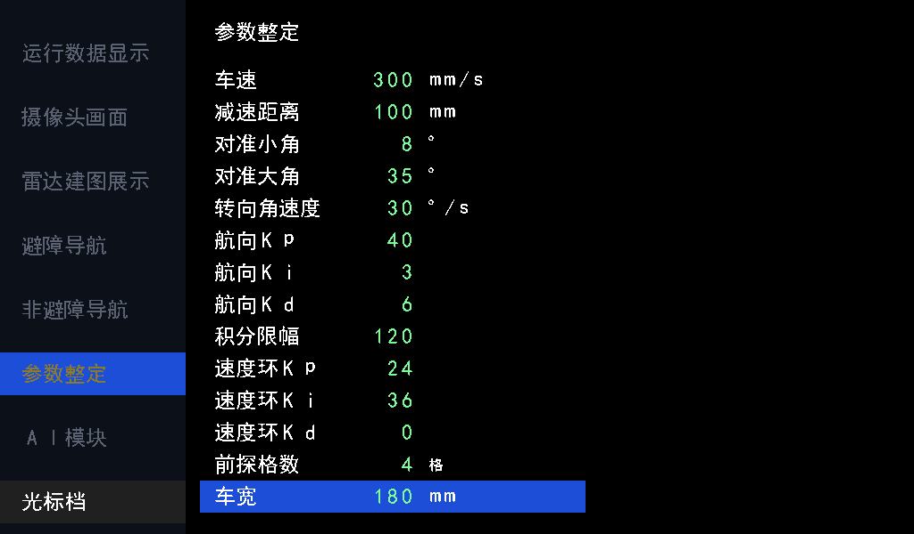
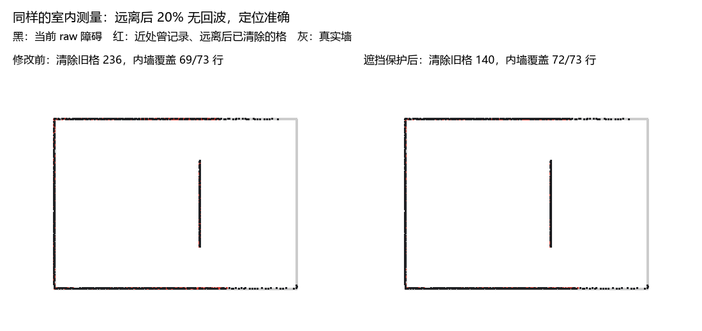
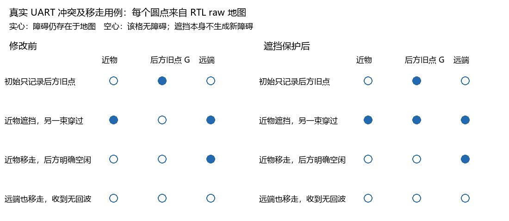

# 地图留存与前探_20261021-26

归档：2026-11-09；来源基线`dd62de7`。本册合并同主题历史报告，保留当时的数值、未完成项及验证边界。旧命令/路径按当时语境阅读；原始证据未搬动，来源路径和SHA见[目录映射](../目录映射.json)。现行操作从[文档首页](../../README.md)进入。

## 本册来源

- [雷达坐标翻转修复验证_20261021.md](#report-01)
- [前探配置运行时化验证_20261025.md](#report-02)
- [地图清理与历史障碍留存分析_20261026.md](#report-03)
- [遮挡保护地图清理验证_20261026.md](#report-04)

---

<a id="report-01"></a>

来源：`doc/雷达坐标翻转修复验证_20261021.md`；原始正文见`git show dd62de7:doc/雷达坐标翻转修复验证_20261021.md`。

<a id="report-01--雷达坐标翻转修复与验证2026-10-21"></a>
## 雷达坐标翻转修复与验证（2026-10-21）

<a id="report-01--问题与修改"></a>
### 问题与修改

实车在复位静止时，前半平面障碍被转到后半平面，再叠加车辆位置。原 `nav_polar` 的 RTL 数学结果正确，但当前高云综合将“乘积按角度条件取负”合并为 DSP 固定减法：`n142_s.ADD_SUB_0=1` 且 `DYN_ADD_SUB_0=FALSE`，角度分支却接到 `CSEL`，而 C 本身为零，无法改变乘积正负。

生产代码只修改 `vendor/verilog-reusable-modules/modules/auto_navigation/rtl/nav_polar.v` 的初始向量：先选择有符号 18 位系数 `+39797/-39797`，再乘以正距离。没有修改接口、状态机、迭代次数、坐标约定、地图或显示逻辑。位移仍为 signed Q16 mm，世界角仍为 `yaw-雷达角`；±90° 外折叠时使用负系数。四轴精确值分支保留。

<a id="report-01--验证方法与结果"></a>
### 验证方法与结果

UART 测试从 `radar_rx` 发送 102 字节 M10 GPS 报文，不直接注入障碍格。链路覆盖串口、解析、随点位姿、坐标换算、逐格扫描、按圈地图整理、地图存储及双缓冲显示。

新增 `radar_coordinates_tb`：13 组四象限、轴旁、四轴、平移及非零 yaw 用例；验证端点 raw 存储和显示像素；再复位并回放已保存实物捕获的前 72 包（约 4.166 ms/包），独立 sin/cos 检查 2934 条合法射线，包含无回波。旧代码重新独立综合后在同台触发 11 个失败检查，实物回放仍检出 1464 条反向射线；修复后的独立综合网表全部通过，证明测试能检出原故障。

`nav_geometry_tb` 保留原 32801 个整数偏移的精确量化检查，新增 9730 条普通角度射线：距离 4000/10000 mm，5 个 yaw，角度每次步进 37 厘度，检查位移误差小于 1 mm。四个正轴有精确输出分支，不能用它们替代普通角度验证。

| 验证 | 检查数 | 周期 | 结果 |
| --- | --- | --- | --- |
| 完整应用 RTL | 31 台 / 2655 项 | 各台独立 | 全部通过 |
| 普通角度 / 量化 | 19 项，9730 射线 / 32801 偏移 | 224143 | 通过 |
| UART、地图及显示 | 34 项，13 控制包 + 72 实物包 | 17393233 | RTL 与独立综合网表均通过 |
| 其中实物回放 | 2934 射线 | 15097600 | 全部误差 <1 mm，无 UART / 解析 / 溢出错误 |
| 现有实际运动回归 | 10 项 / 22 轮规划 | 98000033 | 通过 |

UART 整台周期含复位、地图初始化和显示等待；单列实物回放周期不含之前 66000 拍初始化等待。新增测试采用 50 MHz，每个 UART 位为 109 拍，接近标称 460800 bit/s。原导航运行及非避障调试回归均保留。

独立综合网表保留原公开端口，`run_radar_gate.ps1` 仅替换 `nav_polar`，其余链路为实际 RTL，使用厂商 GW5A primitive 模型；不是完整整车门级或带 SDF 的时序仿真。实际整车 `falcons.vg` 已提取转换模块，通过同一 UART 链路 34 项自检和 72 包 / 2934 射线回放；额外 9730 组角度及朝向扫描全部通过，最大位移误差 0.350876 mm。其仿真外壳只还原该次综合后被裁剪/重命名的控制与数据端口，不修改计算逻辑；日志为 `logs/radar_chain/final_uart_gate.log`、`final_sweep_result.json`。不能只用独立综合作为整车行为证据。

<a id="report-01--综合与布局布线"></a>
### 综合与布局布线

完整构建于 22:31 完成，用时 1050.2 s（17m30s），其中 PnR 12m35s；实际整车网表复核已通过。对比基线为此前 21:24 的 `f85eb2b` 构建，不混入其他时序试验。93 个生产输入中仅 `nav_polar.v` 改变，完整指纹见 `logs/radar_chain/build_inputs.json`。

| 综合资源（整车） | 修复前 | 修复后 | 差值 |
| --- | --- | --- | --- |
| Logic | 36558 | 36753 | +195 |
| LUT | 29684 | 29882 | +198 |
| ALU | 6874 | 6871 | -3 |
| Register | 17256 | 17245 | -11 |
| BSRAM | 122 | 122 | 0 |
| MULTALU27X18 / MULT12X12 / MULT27X36 | 113 / 12 / 51 | 113 / 12 / 51 | 0 |

综合资源以 `impl/gwsynthesis/falcons_syn.rpt.html` 为依据；不把综合网表延迟当作布线后 Fmax。

| 布线后资源 | 修复前 | 修复后 | 差值 |
| --- | --- | --- | --- |
| Logic | 36915 | 37106 | +191 |
| LUT / ALU | 29666 / 7249 | 29864 / 7242 | +198 / -7 |
| Register | 17256 | 17245 | -11 |
| BSRAM | 143 | 143 | 0 |
| 物理 DSP | 221 | 221 | 0 |

| 主时钟 | 目标 | 修复前 Fmax | 修复后 Fmax | 同域 setup 违例 |
| --- | --- | --- | --- | --- |
| i_clk_50m | 50 MHz | 50.018 MHz | **47.167 MHz** | 0 → **241** |
| clk_pixel | 49 MHz | 49.106 MHz | **46.768 MHz** | 0 → **13** |

**功能修复通过，但本次布线没有满足 50/49 MHz 约束，不能作为时序已通过的版本。** 两域 hold 仍为 0。全设计 setup 58→312、hold 18→18，除新增的系统/像素同域违例外，原 DDR 相关时钟问题仍在；没有改动时钟约束或将路径设成例外。

系统最差 setup 为 -1.201 ns：`u_reset_sync/key_stable_s0/Q` → `u_radar_navigation/u_adapter/u_navigation/u_nav/u_route/done_s1/CE`。另有遥控量到避障准心、准心到厘米显示换算的负余量路径。本次重新映射/布局布线后，整车原本很薄的时序余量未能保持；最差列出项不是 CORDIC 初始向量乘法，不能将全局 Fmax 变化简单等同于该乘法增加的延迟。本轮不扩展修改复位、UI 或其他模块，后续时序优化应依据本次新报告排序。

新资源依据 `impl/pnr/falcons.rpt.txt`，新 Fmax / 违例依据 **22:31 生成的** `impl/pnr/falcons_tr_content.html`。报告直到构建结束才全部刷新，不复用构建中残留的 21:24 时序 HTML。旧报告保存在 `logs/radar_chain/before/`，新摘要为 `logs/radar_chain/final_build_result.json`。

位流 `impl/pnr/falcons.fs` 为 38792615 字节，SHA256：`34DF1DFA3B9C02B3FCDF48F26CBBCA88D66446F7AFE29AF289CC6D7E1B9C76B6`。测试过的实际整车转换模块与最终 `falcons.vg` 对应模块逐字一致，93 个生产输入在构建前后无变化。本轮未烧录，尚无修复后的实车验证。


<a id="report-01--复核命令"></a>
### 复核命令

在仓库根目录执行：

```powershell
powershell -NoProfile -ExecutionPolicy Bypass -File sim/run_sim.ps1 -ModelSim D:/apps/modelsim/win64
& D:/Apps/Gowin/Gowin_V1.9.12.03_x64/IDE/bin/gw_sh.exe sim/build_radar_polar.tcl
powershell -NoProfile -ExecutionPolicy Bypass -File sim/run_radar_gate.ps1 -Netlist logs/radar_polar_gate/impl/gwsynthesis/nav_polar_gate.vg
powershell -NoProfile -ExecutionPolicy Bypass -File tools/build.ps1 -Tcl build.tcl -GowinSh D:/Apps/Gowin/Gowin_V1.9.12.03_x64/IDE/bin/gw_sh.exe
```

定向 RTL 检查可加 `-Only radar_coordinates,nav_geometry,radar_map,nav_scan_accumulator`。完整日志位于 `logs/radar_chain/full_regression.log`、`logs/radar_chain/full_build.log` 和 `logs/radar_polar_gate/uart_gate.log`，临时网表与库不提交。

本轮代码、测试与文档合为一个中文提交，提交编号以本文件所在提交为准；提交前再次拉取。不包含两个 RC 示例脚本的原有行尾改动。不自动推送，不下载 SRAM 或 Flash，板上仍需另行更新并实测确认。

提交前拉取并合并队友 `f21f30b` 的 IMU 排线文档更新，保留双方排查与构建记录；该更新仅改文档，恢复本轮修改后 93 个生产输入仍与已验证构建逐项一致，因此不重复运行不受影响的布线。合并及本轮修复合为同一次提交。


<a id="report-01--后续硬件操作记录"></a>
### 后续硬件操作记录

2026-10-21，用户先要求下载 SRAM，成功返回 User Code `0x00008C99`、Status `0x00026230`；随后明确要求固化。Flash ID `0xC22018`，执行 `exFlash Erase,Program,Verify Arora V`，结束地址 `0x049E000`，耗时 142.36 秒，工具返回 `Program and Verify Flash successfully.`，退出码 0。操作使用上述 `11114a2` 位流，SHA256 与 SRAM 下载时完全相同，未重新构建。

该操作覆盖此前 Flash 版本；仍未确认断电重启实测，也不代表时序或实车功能验证通过。日志为 `logs/radar_chain/flash_detect.log`、`flash_program.log`、`flash_program_result.json`。上文本轮“未下载”的描述是修复提交时的快照，此后状态以本节为准。

---

<a id="report-02"></a>

来源：`doc/前探配置运行时化验证_20261025.md`；原始正文见`git show dd62de7:doc/前探配置运行时化验证_20261025.md`。

<a id="report-02--前探配置运行时化验证2026-10-25"></a>
## 前探配置运行时化验证（2026-10-25）

基线：`5683bfa`。本次修改不重新综合、布局布线或烧录，先交付配置页渲染图及 RTL 仿真结果；此前资源和 Fmax 报告不代表本次修改后的结果。

<a id="report-02--行为及接口"></a>
### 行为及接口

删除 `LATERAL_MARGIN_MM` 和 `FRONT_OFFSET_MM`，不保留旧参数或兼容入口。前探从定位中心点开始，沿当前路线八方向检查原始障碍；检查矩形总宽度直接取车宽。与矩形相交或相切的障碍格均检查，边界规则不变。规划膨胀、分段锁定、路线更新和控制器握手不变。

`FORWARD_CHECK_CELLS` 和 `VEHICLE_WIDTH_MM` 不再是 parameter，正式接口改为：

| 输入 | 位宽 | UI 默认 | UI 范围 | 步长 |
| --- | --- | --- | --- | --- |
| `forward_check_cells` | 8 | 4 格，即 200 mm | 1..16 格 | 1 格 |
| `vehicle_width_mm` | 16 | 180 mm | 50..500 mm | 10 mm |

整车 `tune_ctrl` 新增索引 12、13，不调整原有十二项的编号。两项逐层连接到 `nav_drive`，每次扫描开始锁存位置、方向和配置，扫描中调整只影响下一次扫描。框架负责提供约定范围内的输入，不新增内部限幅。复位后 UI 恢复默认值，配置不写入 Flash。`PLAN_INFLATE_CELLS=4` 仍是独立编译参数，车宽改变不自动改变规划膨胀。

默认沿 +x 时检查 x=当前位置..当前位置+200 mm、y=当前位置±90 mm。斜向继续检查旋转后的矩形，使用 Q16 常数投影；配置锁存、尺寸计算、投影乘法和边界计算分拍，运行时没有开方或除法。

<a id="report-02--显示"></a>
### 显示

配置页保持原位置与 36 像素行距，新增两行后共 14 行，最后一行位于 y=540..575，仍在 600 像素屏幕内。14×5=70 个数值字符超出原来的 6 位地址，所以数值生成、读写地址和渲染描述符同步扩展为 7 位，字符 RAM 深度为 128。新增汉字由原字体生成工具统一重建，没有私有字库。



预览由 `tools/preview_tune_page.py` 读取实际 RTL 字库并按当前布局绘制，选中车宽，默认显示 180 mm。不是上板拍摄图。标签、数值、单位、高亮另经 RTL 像素自检验证；预览工具同步修正数字和单位的 16 像素列坐标。

<a id="report-02--验证结果"></a>
### 验证结果

执行 `powershell -NoProfile -ExecutionPolicy Bypass -File sim/run_sim.ps1 -ModelSim D:/apps/modelsim/win64`，**51 台 / 9012 项全部通过**。基线为 8958 项，本次增加 54 项。日志 `logs/front_config_regression.log`。

| 项目 | 检查数 | 周期或结果 |
| --- | --- | --- |
| `nav_drive` | 60 | 1772572 拍；最大单次扫描 3198 拍，即 63.96 μs @50 MHz |
| `tune_ctrl` | 82 | 默认、14 项选行回绕、范围钳位、步长 10 mm、恢复默认、手动禁调及既有功能通过 |
| `tune_page` | 65 | 14 行标签/数值、新增单位、末行高亮、页面互斥通过 |
| `num_text` | 112 | 新字段地址 64..69 正确，不回绕覆盖旧字段 |
| `ui_pipeline` | 6 | 连续扫描 4896384 拍；原五页指纹完全不变，参数页按新增两行更新指纹 |
| `obstacle_motion` | 10 | 98000033 拍；196 个运动节拍、22 轮规划，连续到点和转弯通过 |

前探覆盖八方向空闲/前方/侧方/后方、中心点附近、前探终点、2→4 格调整、100/180/300 mm 车宽变化、扫描中修改配置、16 格/500 mm 上限及地图边界。上限在八方向均未触发 1 ms 扫描超时。延迟统计来自带读口背压和响应延迟的测试台，不等同于实车停车距离或时序报告。

整车顶层独立展开 93 个 RTL 文件通过，0 error / 0 warning；摄像头和 HDMI 使用端口桩，仅证明应用接口连接，不能替代整套 IP 综合或硬件验证。日志 `logs/front_config_top_elaboration.log` 和 `logs/top_compile.log`。

提交前执行 `git pull --no-rebase origin main`，返回 Already up to date，无冲突。提交只包含本次 RTL、文档、预览与测试，保留无关本地文件。本次提交号由 Git 历史及交付回复记录，不把尚未生成的自身哈希写回版本内文档。

---

<a id="report-03"></a>

来源：`doc/地图清理与历史障碍留存分析_20261026.md`；原始正文见`git show dd62de7:doc/地图清理与历史障碍留存分析_20261026.md`。

<a id="report-03--地图清理与历史障碍留存分析"></a>
## 地图清理与历史障碍留存分析

分析基线：`437b48d11365fd9943988fa33efa72856560578c`。本次只新增仿真、取证工具和本文，没有修改生产 RTL、接口或位流。

本文保留修改前的分析结果。随后按用户选择实现了命中后方的遮挡保护，现行规则和对比结果见 [遮挡保护验证](#report-04)。

<a id="report-03--结论"></a>
### 结论

目前没有复现“旧清空请求删除当前圈已经命中的新障碍”的跨圈竞争；复现了“旧障碍因为后续射线经过、该圈没有重新命中而被清掉”。后者是当前清图规则本身的结果。

一圈内命中优先，并不等于静态障碍永久保存。现在的地图是动态占用图：一个格子即使已连续命中很多圈，下一圈只要出现一次穿过且整圈没有命中，就具备被清除的条件。它没有长期可信度，也没有连续多圈确认清空的门槛。

实车所述“远离或转弯后旧点留存不下来”可以由这个规则叠加无回波、格子内部分空间可通行、定位误差造成。尚未采集故障时雷达和位姿的同步记录，因此不能认定实车唯一根因。

<a id="report-03--当前过程"></a>
### 当前过程

1. `nav_radar_adapter` 在每个距离低字节接收时锁存位姿，位姿随点排队，出队不使用更新后的当前位置。
2. `nav_polar` 将测量变为世界射线。距离 `1..9999 mm` 为命中；`0/10000` 为无回波并生成 10 m 射线；`FFFF` 等超量程数据不生成射线。
3. `nav_scanner` 逐格经过射线，端点格有真实命中才写 hit，其余经过格写 free。图外停止。它不会根据“本圈没有看见某格”直接清图。
4. `nav_scan_accumulator` 保存本圈的 hit/free 位。多条射线经过同格只是把同一个 free 位反复置 1；它不保存经过次数，也不保存命中置信度。
5. 换圈后扫描上一圈的位图。清空条件为：上一圈 free=1、上一圈 hit=0、当前圈已接收的 hit=0。新命中写优先于旧清空写。
6. `nav_map` 实际执行 raw 清空，随后重算受影响膨胀格。清理临时 hit/free 位图本身不会清 raw。

对应代码：

- [整圈累计与清空条件](../../../vendor/verilog-reusable-modules/modules/auto_navigation/rtl/nav_scan_accumulator.v)：43–46、112–129 行。
- [无回波距离处理](../../../vendor/verilog-reusable-modules/modules/auto_navigation/rtl/nav_polar.v)：96–97、131–135、205–206 行。
- [射线经过格与端点](../../../vendor/verilog-reusable-modules/modules/auto_navigation/rtl/nav_scanner.v)：148–168 行。
- [原始地图实际写入](../../../vendor/verilog-reusable-modules/modules/auto_navigation/rtl/nav_map.v)：83–92、145–156 行。

<a id="report-03--用三圈说明"></a>
#### 用三圈说明

| 圈 | 同一格的观测 | raw 结果 |
| --- | --- | --- |
| A | 至少一次 hit，其他射线也可能经过 | 立即为障碍；该圈 free 不能删它 |
| B | 没有 hit，但至少一条 free 射线穿过 | 圈内仍保留；B 完成后形成清空请求 |
| C | 开始处理 B 的清空请求 | 若 C 尚无该格新命中，则清空 |

如果 C 的新命中先于清空到达，会拦截旧清空。如果 C 的命中稍后才到达，则可以出现“先清后恢复”；当前圈尚未收到的未来命中无法提前保护。

如果 B 没有任何射线经过该格，free=0，则不会清除。单纯时间经过、距离变远、超出量程或被遮挡都不是清空条件。

<a id="report-03--跨圈竞争检查"></a>
### 跨圈竞争检查

两组 hit/free 位图交替使用。旧组扫描完并清零后才允许下次复用；没有用一个短时期编号直接匹配 raw，也没有“时期编号回绕把新格当旧格”的删除路径。

当前 hit 从同步 RAM 读取会有延迟，但写命中时输出仲裁优先 hit；生产 `nav_map` 接收命中后至少经过 PROBE，在重新接受旧清空之前，累计器已读到新 hit。既有测试覆盖了地图背压期间旧清空等待、新 hit 抢占的情况。

新增实验对每个实际 raw=1→0 的清空记录：计算周期、清理圈号、格坐标、最近命中圈号、free 所在圈号、射线角度和距离。605 次实际清空中：

- 删除上一圈或当前圈命中的次数：0。
- 清空所用 free 圈号不等于“清理圈号−1”的次数：0。

这是本批测试的结论，不替代对所有可能时序的形式证明。

<a id="report-03--为什么远离转弯会放大问题"></a>
### 为什么远离、转弯会放大问题

<a id="report-03--无回波也会清整条-10-m-射线"></a>
#### 无回波也会清整条 10 m 射线

当前 RTL 把距离 0 作为自由空间证据。测量失效、反射弱或其他原因若也表现为 0，就可能把实际存在的障碍所在格登记为 free。FFFF 则直接跳过，本身不会清空旧格。

仓库采集文件 `m10_radar/sim/m10_capture.hex` 中有 719 个完整报文，合计 30198 槽。按现有解析规则计算，其中 5390 槽为距离 0；有效非零且小于 10 m 的槽为 23870。这个统计说明零距离经常出现，但不能证明这些零都属于误测。

<a id="report-03--多条射线并不等于多次清空但增加了-free-出现的机会"></a>
#### 多条射线并不等于多次清空，但增加了 free 出现的机会

free 在圈内是 OR，不是计数。因此 1 束和 100 束的清空强度完全一样。近处通常有更多命中落入同格，hit 优先能保护它；远处命中稀疏后，某一圈更容易只剩 free。

采集文件每包主要有 40/41 个非填充槽。以 40 槽、15°/包计算，角间距约 0.375°；横向点间距在 1 m 约 6.5 mm，在 4 m 约 26 mm，在 8 m 约 52 mm，已经接近或超过 50 mm 格长。斜墙、拐角和薄障碍更易受影响。

一个 50 mm 格中也可能只有一小部分是墙；射线穿过这个格的空白部分，在几何上不矛盾，但当前一位占用模型仍把它登记为 free。下一圈若缺少端点命中，同样能清掉旧格。

<a id="report-03--位姿偏差改变了射线的世界位置"></a>
#### 位姿偏差改变了射线的世界位置

同一面墙的旧命中记在旧位置；有偏差的新射线可能穿过旧位置，却在相邻格重新生成墙。当前规则就会清旧格、写新格。1° 朝向偏差在 4 m 处约产生 70 mm 横向误差，超过一格。

现有建图没有扫描匹配或全局定位修正；改善清图只能提高留存，不能使不准确的位姿自动恢复准确。

<a id="report-03--仿真与结果"></a>
### 仿真与结果

新增 [仿真平台](../../../sim/map_retention_tb.v) 和 [生成、运行及绘图工具](../../../tools/map_retention.py)。

链路为真实 460800/8N1 UART 位流 → 原 `m10_radar` → 原 `nav_polar` → 原 `nav_scanner` → 原 `nav_scan_accumulator` → 原 `nav_map`。换圈握手与生产 `auto_navigation/nav_top` 相同；地图使用原 256×256、50 mm/格、膨胀 4 格。

室内场地外墙为 10×7 m，内部有一面 3.6 m 墙。测量距离由真实位姿与墙线求交生成，再经过原解析和全部建图 RTL，不直接修改地图内存。

每种位姿发送两圈。位置在阶段之间改变，阶段内固定；包间等待下游完成，以隔离清图规则。这不是连续车辆动力学或持续满速输入吞吐测试。

| 对照 | 仿真结果 |
| --- | --- |
| 原障碍未再被射线经过，连续换圈 | 保留 |
| 同圈命中后又被更远射线经过 | 保留 |
| 下一圈只有距离 0 射线经过 | 结圈前保留；清理后消失 |
| 下一圈只有距离 2000 mm 的正常射线经过原 1000 mm 障碍格 | 旧格被清，新远端保留；不依赖距离 0 |
| 准确定位，从距内墙 1 m 移到 4 m | 107 个旧格被清，新增 288 格；内墙原位置仍覆盖 72/73 行 |
| 准确定位，原地转 90° | 与转弯前地图完全相同 |
| 同一真实场地，输入 x 偏 +80 mm、y 偏 −40 mm、yaw 偏 +1° | 原图清除 259 格，新位置新增 335 格；原内墙位置仅剩 9/73 行，墙不是全部消失而是发生错位 |
| 准确定位，远离后每第 5 个采样设为 0 | 原图清除 236 格，其中 127 次清空的记录来自 0 距离射线；内墙原位置覆盖由 72 降为 69 行 |

20% 无回波和上述位姿偏差均是明确设置的实验条件，不是实测误差标定。准确 90° 转弯前后射线角集合相同，是保留稳定性的对照；不能据此认为任意转弯过程都不会有误差。

本批新增实验合计 366 报文、15372 槽、13456 条有效射线、605 次 raw 实际清空，10 项自检通过。总计 50173125 个 50 MHz 周期，等效时钟时间 1.0034625 s；包含初始化与人为包间等待，不换算为整车实时吞吐指标。

必要回归 4 项全部通过，共 91 项检查：

| 回归 | 检查数 | 周期 |
| --- | ---: | ---: |
| nav_scan_accumulator | 18 | 262149；完整空圈扫描 196608 周期，即 3.93216 ms |
| nav_geometry | 19 | 224143，包含 9730 个角度/位姿样本 |
| radar_map | 20 | 2344736 |
| radar_coordinates | 34 | 17393233；包含 72 个真实采集报文回放 |

总计新增与回归 101 项检查通过。生产 RTL 未改，不需要重新综合、布局布线或下载。

复现命令：

```powershell
python tools/map_retention.py
./sim/run_sim.ps1 -ModelSim D:/apps/modelsim/win64 -Only nav_scan_accumulator,radar_map,nav_geometry,radar_coordinates
```

原始产物目录：`logs/map_retention_20261026/`。

- `transcript.log`：自检、阶段快照和周期。
- `input.txt`、`snapshots.json`：全部 UART 输入与阶段定义。
- `clear_events.csv`：逐次实际清空的原因证据。
- `summary.json`：旧格删除、新格生成、原墙位置覆盖统计。
- `map_retention.png`：从 RTL raw 内存导出的对照图；不是示意占用图。
- 必要回归汇总：`logs/map_retention_regression_20261026.log`。

<a id="report-03--建议优先级"></a>
### 建议优先级

1. **先收紧清空证据。** 对已存在障碍的删除增加跨圈确认，命中则立即恢复保护。按“不同的完整圈”累计，不能按射线条数累计，否则同圈多束又会迅速清空。连续 2–3 圈可作为演示版本的起点，但会延迟移动障碍消失后的清除，参数需结合实际圈频。
2. **限制远处清图。** 若主要目标是保留走过的室内静态地图，可只在车附近清历史障碍，远处允许加障碍、保留旧障碍。示例近区 0.5–1 m，必须覆盖实际前探区。这样仍能演示近处障碍移开后恢复通行，代价是远处临时障碍和定位形成的旧痕迹也会保留，待靠近或用户清图。
3. **单独约束零距离的删除能力。** 不宜把一次 0 距离作为整条 10 m 的强删除证据。可让零距离只参与近区、多圈确认；正常的更远有效回波仍可作为清空证据。直接忽略全部 0 最简单，但空旷方向没有更远回波时，消失障碍会难以清除，应先明确这个取舍。
4. **检查实车定位和转弯采样。** 固定墙面，分别静止、直走、原地转弯，观察同一墙在世界地图中是否位移。采集同期雷达与位姿，才能区分无回波误清、测距变化和位姿误差。若主要是错位，延迟清理只能减缓现象，不能替代定位或扫描配准。

演示项目可优先采用“近区允许清理、远区保留历史”，再按实测决定是否加入跨圈确认。不建议为了本问题立即增加另一套全局地图或完整 SLAM。

---

<a id="report-04"></a>

来源：`doc/遮挡保护地图清理验证_20261026.md`；原始正文见`git show dd62de7:doc/遮挡保护地图清理验证_20261026.md`。

<a id="report-04--遮挡保护地图清理验证"></a>
## 遮挡保护地图清理验证

<a id="report-04--实现范围"></a>
### 实现范围

修改前基线为 `437b48d11365fd9943988fa33efa72856560578c` 的工作树生产 RTL；完整基线哈希见 `logs/map_shadow_20261026/baseline/sources.json`。问题分析见 [原报告](#report-03)。本次实现与说明、测试在同一个提交中交付，未增加旧方案开关。

命中后方也反对清空：

```text
采样位置 ── free ── 真实命中 ── shadow ── 10 m / 地图边界
                        │          │
                    立即写 raw   只置保护位，不写 raw
```

原 `hit0/hit1` 两张一位图同时记录真实命中与命中后的遮挡保护，原 `free0/free1` 不变。仍为两组保护/经过记录，共 262144 bit，即 32 KiB；raw/cost 地图、规划存储与外部交付接口不变。

同圈只要有一条射线命中本格，或命中更近物体后沿原方向经过本格，就禁止清空该格。命中前的射线仍登记 free。无回波没有遮挡物，继续登记 10 m 内 free；FFFF 等非法槽仍不生成射线。保护范围不扩大为扇形，也不使用规划膨胀图。

上一圈有 free、没有任何保护，且当前圈尚无保护时才清空。新命中仍立即生效；若当前圈的反对证据在清空已经完成之后才到达，遮挡保护本身不恢复 raw 旧点，不伪造新障碍。下一圈没有任何射线经过的格子继续保持。

近物消失后，只要后方在完整一圈内被明确测为空闲且没有其他反对，仍会清除。持续遮挡则继续保留，属于本次选择的保守规则；它不能修复持续定位偏差或所有射线一致漏测。

<a id="report-04--rtl-和时序组织"></a>
### RTL 和时序组织

生产修改仅限 `auto_navigation` 内部五个文件：

| 文件 | 修改 |
| --- | --- |
| nav_polar.v | 输出已有锁存有效距离的低 14 位，不增加距离寄存器 |
| auto_navigation.v / nav_top.v | 内部传递距离及遮挡标志；外部 radar_navigation 接口不变 |
| nav_scanner.v | 命中后继续 DDA 遍历，增加不写 raw 的遮挡事件，10 m / 图外截止 |
| nav_scan_accumulator.v | 遮挡复用 hit RAM，观测空隙中提交后台清空 |

扫描器内部 `wr_val=1` 为真实命中，`wr_shadow=1` 为命中后方；两者互斥。累计器只把 `wr_val=1` 直接送至 raw 写口，遮挡不占用 raw/cost 更新事务。

10 m 截止没有运行时除法或开方。对测距 `r`、原射线 Q16 分量 `dx`，到下一 x 格界的距离为 `g`，判断格界是否在量程内使用：

```text
g × r × 65536 ≤ abs(dx) × 10000
```

沿 y 同理。每推进一格减去 `CELL_MM × r × 65536`，保留当前射线方向；恰到量程格界时允许登记沿射线进入的那个接触格，绝不写成实际障碍。

各级安排：

- IDLE：锁存输入及距离，原坐标换算保留。
- GAPS：求第一格界距离，同时并行计算常数乘积与每格预算。
- PRODUCTS：并行计算 DDA 格界乘积、距离预算乘积。
- START：分别寄存 DDA 误差和 10 m 剩余预算，乘法之后有寄存器隔离。
- CHECK：寄存本格坐标和 free/hit/shadow 属性。
- SEND：握手后逐轴并行更新坐标、误差和预算；背压保持整个事件。

新增剩余预算使用 44 位有符号量；方向判断、x/y 更新不互相串接，不把常数乘、相减和输出握手闭合成一条组合链。

清空调度新增一个 6 位饱和空闲计数器：连续 64 拍没有观测事务才允许提交旧清空，50 MHz 下为 1.28 µs。这样避免在一串点尚在处理时反复启动较长的膨胀重算，并覆盖遮挡位写入后的同步 RAM 旧读值。计数器只影响提交时机，不影响清空条件；没有新增 FIFO 或地图 RAM。

<a id="report-04--同场景对比"></a>
### 同场景对比

基线与新版发送的每个 UART 报文、距离及采样位姿逐条核对相同；只对遮挡冲突结果使用不同的自检期望。场地及此前的近墙、远离、90° 转弯、定位误差、无回波假设不变；新增近物移走的完整过程。每阶段使用两圈，默认实验在包间等待结算，以隔离地图规则。

| 场景 | 修改前 | 修改后 |
| --- | ---: | ---: |
| 近处准确定位，内墙覆盖行 | 72/73 | 72/73 |
| 准确定位远离，删除旧格 | 107 | 105 |
| 准确定位原地转 90°，额外删除旧格 | 0 | 0 |
| 位置偏 +80/−40 mm、朝向偏 +1°，删除旧格 | 259 | 256 |
| 远离后 20% 无回波，删除旧格 | 236 | 140 |
| 同上，原内墙位置覆盖行 | 69/73 | 72/73 |
| 全部场景实际 raw 清空次数 | 608 | 507 |
| 用旧请求删除当前圈/上一圈保护的次数 | 0 | 0 |

无回波场景旧格删除减少约 40.7%。这是固定输入下的留存对比，不代表所有减少的删除都属于正确保留。位置偏差场景依然明显错位，不能靠遮挡保护解决。



<a id="report-04--遮挡与障碍移走"></a>
#### 遮挡与障碍移走

两束射线在同一个 50 mm 行内：一束在近处命中，另一束从略有差异的位置经过同格，命中更远处。

| 阶段 | 修改前后方旧格 G | 修改后后方旧格 G |
| --- | --- | --- |
| 初始发现 G | 保留 | 保留 |
| 近物挡住 G，同时另一束认为 G 空闲 | 删除 | 保留 |
| 近物移走，完整一圈明确经过 G 且无反对 | 无障碍 | 清除 |
| 更远的障碍也移走，收到无回波 | 远端清除 | 远端清除 |

同时检查保护经过的中间空格 raw 保持 0，排除把遮挡写成假障碍。用例中的换圈辅助射线另有侧向命中，因此最后检查的是主轴近物/G/远端三个格清除，不要求整张地图全为 0。



<a id="report-04--自检周期与连续输入"></a>
### 自检、周期与连续输入

ModelSim 10.6d，50 MHz。最终批量回归 `logs/map_shadow_full_final.log`：53 个测试台、9088 项检查全部通过。新增/扩展内容：

- `nav_scanner`：18 项，覆盖八方向、任意角度、起点格界、地图边缘、1 mm 命中、10 m 截止、无回波及背压；逐格与独立浮点求交参考核对。7235 周期，17 条射线，观测到的单射线最大 579 周期，含测试背压，约 11.58 µs，不是所有输入的最坏周期上界。
- `nav_scan_accumulator`：27 项，覆盖 free/保护两种顺序、保护不生成 raw、保护移走后清理、旧清空与新遮挡竞争、连续观测延后清空及空隙后恢复。总计 262149 周期，含并行完整地图测试；初始化 65536 拍，空圈扫描仍为 196608 拍，即 3.93216 ms。
- 真实 UART 地图对比：383 个报文、16086 槽、13465 条有效射线，18 项自检全部通过；新增保护事件 1063165 次，无保护误删。修改前 53545503 周期，新版 55257509 周期，增加约 3.20%。此时间包含初始化、地图重算与包间等待，不是车辆运动耗时。
- 连续 UART：同样 383 报文，不插入包间结算等待，18 项自检全部通过；16086 槽完整接收，UART/报文/溢出错误均为 0，总计 44858289 周期。修改前同样压力输入会丢 2 包；空闲提交调度使新版此场景不丢包。压力场景包含位姿突然偏移，结果仅对本批输入成立。

既有真实采集回放、显示、UI、多目标控制、动态规划、近障停车及障碍清除恢复等回归继续通过。总计最终批量 9088 项加两组 UART 各 18 项，合计 9124 项检查；修改前对照的 18 项另计。

<a id="report-04--ram-与资源"></a>
### RAM 与资源

使用 Gowin V1.9.12.03 对同型号 GW5AT-138B 做默认参数的独立模块综合。依据各自 `*_syn_resource.html`，列的是综合报告字段，不是整车布局布线资源：

| 模块 | FF 修改前→后 | ALU 修改前→后 | LUT 修改前→后 | DSP 字段修改前→后 | BSRAM 修改前→后 |
| --- | ---: | ---: | ---: | ---: | ---: |
| nav_scan_accumulator | 54→60 | 8→8 | 266→276 | 0→0 | 16→16 |
| nav_scanner | 382→454 | 322→376 | 399→461 | 8→13 | 0→0 |

raw/cost 与规划 RAM 的 RTL 字节不变；本次没有新增地图存储。扫描器用少量寄存器和运算资源保存量程预算。

本次没有完成新的整车布局布线，不给出新 Fmax 或全工程时序收敛结论。已下载的位流仍为修改前版本；本次未进行下载。

<a id="report-04--复现及产物"></a>
### 复现及产物

```powershell
# 最终全量回归
./sim/run_sim.ps1 -ModelSim D:/apps/modelsim/win64

# 同输入地图效果及对照图（before 是保存的基线产物）
python tools/map_retention.py --out logs/map_shadow_20261026/after --compare logs/map_shadow_20261026/before

# 连续 UART 输入
python tools/map_retention.py --out logs/map_shadow_20261026/continuous_scheduled --continuous
```

`--baseline --rtl-root <保存源码目录>` 仅供仿真对照使用，不保留生产 RTL 旧实现或兼容参数。基线源码只位于忽略的 logs 目录，不随交付模块提交。

详细产物位于 `logs/map_shadow_20261026/`：before/after 的输入、快照、逐次清空日志、summary/comparison JSON、连续输入日志，以及 synthesis/before、synthesis/after 的独立综合报告。对照 PNG 同步保存在 `doc/img/`，不依赖临时基线源码即可查看。

<a id="report-04--迁入最新-ai-分支的复核2026-10-29"></a>
### 迁入最新 AI 分支的复核（2026-10-29）

按用户指定顺序，先在 `codex/ai-visual-inspection` 的 `233c0f2` 上完成短段锁定和运行时规划窗口，提交为 `7a8f336`；随后只迁移原遮挡保护提交 `deb9e81`，不迁移 `a45eab0` 的任意角度规划参考。

本次两处文本冲突均经用户决定：测试清单保留 AI 分支已有测试及 `nav_lock_tb`，加入 `nav_scanner_tb`；自检说明保留 AI 分支总说明，追加遮挡保护说明。RTL 自动合并，保留最新 AI 图层/地图读仲裁和本次短段锁定、UI 参数。新增的两个导航测试台显式连接观测距离输入，未增加生产接口或旧方案兼容。

迁移后完整入口 `sim/run_sim.ps1` **81 台 / 10641 项通过**，日志 `logs/short_lock_shadow_final.log`、结果 `logs/short_lock_shadow_results.json`。其中 `nav_lock` 12 项 / 2245363 拍，`nav_route` 42 项 / 378 拍；最远目标查找实测最长 24 拍，原实时时间运动闭环继续通过。AI 视觉图层、地图仲裁、UI、巡检控制等沿完整入口回归。

另运行 `python tools/map_retention.py --out logs/short_lock_shadow_migration/continuous --continuous`：18 项通过，44858289 拍，383 包 / 16086 槽 / 13465 条有效射线，保护输出 1063165 次、实际清除 507 次、受保护格误清 0、errors=0，收到槽数完整。周期及统计与原遮挡保护实现相同；这不是所有输入的吞吐上界或实车定位证明。

本次迁移未重新综合、布局布线或烧录，上文旧资源/时序数据只对应原实现，不能作为本次组合版本结论。两次提交前均拉取对应远端分支，当前迁移提交的 ID 以 Git 历史为准。
