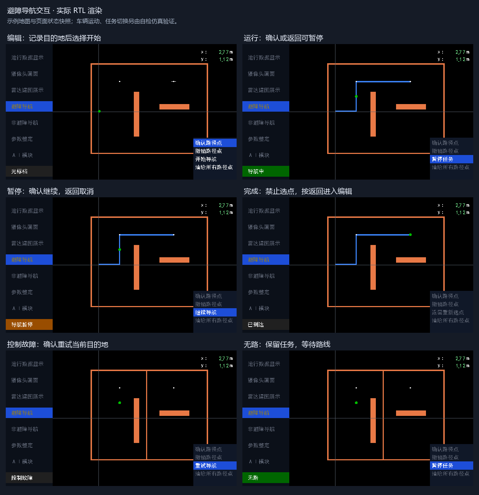

# 导航接入与交互验证_20261021-25

归档：2026-11-09；来源基线`dd62de7`。本册合并同主题历史报告，保留当时的数值、未完成项及验证边界。旧命令/路径按当时语境阅读；原始证据未搬动，来源路径和SHA见[目录映射](../目录映射.json)。现行操作从[文档首页](../../README.md)进入。

## 本册来源

- [自动导航接入验证.md](#report-01)
- [避障导航UI交互审查与状态规范_20261025.md](#report-02)
- [避障导航UI交互重构验证_20261025.md](#report-03)

---

<a id="report-01"></a>

来源：`doc/自动导航接入验证.md`；原始正文见`git show dd62de7:doc/自动导航接入验证.md`。

<a id="report-01--自动导航整车接入验证"></a>
## 自动导航整车接入验证

> 历史验证：正文对应当轮输入和下载，算法/接口后续状态见[现行接入](../../导航控制方案.md#三个任务入口共用底盘)，最近整车构建见[巡检验证](../../AI巡检验证记录.md)。

本轮按用户要求分步提交，只记录实际执行的验证，不把仿真当作实车结果。既有 RC 示例脚本本地修改保留，不纳入导航提交。

<a id="report-01--第一步雷达与公共位姿"></a>
### 第一步：雷达与公共位姿

- 已启用三个导航 / 雷达依赖，C14 接导航内部 M10 接收器；暂不授权规划和运动。
- `nav_pose` 在 odom 更新后一拍成组采集 x/y/yaw，+180° 转为 -180°；坐标清零同步清导航，运行中不受理清零。
- UART 实包自检：10/10，588746 周期（50 MHz 下 11.77492 ms），四个朝向、历史保留、位置有效与清零通过。
- 应用回归：20/20 通过，含原有 19 台及新雷达建图台；`logs/step1_regression.log`。
- 应用顶层展开：76 个 RTL 通过；摄像头 / HDMI 使用同端口替身，因旧 ModelSim 不能读取现有 DDR 加密 IP。此检查只证明应用连线，完整生产顶层留到最终 Gowin 构建。
- 复核命令：`powershell -NoProfile -ExecutionPolicy Bypass -File sim/run_sim.ps1 -ModelSim D:/apps/modelsim/win64`；单项可加 `-Only radar_map`。
- 提交：`d583c94`。

<a id="report-01--第二步新增避障选点原非避障调试保留"></a>
### 第二步：新增避障选点，原非避障调试保留

- 原 `nav_free_ctrl`、`nav_ctrl`、非避障单测及联合测试按第一步版本原样保留，不改变 L1/L2 调试行为。
- 新增 `nav_obstacle_ui`，复用准心及点表，四项辅助菜单与目的地索引仅属于避障页。原六页编号保留，显示公共数据按当前页选择。
- 避障规划可预先运行，运动仍未授权。原非避障页面仍可按原流程调试。
- 原第二步合并入口的提交已按用户要求撤销，本步验证通过后一次重新提交，不补冗余修正提交。

- 验证：22/22 应用自检通过（`logs/step2_preserved_regression.log`）；原非避障选点 84 项、原控制器 119 项、原联合台 79 项均通过。
- 新避障选点 20 项 / 112197 周期，UI→BFS 预规划 5 项 / 131153 周期通过；应用顶层端口展开 77 个 RTL 通过。
- 与第一步逐字节比对 `nav_free_ctrl.v`、`nav_ctrl.v` 及原非避障测试无差异。仅自动避障运行中屏蔽坐标清零，非避障调试清零行为保持原样。

- 第二步提交：`8f70544`（替代已撤销的入口合并提交）。

<a id="report-01--第三步避障目标点执行与停车握手"></a>
### 第三步：避障目标点执行与停车握手

- 新增 `nav_point_ctrl`，原 `nav_ctrl` 未修改。复用原投影、CORDIC、航向 PID 与减速算法，正常完成保持电平；目标动态更新，直行阶段包含减速余量；急停取消在途计算并重新确认本次停稳。
- 停稳仍用控制器现有轮速 / IMU 判据，不在导航框架增加第二套检测。新执行器单点超时默认为 300 s，适应地图范围内低速演示；其余控制参数沿用参数整定页。
- 已接导航运动授权及控制反馈，实际刹车使用底盘现有 i_estop；普通导航停车不写入全局 S4 锁存。
- 底盘自动指令做两路选择，手动仍由 run_en 解锁；避免自动停车输出使手动解锁被旁路。
- 新执行器自检 17/17、4034 周期，覆盖启动停车、转向再直行、目标延长 / 缩短、正常保持完成、旧完成遇新急停、计算途中抢占、减速阶段和堵转。
- 全应用 23/23 通过（`logs/step3_regression.log`），顶层应用端口展开 78 个 RTL 通过；原非避障 UI / 控制器逐字节保持。

- 第三步提交：`1d7b3eb`。

<a id="report-01--第四步显示双缓冲与完整运动闭环"></a>
### 第四步：显示双缓冲与完整运动闭环

- 新增 `nav_map_view`，地图 / 路线独立双缓冲，完整帧收到后仅在像素帧边界切换。地图逐格覆盖 0/1；路线接收一份航点表，清后台并顺序画完整线段，忙时跳过新帧，不反压导航。
- 雷达页及避障页显示实际障碍和规划路线；暂不显示原始点云。保留原世界坐标、准心、目的地点和车辆标记，补已到达 / 无路状态。非避障页不叠加地图 / 路线。
- 新运动联合台连真实避障 UI、BFS、执行器及理想差速车辆模型。50 MHz 下 500000 周期代表 10 ms，车辆 / 定位在规划期间持续推进；1 m/s 仅为仿真配置，底盘瞬时制动、停稳观察 2 周期，不据此宣称实车安全。
- 联合台 10/10：两目的地含一次转弯、暂停 / 恢复、近处实际障碍停车、明确空闲观测后重新起步及最终停车。总计 93000033 周期（1.86000066 s），186 次车辆更新、20 轮规划；无冻结车辆等待 BFS。雷达包和坐标转换由实包测试单独验证。
- 显示台 17/17、327846 周期（6.55692 ms）通过，含中断帧后新 start 覆盖、零位清旧障碍、独立空路线、完整横纵段与帧边界交换。
- 全应用 25/25 通过（`logs/step4_regression.log`）；随后补的图层优先级 / 页面隔离检查 4/4 通过，渲染台共 50 项（`logs/step4_layers.log`）。全套当前合计 2269 项。
- 顶层应用端口展开 79 个 RTL 通过；引脚检查 117 路无重复，手册比对通过；原非避障 UI / 控制器 / 对应测试仍与第一步逐字节一致。完整摄像头加密 IP 留给下一步 Gowin 生产构建。

<a id="report-01--整车接手操作"></a>
#### 整车接手操作

1. 雷达串口接 C14（J3.3），定位沿用编码器和 IMU；完成开机标定后开始建图。默认 25.6 m 正方形地图，初始化位置为中心，+x 向初始车头，+y 向左，yaw 逆时针；位置 mm、yaw 0.01°。
2. 光标档进入“避障导航”，满杆控制准心 500 mm/s，确认路径点加入列表，最多 16 点；辅助菜单选择“开始导航”。目标换算为 100 mm 格，显示原毫米点与实际格中心每轴最多相差约 50 mm（约 3 px）。
3. 启动先停车握手，再执行 BFS 输出目标。控制器自行转向再直行；共线目标可动态延长，内部规划分段仍由导航锁定。每个用户目的地到达后自动提交下一点，最终显示已到达并停车；无路不跳过该点。
4. 运行中确认或返回键暂停；S1、遥控失效 / S4 也撤销自动运动。暂停保留地图和目标，确认后恢复；手动接管不清图，切回光标仍保持暂停，须确认恢复。暂停再返回取消任务并退出交互。
5. 坐标清零沿用 S2 / 原串口入口；避障运行期间不受理，停车后清位置、航向、地图和目标。原非避障调试模块及 L1/L2 行为保留，使用独立页面。
6. 障碍显示为橙色，规划线为蓝色；既有坐标轴 / 车 / 准心 / 目标点与菜单继续覆盖其上。地图 / 路线按独立完整帧刷新，显示有刷新延迟，不能替代底层急停判断。

按最新用户指令，本版本先保存提交，再仅写入 SRAM 验证；Flash 保持不变。实际默认速度仍为参数页的 300 mm/s，首次落地从 100 mm/s 验证；前缘偏移和侧向余量及制动距离仍需实测。

- 第四步提交：`b809cdc`。

<a id="report-01--第五步采样对齐整体验证与生产构建"></a>
### 第五步：采样对齐、整体验证与生产构建

- 新增实际 `odom` → `nav_pose` 联合自检，修正联调发现的位置滞后一整个测速窗口：修复前两次积分为 33 / 67 mm，导航仍为 0 / 33 mm。原因是 odom 本身已延迟一拍更新，旧适配在同拍读取了更新前值。
- 采集延后到积分完成后的下一拍，并输出内部 `pose_tick`；新执行器据此读取同组位置。不改原非避障控制器、外部传感器接口或测速频率。
- 新位姿台 8/8、34 周期通过；全应用 26/26、2277 项通过（`logs/step5_regression.log`）；应用顶层展开 79 个 RTL 通过。
- 新增实际 RTL 界面预览入口 `tools/preview_navigation.py`，14 帧完成，0 errors / 0 warnings；生成原图、两组总览及完整总览，人工查看文字 / 颜色 / 遮挡关系。示例状态与地图不是实车截图或轨迹。
- 发现采样问题时主动中止了首轮布局；该次只留下综合中间产物，不作为最终资源 / Fmax 结果。修正并回归后，从 `build.tcl` 重新完整构建；耗时 1205.2 s，18:05:20 正常退出。

<a id="report-01--本轮综合资源"></a>
#### 本轮综合资源

来源为修正采样后的 `impl/gwsynthesis/falcons_syn.rpt.html` 利用率汇总，以及 `falcons_syn_rsc.xml` 的实例统计。构建配置保持 GW5AT-138B / GW5AT-LV138PG484AC1/I0，系统 50 MHz、HDMI 像素 49 MHz；摄像头、DDR、原非避障调试全部保留。

| 资源 | 本轮综合结果 |
| --- | --- |
| Logic | 36174 / 138240（报告 27%） |
| LUT（含 INV，利用率汇总口径） | 29322 |
| ALU | 6852 |
| Register | 17032 / 139095（报告 13%） |
| BSRAM | 106 / 340（报告 32%） |
| DSP 原语 | MULTALU27X18 113、MULT12X12 12、MULT27X36 49；不将不同原语个数相加冒充物理 DSP 数 |

| 本轮相关实例（含其子模块） | Register | LUT | ALU | BSRAM |
| --- | ---: | ---: | ---: | ---: |
| 雷达与规划 `u_radar_navigation` | 2864 | 5985 | 2182 | 46 |
| 避障执行器 `u_nav_point_ctrl` | 505 | 1809 | 421 | 0 |
| 避障选点 `u_nav_obstacle_ui` | 904 | 822 | 353 | 0 |
| 显示双缓冲 `u_nav_map_view` | 120 | 328 | 54 | 17 |
| 位姿采集 `u_nav_pose` | 70 | 29 | 0 | 0 |

这些不是整车相对旧版本的资源增量。BSRAM 的 17 块对应两份地图位图、两份路线位图和单份航点表；导航原本的地图 / 路线存储另算在 46 块内。

<a id="report-01--布局布线与时序结果"></a>
#### 布局布线与时序结果

`impl/pnr/falcons.rpt.txt`：Logic 36522（29304 LUT、7218 ALU），Register 17032，BSRAM 127/340，DSP 217/298（73%）。这些为物理实现结果，与上面的综合口径分列；BSRAM 映射后增加，不能混用两个阶段的数值。

`impl/pnr/falcons_tr_content.html` 的 Max Frequency / TNS Summary：

| 时钟 | 约束 MHz | 布线后 Fmax MHz | Setup TNS ns | 违规端点 |
| --- | ---: | ---: | ---: | ---: |
| i_clk_50m | 50.000 | 45.800 | -98.088 | 153 |
| clk_pixel | 49.000 | 45.142 | -16.544 | 26 |
| camera_pclk | 52.499 | 212.678 | 0 | 0 |
| clk_cam200 | 200.000 | 2240.145 | 0 | 0 |
| clk_cam50 | 50.000 | 146.620 | 0 | 0 |
| clk_ddrf | 50.000 | 75.874 | 0 | 0 |

clk_serial 没有可用于计算 Fmax 的数据路径，不能拿空值当作通过。全报告 setup 237 / hold 18；上述系统和像素同域 setup 共 179，hold 都为 0。其他报告路径包括 DDR / 串行器等时钟关系，保留原约束，没有据此宣称全部安全。

相对接入前文档基线，系统 49.733 → 45.800 MHz、像素 48.807 → 45.142 MHz，同域 setup 4 → 179。**位流生成成功，时序尚未达到 50 / 49 MHz 要求**，不能把软件自检通过或下载成功当作实车 / 时序验收。

最差 25 条 setup 中可直接定位：

- 系统：`u_imu/rx_buf[8]_3_s0 → n4483_s/A[2]`，slack -1.834 ns，原 IMU 计算链仍是主要瓶颈。
- 新页面选择：`page_0_s1 → nav_cur_x_cm_r_4_s0`，slack -1.746 ns；页面选择与毫米到厘米换算串在一拍，是后续优先拆分点。
- 像素：`u_hdmi/u_disp_driver/vcount_r_3_s0 → u_dyn_text/o_rdata_3_s0`，slack -1.744 ns；动态文字地址 / 读口链需单独检查。

这次仅记录构建结果，按用户“先保存当前版本、SRAM 烧录验证”的指令停止继续优化。未修改时钟约束来消除报告违例。

<a id="report-01--产物及复核"></a>
#### 产物及复核

- `impl/pnr/falcons.fs`，2026-10-21 18:05:15，38687229 字节。
- SHA256：`F03A1566138ECF2C0198262C6FD7846CC4554D89A541E9AF24A8CAD3300C42F6`。
- 构建日志：`logs/navigation_build.log`；源文件为本次提交的 RTL，构建完成后未再改 RTL。
- 复核：`powershell -NoProfile -ExecutionPolicy Bypass -File tools/build.ps1 -GowinSh D:/Apps/Gowin/Gowin_V1.9.12.03_x64/IDE/bin/gw_sh.exe`。
- 预览：`python tools/preview_navigation.py`；原图、总览及 ZIP 位于 `logs/nav_ui_preview/`。示例地图 / 状态供界面检查，流程验证以自检台为准。
- 按用户“先保存提交，再烧录”指令，先提交源码，再执行 `tools/program_flash.ps1 -Action Sram`（CLI 操作码 2）。未执行 Flash 擦写 / 固化；烧录记录合入同一提交，避免另增纯记录提交。

<a id="report-01--sram-下载结果"></a>
#### SRAM 下载结果

- Programmer 识别 `GW5AT-138B (0x0011081B)`，下载器 `Gowin USB Cable(FT2CH)/0`。
- `SRAM Program` 完成，进程退出码 0；100%、`Finished`，用时 10.99 s。
- User Code `0x0000E2B8`，Status Code `0x00026230`；下载日志 `logs/navigation_sram.log`。
- 位流新鲜度检查通过，所下载位流与上文 SHA256 相同；Flash 未写入。
- 额外只读检查 COM8，115200 / 8N1，5 秒收到 0 字节；没有取得运行串口证据，未向串口发送控制指令。下载成功不等于界面、雷达和落地导航已通过实物验收；这些仍需板上观察。


<a id="report-01--同圈射线不互相清障2026-10-21"></a>
### 同圈射线不互相清障（2026-10-21）

本步新增 `nav_scan_accumulator`，接在逐格射线输出和实际障碍地图之间；正式 `radar_navigation` 端口不变。新命中仍立即写入实际障碍和规划预留区域；射线的清空请求先记下，下一圈开始后再处理。同圈任何命中优先于清空，清理上一圈时也保护新一圈已命中的格子。没有观测到的历史障碍保留。

换圈按首槽报文角回绕识别，标记随极坐标流水传递，跨过 `FFFF` 等无效槽，不直接拿输入侧的整圈事件修改下游地图。两组命中 / 经过位图交替收集与整理，共 32 KiB；整理期间仍处理新射线，缓冲未空闲时在圈边界等待，避免覆盖在途结果。本步不改距离 0 的现有处理，不修改显示坐标，也不修改原非避障导航。

<a id="report-01--自检与必要回归"></a>
#### 自检与必要回归

| 检查 | 结果 | 实测周期（50 MHz） |
| --- | --- | --- |
| `nav_scan_accumulator_tb` | 18 项通过；两种命中 / 清空顺序、跨圈清障、保留未观测障碍、重叠膨胀、旧清空被新命中抢占、整理中持续接收、缓存复用 | 总计 262149；16×16 空圈含任务握手 770，一处清障 771（清障和后续遍历并行）；256×256 初始化 65536，空圈遍历 196608 = 3.93216 ms |
| `radar_map_tb` | 16 项通过；真实 UART→坐标转换→地图，新增远射线不擦除近命中、下一圈确认清障、边界槽无效和整包无效后仍传递换圈标记 | 2002191 = 40.04382 ms |
| `obstacle_motion_tb` | 10 项通过；实际 UI / BFS / 控制器 / 运动模型，近障仍停车，跨圈清障后继续到两处目的地 | 98000033 = 1.96000066 s；21 轮规划；运动和定位始终推进 |
| 全应用回归 | 27 台 / 2301 项全部通过 | `logs/scan_regression.log`；各台周期见 `logs/sim_*.log` |
| 应用顶层端口展开 | 80 个 RTL 通过 | 摄像头 / HDMI 使用同端口替身，不代替真实 IP 的 Gowin 构建 |
| 原非避障文件 | 与 `d583c94` 比对无差异 | `nav_ctrl.v`、`nav_free_ctrl.v`、`nav_free_tb.v`、`nav_sys_tb.v` |

额外诊断用同一份历史 72 包串口记录、相同位姿及输入时序重放，经真实地图显示流、双缓冲和 RGB 渲染，四项检查通过（两侧建图、正 x 像素、无串口 / 缓存错误、整圈保持有效），15729622 拍。最后实际障碍格由旧版正 x 11 / 负 x 6，变为本版正 x 58 / 负 x 31；该对比说明减少了清空覆盖，不代表点位精度、实物效果或 x>0 问题已全部验收。诊断输入和产物留在忽略目录 `logs/radar_review/`。

复核：`powershell -NoProfile -ExecutionPolicy Bypass -File sim/run_sim.ps1 -ModelSim D:/apps/modelsim/win64`。定向检查可加 `-Only nav_scan_accumulator,radar_map,obstacle_motion`。

本节与实现一起提交，提交编号以本节所在 Git 提交为准；提交前按新协作约定先拉取。没有写入 SRAM 或 Flash，当前板上仍是上文 18:05 构建版。


<a id="report-01--本步综合结果"></a>
#### 本步综合结果

生产配置保持不变，完整综合已完成。来源为 `impl/gwsynthesis/falcons_syn.rpt.html` 利用率汇总及 `falcons_syn_rsc.xml`，基线为本步修改前的 18:05 构建。

| 综合资源 | 修改前 | 本步 | 增量 |
| --- | ---: | ---: | ---: |
| Logic（LUT + ALU） | 36174 | 36474 | +300 |
| LUT（含 INV） | 29322 | 29600 | +278 |
| ALU | 6852 | 6874 | +22 |
| Register | 17032 | 17104 | +72 |
| BSRAM | 106 | 122 | +16 |

`u_scan_accumulator` 本身为 Register 54 / LUT 217 / ALU 8 / BSRAM 16，新增存储均映射为 BSRAM；其余增量来自换圈标记及握手连接。DSP 原语数量保持 MULTALU27X18 113、MULT12X12 12、MULT27X36 49。综合结果不能替代物理资源与布线后 Fmax，后者单独记录。


按用户最新要求，在 19:05 停止本轮布局布线，先提交，再修改地图分辨率后统一构建。综合结果已完成并保留；本步没有新的布线后资源或 Fmax，不沿用上一步数字冒充本步结果。`logs/scan_build.log` 的退出码 -1 是主动停止，历史 `impl/pnr/falcons.fs` 仍为 18:05 文件；未进行下载。


<a id="report-01--地图改为-128-m--50-mm2026-10-21"></a>
### 地图改为 12.8 m / 50 mm（2026-10-21）

上一项“同圈射线不互相清障”已独立提交为 `4569b60`，按用户要求停止其在途构建，再实施本步。正式接口的端口和毫米 / 角度单位不变，地图仍为 256×256，中心格线仍对应世界 `(0,0)`；有效位置范围改为 `[-6400,6400)` mm。

```text
格号 = floor((世界毫米 + 6400) / 50)
格中心毫米 = 50 × 格号 - 6375
```

<a id="report-01--距离参数同步"></a>
#### 距离参数同步

| 项目 | 原 100 mm 配置 | 本步 50 mm 配置 | 对应实际距离 |
| --- | ---: | ---: | --- |
| 规划预留半径 `PLAN_INFLATE_CELLS` | 2 | 4 | 每侧 200 mm；最多 9×9 格 |
| 车前检查 `FORWARD_CHECK_CELLS` | 3 | 6 | 从车前缘向前 300 mm |
| 停车后接出半径 `BFS_RELAX` | 2 | 4 | 200 mm |
| 中继间距 `W_MAX - 1` | 19（W_MAX=20） | 38（W_MAX=39） | 1900 mm |
| 居中最短段 `L_MIN` | 6 | 12 | 600 mm |
| 侧向探测深度 `PROBE_D` | 5 | 10 | 500 mm |
| 沿段探测间距 `PROBE_STEP` | 4 | 8 | 400 mm |
| 居中触发距离 `CLEAR_TRIGGER` | 4 | 8 | 400 mm |
| 路线增长预算 `PATH_INC_MAX` | 10 | 20 | 1000 mm |

180 mm 车宽、150 mm 前缘距离、20 mm 侧向余量保持毫米值。网格容量、队列容量、航点容量、规划 / 显示周期不按距离翻倍。雷达量程仍为 10 m，射线出图后只保留图内经过部分；从地图中心沿坐标轴只有 6.4 m 图内距离。

极坐标量化使用 `ceil(2^22/50)=83887`，乘积扩为 34 位，负数向下取整补偿改为 49。射线起点、位姿范围检查、目标中心换算和局部接出范围一并更新。没有增加旧规格开关。

地图网格保持256×256、50mm/格、世界范围±6.4m。避障导航页原点为`(412,300)`，以60px/m等比例显示（3×3像素/格），Y轴约−5到+5m；X轴按同一比例，屏幕可见约−3.4到+10.18m，其中超过底层地图右边界的区域留空、不回绕，选点最大X为6375mm。准心Y范围−4983到5000mm，车位/航点/路线/障碍同步缩放。独立雷达页保留120px/m（6×6像素/格），普通导航页及规划器、地图数据范围不变。

<a id="report-01--自检与必要回归-1"></a>
#### 自检与必要回归

- 新增 `nav_geometry_tb`：18 项 / 353 拍，通过四轴、负坐标、49/50/51 mm、地图两端、10 m 出图、输出等待和位姿越界；独立整数除法穷举校验全部 32801 个可达量化偏移。首轮抓到负数补偿仍为 99 的问题，修复为 49 后再完整回归。
- UART 建图 `radar_map_tb`：20 项 / 2344736 拍（46.89472 ms），含中心格边界、四格膨胀边缘、10 m 射线不生成地图边界障碍，以及上一项跨圈保留 / 清障检查。
- 实际运动闭环：10 项 / 98000033 拍（1.96 s）、22 轮规划；初始位置改为新中心 `(25,25)` mm，两处目的地保持约 0.4 m 间距，到点验收窗口仅平移、不扩大。
- 完整 ModelSim 回归：28 台 / 2323 项全部通过，`logs/grid50_regression.log`；其余台周期见 `logs/sim_*.log`。
- 应用顶层端口展开：80 个 RTL 通过，摄像头 / HDMI 仍用同端口替身；真实 IP 由本步 Gowin 全构建覆盖。
- 原非避障四个文件与 `d583c94` 逐字节一致；无关 RC 示例脚本改动不提交。

复核命令与前一项相同；定向可加 `-Only nav_geometry,radar_map,obstacle_page,obstacle_plan,obstacle_motion`。本节与实现一并提交，编号以本节所在提交为准；提交前再次拉取。未进行任何 SRAM / Flash 下载。


50 mm 配置额外重放历史 72 包记录，四项检查通过：两侧建图、正 x 实际 RGB 输出、无串口 / 缓存错误、整圈保持有效。实测 15729622 拍（314.59244 ms），最后实际障碍格正 x 105、负 x 62；日志 `logs/radar_review/capture_grid50.log`。该记录来自历史采样，不代替当前板上验证。

<a id="report-01--本步综合资源"></a>
#### 本步综合资源

同一整车与约束，来源为本步 `impl/gwsynthesis/falcons_syn.rpt.html` 及 `falcons_syn_rsc.xml`。对比对象为上一项 `4569b60` 已完成的综合，而不是其中已中止的布局布线。

| 综合资源 | 100 mm 同圈修复版 | 本步 50 mm 版 | 增量 |
| --- | ---: | ---: | ---: |
| Logic（LUT + ALU） | 36474 | 36527 | +53 |
| LUT（含 INV） | 29600 | 29651 | +51 |
| ALU | 6874 | 6876 | +2 |
| Register | 17104 | 17119 | +15 |
| BSRAM | 122 | 122 | 0 |
| MULTALU27X18 原语 | 113 | 113 | 0 |
| MULT12X12 原语 | 12 | 12 | 0 |
| MULT27X36 原语 | 49 | 51 | +2 |

网格和缓存仍是 256×256，因此存储容量不随毫米精度增加。DSP 原语分列，不相加冒充物理 DSP；后者和 Fmax 以布线后报告为准。


<a id="report-01--本步布局布线与时序"></a>
#### 本步布局布线与时序

完整生产构建 `build.tcl` 于 19:31 完成，1023.9 s（17m03s），退出码 0；日志 `logs/grid50_build.log`。器件、时钟和约束不变，摄像头 / DDR / 原非避障调试全部保留。

`impl/pnr/falcons.rpt.txt`：Logic 36874（29633 LUT + 7241 ALU），Register 17119，BSRAM 143/340，物理 DSP 221/298。报告未推断锁存器。相较 18:05 旧地图、旧清障方式的物理结果，分别增加 Logic 352 / Register 87 / BSRAM 16 / DSP 4；这同时包含 `4569b60` 与本步，不能当作单独改分辨率的增量。

`impl/pnr/falcons_tr_content.html`：

| 时钟 | 约束 MHz | 本次 Fmax MHz | Setup TNS ns | Setup 端点 |
| --- | ---: | ---: | ---: | ---: |
| i_clk_50m | 50.000 | 44.154 | -292.538 | 296 |
| clk_pixel | 49.000 | 43.687 | -32.200 | 38 |
| camera_pclk | 52.499 | 207.079 | 0 | 0 |
| clk_cam200 | 200.000 | 2240.145 | 0 | 0 |
| clk_cam50 | 50.000 | 129.566 | 0 | 0 |
| clk_ddrf | 50.000 | 83.788 | 0 | 0 |

clk_serial 没有用于计算 Fmax 的数据路径。全局 setup 392 / hold 18，系统与像素同域 setup 334 / hold 0。**系统与像素时序仍未收敛**：相较 18:05 基线分别为 45.800→44.154 MHz、45.142→43.687 MHz；未用放宽时钟或修改约束来消除报告违例。由于上一项布局布线按要求中止，没有“仅同圈修复”的 Fmax，不能将这个变化单独归因于 50 mm 网格。

报告最差同域路径仍可定位到：

- 系统：`u_imu/rx_buf[11]_4_s0/Q → n4483_s/A[3]`，slack -2.648 ns。
- 像素：`u_hdmi/u_disp_driver/vcount_r_0_s0/Q → u_dyn_text/o_rdata_1_s0/D`，slack -2.482 ns。

本步按地图修改范围记录结果，未修改这些既有计算 / 显示链路。功能自检通过与生成位流不代表已达到 50/49 MHz 时序要求。

<a id="report-01--产物与提交"></a>
#### 产物与提交

- `impl/pnr/falcons.fs`：2026-10-21 19:31:32，38792615 字节。
- SHA256：`F0F7890C58E01A32F995258302EC2D85C78BE1E8F9814AC62DAB5C780BED6736`。
- 复核：`powershell -NoProfile -ExecutionPolicy Bypass -File tools/build.ps1 -GowinSh D:/Apps/Gowin/Gowin_V1.9.12.03_x64/IDE/bin/gw_sh.exe`。
- 构建后再次执行 `git pull --ff-only`，结果为已是最新；代码、注释、交接文档及测试同一中文提交，编号见本节所在提交。未推送。
- 本步没有 SRAM / Flash 下载。当前板上 SRAM 仍为 18:05 的旧地图版本（User Code `0x0000E2B8`），Flash 仍为 2026-10-20 固化版，不能将当前屏幕表现当作新代码验证。

---

<a id="report-02"></a>

来源：`doc/避障导航UI交互审查与状态规范_20261025.md`；原始正文见`git show dd62de7:doc/避障导航UI交互审查与状态规范_20261025.md`。

<a id="report-02--避障导航-ui-交互审查与状态规范"></a>
## 避障导航 UI 交互审查与状态规范

审查日期：2026-10-25。代码基线 `e90a9e9`。第 3、4 节记录该基线的缺陷，第 5 节为确认后的交互规范；现已据此实施，验证见 [UI 交互重构验证](#report-03)。用户操作见 [操作指南](../../导航控制方案.md#按键)。

<a id="report-02--1-结论及范围"></a>
### 1. 结论及范围

导航结束后不能正常开始下一次任务的主因是 UI 缺少最后一个目的地到达后的结束转换，也没有完成状态下按返回进入编辑的路径。导航核心已给出“已到达”，UI 仍保留 RUNNING；准心、点表和辅助菜单又都只允许在 SETUP 中修改。

建议将浏览、编辑、运行、暂停、完成、控制故障六种行为统一到一个 UI 状态中。完成后释放目标与运动许可，保留“已到达”显示，禁止选点；按返回才进入编辑，准备下一轮任务。暂停保留未完成任务，取消清除任务，故障恢复重试当前目的地。地图与定位原点不因任务完成、暂停或取消而重置。

只调整避障导航 UI、顶层相应接线及显示状态归属。非避障导航页、规划算法、分段锁定、实时避障和控制器握手保持现有规则。

<a id="report-02--2-当前各层分别决定什么"></a>
### 2. 当前各层分别决定什么

| 位置 | 当前职责 |
| --- | --- |
| `rtl/rc/rc_input.v` | 遥控事件生成；确认、返回、辅助菜单只在有效光标档产生单拍事件 |
| `rtl/top/falcons_top.v` | 左侧菜单选择和切页；`nav_lock` 决定遥控事件是否归导航页；板载 S3 可强制切页 |
| `rtl/ui/nav_obstacle_ui.v` | 准心、最多 16 个目的地、运行/暂停、多目的地提交 |
| `radar_navigation` 内部 `nav_top` | 当前单个目的地的路线和正式状态，3=已到达、4=暂时无路 |
| `rtl/nav/nav_point_ctrl.v` | 执行目标点、停稳完成反馈和控制故障 |
| `rtl/ui/ui_render.v` | 绘制菜单、准心和目的地；目前同时读取 UI 的 run/paused 和核心的 nav_state 决定文案 |

一次 UI 导航任务可能包含多个目的地。核心的“当前目的地到达”只有在最后一个目的地时，才等于整次任务完成。

<a id="report-02--3-当前状态及按键行为"></a>
### 3. 当前状态及按键行为

`ui_active` 表示本页是否接管遥控交互；另外还有 SETUP、RUNNING、PAUSED 三态。

| 当前情况 | 准心/目的地/辅助菜单 | 确认 | 返回 | 自动事件 |
| --- | --- | --- | --- | --- |
| 页面未接管交互 | 不可编辑 | 若仍在本页，重新进入交互；同拍也由顶层确认左侧菜单 | 不启动任务 | 切入本页会初始化准心、清点表 |
| SETUP | 可移动准心，记录/撤销/清空；CH8 选四个菜单项 | 执行高亮项；有目的地才能开始 | 退出交互 | 手动档不编辑 |
| RUNNING | 全部锁定 | 暂停 | 暂停 | 手动/停机条件使其暂停；控制故障退 SETUP |
| PAUSED | 全部锁定 | 暂停条件解除且非手动时恢复 | 退 SETUP 并退出交互 | 条件解除不会自动恢复 |
| 当前目的地到达、后面还有点 | 继续锁定 | 仍按 RUNNING 解释 | 仍按 RUNNING 解释 | 撤销旧目标，等命令释放，再提交下一点 |
| 最后目的地到达 | 仍锁定 | 变成暂停 | 第一次暂停、第二次退出 | **没有任务完成分支，UI 一直 RUNNING** |
| 核心报无路 | 仍锁定 | 暂停 | 暂停 | 保留目标、继续重规划；找到路线后可自动继续 |

辅助菜单依次为：确认路径点、撤销路径点、开始导航/暂停任务、清除所有路径点。

当前从“已到达”恢复编辑的绕行操作是：返回两次退出交互，再确认一次重新进入，随后将辅助菜单切回“确认路径点”。旧点表仍在，需另外清空。直接确认容易重跑旧任务。

<a id="report-02--4-问题及优先级"></a>
### 4. 问题及优先级

<a id="report-02--p0最后到达后-ui-没结束"></a>
#### P0：最后到达后 UI 没结束

位置：`nav_obstacle_ui.v:229` 的状态转换及 `:287` 的目的地推进。

推进条件要求“到达并且还有下一个目的地”。最后一个目的地到达时，不撤销目标、不结束运行，也没有定义完成后按返回进入编辑的转换。`cursor_en` 在 `:130` 要求 SETUP，点表编辑 `:181` 和辅助菜单 `:209` 同样要求 SETUP，所以这三个入口一起失效。

显示层却直接读取核心的“已到达”状态，于是出现“屏幕说已到达，交互仍按运行中解释”的矛盾。顶层 S2 清零还要求 `!obs_run`，因此完成后直接按 S2 也会被运行状态挡住。

修复必须同时处理任务结束、目标释放和显示，不能只解锁准心或强制把核心状态清零。

<a id="report-02--p1故障后重试会丢失当前目的地进度"></a>
#### P1：故障后重试会丢失当前目的地进度

位置：`nav_obstacle_ui.v:239`、`:271`。

控制器故障使 UI 直接退回 SETUP。SETUP 随后把 `goal_index` 归零，点表和“开始导航”高亮仍保留。若在第二个目的地执行时故障，再确认开始，会重走第一个已完成的目的地。

建议故障进入明确的“控制故障”状态，撤销运动许可但保留当前目的地和任务索引。用户明确重试后重新执行当前目的地；取消才清除任务。显示必须保留故障提示，不能马上变成普通选点状态。控制器仍按原有停车/请求释放协议复位内部执行状态。重试不新增底盘健康端口：用户确认表示准备重试，手动/全局暂停条件仍禁止恢复；再次失败就再次进入故障状态。

<a id="report-02--p1取消与再次进入的行为不一致容易误重跑"></a>
#### P1：取消与再次进入的行为不一致，容易误重跑

位置：`nav_obstacle_ui.v:179`、`:207`、`:216`。

真正切入页面时清空点表并把高亮放回“确认路径点”；在同一页面退出交互后再次确认，只把 `ui_active` 置 1，不清点表、不复位辅助菜单。

用户看到的都是“重新进入选点”，实际状态却不同。取消后若再确认，仍可能高亮“开始导航”，第二次确认直接从旧点表索引 0 开始。

建议统一：取消任务后撤销目标、清空点表、归零索引和目的地提交阶段、辅助菜单回到“确认路径点”。同页再次进入和离页后再进入使用同一个新任务初始化动作。

<a id="report-02--p2辅助菜单和状态文案没有完整表达按键含义"></a>
#### P2：辅助菜单和状态文案没有完整表达按键含义

位置：`ui_render.v:221`、`:263`、`:1036`。

- 暂停时第三项写“开始导航”，实际动作是继续当前任务，应显示“继续导航”。
- 运行、暂停时“确认/撤销/清空”仍亮着，但操作被忽略；退出交互后辅助菜单高亮也仍存在。
- 当前只读取核心状态的“已到达”，无法独立保存整次 UI 任务结束结果。若修复时直接撤销 goal_valid，核心状态立即变成关闭，完成提示会丢失。

建议完成提示由 UI 的完成状态保存；辅助菜单文字、启用颜色和高亮由 UI 状态统一决定。手动/急停/无信号提示也应与控制权一致。

<a id="report-02--已确认正常应保留的行为"></a>
#### 已确认正常、应保留的行为

- 手动接管自动暂停；切回光标档不会自动恢复。
- 外部暂停条件未解除时，确认不能恢复；条件解除后仍需重新确认。
- 中途目的地到达，先撤销旧目标并等命令释放，再提交下一点。
- 无路保留当前目的地，持续寻找路线；不是最终到达，也不能跳过该目的地。
- 空点表不能开始；点表满 16 个后不会越界写入。

“无路”继续等待路线是现有实时避障行为，不应改成自动结束任务。如果用户想另选目标，按返回暂停，再返回取消即可。

<a id="report-02--5-建议的统一交互规范"></a>
### 5. 建议的统一交互规范

<a id="report-02--51-行为状态"></a>
#### 5.1 行为状态

建议使用单个 3 位内部状态表达六种行为，现有 ui_active/run/paused 从它派生。无需为每个细节增加独立状态标志，也不复制点表。编码在 `rtl/ui/nav_obstacle_states.vh` 中统一定义。`nav_obstacle_ui.o_nav_state[2:0]` 的 0..6 依次为浏览、编辑、运行、暂停、完成、故障、无路；无路只改变运行中的显示码，不单独存储行为状态。导航和底盘的六信号控制接口不变。

| 状态 | 准心/点表 | 确认 | 返回 | 目标及运动 |
| --- | --- | --- | --- | --- |
| 浏览 | 不编辑，遥控归左侧菜单 | 左侧选中避障导航时，初始化新任务并进入编辑 | 无导航任务动作 | 无目标、无运动许可 |
| 编辑 | 可移动、选辅助菜单，记录/撤销/清空 | 执行选中项；有点才能开始 | 退出交互并清除本次任务 | 不执行目标；开始后仍等旧命令完全释放再提交 |
| 运行 | 不编辑；第三项“暂停任务”，其他编辑项禁用 | 暂停 | 暂停 | 当前目的地持续有效；按顺序导航 |
| 暂停 | 不编辑；第三项“继续导航” | 条件允许后继续当前目的地 | 取消任务、清点表并回浏览 | 保留目标和当前索引，撤销运动许可 |
| 完成 | 只读，禁止移动准心、选点和切换辅助菜单 | 无动作，不重跑旧任务 | 直接进入编辑，清旧任务点、重置提交阶段，辅助菜单回“确认路径点”，准心初始化到当前车辆位置 | 撤销旧目标，运动许可关闭；保留“已到达”结果和只读目的地点表直到返回 |
| 控制故障 | 不编辑；明确显示故障与重试含义 | 故障允许恢复后重试当前目的地 | 取消任务、清点表并回浏览 | 保留当前目标/索引，运动许可关闭 |

运行中核心报无路，行为状态仍为运行，显示“无路，等待路线”；地图变化后按原有规则继续。暂停、手动或故障退出后不会因障碍消失而自行恢复。

<a id="report-02--52-一次完整任务"></a>
#### 5.2 一次完整任务

1. 进入编辑：清任务点和提交阶段；辅助菜单选“确认路径点”，准心初始化为当前车辆位置。
2. 选点：摇杆移动准心，CH8 切辅助项，确认记录目的地；最多 16 点。不修改地图或定位原点。
3. 开始：冻结点表；仅在旧命令和完成反馈已释放后提交第一个目的地，不把开始确认重复当作一次暂停或一次选点。
4. 中间目的地到达：保持运行；撤销旧目标，等原有握手释放，索引加一，再提交下一目的地。
5. 最后目的地到达：进入完成，关闭运动许可、撤销目标。保留完成提示和只读目的地点表，不依赖核心继续保持旧目标；准心、确认及辅助菜单操作均不能创建或启动任务。
6. 再次选点：完成状态按返回一次，直接进入编辑，不退出页面。此时清旧任务点，索引和提交阶段归零，辅助菜单回“确认路径点”，准心初始化为当前位置，清除完成提示。之后才能移动准心、记录新点并开始新任务。编辑状态再按返回才退出到浏览。

完成后的地图和定位连续保留，新任务从车辆当时位置开始规划。禁止为恢复交互而复位整个 radar_navigation 或 odom。

<a id="report-02--53-暂停取消与故障"></a>
#### 5.3 暂停、取消与故障

- 暂停：保留点表、当前目的地和索引，只撤运动授权；正在停车时继续完成原有急停握手。
- 恢复：必须用户明确确认，且当前不是手动、没有停机条件。继续当前及后续目的地。
- 取消：撤销目标和授权、清任务点、索引与提交阶段；不清地图和原点。再次进入一律是新任务。
- 控制故障：保持当前目的地和进度，显示故障；重试从当前实际位置重新接出，已完成的目的地不重走。
- 无路：保留任务、持续重规划；可暂停或取消，不能自动当成完成。
- 强制切页：取消任务并按原有流程停车，不留下后台自动行驶任务。
- 全局清零 S2：是地图/定位原点重置，不能代替“取消任务”。目前只看 obs_run 的门禁不足以表达“已经停稳”；后续可把允许清零明确限定在控制握手已释放时。这是额外联调检查项，本轮没有复现实车运动中清零。

<a id="report-02--54-显示归属"></a>
#### 5.4 显示归属

由 UI 在系统时钟域统一确定页面显示状态，然后传给像素域。显示层只渲染，不把核心当前目的地到达直接解释为整次任务到达。

- 完成文案由 UI 的完成状态维持；完成状态禁止选点，确认和辅助菜单无效，显示“返回重新选点”。按返回进入编辑时清除完成提示。
- 暂停显示“导航暂停”；手动接管应明确显示当前控制权为手动。
- 控制故障不退成普通光标提示。
- 无路仅在仍运行并等待路线时显示，不能遮盖暂停/故障。
- 急停、无信号等全局高优先级提示继续保留。
- 四项辅助菜单保留；不可用项变暗，不允许出现“亮着但确认无效”的误导。浏览时取消辅助菜单高亮。

<a id="report-02--6-复现与测试缺口"></a>
### 6. 复现与测试缺口

最初审查阶段尚未修改 RTL，曾使用基线的真实 `nav_obstacle_ui` 和临时测试台模拟核心到达/无路及控制故障，得到以下复现记录。实施后的正式自检见重构验证文档。

- 临时台：`logs/nav_ui_review/nav_ui_review_tb.v`。
- 日志：`logs/nav_ui_review/review.log`。
- 18 项观察检查、6437 拍，0 错误/告警。检查刻意验证现有异常是否可复现，因此通过代表复现成功，不代表 Bug 已修复。反馈来自测试台，不是再次运行整车运动或硬件。
- 已复现：最终到达仍 RUNNING、准心/辅助菜单锁定、完成后确认变暂停、取消后旧列表和 START 高亮保留、重进误重跑旧点、故障重试退回第一个目标。
- 同台确认：无路持续等待，手动及暂停恢复需明确确认。

现有 `sim/obstacle_page_tb.v:57` 明确检查“最后目标继续有效”，没有检查完成后能否再次选点。`i_ctrl_fault` 固定接 0。`obstacle_motion_tb` 在首次最终到达时结束，也没有第二次任务。因此原 51 台 / 9012 项通过不足以覆盖本问题。

本次实施按以下分组补充了正式回归；S2 的物理停稳门禁仍是额外联调项，不包含在本次逻辑修改内：

| 组 | 必测闭环 |
| --- | --- |
| 完成与再导航 | 单目标/多目标完成后禁止移动、选点和重启；返回一次→编辑→新选点→再次到达；编辑再返回→浏览；完成后 S2/切页 |
| 暂停/恢复 | 执行中确认或返回暂停；手动接管；停机条件；恢复后不重跑已完成目标 |
| 取消/再进 | 运行→暂停→取消；同页重新进入；离页再进；高亮归默认、旧点不残留 |
| 故障 | 第二个目的地控制故障→重试仍是第二个；故障→取消→新任务 |
| 无路/避障 | 无路仍保留当前目标；障碍消失恢复；暂停期间障碍消失不能恢复运动 |
| 基础编辑/显示 | 空列表、满列表、撤销和清空；运行/暂停/完成禁编辑；返回编辑后恢复选点；完成提示持久；暂停按钮文案正确 |

本次修改限制在 UI、顶层显示状态接线及对应测试和文档；规划器和底盘握手未变。

---

<a id="report-03"></a>

来源：`doc/避障导航UI交互重构验证_20261025.md`；原始正文见`git show dd62de7:doc/避障导航UI交互重构验证_20261025.md`。

<a id="report-03--避障导航-ui-交互重构验证2026-10-25"></a>
## 避障导航 UI 交互重构验证（2026-10-25）

基线 `e90a9e9`。用户操作见 [避障导航操作指南](../../导航控制方案.md#按键)，交互设计见 [状态规范](#report-02)。本次没有重新综合、布局布线或烧录；下面的周期为仿真统计，不是 Fmax 或实车制动结果。

<a id="report-03--修改结果"></a>
### 修改结果

- 移除原来的三态加 ui_active 独立状态存储，使用统一的六种 UI 行为。3 位输出码的无路是运行中的显示分支，不另存一个行为状态。
- 最终到达后撤销目标及运动许可，保留完成状态和只读目的地点表。完成中不能选点或再次开始，按返回一次进入编辑，清旧任务、复位提交阶段，准心回到当前位置、辅助项回“确认路径点”。编辑再返回退出交互。
- 暂停保留目标和索引，解除手动或停机条件不会自行恢复。控制故障同样保留进度，重试继续当前目的地。取消/退出清任务，新进入不复用旧点或 START 高亮。
- 核心报无路继续保留目标并规划。地图、定位原点、多目标顺序、分段锁定和六信号控制器握手不变。
- 显示改为接 UI 状态，移除直接接核心状态的旧显示端口；暂停/故障/完成分别提示继续、重试、返回。编辑外隐藏准心，不可用辅助项变灰；完成及浏览无辅助高亮，手动档所有辅助项变灰。

新增状态编码在 `rtl/ui/nav_obstacle_states.vh`；对应 UI 输出与显示输入都为 3 位。`radar_navigation` 的正式接口未改。移除了顶层原本未使用的 nav_state 二选一线，不保留旧显示口。

<a id="report-03--时序处理"></a>
### 时序处理

目的地点表连续保存，用 5 位寄存点数直接管理追加/撤销，16 位有效点掩码由并行比较派生；移除原逐位求和链和冗余有效位存储。状态与点数更新不串入车辆坐标乘法。目标仍先寄存非负偏移，下一拍换算格号；UI 状态先在系统域产生，再经现有两级同步到像素域。辅助文字的灰色标志与字形同步流水，避免把页面译码直接串入 RGB 选择。

以上为 RTL 结构依据，不声称新版本资源减少或 Fmax 提升，须另行综合和布局布线确认。

<a id="report-03--验证"></a>
### 验证

1. 完整应用回归：52 台 / 9059 项全部通过，`logs/nav_ui_update/regression.log`。
2. 全回归后补充手动档灰色/高亮两项检查，最终受影响 UI 复核：5 台 / 121 项全部通过，`logs/nav_ui_update/final_ui_regression.log`。复核包含 obstacle_page、obstacle_display、ui_render、ui_layers、ui_pipeline；其余 RTL 未再改动。
3. 整车端口展开：93 个 RTL 文件通过，0 error / warning，`logs/nav_ui_update/top_elaboration.log`。摄像头/HDMI 使用端口桩，只证明连接，不代替生产 IP 构建。
4. 实际 RTL 页面渲染：15 帧导出完成，0 error / warning，`logs/nav_ui_update/preview/render.log`。示例地图及静态页面输入只用于显示检查，运动闭环另测。

| 测试 | 检查数 | 周期与覆盖 |
| --- | --- | --- |
| obstacle_page | 44 | 112855 拍；双次任务、完成只读/返回编辑、第二目标故障重试、手动与暂停、取消/重进、16 点容量、准心边界及清零 |
| obstacle_display | 20 | 56026 拍；继续/重试/返回文字、完成持久、禁用项灰色、完成及手动无高亮、非避障标签不受影响 |
| obstacle_motion | 15 | 152500034 拍，3.05000068 s @50 MHz；305 次位姿推进、33 轮规划 |
| obstacle_plan | 5 | UI 到真实导航核心的预规划、暂停保留目标和取消释放 |
| ui_pipeline | 6 | 4896384 拍；仅避障页指纹按新行为更新，另五页指纹保持不变 |
| ui_layers | 1 | 131072 组图层覆盖及配色组合，通过 |

运动台真实推进规划与车辆时间，包含运行暂停、近场障碍、清障恢复、多目标执行；手动以 750 mm/s 行驶 100 ms 跨格，定位持续更新，切回后不自动恢复，明确确认后从新位置重新规划。第一趟完成后测试确认无效、返回编辑，选择新目标，再完成第二趟并释放请求。底盘模型理想响应，手动接管守卫沿用已有独立回归；此台不代表实车停车性能。

`nav_free_ctrl.v`、`nav_ctrl.v`、`nav_point_ctrl.v`、导航核心 `nav_top.v` 和 `nav_command.v` 与基线逐字节相同。原非避障调试、规划和控制接口未改。

<a id="report-03--渲染预览"></a>
### 渲染预览

下图来自实际 RTL 输出，按编辑、运行、暂停、完成、控制故障、无路排列。



<a id="report-03--范围边界"></a>
### 范围边界

S2 的物理停稳门禁仍是原实现，本次用户指南要求停稳退出任务后再清零；未把它扩展成新的控制状态。没有增加任务副本、兼容开关、超时重试或新的底盘健康接口。

本次中文提交包含上述实现、测试、用户指南和规范；提交号由 Git 及交付回复记录，不在版本内文档写入尚未生成的自身哈希。提交前再次拉取，冲突由用户决定；不自动推送。
