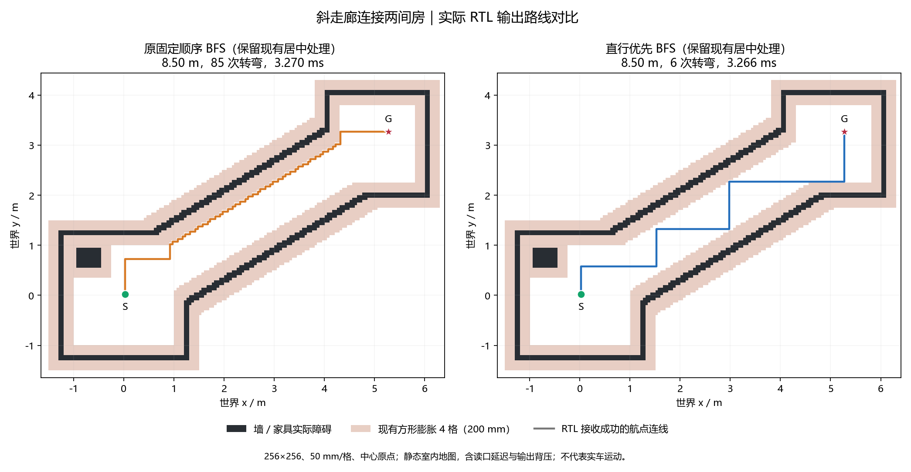
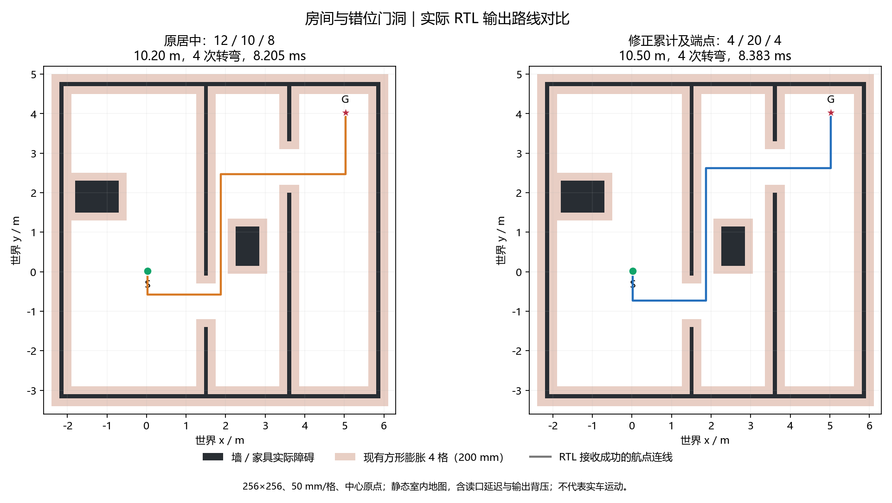

# 规划与路线演进_20261022-25

归档：2026-11-09；来源基线`dd62de7`。本册合并同主题历史报告，保留当时的数值、未完成项及验证边界。旧命令/路径按当时语境阅读；原始证据未搬动，来源路径和SHA见[目录映射](../目录映射.json)。现行操作从[文档首页](../../README.md)进入。

## 本册来源

- [BFS直行优先验证_20261022.md](#report-01)
- [路线居中修正验证_20261022.md](#report-02)
- [当前段轴线补画验证_20261023.md](#report-03)
- [Dijkstra导航验证_20261025.md](#report-04)
- [Dijkstra存储优化验证_20261025.md](#report-05)
- [八方向导航改造记录_20261025.md](#report-06)

---

<a id="report-01"></a>

来源：`doc/BFS直行优先验证_20261022.md`；原始正文见`git show dd62de7:doc/BFS直行优先验证_20261022.md`。

<a id="report-01--直行优先-bfs-实现与验证2026-10-22"></a>
## 直行优先 BFS 实现与验证（2026-10-22）

本次面向室内演示：在房间、门洞、通道和家具地图中，减少斜墙栅格化后的频繁小转弯。只修改生产 `nav_planner.v`，不改变公开接口、地图规则、分段锁定、后台调度或控制器握手。基线为 `b221b9a`；代码、测试、文档同一中文提交，编号以本文件所在提交为准。

<a id="report-01--实现"></a>
### 实现

仍然从目标向起点做四邻接 FIFO BFS，每格首次访问时记录父方向。队列项由 16 位格号改成 `{2 位搜索方向, 16 位格号}`，出队时一起锁存。对每个节点，按直行、左、右、反向扩展；目标根节点没有进入方向，固定从 +x 开始。方向指的是反向搜索方向，不是小车朝向。

实际选中的方向同时用于邻格计算、父方向和后续入队，避免枚举序号和方向不一致。只需 2 位组合选择和 2 位寄存器，没有增加状态、父方向存储读口或每节点固定周期。8192 项队列增加逻辑容量 16384 bit，即 2 KiB；物理存储与时序以本轮实际报告为准。

FIFO 层次不变，因此 BFS 仍求最短栅格距离。这是同距离下的搜索偏好，**不保证全局最少转弯，也不保证任意地图都减少转弯**。现有居中处理仍可能在预算内增加最终路线长度，不能把最终长度与未经居中的软件最短路直接混比。本次不引入方向状态最短路、优先队列或额外兼容参数。

<a id="report-01--地图与自检"></a>
### 地图与自检

地图为 12.8×12.8 m、256×256 格、每格 50 mm、中心原点。车宽 180 mm；障碍横纵每侧膨胀 4 格（200 mm），与当前 RTL 一致。场景按室内尺寸搭建，包含 100 mm 墙、约 1.3 m 门洞和家具；不是实测场地图。正式生成器产出的三个主要 raw / cost 地图，与此前演示的软件地图逐格相同。

`sim/bfs_indoor.py` 用标准库生成地图和独立 FIFO 参考；不直接调用 RTL 的方向选择。`nav_planner_tb` 同时验证关闭和开启居中的规划器，28 个请求共 434 项检查：

- 三个主要室内场景：错位门房间、约 31° / 1.4 m 斜走廊、带门斜隔墙与斜放长桌。
- ±15° / ±30° / ±45° × 净宽 1.2 / 1.5 / 2.0 m，共 18 个通道。
- 同格起终点、起点实障碍、终点实障碍、封路无解、局部接出关闭 / 开启及地图边界。
- 原始 BFS 每个路径格与独立参考一致，距离和转弯数均一致；开启居中后逐格检查所有输出线段、边界和额外路长预算。
- 地图读口变化延迟与航点背压；房间累计入队超过 8192，验证环队列回绕。封路和障碍起终点不输出路线。

修改前真实 RTL 在独立库跑相同地图、延迟和背压，434 项通过；修改后也全部通过。测试台总周期为基线 5025880 → 新版 5026192，两组居中配置并行运行，该总数不是单次规划延迟。新 RTL 整车完整回归 **32 台 / 3089 项通过**；运动回归仍为 98000033 周期、22 轮规划，包含暂停恢复、前方 raw 障碍停车、清除后继续及第二目的地。

<a id="report-01--实际-rtl-输出对比"></a>
### 实际 RTL 输出对比

以下均为开启现有居中处理后的接收成功航点；转弯按连续线段的方向变化计数，同向中继不重复算。不是软件参考路线，也不是实车测量。周期包含地图清理、搜索、居中复核和发射等待；毫秒按标称 50 MHz 折算，不代表约束已经通过。

专项台 `wp_limit=512`，足够覆盖所有场景，两版均输出到相同终点的完整路线。整车 `MAX_WP=1024` 和前缀发布策略没有修改；这里的转弯数不是实车累计停车次数，实际任务仍由原有协调器和控制器执行。

| 室内场景 | 最终路长，前 / 后 | 转弯，前 / 后 | 周期，前 / 后 | 新版标称时间 |
| --- | --- | --- | --- | --- |
| 房间与错位门洞 | 10.20 / 10.20 m | 5 / 4 | 409753 / 410246 | 8.20492 ms |
| 斜走廊连接两间房 | 8.50 / 8.50 m | 85 / 6 | 163499 / 163279 | 3.26558 ms |
| 斜隔墙、门洞与长桌 | 8.10 / 8.10 m | 19 / 2 | 451753 / 452730 | 9.05460 ms |

关闭居中时，三个场景路长仍分别为 9.70 / 8.50 / 8.10 m，前后完全相同；房间最终多出的 0.50 m 来自已有居中策略，两版均如此。未居中周期分别为 406977→407667、163157→160755、450871→450370。读取和接收的周期性背压也会受各轮起始相位影响，不能把全部周期差解释成固定逻辑开销。

额外 18 组斜通道在两种居中配置下均减少转弯，总数 **1404→92**，最短格距不变。队列全套最大占用 233 / 8192，未溢出。它们支持室内演示效果，不构成任意复杂地图的保证。

图像由 `sim/plot_bfs_indoor.py` 读取 RTL CSV 重建：



其他图：[房间与错位门](../../img/bfs_rooms_doors_20261022.png)、[斜隔墙与长桌](../../img/bfs_slanted_wall_furniture_20261022.png)。仅保留这三张报告插图；地图、CSV、库和日志按仓库规则不提交，可用脚本重建，不纳入交付 RTL。

<a id="report-01--综合与布局布线"></a>
### 综合与布局布线

基线来自 `b221b9a` 对应的 2026-10-21 22:31 报告。基线已未达 50 / 49 MHz，比较不使用更早的 50.018 / 49.106 MHz 版本。93 个生产输入中只有规划器 RTL 改变，没有改约束。

| 综合资源（整车） | 基线 | 新版 | 差值 |
| --- | --- | --- | --- |
| Logic | 36753 | 36607 | -146 |
| LUT | 29882 | 29732 | -150 |
| ALU | 6871 | 6875 | +4 |
| Register | 17245 | 17270 | +25 |
| BSRAM | 122 | 123 | +1 |

综合依据 `impl/gwsynthesis/falcons_syn.rpt.html`。实际网表队列为 9 个 8192×2 的 SDPB，基线 8 个，符合增加 2 KiB 的容量变化；未增加父方向存储读口。整车逻辑和寄存器差值包含综合器重新映射的影响，不能只按新增 2 位寄存器推算全设计差值。

完整构建于 11:19 结束，耗时 1548.5 s（25m48s），其中 PnR 20m50s，路由 16m27s。以下资源来自新 `impl/pnr/falcons.rpt.txt`，Fmax 与违例来自 11:19:39 更新的 `falcons_tr_content.html`，没有采用构建过程中残留的昨日时序报告。

| 布线后资源（整车） | 基线 | 新版 | 差值 |
| --- | --- | --- | --- |
| Logic | 37106 | 36949 | -157 |
| LUT / ALU | 29864 / 7242 | 29714 / 7235 | -150 / -7 |
| Register | 17245 | 17270 | +25 |
| BSRAM | 143 | 144 / 340 | +1 |
| DSP | 221 | 221 / 298 | 0 |

| 时钟 | 约束 | 基线 Fmax | 新版 Fmax | 同域 setup 违例，前 / 后 | 新版 hold |
| --- | --- | --- | --- | --- | --- |
| i_clk_50m | 50 MHz | 47.167 MHz | **50.000 MHz** | 241 / 0 | 0 |
| clk_pixel | 49 MHz | 46.768 MHz | **50.045 MHz** | 13 / 0 | 0 |

两个主时钟同域的 setup / hold 均无违例，但**系统最差余量只显示 0.000 ns，余量很薄**。最差列出系统路径为 `u_odom/y_q10_16_s3/Q` → `odom_y_cm_r_12_s0/D`，不是新增的搜索方向选择。全设计 setup 312→58、hold 仍为 18，原 DDR 相关时钟问题未解决，不能称为全工程时序收敛。本次不扩大修改无关模块或约束。

本轮全设计 Fmax 回升是实际综合和布线结果，不能据此推断“优先直行”算法本身必然提频。输入变更导致的映射和布线调整也会影响其他路径；代码层面没有新增每节点状态或父方向读口。

位流为 38792615 字节，SHA256 `6EF6D643A57D9D8D62EEE2D0938052C813C80BDD71D3D9856F4D4FDB8944070A`。93 个实际构建输入在开始和结束后逐项一致。最终摘要为 `logs/bfs_straight/build_result.json`，实际输入指纹为 `production_inputs.json`。

<a id="report-01--复核与范围"></a>
### 复核与范围

```powershell
powershell -NoProfile -ExecutionPolicy Bypass -File sim/run_sim.ps1 -ModelSim D:/apps/modelsim/win64 -Only nav_planner
powershell -NoProfile -ExecutionPolicy Bypass -File sim/run_sim.ps1 -ModelSim D:/apps/modelsim/win64
powershell -NoProfile -ExecutionPolicy Bypass -File tools/build.ps1 -Tcl build.tcl -GowinSh D:/Apps/Gowin/Gowin_V1.9.12.03_x64/IDE/bin/gw_sh.exe
python sim/plot_bfs_indoor.py
```

`logs/bfs_straight/` 保存 baseline / fixtures 两组地图、参考、RTL 周期与航点、完整回归和构建日志、构建前报告及输入指纹。本次不修改其他生产模块或约束，不自动推送，不下载 SRAM / Flash；板上仍为 `11114a2` 雷达修复版。提交前再次拉取并核对受影响项，只提交本任务文件，保留两个 RC 示例脚本原有行尾改动。

---

<a id="report-02"></a>

来源：`doc/路线居中修正验证_20261022.md`；原始正文见`git show dd62de7:doc/路线居中修正验证_20261022.md`。

<a id="report-02--路线居中最小间隙端点与参数修正2026-10-22"></a>
## 路线居中：最小间隙、端点与参数修正（2026-10-22）

参考用户提供的 `ROUTE_CENTERING_ANALYSIS.md` 修改前分析，仅实施用户明确选择的三项：累计最小间隙、探针包含两端点，以及 `L_MIN=4` / `PROBE_D=20` / `PROBE_STEP=4`。没有实施报告中另外提出的逐格法向测量或多次缩小偏移重试。

生产代码只修改 `nav_planner.v`，公开接口、BFS、地图、分段锁定及控制器握手不变。基线为 `d61136e`；本次代码、测试、文档一个中文提交，编号以本文件所在提交为准。

<a id="report-02--具体变化"></a>
### 具体变化

| 项目 | 修改前 | 修改后 |
| --- | --- | --- |
| 每侧间隙 | 第一个发现阻挡的探针决定结果 | 每次阻挡都按较小距离更新，累计全部探针的最小值 |
| 沿段位置 | 8、16……，小于段长 | 0、4、8……、段长；尾部不足间距时补终点，终点只测一次 |
| `L_MIN` | 12 格 / 600 mm | 4 格 / 200 mm |
| `PROBE_D` | 10 格 / 每侧 500 mm | 20 格 / 每侧 1 m |
| `PROBE_STEP` | 8 格 / 400 mm | 4 格 / 200 mm |
| 未测到边界的间隙值 | 11 | 21 |
| 法向计数 | 5 位，单位置 20 次 | 6 位，单位置 40 次 |

例如长度 4 格时测位置 0、4；长度 7 格时测 0、4、7；长度 8 格时测 0、4、8。只有当前探针位置已经等于段长才结束，不再用“下一位置将超过段长”提前结束。

`probe_plus` 和 5 位 `probe_distance` 共用于地址与最小值比较，避免在多处重复计算距离。20 格距离及“无边界”值 21 仍适合现有 5 位间隙；扫描序号要覆盖 1……40，因此必须扩为 6 位，同时修正比较和递增常量，避免只改参数却在第 8 或 32 次提前结束 / 回绕。没有增加状态、RAM 或读口。

`CLEAR_TRIGGER=8`、`PATH_INC_MAX=20`、`OFF_MAX=16` 保持不变。首段和末段不做横向平移，中间段仍经过几何限制和完整逐格复核；失败时仍撤销本次平移。新配置扩大测量范围，不表示取消预算或允许穿过障碍，也不能保证几何意义上的全段中心。

<a id="report-02--自检与必要回归"></a>
### 自检与必要回归

沿用 256×256、50 mm/格、中心原点、方形膨胀 4 格的室内场景，增加两个净宽 0.75 m、长度约 3.5 m 的斜通道，专门形成 4～11 格短拐段。合计 30 个地图 / 请求，分别关闭与开启居中。

`nav_planner_tb` 从地图独立计算所有预期探针位置的最小值，不采用 DUT 已累计结果作为参考；同时核对端点序列、每位置全部 40 次读取、短段和尾部补点。地图模型同步正式 `nav_map`：探针读到图外时回答 raw/cost 阻挡，最终路线仍不得越界。

| 验证 | 结果 |
| --- | --- |
| 更新后专项自检 | **531 项通过**，5397185 周期 |
| 相同新自检对旧 RTL | 检出 49 项失败，5225304 周期；这是预期的缺陷检出，不算新版通过 |
| 累计完整测量段 | 104 段，其中短于 12 格 17 段，恰好 4 格 15 段 |
| 后续出现更近障碍 | 正侧 12 段、负侧 37 段 |
| 段长非 4 的倍数 | 59 段，覆盖最后不足间距的终点 |
| 端点参与限制最小间隙 | 99 段 |
| 每侧到达 20 格的扫描 | 正侧 / 负侧各 823 次 |
| 关闭居中 | 全部 30 个请求的路径 / 周期 / 队列指标与基线一致 |
| 完整整车回归 | **32 台 / 3186 项全部通过** |
| 运动闭环 | 98000033 周期、22 轮规划；暂停、恢复、前障停车及多目的地通过 |

首轮新增检查发现原有 28 场景没有 4～11 格可居中段，测试因短段覆盖不足失败；随后补充上述两种窄通道，新版完整通过，没有放宽检查。旧实现的双侧最小值、端点位置、深度和短段检查均能被当前测试检出。

<a id="report-02--路线与计算周期"></a>
### 路线与计算周期

以下为开启居中、`wp_limit=512` 的实际接收航点。两版均为相同的直行优先 BFS，不再混入上一步 BFS 枚举策略的收益。周期包括地图清理、BFS、居中、复核及读写等待，毫秒按标称 50 MHz 换算，不代表时序已通过。

| 室内场景 | 路长，前 / 后 | 转弯，前 / 后 | 周期，前 / 后 | 新版标称时间 |
| --- | --- | --- | --- | --- |
| 房间与错位门洞 | 10.20 / 10.50 m | 4 / 4 | 410246 / 419137 | 8.38274 ms |
| 斜走廊连接两间房 | 8.50 / 8.50 m | 6 / 6 | 163279 / 171973 | 3.43946 ms |
| 斜隔墙与家具 | 8.10 / 8.10 m | 2 / 2 | 452730 / 457300 | 9.14600 ms |

房间路线因测量结果变化采用了更大平移，增加 6 格 / 300 mm；相比原始 BFS 仍仅增加 16 格，没有超出已有 20 格预算。本次修正目标是间隙累计和采样准确，不保证路线长度下降或每个场景转弯减少。

30 场景的探针位置数由 280 增至 823，每位置读取由 20 增至 40，总法向读取 5600→32920。大段的采样工作量大致增加四倍，再加两端点及新增短段，不能只按深度翻倍估算；但整轮还包含 BFS 等阶段，三个主要场景的总周期增幅分别约 2.17%、5.32%、1.01%。



<a id="report-02--综合与布局布线"></a>
### 综合与布局布线

基线为 11:19 的 `d61136e`，只有规划器生产 RTL 改变，没有改约束。综合资源来自本轮 13:22 更新的 `impl/gwsynthesis/falcons_syn.rpt.html`：

| 综合资源（整车） | 基线 | 新版 | 差值 |
| --- | --- | --- | --- |
| Logic | 36607 | 36483 | -124 |
| LUT | 29732 | 29628 | -104 |
| ALU | 6875 | 6855 | -20 |
| Register | 17270 | 17272 | +2 |
| BSRAM | 123 | 123 | 0 |

完整构建于 13:34 完成，用时 990.5 s（16m30s），其中 PnR 11m33s。布线资源来自新 `impl/pnr/falcons.rpt.txt`，时序来自 13:34:19 更新的 `falcons_tr_content.html`，没有混用构建过程中残留的 11:19 时序报告。

| 布线后资源（整车） | 基线 | 新版 | 差值 |
| --- | --- | --- | --- |
| Logic | 36949 | 36839 | -110 |
| LUT / ALU | 29714 / 7235 | 29610 / 7229 | -104 / -6 |
| Register | 17270 | 17272 | +2 |
| BSRAM | 144 | 144 / 340 | 0 |
| DSP | 221 | 221 / 298 | 0 |

| 时钟 | 约束 | 基线 Fmax | 新版 Fmax | 同域 setup 违例，前 / 后 | 新版 TNS | 新版 hold |
| --- | --- | --- | --- | --- | --- | --- |
| i_clk_50m | 50 MHz | 50.000 MHz | **47.170 MHz** | 0 / 193 | -109.626 ns | 0 |
| clk_pixel | 49 MHz | 50.045 MHz | **46.449 MHz** | 0 / 22 | -12.693 ns | 0 |

**功能自检通过，但本轮系统和像素时序均未达标。** 全设计 setup 58→273、hold 18→18；原 DDR 相关时钟问题仍在。没有修改约束或将失败路径设为例外。

系统最差列出路径为 `u_reset_sync/key_stable_s0/Q` → `u_radar_navigation/u_adapter/u_navigation/u_nav/u_route/r_target_x_0_s1/CE`，slack -1.199 ns；像素最差列出路径为 `u_hdmi/u_disp_driver/vcount_r_0_s0/Q` → `u_ui/u_text_rom_lg/mem_mem_0_0_s/AD[10]`，slack -1.121 ns。它们不是新的最小间隙比较路径。此前系统余量只有 0.000 ns，本次输入变化后的重新映射和布局布线未能维持余量；探针数量增加直接影响的是计算周期，不能单凭探针数量解释 Fmax。后续应针对当前实际关键路径处理，本任务不扩大修改复位或显示模块。

位流为 38920103 字节，SHA256 `2C3A27BCC6841FB0320DD096F62002644AB3238FA1F8838F01BBFBD191447627`。93 个实际构建输入在开始和结束后逐项一致。资源、时钟、违例及产物指纹的摘要为 `logs/route_centering/build_result.json`，输入为 `production_inputs.json`。本轮不烧录，不把工具正常结束当作时序通过。

<a id="report-02--复核与文件范围"></a>
### 复核与文件范围

仓库根目录：

```powershell
powershell -NoProfile -ExecutionPolicy Bypass -File sim/run_sim.ps1 -ModelSim D:/apps/modelsim/win64 -Only nav_planner
powershell -NoProfile -ExecutionPolicy Bypass -File sim/run_sim.ps1 -ModelSim D:/apps/modelsim/win64
powershell -NoProfile -ExecutionPolicy Bypass -File tools/build.ps1 -Tcl build.tcl -GowinSh D:/Apps/Gowin/Gowin_V1.9.12.03_x64/IDE/bin/gw_sh.exe
python sim/plot_bfs_indoor.py --baseline logs/route_centering/baseline --current logs/bfs_straight/fixtures --output logs/route_centering --labels '原居中：12 / 10 / 8' '修正累计及端点：4 / 20 / 4'
```

`logs/route_centering/` 保存旧 RTL / 构建报告、同台缺陷检出、前后 CSV、完整回归、输入指纹及本轮构建；当前自检生成物仍在 `logs/bfs_straight/fixtures/`。测试库、地图、CSV、网表和位流不提交，只保留验证文档与一张报告插图。没有修改用户提供的原分析报告或两个 RC 示例脚本，均不纳入本任务提交。

提交前再次拉取，代码 / 测试 / 文档同一个中文提交；不自动推送或下载。板上 Flash 仍为 `11114a2` 雷达修复版。

---

<a id="report-03"></a>

来源：`doc/当前段轴线补画验证_20261023.md`；原始正文见`git show dd62de7:doc/当前段轴线补画验证_20261023.md`。

<a id="report-03--当前任务轴线补画验证2026-10-23"></a>
## 当前任务轴线补画验证（2026-10-23）

<a id="report-03--修改范围"></a>
### 修改范围

导航正式入口新增显示输出 `target_axis_y`，直接连接 `nav_command.command_dir[0]`：0 水平、1 竖直，仅在 `cmd_valid=1` 时解释。逐层透传到整车显示端，不新增方向寄存器，不改变控制器六信号接口、其他方向逻辑、后台规划和分段锁定。

`nav_map_view` 收完一轮航点后，同拍保存命令有效位、轴向、定位和当前输出目标。水平段从 `(车辆 x, 目标 y)` 画到目标；竖直段从 `(目标 x, 车辆 y)` 画到目标。坐标先加 6400 mm 寄存，清图阶段再按 50 mm 换算格号，避免加法和除法串在同一拍。使用导航公共位姿，不使用已裁剪到屏幕边缘的车辆标记坐标。

先补画当前任务线，再连接原航点；两者可以重叠，不合并内部段。复用原路线双缓冲 RAM、CLEAR / FETCH / TAKE / PLOT 状态；没有新增 RAM、状态、逐像素判断或显示握手。新一轮清后台后重画，帧边界切换，旧线不会累计成轨迹。命令无效时不补画，沿用约 100 ms 路线刷新，撤销到屏幕更新仍有刷新和换帧延迟。车辆标记继续显示真实位置。

<a id="report-03--自检和回归"></a>
### 自检和回归

| 验证 | 结果 | 周期 |
| --- | --- | --- |
| `nav_command` | 新增 20 项通过：四方向、同向目标更新、后台新方向不能提前改变当前任务轴向、换向停车握手 | 92 |
| `nav_map_view` | 17→40 项通过：四方向轴线、正负毫米坐标、横向偏差、前进清尾、目标延长/缩短、轴向切换、零长度、取消清线、取样后输入变化、锁定中间点与后续拐角、原双缓冲检查 | 1049163 |
| `radar_coordinates` | 34 项通过，新增显示输入显式接线；72 个实物包及原 UART→地图→显示检查保持 | 17393233 |
| `obstacle_motion` | 10 项通过，运动和规划行为不变 | 98000033，22 轮规划 |
| `ui_pipeline` | 6 页原扫描指纹不变 | 4896384 |
| 全应用 | 35 台通过；完整回归后补三项显示断言，再对受影响三台回归通过，最终累计 3234 项 | 各台见 `logs/sim_*.log` |
| 整车顶层展开 | 81 个输入文件（含相机/HDMI 端口桩）通过，新增输出逐层接线正确 | 仅展开，不模拟硬件 |

一航点场景的路线后台绘制耗时：当前段 18 格为 65558 周期（1.31116 ms）；8 格为 65548；14 格为 65554；4 格为 65544；零长度为 65540。相对原一航点重画仅增加 `轴向格距+1` 次写格，最大 256 周期，即 5.12 µs；其余仍是原 65536 格清图开销。方向引出是已有寄存器的一位连线，不增加控制延迟。

复核命令（仓库根目录）：

```powershell
powershell -NoProfile -ExecutionPolicy Bypass -File sim/run_sim.ps1 -ModelSim D:/apps/modelsim/win64
powershell -NoProfile -ExecutionPolicy Bypass -File sim/run_sim.ps1 -ModelSim D:/apps/modelsim/win64 -Only nav_map_view,nav_command,radar_coordinates
python logs/check_top.py
```

完整日志在忽略目录 `logs/sim_*.log`；显示输入补线后的定向回归取代此前对应台结果。直接用 ModelSim 读取全套生产加密视频 IP 不受支持；顶层接线验证沿用相机/HDMI 端口桩，仅验证应用接线，不宣称完成视频 IP 行为验证。

实现提交 `e5f5950` 完成时仅验证 RTL，随后按用户要求重新综合、布局布线，结果见下节。源码、文档和测试已统一提交；本次构建记录属于后续独立任务。


<a id="report-03--完整综合布局布线2026-10-23-1316"></a>
### 完整综合、布局布线（2026-10-23 13:16）

生产源码为 `e5f5950e83f7e6fa9231ab55401f44c595921e91`，与上版 `5bedeee` 的完整首轮报告比较。94 个生产输入中仅补线涉及的 7 个 RTL 有变化；98 个输入（含约束、包清单及构建脚本）构建前后指纹一致，约束和选项未变。提交前拉取为最新。

完整 `build.tcl` 用时 **677.3 s（11m17s）**，PnR 为 **6m44s**，生成位流和最终报告，工具退出码 0。结果如下：

| 项目 | 上版 5bedeee | 本版 e5f5950 | 变化 |
| --- | ---: | ---: | ---: |
| 综合 Logic | 36366 | 36770 | +404 |
| 综合 LUT / ALU | 29329 / 7037 | 29712 / 7058 | +383 / +21 |
| 综合寄存器 | 17402 | 17455 | +53 |
| 综合 BSRAM | 123 | 123 | 0 |
| 布线 Logic | 36680 | 37086 | +406 |
| 布线 LUT / ALU | 29285 / 7395 | 29668 / 7418 | +383 / +23 |
| 布线寄存器 | 17402 | 17455 | +53 |
| 布线 BSRAM | 144 | 144 | 0 |
| 布线 DSP | 237 | 237 | 0 |
| 系统 Fmax（MHz，要求 50） | 48.958 | **50.056** | **+1.098** |
| 像素 Fmax（MHz，要求 49） | 48.686 | **49.462** | **+0.776** |
| 系统同域 setup / hold 违例端点 | 34 / 0 | **0 / 0** | -34 / 0 |
| 像素同域 setup / hold 违例端点 | 1 / 0 | **0 / 0** | -1 / 0 |
| 全局 setup / hold 违例端点 | 93 / 18 | **58 / 18** | -35 / 0 |

系统最差列出 setup 余量 **+0.022 ns**：`u_tilt/comp_prod2_0_s/DOUT[26] → mult_1576_s2/A[26]`，为角速度显示相关支路。像素最差 **+0.191 ns**：`u_hdmi/u_disp_driver/vcount_r_0_s0/Q → Disp_Red_3_s0/D`。两域达到各自约束，但系统余量仍薄。全局 58 / 18 违例尚在，列出的最差仍为 DDR `clk_cam200 → clk_ddrf`，-4.032 ns；不能据此宣称全工程时序收敛。

物理 Logic 约占 27%、寄存器 13%、BSRAM 43%、DSP 80%。补线增加坐标换算、位置取样与画线控制逻辑，未增加 BSRAM / DSP。此次没有专门调整时序表达或构建参数；Fmax 改善是本轮综合映射与全局布局布线的结果，不证明增加补线逻辑必然提频。

位流 `impl/pnr/falcons.fs`：38,920,103 字节，生成于 13:16:36（UTC+8），SHA256：

```text
dc73be6587e81dd8aeff3a445e2a2203541e88401a9fcc6d13e128c16b5f8aa2
```

综合依据 `impl/gwsynthesis/falcons_syn.rpt.html`；物理资源依据 `impl/pnr/falcons.rpt.txt`；Fmax、余量及违例依据最终 `impl/pnr/falcons_tr_content.html`（13:16:40）。本次输入指纹、基线、日志、解析结果及产物副本保存在忽略目录 `logs/current_segment/build_20261023/`。构建命令：

```powershell
powershell -NoProfile -ExecutionPolicy Bypass -File tools/build.ps1 -Tcl build.tcl -GowinSh D:/Apps/Gowin/Gowin_V1.9.12.03_x64/IDE/bin/gw_sh.exe
```

本次未改 RTL、未重复运行已通过的功能回归，也未烧录。当前 SRAM 仍为 `18d564e`，Flash 仍为 `11114a2`，与新生成位流分开记录。

---

<a id="report-04"></a>

来源：`doc/Dijkstra导航验证_20261025.md`；原始正文见`git show dd62de7:doc/Dijkstra导航验证_20261025.md`。

<a id="report-04--四桶-dijkstra-导航验证2026-10-25"></a>
## 四桶 Dijkstra 导航验证（2026-10-25）

<a id="report-04--范围与基线"></a>
### 范围与基线

在 `codex/navigation-eight-directions` 分支将等权八方向 BFS 替换为直步 2、斜步 3 的反向 Dijkstra。保留地图规则、原点、局部接出、八方向两侧格检查、三段居中、后台规划、分段锁定、动态控制目标和六信号握手。未修改电机控制、UI 显示和摄像头逻辑。

基线为分支 `37f77dc`（RTL 来源 `4eaa1f0`），此前已对 122 个输入校验并完整构建，系统 / 像素 Fmax 50.009 / 49.143 MHz，物理 BSRAM 170。启动时拉取主线遇到仿真清单冲突；按用户“先不合并，在分支上修改”的新要求已执行 merge --abort。隔离目录中的合并尝试构建已终止，不用于对比；旧分支的完整构建报告保存在 `logs/dijkstra/baseline_build/`。本次提交前只刷新远端信息，不合并主线。

<a id="report-04--搜索实现"></a>
### 搜索实现

删除 `nav_bfs.v`，新增 `nav_dijkstra.v`，同步替换规划入口和文件清单。没有旧搜索模式或兼容端口。规划器对外接口不变，`path_len` 仍表示原始路径的格步数，不改成代价。

- 18 位距离表：全 1 为未发现，65535 条边每边最多 3 的上限 196605 可覆盖。
- 16 位累计转弯表、3 位父方向表。第一步不计转弯；同格新代价更小时更新、入桶；等代价时比较累计转弯次数，较少则更新父链与计数，不重复入桶；两者相同则保持先发现的父链。
- 四个循环桶，按 `代价低两位` 选择；同桶 FIFO。8192 条格号 RAM 和链指针 RAM 组成共享池，释放的条目回到空闲链表。
- 取出节点后读取距离；值已改变的旧条目直接跳过。只有起点以当前最小代价出桶时才回溯，不在首次发现起点时提前结束。
- 每个节点按原方向、±45°、±90°、±135°、反向扩展。非等价的更短路线始终优先；同代价转弯比较只是单格单父的改善，不保证全局最少转弯，未扩展为八倍方向状态。
- 正边权保证所有等价父链更新都在该节点出桶之前完成，所以等代价改善不需要重入桶；距离减小时仍需重入桶，旧条目留到取出时跳过。

最初仅采用直行枚举加同桶 FIFO 的样稿，在通道中产生了 53 次方向变化，未采用。局部直行标志、直行前插也未改善该例。最终增加同代价累计转弯比较，将通道恢复到 3 次；这比原先纯距离方案多一张 16 位整图 RAM，资源估计应随之增加 64 块 BSRAM，而不能沿用最初纯距离版本的预算。生产仅保留最终实现。

<a id="report-04--时序处理"></a>
### 时序处理

四张主表和转弯表均为同步 RAM、统一单写口，RAM 输出寄存器不复位，使用前由读状态装载。

搜索分为：取桶头→读取条目/链接→释放条目→读取距离/父方向/转弯→检查旧条目→缓存八邻格→生成邻格地址、候选代价与转弯数→读表→分别比较距离与转弯→判定→读空闲链接→更新表和入桶。比较结果先寄存，避免距离比较、转弯比较、选择和 RAM 写地址串在一个周期。回溯共用父方向读口。未加入运行期乘除或全表最小值比较树。

独立搜索核心综合：FF 445、LUT 859、ALU 408、BSRAM 163、DSP 0。该结果确认 RAM 推断，但不能代替整车综合或布局布线 Fmax。

<a id="report-04--自检与回归"></a>
### 自检与回归

参考使用 Python 二叉堆，而 RTL 使用循环桶和空闲链表。57 张图包含原 41 张室内、方向和角点地图，新增 4 张不等长斜段开放场景和 12 张室内随机障碍。开放不等长场景额外验证 `2×max(dx,dy)+min(dx,dy)` 最小代价及至多一次方向变化。读图、输出均施加背压。

| 测试 | 检查数 | 周期 / 结果 |
| --- | ---: | --- |
| nav_dijkstra | 229 | 19344761；完整路径、2/3 代价、父链、背压、边界与斜向两侧格；280 次距离改善、280 个旧条目跳过、17854 次等距转弯改善 |
| nav_dijkstra_pool | 6 | 643；满池不输出半条路径，同格重入、复用、阻塞起点、搜索中复位及再次启动 |
| nav_planner | 457 | 19541120；关闭/开启居中各 57 图，完整线段检查和 10/14 居中增长预算；25 次居中接受，其中 11 次斜段 |
| nav_planner_limit | 6 | 55541；截断、排空、重复请求和同格目标 |
| obstacle_motion | 10 | 98000033，22 轮规划，与基线相同；暂停恢复、近障停车、清障续行和两个目标 |
| 完整回归 | 8637 | 50 台全部通过 |
| 整车顶层 | — | 93 个输入文件的应用端口桩展开通过；摄像头/HDMI 为已有端口桩 |

完整回归命令：

```powershell
powershell -NoProfile -ExecutionPolicy Bypass -File sim/run_sim.ps1 -ModelSim D:/apps/modelsim/win64
```

日志：`logs/dijkstra/final_regression.log` 和 `logs/sim_nav_dijkstra*.log`。独立综合网表回放 57 图 / 228 项通过，19344761 周期、errors=0，与 RTL 一致。网表测试只检查外部路径、代价、几何和背压，不依赖内部队列监控；其文件位于 `logs/dijkstra/core_synthesis/`。同一批原 41 图的核心周期为 14862392，基线 12541398，约增加 18.5%；最终队列峰值 459/8192。整车构建结果见后续记录。

<a id="report-04--路线效果"></a>
### 路线效果

以下都对比实际 RTL 输出、同一地图/膨胀/居中参数，前后均开启居中；米数为逐段欧氏长度，方向变化次数含任何方向切换。Dijkstra 的主目标为 2/3 代价，居中仍沿用 10/14 增长预算，因此不能将最终米数或转弯数宣称为全局最优。

| 场景 | 等权 BFS 路长 / m | Dijkstra 路长 / m | 方向变化（前→后） | 规划周期（前→后） |
| --- | ---: | ---: | --- | --- |
| 房间与错位门洞 | 8.5347 | 8.4790 | 5→6 | 965778→1163851 |
| 斜走廊连接两间房 | 6.8861 | 6.5962 | 3→3 | 327205→369886 |
| 斜墙与家具 | 6.9296 | 6.2255 | 2→3 | 869548→1195824 |

居中前的 2/3 代价分别由 351→323、285→275、294→260，均下降。

50 MHz 下，新版本三图规划时间约 23.28、7.40、23.92 ms。没有向上、向下斜走相互抵消的开放空间长折线，但并非每张图的总转弯数都下降。

```powershell
python sim/plot_dijkstra.py --centered
```

图像保存为 `logs/dijkstra/case_0_centered.png`、`case_1_centered.png`、`case_2_centered.png`。三栏依次为等权 BFS 居中、Dijkstra 原始、Dijkstra 居中。旧路线 CSV 保存在 `logs/dijkstra/baseline_route/`，新路线由自检生成。图像展示规划路线，未进行本版实车烧录验证。

<a id="report-04--整车综合与布局布线"></a>
### 整车综合与布局布线

2026-10-25 14:53:27 启动完整 `tools/build.ps1 -Tcl build.tcl`，15:11:29 完成，退出码 0，总耗时 18 分 02 秒，报告中的布局布线耗时 14 分 06 秒。使用与基线相同的器件、CST/SDC、工具和构建选项，未修改约束或布局种子。构建前后 122 个输入哈希全部一致；最后仅更新文档和仿真脚本注释，没有改变构建输入。

<a id="report-04--资源"></a>
#### 资源

| 综合报告 | 等权 BFS 基线 | 本版 | 差值 |
| --- | ---: | ---: | ---: |
| Logic | 43609 | 44227 | +618 |
| LUT | 34406 | 34939 | +533 |
| ALU | 9203 | 9288 | +85 |
| 寄存器 | 19173 | 19387 | +214 |
| BSRAM | 148 | 285 | +137 |

| 布局布线报告 | 等权 BFS 基线 | 本版 | 差值 |
| --- | ---: | ---: | ---: |
| Logic | 44063 | 44681 | +618 |
| 寄存器 | 19173 | 19387 | +214 |
| BSRAM | 170 | 307 | +137 |
| DSP | 248.5 | 248.5 | 0 |

物理 BSRAM 占 307/340，约 90.3%，剩余 33 块。净增加可分解为：距离表替换 seen 表约 +68 块，共享桶池替换原 FIFO 约 +5 块，16 位转弯表 +64 块，共 +137。最初纯距离预算未包括累计转弯表，不能将最终版本仍描述为仅增加 75～95 块。未增加八倍方向状态或 DSP 算法单元。

<a id="report-04--布线后时序"></a>
#### 布线后时序

| 项目 | 等权 BFS 基线 | 本版 |
| --- | ---: | ---: |
| 系统 Fmax / MHz | 50.009 | 50.070 |
| 像素 Fmax / MHz | 49.143 | 49.775 |
| 系统同域 setup / hold 端点 | 0 / 0 | 0 / 0 |
| 像素同域 setup / hold 端点 | 0 / 0 | 0 / 0 |
| 全局 setup / hold 端点 | 58 / 18 | 58 / 18 |
| 列出的最差系统 setup 余量 / ns | +0.004 | +0.028 |
| 列出的最差像素 setup 余量 / ns | +0.059 | +0.318 |

系统域达到 50 MHz，但余量仍很薄。本轮列出的最差系统路径为 `mult_1612_s2/DOUT[20] → u_voice_motion/turn_diff_9_s1/CE`；像素路径为 HDMI 横计数器至绿色输出寄存器。新搜索 RAM 不在报告列出的最差系统路径上，但不能据此保证后续布局或其他配置的时序。

全局违例仍存在，首条列出的 DDR `clk_cam200 → clk_ddrf` setup 余量为 -2.269 ns（基线 -3.500 ns）。`camera_pclk_d` 使用通用布线的 PR1014 告警保留。没有修改摄像头/DDR 或屏蔽路径，不宣称整设计时序全部收敛；也不把 Fmax 的小幅变化单独归功于搜索算法。

<a id="report-04--产物与提交"></a>
#### 产物与提交

最终报告、资源表、综合网表、位流、122 项输入哈希和解析元数据位于 `logs/dijkstra/final_build/`；结果文件为 `result.json`。输入清单 SHA-256 为 `b0da61dc8158618ef1c2ddbc97d3940723a45227d979f11b51ffa58eb85bf051`。基线报告在 `logs/dijkstra/baseline_build/`，所有构建生成物不加入版本控制。

位流为 `impl/pnr/falcons.fs`，2026-10-25 15:11:24，42234791 字节，SHA-256 `70d0a60751ac67c1013a1aad27c9ceaba5a9ed90988c6fa44261c51021f8cc77`。本轮未烧录、未推送。RTL、测试和本记录在同一个中文提交中；提交前更新远端信息，按最新要求不合并主线，实际提交号见本记录首次引入的提交。

<a id="report-04--主线合并与发布"></a>
### 主线合并与发布

后续用户明确要求合并到主分支并推送，因此在 `main` 先执行 `git pull --ff-only origin main` 更新到 `00fb97e`，再合并导航分支 `0626bfd`。唯一内容冲突为 `sim/run_sim.ps1` 测试列表开头：主线新增摄像头测试，导航分支在相同位置新增导航测试。已向用户说明，并按用户选择保留双方条目。

合并后完整回归 **51 台 / 8893 项通过**，93 个输入文件的应用端口桩展开通过；日志在 `logs/merge_dijkstra_main/`。提交前再次获取远端主线，确认它仍为 `00fb97e`。原有两个 RC 脚本本地改动及两个未跟踪文档均做哈希比对，保持原样，未纳入合并提交。

本任务最近一次成功 SRAM 下载对应 `0626bfd`，程序返回 Finished、退出码 0。本次合并不重新构建或下载，前面的资源和 Fmax 仍只对应合并前导航分支。合并后的 AI、摄像头及导航整体硬件产物需在后续完整构建后生成。使用中文合并提交，推送目标为 `origin/main`。

---

<a id="report-05"></a>

来源：`doc/Dijkstra存储优化验证_20261025.md`；原始正文见`git show dd62de7:doc/Dijkstra存储优化验证_20261025.md`。

<a id="report-05--dijkstra-存储优化验证2026-10-25"></a>
## Dijkstra 存储优化验证（2026-10-25）

<a id="report-05--范围与基线"></a>
### 范围与基线

从主线 `95a70f5` 开始，先执行 `git pull --ff-only origin main`，结果 Already up to date，无冲突。保留已有两个 RC 脚本改动和两个未跟踪文档。修改仅涉及搜索存储及其直接测试、说明，不改变正式接口、分段锁定、规划起点规则、后台切换、前探或控制握手。

旧主线已合入 AI/摄像头修改，故不使用更早分支 `0626bfd` 的时序作为本次唯一基线。从 Git 归档 `95a70f5` 到独立目录 `logs/nav_ram_reduce/baseline/`，相同器件、约束、工具和选项重新完整构建；新版本在主工作目录构建。两套输入隔离。

<a id="report-05--实现"></a>
### 实现

- 删除每格 18 位绝对距离。每格只存 3 位状态：000 未发现，001 已确定，1bb 表示未确定且暂定代价的低两位为 bb。有效未确定代价属于 d..d+3，模 4 相减恢复相对代价，和边代价 2/3 比较。
- 取出节点后先检查状态/桶号，下一 SETTLE 拍写已确定状态。旧队列条目跳过；起点确定后才回溯。父方向表继续保存，因此无需保留各节点绝对距离来回溯。
- 全局只保留 2 位当前桶和候选桶，未保留无用途的 18 位代价计数器。RELATIVE 拍寄存两位差值，RELAX 拍并行比较相对代价和转弯数，RELAX_TAKE 拍决定是否更新。
- 转弯表改为 8 位，达到 255 后不再增加，绝不回绕。主目标 2/3 最短代价规则保持；超过 255 次转弯后不再精细区分同代价候选。
- 搜索核心与规划入口的 QMAX 默认改为 2048，继续共用格号 RAM、链接 RAM 和空闲链表。容量用尽仍报告本次规划失败，不发布半条路线；相较旧容量 8192，复杂地图的容量上限会变化。
- 所有表仍为同步 RAM、统一单写口，未保留旧距离表、旧计数或兼容模式；外部 path_len 仍为格步数。

3 位距离状态是在四桶不变量下的重编码；8 位计数饱和与降低队列容量是此次明确采用的范围取舍，不能把这两项称为无限条件下完全等价。

<a id="report-05--首轮验证"></a>
### 首轮验证

新增单通道含 258 次转弯，原始路径长度在测试缓存内；独立堆式 Dijkstra 参考保留完整代价并采用 255 饱和排序。58 图覆盖桶号回绕、距离改善、旧条目、同代价转弯改善、边界、斜向两侧格与输出背压。小容量池覆盖满池失败、重入、复用及搜索中复位。

搜索核心 286 项、共享池 6 项、规划入口 465 项、截断重入 6 项首轮全部通过。原有 57 图的原始与居中航点各 278 行，与优化前 CSV 完全一致；新增场景检查起点桶状态已确定及计数为 255。

独立搜索核心综合为 FF 376、LUT 766、ALU 321、BSRAM 60、DSP 0。旧独立核心为 FF 445、LUT 859、ALU 408、BSRAM 163。实际表分配和整车资源以最终报告为准。

<a id="report-05--完整验证及构建"></a>
### 完整验证及构建

完整回归 **51 台 / 8958 项通过**，93 个输入文件的应用端口桩展开通过。独立综合网表回放同一 58 图，232 项外部路径、代价、几何及背压检查通过，21490226 周期、errors=0，与 RTL 一致。网表回放不采集内部桶状态、计数表和队列监控；这些由 RTL 自检直接检查。

| 测试 | 项数 | 周期 / 结果 |
| --- | ---: | --- |
| nav_dijkstra | 286 | 21490226；280 次距离改善、280 个旧条目、17854 次等代价转弯改善、3096 次桶回绕；饱和场景通过 |
| nav_dijkstra_pool | 6 | 668；满池、复用、重入、复位 |
| nav_planner | 465 | 21696217；58 图各关闭/开启居中，25 次平移接受、11 次斜段 |
| nav_planner_limit | 6 | 40499；容量前缀、排空、再次请求 |
| obstacle_motion | 10 | 98000033 / 22 轮，与旧版本相同 |

同一批原 57 图核心周期从约 19344761 增至 21219472（后者逐图求和，约 +9.7%）。原 57 图队列峰值仍为 459/2048。新增单通道为 2274 步、258 次转弯，搜索 270518 周期，规划/居中 280213 周期、259 个航点；起点已确定，转弯表存 255，未回绕。

前三图居中周期由 1163851 / 369886 / 1195824 变为 1292812 / 402366 / 1329104；50 MHz 下约 25.86 / 8.05 / 26.58 ms。航点内容不变，周期增加来自独立的 SETTLE 和 RELATIVE 拍。

命令与日志：`sim/run_sim.ps1 -ModelSim D:/apps/modelsim/win64`；`logs/nav_ram_reduce/regression.log`、`core_synthesis/gate.log`、`top_elaboration.log`。独立核心实测 RAM 分配为状态 12、转弯 32、父方向 12、格号 2、链表 2，共 60；相较原163，节省103。

两套完整构建均成功，退出码 0。基线完整构建耗时 16 分 23 秒，布局布线 12 分 32 秒；新版本完整构建耗时 16 分 45 秒，布局布线 13 分 01 秒，2026-10-25 16:15:04 完成。两套各 122 个输入均校验哈希；基线输入另外和 Git 归档逐字节核对，结束时新版本输入未变。

<a id="report-05--资源比较"></a>
#### 资源比较

| 综合报告 | 95a70f5 基线 | 本版 | 差值 |
| --- | ---: | ---: | ---: |
| Logic | 44251 | 44002 | -249 |
| LUT | 34965 | 34801 | -164 |
| ALU | 9286 | 9201 | -85 |
| 寄存器 | 19346 | 19320 | -26 |
| BSRAM | 285 | 182 | -103 |

| 布局布线报告 | 95a70f5 基线 | 本版 | 差值 |
| --- | ---: | ---: | ---: |
| Logic | 44712 | 44465 | -247 |
| 寄存器 | 19346 | 19320 | -26 |
| BSRAM | 307 | 204 | -103 |
| DSP | 248.5 | 248.5 | 0 |

物理 BSRAM 从 90.3% 降到 60%，剩余由 33 增为 136 块。节省分解：距离 72→状态12（省60），转弯64→32（省32），共享池15→4（省11）。搜索核心163→60，减少约63.2%；整车307→204，减少约33.6%。未改地图、圈合并、路线 bank 或显示双缓冲。

<a id="report-05--布线后时序"></a>
#### 布线后时序

| 项目 | 95a70f5 基线 | 本版 |
| --- | ---: | ---: |
| 系统 Fmax / MHz | 50.027 | 50.036 |
| 像素 Fmax / MHz | 49.459 | 49.093 |
| 系统同域 setup / hold 端点 | 0 / 0 | 0 / 0 |
| 像素同域 setup / hold 端点 | 0 / 0 | 0 / 0 |
| 全局 setup / hold 端点 | 58 / 18 | 58 / 18 |
| 列出的最差系统 setup 余量 / ns | +0.011 | +0.015 |

本版列出的系统最差路径是 `u_nav/u_command/target_x_mm_1_s0/Q → u_nav/replan_count_5_s1/CE`，像素路径是 HDMI 横计数器至绿色输出寄存器，像素余量 +0.039 ns。搜索没有出现在报告列出的最差系统路径，但不能把该现象推广到后续布局或其他配置。像素 Fmax 下降约0.366 MHz，当前仍无同域违例；系统及像素余量仍薄，不宣称有显著时序优化。

全局仍有 DDR/摄像头相关时序违例和通用时钟布线告警，没有修改约束或屏蔽路径，不能宣称全设计时序收敛。资源和 Fmax 均来自对应阶段实际报告，不把独立核心综合结果当作整车布线结论。

<a id="report-05--产物复现与提交"></a>
#### 产物、复现与提交

- 基线报告/位流/网表、元数据及122项哈希在 `logs/nav_ram_reduce/baseline_meta/`，源码快照在 `baseline/`；新版本在 `logs/nav_ram_reduce/final_build/`。解析结果分别为 `result.json`，构建生成物不加入 Git。
- 完整构建入口均为 `powershell -NoProfile -ExecutionPolicy Bypass -File tools/build.ps1 -Tcl build.tcl -GowinSh D:/Apps/Gowin/Gowin_V1.9.12.03_x64/IDE/bin/gw_sh.exe`，从各自源码根目录运行。
- 新位流 `impl/pnr/falcons.fs`：2026-10-25 16:14:59，41343069 字节，SHA-256 `a49c8231f4333bb0206fd9ce4014b7a7603ba86fe393eb27657f21192c78a03e`。本轮未烧录、未推送。
- 提交前再次拉取主线，若有冲突先由用户决定。RTL、必要测试和本记录使用一个中文提交；实际提交号以本记录首次引入的提交为准。

---

<a id="report-06"></a>

来源：`doc/八方向导航改造记录_20261025.md`；原始正文见`git show dd62de7:doc/八方向导航改造记录_20261025.md`。

<a id="report-06--八方向导航改造记录2026-10-25"></a>
## 八方向导航改造记录（2026-10-25）

分支 `codex/navigation-eight-directions`，起点 `55f8a72`。采用八邻域等权 FIFO BFS，保留直行优先、分段锁定、后台规划和控制握手。每步通过自检和必要回归后独立中文提交，提交前拉取 `origin main`；不推送或下载。

<a id="report-06--实施顺序"></a>
### 实施顺序

1. 独立八方向搜索核心：八格缓存、禁止穿角、三位父方向、十九位 FIFO，以及独立地图参考。
2. 导航链路：接入八方向路径，替换四方向分段、发布复核、raw 前探和显示；控制器六信号握手不变。
3. 八方向居中：三段局部窗口平移求交，整数交点、法向探针、最小间隙、全段复核与实际长度预算。
4. 最终整车回归和完整综合布线，与本分支开始前的独立源码快照比较。

<a id="report-06--第一步八方向搜索核心"></a>
### 第一步：八方向搜索核心

新增 `nav_bfs.v`，尚未接管原整车规划器，本步没有新增四/八方向选择参数或兼容路径。方向从东开始逆时针编号 0..7，按直、左45、右45、左90、右90、左135、右135、反向依次扩展。反向搜索时父方向保存回到根的方向，输出从起点到目标的逐格路径。

每次出队后先读取周围八格并缓存允许通行位。斜向要求终点及两侧格都允许通行；边界格禁止越界。raw 永远阻塞，停车后局部接出沿用原起点附近 raw 空、cost 可放宽的规则。等权搜索保证步数最短，不保证米数最短或全局转弯最少。

坐标地址、读请求、读响应、通行计算、seen 读取和入队分状态执行；seen/parent/queue 使用同步写入，输出背压保持。每个节点最多读取八个周边格，不重复读取四个斜向的侧格。父方向 3 位，FIFO 为 16 位格号加 3 位进入方向，深度 8192。

独立 Python 参考复用原 30 个室内/边界地图，增加八个方向和三个墙角场景，共 41 个。自检加入请求背压、1..4 拍响应延迟和航点背压；164 项通过，12639801 周期，队列峰值 452/8192。所有逐格路径与独立参考一致，包含斜向两侧格检查。格式整理后同台复跑确认。

命令：

```powershell
powershell -NoProfile -ExecutionPolicy Bypass -File sim/run_sim.ps1 -ModelSim D:/apps/modelsim/win64 -Only nav_bfs
powershell -NoProfile -ExecutionPolicy Bypass -File sim/run_sim.ps1 -ModelSim D:/apps/modelsim/win64
```

地图、参考路径、日志只写入忽略目录 `logs/eight_direction/`，不交付生成数据。首次编译修复了参数重命名遗漏和旧 ModelSim 对 `$sformatf` 赋给 packed 字符数组的限制，未放宽任何检查。

完整应用 **44 台 / 8484 项通过**，运动闭环仍为 98000033 周期 / 22 轮规划。源码格式整理后独立复跑新搜索台通过。第一步提交 `eff0faf`。

前三个室内用例的未居中路径，四方向→八方向路长为 9.70→8.46 m、8.50→6.89 m、8.10→6.52 m；方向变化为 4→6、6→3、2→3，不能宣称转弯总会减少。`python sim/plot_bfs_eight.py` 可复现图片；八方向参考路径已在 RTL 台逐格核对，图像在 `logs/eight_direction/case_*_eight.png`。

<a id="report-06--综合布线基线"></a>
### 综合布线基线

主线已经新增 AI、语音功能，因此不直接把 2026-10-23 报告作为八方向改造基线。已从 `55f8a72` 用 Git 归档建立独立只读源码快照（`logs/eight_direction/baseline/`），在该目录执行相同 `build.tcl`。它的输入不会跟随工作目录改动；最终新版本使用同样约束和构建选项。资源以综合/物理报告分别记录，Fmax 以最终布线报告为准。


<a id="report-06--第二步八方向导航链路"></a>
### 第二步：八方向导航链路

搜索入口已替换为 `nav_bfs` 与流式拐点/中继输出，删除原四方向 BFS 和原直角专用居中实现；此步骤尚未加入新居中，生产输出为未平移的八方向路线。没有保留四/八方向模式切换或旧显示接口。

路线方向、候选首段方向、控制任务和前探统一三位编码，路线 X 字扩为 19 位。`nav_segments` 收点后增加判定拍，按四类直线常量判断共线同向；锁定前缀独立输出，控制目标可延伸到最远同向点。新 `nav_line_cells` 在两拍几何准备后枚举完整闭线段，斜向输出两侧格；发布验证复用此枚举，不再按大包围矩形扫描整条斜线。

raw 前探增加斜向坐标系：格中心计算、加减旋转、面积重叠判断和读图各占独立阶段；常量平方根只在参数展开时计算。格面积和相切包含在检查内，旋转/等待阶段仍由原 `ctrl_linear_active` 授权规则处理。没有实际朝向限制。显示输出改为两位 `target_line_dir`，替换一位轴向接口；斜线同时更新 x/y，投影分拍并沿线裁剪，像素读图和颜色链不变。

新增分段与候选隔离 32 项、闭线段枚举 17 项、前探 33 项，控制握手扩至八方向 40 项，显示扩至 47 项，定向自检均通过。前探 1253125 周期，单次扫描最长 478 周期；闭线段和分段台的周期见日志。规划入口 41 地图 / 164 项，12638748 周期，通过背压、完整线段与独立 BFS 参考。运动闭环 10 项通过，228000033 周期 / 48 轮规划，达到两个目标；时间相较原四方向基线增加，不能因路线格步减少就宣称车辆更快。

本步完整 **47 台 / 8226 项通过**，应用顶层 92 个输入文件的端口桩展开通过。闭线段 228 周期，分段/候选隔离 243 周期，显示 1377026 周期。第二步提交 `7a83ba2`。Gowin 独立基线已完成：综合 Logic 40317 / FF 18078 / BSRAM 142；物理 Logic 40653 / FF 18078 / BSRAM 164 / DSP 235.5；系统 / 像素 Fmax 50.167 / 49.023 MHz，同域 setup/hold 均 0，全局 58/18。该基线对应当前主线 `55f8a72`，与早先没有完整 AI 功能的报告分开使用。


<a id="report-06--第三步八方向居中与前缀排空"></a>
### 第三步：八方向居中与前缀排空

新增 `nav_center`，用 A/B/C/D 四点表示三个相邻段，固定已输出 A 和未来 D，平移 B-C 支撑线后与前后支撑线求交。四类直线用 y、y-x、x、x+y 表示；交点运算只用加减和右移，半格交点拒绝，不将两轴分别取整。新候选需保持三段的原方向、正长度和边界，并复用 `nav_line_cells` 逐格检查三段及斜向侧格。一个候选失败只是不采用这次平移，不产生任意斜率补线。

探针从 0 开始，包含末端，非步长整数倍补末点。按所有采样位置累计两侧最近阻挡，法向斜探针也检查跨步两侧格；遇到阻挡后停止该位置该侧的继续探测。默认轴向 L_MIN/深度/步距为 4/20/4，斜向换为 3/14/2，距离近似一致。长度预算改为正步 10、斜步 14 的近似物理长度增量，累计允许增长 PATH_INC_MAX×10，默认 200 单位（约 1 m）。居中前后仍必须完整可通行。

流水拆分：方向和长度→探针基点→探针端点→侧格→读请求/响应；偏移→支撑线常量→交点→几何；步数→10/14 加权→两段部分和→第三段→长度差→累计预算。14 倍用 `(n<<4)-(n<<1)`，避免三项加法链。候选只有三段复核全部通过才修改待输出点和预算。前探增加格中心与相对车辆坐标之间的寄存拍，新最长扫描 548 周期，远低于 50000 周期扫描预算。

规划入口先将 BFS 路径压成真正拐点，居中后再插入 W_MAX-1 格中继；容量前缀输出完成后排空余下搜索/居中流，保证没有未返回的读图请求误入下一轮。重复请求、两个中继截断及起终点重合通过 6 项专项检查。开放竖直路线测试发现固定朝东的搜索根节点会在等权平局中产生不必要斜折，已将根节点进入方向锁存为目标朝起点的八方向，Python 独立参考同步；未引入加权搜索或转弯代价。

自检结果：

| 测试 | 项数 | 周期 / 结果 |
| --- | ---: | --- |
| nav_center | 41 | 32642；八方向预期平移、两端点与非整步尾点、两侧最小间隙、超预算拒绝、探针间障碍被完整检查拒绝 |
| nav_bfs | 164 | 12541398；41 图逐格参考一致 |
| nav_planner | 329 | 12661972；关闭/开启居中各 41 图，22 次平移接受，其中 8 次斜段；完整线段与 10/14 增长预算通过 |
| nav_planner_limit | 6 | 22336；截断排空、重入及同格终点 |
| nav_drive（新增相对坐标流水后） | 33 | 1253578，最长 548 周期 |
| obstacle_motion（最终流水） | 10 | 98000033 周期 / 22 轮规划；暂停、raw 急停、清障续行及两个目的地 |
| 完整回归 | 8438 | 49 台全部通过；增加前探寄存拍后，受影响三台再次通过 |
| 整车顶层 | — | 93 个输入文件的应用端口桩展开通过 |

前三个室内地图开启居中的周期为 965778、327205、869548（50 MHz 下约 19.32、6.54、17.39 ms）。与四方向原始路线对照：路长 9.70→8.53 m、8.50→6.89 m、8.10→6.93 m；方向变化 4→5、6→3、2→2。不能把局部直行优先宣称为全局最少转弯，也不能把最少格步当米数最短。`python sim/plot_bfs_eight.py --centered` 生成四方向原始、八方向原始及八方向居中三栏图，保存到 `logs/eight_direction/case_*_centered.png`。

本步提交 `6cbd538`。第四步记录最终新 RTL 的综合、布线及与独立基线的对比。


<a id="report-06--第四步前置修正搜索队列保持块-ram"></a>
### 第四步前置修正：搜索队列保持块 RAM

第一次整车综合在技术映射时报 DFF 175385 超过器件 139095 上限，没有进入布局布线；旧的 `falcons.fs` 时间为 2026-10-23，不能当成本轮产物。失败日志保存在 `logs/eight_direction/final_build/failed_full_build.log`。

定位到 `nav_bfs` 的队列初始化、入队分别对数组使用不同写地址。将互斥写操作整理为统一的写使能、写地址和写数据；seen 同样统一写口。没有调整队列容量、状态或算法周期。独立搜索核心综合前为 DFF 155896 并超限；修正后为 FF 229、LUT 461、ALU 323、BSRAM 26。原队列 8192×19 位被展开为寄存器，这是此次超限主因。

独立前后综合脚本、日志和网表位于 `logs/eight_direction/ram_probe/`；整车回归、网表回放及最终构建结果随后记录。网表回放不采集 RTL 内部的队列占用统计，只检查外部路径、参考一致性、角点通行和背压。

本次修正后完整回归 **49 台 / 8438 项通过**。独立综合网表回放同一组 41 图 / 164 项通过，12541398 周期、errors=0，与 RTL 周期一致；包括连续请求和不同地图，不依赖 RAM 上电初值。单写口调整没有增加规划时钟周期。提交前已拉取主线（Already up to date），独立提交 `4eaa1f0`，最终对比见下一节。


<a id="report-06--第四步完整综合与布局布线结果"></a>
### 第四步：完整综合与布局布线结果

最终 RTL 来源为 `4eaa1f0`，分支 `codex/navigation-eight-directions`；基线为同一天从主线 `55f8a72` 归档出的独立源码。两者均使用 GW5AT-138B、相同 CST/SDC 和构建选项，未调整约束或布局种子。最后完整回归为 49 台 / 8438 项，搜索核心综合网表另过 41 图 / 164 项，周期与 RTL 相同。

最终构建命令：

```powershell
powershell -NoProfile -ExecutionPolicy Bypass -File tools/build.ps1 -Tcl build.tcl -GowinSh D:/Apps/Gowin/Gowin_V1.9.12.03_x64/IDE/bin/gw_sh.exe
```

2026-10-25 12:51:17 启动，13:16:49 完成，退出码 0，总耗时 25 分 33 秒，布局布线报告耗时 21 分 57 秒（基线 12 分 59 秒）。本轮构建未修改源文件；122 个构建输入 SHA-256 在结束后再次检查全部相同。综合、时序、物理报告、网表、位流和元数据已保存到 `logs/eight_direction/final_build/`，具体解析为 `result.json`。这些生成文件不加入版本控制。

<a id="report-06--资源比较"></a>
#### 资源比较

| 综合报告项目 | 四方向基线 | 八方向本版 | 差值 |
| --- | ---: | ---: | ---: |
| Logic | 40317 | 43609 | +3292 |
| LUT | 33213 | 34406 | +1193 |
| ALU | 7104 | 9203 | +2099 |
| 寄存器 | 18078 | 19173 | +1095 |
| BSRAM | 142 | 148 | +6 |

| 布局布线报告项目 | 四方向基线 | 八方向本版 | 差值 |
| --- | ---: | ---: | ---: |
| Logic | 40653 | 44063 | +3410 |
| 寄存器 | 18078 | 19173 | +1095 |
| BSRAM | 164 | 170 | +6 |
| DSP | 235.5 | 248.5 | +13 |

综合报告与布局布线报告采用各自的资源口径，不混用。方向位宽、斜向检查、三段几何和长度预算会增加资源；仍在器件容量内。生产网表中 `u_bfs` 为寄存器 213、LUT 440、ALU 252、BSRAM 26，确认队列没有再次展开为寄存器。它与独立综合 229 FF 的差别来自整车常量传播。

<a id="report-06--布线后时序"></a>
#### 布线后时序

| 项目 | 四方向基线 | 八方向本版 |
| --- | ---: | ---: |
| 系统 Fmax / MHz | 50.167 | 50.009 |
| 像素 Fmax / MHz | 49.023 | 49.143 |
| 系统同域 setup / hold 端点 | 0 / 0 | 0 / 0 |
| 像素同域 setup / hold 端点 | 0 / 0 | 0 / 0 |
| 全局 setup / hold 端点 | 58 / 18 | 58 / 18 |
| 列出的最差系统 setup 余量 / ns | +0.067 | +0.004 |
| 列出的最差像素 setup 余量 / ns | +0.010 | +0.059 |

系统域只比 50 MHz 略高，余量非常小，不作为稳健时序余量的结论。新系统最差路径是 `u_nav/target_index_1_s1/Q → u_nav/u_command/last_q_s0/D`；像素最差路径为 HDMI 横坐标计数器至蓝色输出寄存器。本次已经对搜索访问、几何、预算和投影分拍，不能据综合通过推断这些逻辑没有布线影响。

全局 58/18 的数量与基线相同，但不代表违例路径延迟完全不变；例如列出的 DDR `clk_cam200 → clk_ddrf` setup 最差余量由 -3.098 ns 变为 -3.500 ns。仍有 `camera_pclk_d` 使用通用布线的 PR1014 告警。没有修改摄像头/DDR 或屏蔽这些路径，因此不宣称整设计时序全部收敛。

<a id="report-06--产物提交与复现"></a>
#### 产物、提交与复现

- 搜索核心：`eff0faf`；八方向链路：`7a83ba2`；八方向居中：`6cbd538`；RAM 写口修正：`4eaa1f0`。每次提交前均已拉取主线。
- 最终位流：`impl/pnr/falcons.fs`，2026-10-25 13:16:45，40323165 字节，SHA-256 `17ee71c40dde1403b91afb8def434bc0cdabcd2a18d1dc5816b7e577c7032454`。本轮没有烧录，也没有推送。
- 图像复现：`python sim/bfs_eight.py` 生成地图与独立参考；完整回归生成实际 RTL 航点；`python sim/plot_bfs_eight.py --centered` 生成三张对照图。保留的四方向对照数据位于 `logs/eight_direction/four_direction/`。
- 图像路径：`logs/eight_direction/case_0_centered.png`（房间）、`case_1_centered.png`（通道）、`case_2_centered.png`（斜墙）。深色为原始障碍、浅色为现有规划预留区；三栏依次为四方向原始、八方向原始、八方向居中。仅展示规划路线，不代表实车运动。
- 最终资源和时序记录随本节独立提交；代码构建来源固定为 `4eaa1f0`，之后只更新文档。
