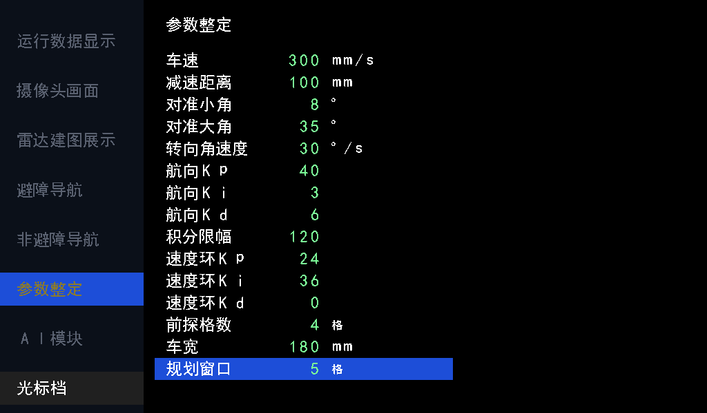

# 导航时序与参数_20261029

归档：2026-11-09；来源基线`dd62de7`。本册合并同主题历史报告，保留当时的数值、未完成项及验证边界。旧命令/路径按当时语境阅读；原始证据未搬动，来源路径和SHA见[目录映射](../目录映射.json)。现行操作从[文档首页](../../README.md)进入。

## 本册来源

- [短段锁定与运行时规划窗口验证_20261029.md](#report-01)
- [短段导航时序审查与优化_20261029.md](#report-02)

---

来源：`doc/短段锁定与运行时规划窗口验证_20261029.md`；原始正文见`git show dd62de7:doc/短段锁定与运行时规划窗口验证_20261029.md`。

## 短段锁定与运行时规划窗口验证

后续分拍审查、组合链修正及新验证见 [时序审查与优化](#report-02)。

在 `codex/ai-visual-inspection` 的 `233c0f2` 上完成；先提交本次修改，再迁移旧导航分支超前的提交。本记录对应本次提交内容，不填写尚未生成的自身 commit ID。

### 行为

- `nav_planner` 在居中之后按 `w_max−1` 格插入短段边界；`nav_segments` 改为一项寄存缓冲，只登记方向，保留所有短段，不再做同向合并。
- `nav_route` 的 RAM 保存全部短段。当前短段终点供后台规划使用；控制器目标独立向后查找，连续同方向时延伸，转向、折返、路线末尾结束。
- 例如 `A→B→C→D→E` 在 D 转弯：当前内部锁定 A→B，控制输出 D，后台从 B 规划。位置越过 B 或存在横向误差不改变这个起点。控制器确认完成 D 后，按当前路线中的 D 索引跳过已包含的短段，开始 D 后的下一短段。
- 发布可能改变点编号，按完成目标坐标对应当前路线索引；删除命令执行器中旧编号的输入、存储和回传。若完成发生在描述符读取期间、无法对应，完成握手后从实际位置重算，不使用失效的旧编号。
- 正常目标/急停四相握手、控制器自行转向、地图规则及 AI 图层语义不变。

### 参数与界面

新增正式运行输入 `w_max[7:0]`，沿 `radar_navigation → adapter → auto_navigation → nav_top → nav_planner` 连接整定页参数 14（`tune_p[455:448]`）。不保留编译期 `W_MAX` 参数。

默认 5，合法 2..64，步长 1；包含起点，因此默认短段端点最多相差 4 格，轴向 200 mm、45°约 283 mm。请求接受时锁存，当轮不随 UI 改值变化；已锁定短段不随配置伸缩。页内显示原值 5，不把它误记为 5 格位移。

整定页扩为 15 行，行高 32 px、文字偏移 4 px，最后一行止于 y=551，不覆盖 y=552 开始的状态栏。新增字段仍使用现有 128 字符 RAM；字库由 `tools/font_chars.txt` 重生成，未另加显示通路。预览读实际字模生成，像素测试检查新增标签、数值、单位和高亮；其余五页像素指纹不变。

### 时序实现

最远同向查找采用同步 RAM 读取与方向比较分拍，每点两拍，结束后增加一拍对齐毫米换算。查找完成才使能新描述符；已有控制器请求和目标保持。没有组合展开 MAX_WP 个点，没有额外路线 RAM，也没有新增兼容状态。

`w_max−1` 在请求接受时寄存；运行时正负位移由寄存步距选择，后续短段逐个产生。删除旧两点特判和同向合并的前看状态机，以及不再使用的命令索引链。

### 验证

运行 `sim/run_sim.ps1 -ModelSim D:/apps/modelsim/win64`，最新 AI 分支完整 **80 台 / 10614 项通过**。原始日志：`logs/short_lock_ai_final.log`，结果索引：`logs/short_lock_ai_results.json`。

| 测试 | 检查 | 周期 | 覆盖 |
| --- | ---: | ---: | --- |
| nav_lock | 12 | 2245363 | 真正规划到控制链：短段起点、最远目标、后台发布、位姿跨格/横向误差、运行改窗口、完成信任、索引变化、读取期间完成后重算 |
| nav_route | 42 | 378 | 八方向全部中继保留、首段/中途读出最远点、转弯独立、候选取消不改活动路线 |
| nav_planner_limit | 6 | 40499 | 窗口 5/2、请求后改为 64 不影响当轮、容量前缀截断、排空重入、起终点重合 |
| nav_planner | 465 | 21697391 | 58 图，两种居中配置；完整线段通行、斜向侧格、每短段最多 4 格、独立 Dijkstra 参考 |
| obstacle_motion | 15 | 152500034 | 原实时时间闭环、暂停/手动位移恢复、近障停车、清障、两趟多目标 |
| tune_ctrl | 89 | 原台未输出周期汇总 | 新参数默认、步长、上下界、复位及选行回绕；原整定行为 |
| tune_page | 69 | 原台未输出周期汇总 | 15 行标签/数值、新单位/高亮、未覆盖其他页面 |
| num_text | 117 | 原台未输出周期汇总 | 新字段 70..74 地址与原字段格式 |
| ui_pipeline | 6 | 4896384 | 六页完整 HDMI 像素；仅参数页指纹按新布局更新 |

`nav_lock` 首次命令 114831 拍（2.29662 ms @50 MHz）；实测最长最远目标查找 24 拍（0.48 μs），只是此用例的最大值，不是全部 MAX_WP 配置的上界。

首次回归在极端 2274 步多转弯通道中检出测试固定 512 航点容量不足。将完整路线台改为生产容量 1024 后，该图输出 635 个短段点并完整到达；另保留独立小容量截断台，未放宽 RTL 容量限制或路线正确性判据。其余首轮失败是测试仍按旧合并点数、旧 UI 几何/指纹及同拍读旧有效位判断，均已改为新规格并重新完整回归。

额外整车顶层语法检查：ModelSim 严格模式在基线和修改版均报告同一对既有 2388 错误（route_disp_x/y 在声明前引用形成隐式网线）。未改这处无关源代码；抑制该既有诊断后当前顶层编译通过。此检查不代表 Gowin 综合或布局布线。

本次未重新综合、布局布线或下载硬件，不给出新资源占用或 Fmax 结论。

---

来源：`doc/短段导航时序审查与优化_20261029.md`；原始正文见`git show dd62de7:doc/短段导航时序审查与优化_20261029.md`。

## 短段导航时序审查与优化

审查基线为 `f962c05`。仅修改上轮短段锁定新增的路线查找、运行时步距和完成判断；正式接口、短段锁定、最远同向目标及控制器握手保持不变。

### 审查发现

上轮已有的同步 RAM 读出→方向检查→毫米换算对齐、控制描述符寄存、一项点流缓冲都已分拍；路线没有用组合循环向后遍历。但仍有三处遗漏：

1. `nav_route.drive_valid` 包含 `!switch_bank`，而 switch_bank 来自 nav_top 的 publish_ok。由此将地图版本、地图空闲、候选验证等发布条件间接接回描述符和控制器状态链，违反 nav_top 既有的隔离约定。
2. `scan_index+1 < active_length` 和 `drive_index+1 >= active_length` 在索引上串接进位与比较，完成反馈中又重复计算一次。索引固定 16 位，超过生产 1024 点所需的 10 位。
3. W_MAX 改为运行时输入后，原来的常量负位移变成同拍取负、选择方向、坐标相加；不能继续按常量偏移看待。

### 修改

- drive_valid 仅由已登记状态、活动路线和索引对应关系产生，不再组合依赖发布请求。发布沿前仍可读旧 bank；nav_top 在整个 R_PUB 阶段屏蔽新描述符，发布沿后 READ 状态自然撤销有效位，已有控制器目标保持。
- 发布时登记最后一个有效地址，RAM 读出同拍登记 read_last，下一拍与方向一起使用；控制目标同步登记 drive_last，final_target 只由有效位和这个标志产生。完成反馈复用 final_target，删除重复的索引加一比较和 completed_index 别名。
- 扫描地址按 MAX_WP 的实际地址位宽保存；保留原来的 target_index 越界取末点行为，不增加新的接口或防御分支。容量 1、非二次幂和满 1024 点都检查末点与地址回绕。
- 合法 w_max 为 2..64，gap 为 1..63，使用 6 位；MEASURE 阶段登记 7 位有符号负步距，下一拍只做方向选择和坐标相加。不增加计算状态或等待拍。

### 自检与周期

完整入口 `sim/run_sim.ps1 -ModelSim D:/apps/modelsim/win64`：**81 台 / 10658 项通过**，日志 `logs/short_lock_timing_20261029/full_regression.log`，结果 `final_results.json` 位于同目录。

| 台 | 检查数 | 周期 | 主要结果 |
| --- | ---: | ---: | --- |
| nav_route | 55 | 3084 | 八方向、发布请求不组合撤销旧描述符、1/5/1024 点容量、末地址直接读出、候选隔离 |
| nav_planner_limit | 10 | 395756 | 窗口 2/5/64，最大步距 ±63，请求后改值不影响当轮，容量截断排空 |
| nav_lock | 12 | 2245363 | 短段起点、动态最远目标、发布后索引变化、读取期间完成、停后实际位姿重算 |
| nav_planner | 465 | 21697391 | 58 图、两种居中配置、完整线段与独立 Dijkstra 参考 |
| obstacle_motion | 15 | 152500034 | 实时时间闭环、暂停/手动位移恢复、近障停车与清障、多目标 |

nav_lock 总周期与基线完全一致，首次命令仍为 114831 拍（2.29662 ms @50 MHz）；最远目标查找每点仍为两拍。监视器最长读出指标 24→23 拍来自去掉发布沿前的组合无效，不是规划算法本身减少一拍。满 1024 点顺序读出使用 2049 拍（含末尾对齐，不含请求前等待）。

新增测试首次运行发现测试台撤销 load_begin 后同拍读取旧 ready 而重复写首点，以及扩大测试地图后原 100000 拍等待上限不足。已修正测试握手、扩大等待上限，并保持坐标、点数和末点断言；修复后重新完整回归，未放宽 RTL 功能判断。

### 局部综合

Gowin 1.9.12.03、GW5AT-138B；优化前后使用相同器件与配置。nav_route 单独将默认容量设为生产使用的 1024；nav_planner 使用相同的独立默认 16×16 地图。输入快照、脚本和原报告保存在 `logs/short_lock_timing_20261029/synthesis/{before,after}/`；结果为 `synthesis_resources.json`，4 次综合均退出 0。生产 RTL 与测试/综合快照逐字节一致，容量覆盖仅用于两份相同的路线测量副本。

| 独立模块 | 项目 | 优化前 | 优化后 |
| --- | --- | ---: | ---: |
| nav_route，1024 点 | Logic（LUT+ALU） | 355 | 269 |
| | LUT | 275 | 172 |
| | ALU | 80 | 97 |
| | 寄存器 | 187 | 187 |
| | BSRAM | 11 | 11 |
| nav_planner，16×16 | Logic（LUT+ALU） | 6936 | 6926 |
| | LUT | 4583 | 4577 |
| | ALU | 2353 | 2349 |
| | 寄存器 | 2965 | 2970 |
| | BSRAM | 5 | 5 |

这是独立模块综合数据，不能直接相加当作整车资源，也不能推导 MHz 提升。整车综合和布局布线按用户要求在提交后运行，最终资源与 Fmax 以 `logs/short_lock_timing_20261029/full_build/` 中的新报告为准；构建前已有产物若来源不同，只作为历史参考，不作为本轮优化的同源基线。
