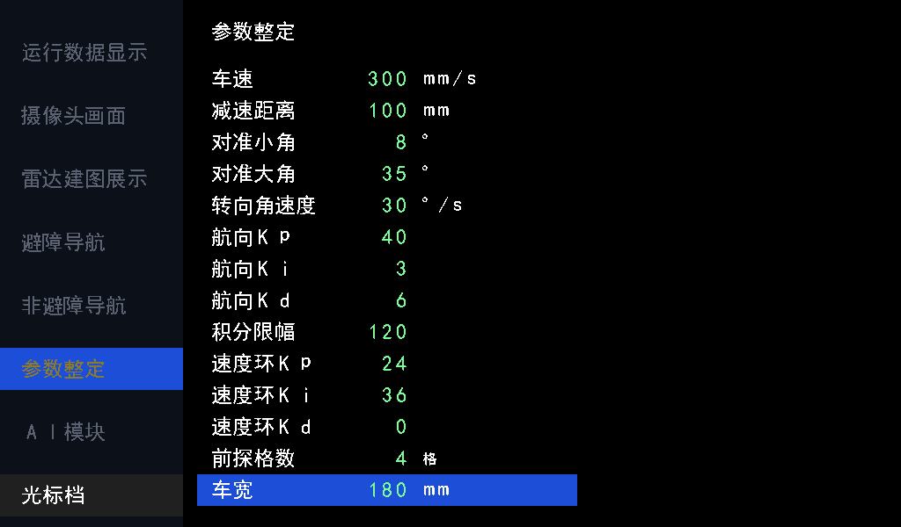

# 前探配置运行时化验证（2026-10-25）

基线：`5683bfa`。本次修改不重新综合、布局布线或烧录，先交付配置页渲染图及 RTL 仿真结果；此前资源和 Fmax 报告不代表本次修改后的结果。

## 行为及接口

删除 `LATERAL_MARGIN_MM` 和 `FRONT_OFFSET_MM`，不保留旧参数或兼容入口。前探从定位中心点开始，沿当前路线八方向检查原始障碍；检查矩形总宽度直接取车宽。与矩形相交或相切的障碍格均检查，边界规则不变。规划膨胀、分段锁定、路线更新和控制器握手不变。

`FORWARD_CHECK_CELLS` 和 `VEHICLE_WIDTH_MM` 不再是 parameter，正式接口改为：

| 输入 | 位宽 | UI 默认 | UI 范围 | 步长 |
| --- | --- | --- | --- | --- |
| `forward_check_cells` | 8 | 4 格，即 200 mm | 1..16 格 | 1 格 |
| `vehicle_width_mm` | 16 | 180 mm | 50..500 mm | 10 mm |

整车 `tune_ctrl` 新增索引 12、13，不调整原有十二项的编号。两项逐层连接到 `nav_drive`，每次扫描开始锁存位置、方向和配置，扫描中调整只影响下一次扫描。框架负责提供约定范围内的输入，不新增内部限幅。复位后 UI 恢复默认值，配置不写入 Flash。`PLAN_INFLATE_CELLS=4` 仍是独立编译参数，车宽改变不自动改变规划膨胀。

默认沿 +x 时检查 x=当前位置..当前位置+200 mm、y=当前位置±90 mm。斜向继续检查旋转后的矩形，使用 Q16 常数投影；配置锁存、尺寸计算、投影乘法和边界计算分拍，运行时没有开方或除法。

## 显示

配置页保持原位置与 36 像素行距，新增两行后共 14 行，最后一行位于 y=540..575，仍在 600 像素屏幕内。14×5=70 个数值字符超出原来的 6 位地址，所以数值生成、读写地址和渲染描述符同步扩展为 7 位，字符 RAM 深度为 128。新增汉字由原字体生成工具统一重建，没有私有字库。

预览由 `tools/preview_tune_page.py` 读取实际 RTL 字库并按当前布局绘制，选中车宽，默认显示 180 mm。不是上板拍摄图。标签、数值、单位、高亮另经 RTL 像素自检验证；预览工具同步修正数字和单位的 16 像素列坐标。

## 验证结果

执行 `powershell -NoProfile -ExecutionPolicy Bypass -File sim/run_sim.ps1 -ModelSim D:/apps/modelsim/win64`，**51 台 / 9012 项全部通过**。基线为 8958 项，本次增加 54 项。日志 `logs/front_config_regression.log`。

| 项目 | 检查数 | 周期或结果 |
| --- | --- | --- |
| `nav_drive` | 60 | 1772572 拍；最大单次扫描 3198 拍，即 63.96 μs @50 MHz |
| `tune_ctrl` | 82 | 默认、14 项选行回绕、范围钳位、步长 10 mm、恢复默认、手动禁调及既有功能通过 |
| `tune_page` | 65 | 14 行标签/数值、新增单位、末行高亮、页面互斥通过 |
| `num_text` | 112 | 新字段地址 64..69 正确，不回绕覆盖旧字段 |
| `ui_pipeline` | 6 | 连续扫描 4896384 拍；原五页指纹完全不变，参数页按新增两行更新指纹 |
| `obstacle_motion` | 10 | 98000033 拍；196 个运动节拍、22 轮规划，连续到点和转弯通过 |

前探覆盖八方向空闲/前方/侧方/后方、中心点附近、前探终点、2→4 格调整、100/180/300 mm 车宽变化、扫描中修改配置、16 格/500 mm 上限及地图边界。上限在八方向均未触发 1 ms 扫描超时。延迟统计来自带读口背压和响应延迟的测试台，不等同于实车停车距离或时序报告。

整车顶层独立展开 93 个 RTL 文件通过，0 error / 0 warning；摄像头和 HDMI 使用端口桩，仅证明应用接口连接，不能替代整套 IP 综合或硬件验证。日志 `logs/front_config_top_elaboration.log` 和 `logs/top_compile.log`。

提交前执行 `git pull --no-rebase origin main`，返回 Already up to date，无冲突。提交只包含本次 RTL、文档、预览与测试，保留无关本地文件。本次提交号由 Git 历史及交付回复记录，不把尚未生成的自身哈希写回版本内文档。
