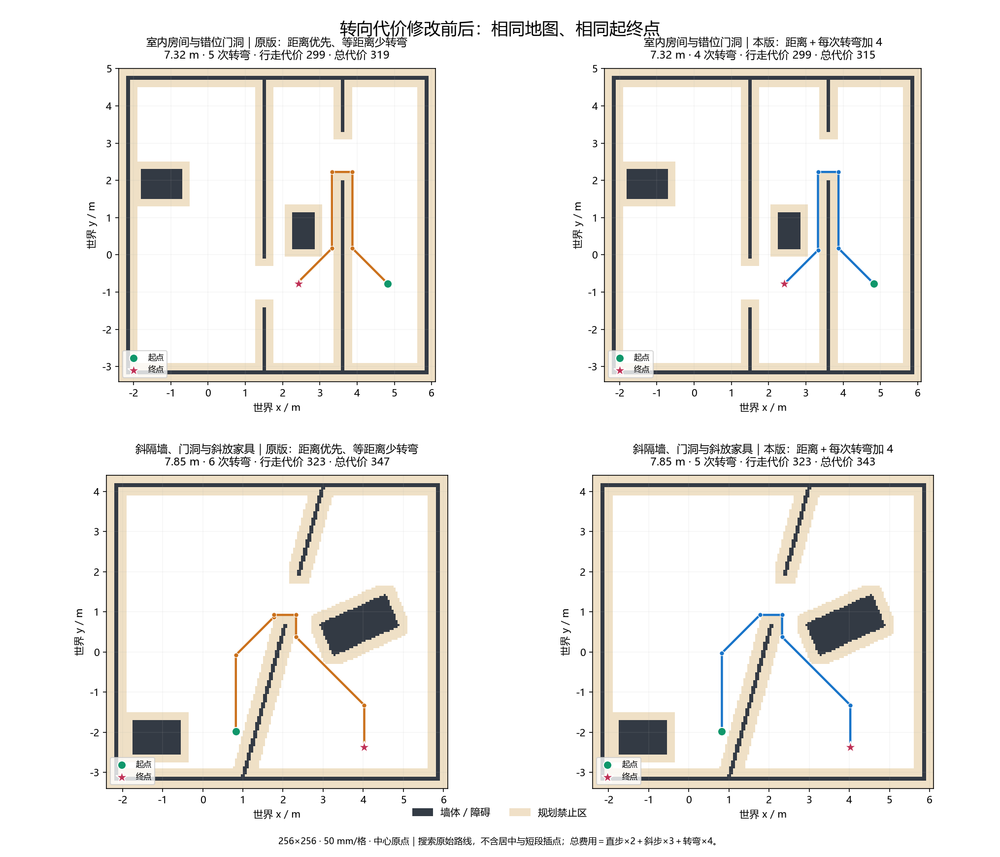
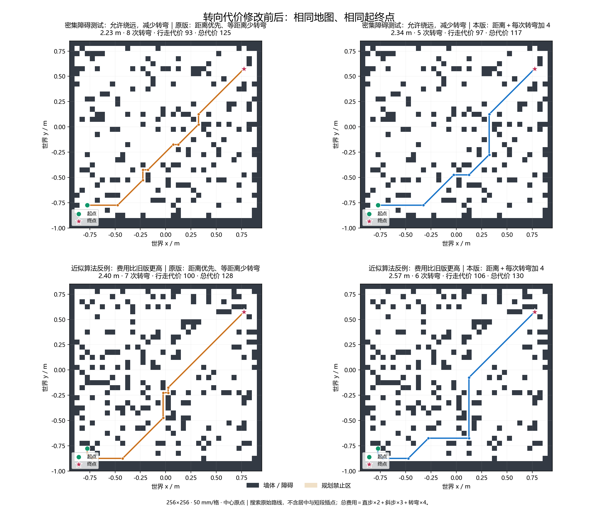

# 单状态转向代价导航验证（2026-10-29）

## 基线与范围

先拉取主分支，确认队友合并后的 `8a20acb`，再从该提交新建 `codex/navigation-turn-cost`。没有从旧 AI 分支继续开发。保留既有 RC 示例脚本改动和未跟踪文档，不纳入本次提交。

本次生产 RTL 只修改 `nav_dijkstra.v`。所有正式接口、搜索起终点、居中处理、短段锁定、控制器最远同向目标、地图规则、控制握手和后台调度保持不变。没有旧算法选择开关。

## 搜索规则

总代价为 `2 × 直步数 + 3 × 斜步数 + 4 × 路径内部方向变化次数`。同向短段边界不收费；45°、90°等方向改变均收费 4。费用固定为 4，不新增运行参数或 UI 项。车辆初始朝向，以及锁定前缀与本轮搜索路线接缝的转向不纳入费用；当前搜索接口没有输入这些方向，本次不扩大接口范围。

每格仍只存一份结果；代价严格改善才替换父方向，代价相同时保留先发现的父链。邻居先访问原方向，再按逐渐增大的角度偏差访问。删除累计转弯 RAM、饱和计数器、等代价比较和单独修改父链的状态；不再要求“总代价相同再比较累计转弯数”。

单格只存一个方向会丢掉其他方向的候选，属于近似搜索。既不保证总代价全局最小，也不保证每张地图的总代价或转弯次数比旧版更好。保留一个确实变差的场景，不把堆参考一致性称为全局最优性证明。

## 桶状态与时序

单次费用只有 2、3、6、7；八个 FIFO 循环桶共用原有 2048 项格号/链接/空闲链表。未确定节点的有效代价位于当前最小代价至其后 7，因此仍可用模 8 的相对差值比较，完全不需要绝对距离表。每格状态从 3 位改成 4 位：0000 未发现，0001 已确定，1bbb 表示待处理桶编号。

| 拍 / 状态 | 本拍工作 |
| --- | --- |
| EXPAND | 保存邻居坐标、方向，以及是否需要转弯 |
| STEP_COST | 费用直接拼接为 `{是否转弯, 1, 是否斜步}`，登记费用及三位桶号相加结果 |
| RELAX_READ | 同步读取邻居状态表 |
| RELATIVE | 登记三位模 8 差值 |
| RELAX | 并行比较“未发现”及“费用更小”，登记结果 |
| RELAX_TAKE | 按登记结果决定是否申请队列条目 |
| ALLOC_READ / ENQUEUE | 同步读空闲链表，然后统一写 RAM 和桶头尾 |

方向比较不串到桶号加法；RAM 输出不直接串减法和比较；原有统一单写口、同步读口和旧条目检查保留。没有新增 DSP、除法器或全表组合排序。

## 仿真

完整回归：**81 台 / 10684 项通过**，进程退出 0。具体耗时和逐台结果保存在 `logs/turn_cost_20261029/regression_execution.json`、`regression.log`、`regression_results.json`。修改前后分别用原版/本版 RTL 对同一 60 图逐格核对，两个搜索核心各 296 项通过；不是只用软件参考画路线。

| 自检 | 检查数 | 周期 / 结果 |
| --- | ---: | --- |
| nav_dijkstra | 296 | 26293084；60 图，包含八方向、斜向侧格、同代价发现顺序、背压、桶回绕和旧条目 |
| nav_dijkstra_pool | 6 | 小容量满池失败、复用、重入、复位通过 |
| nav_planner | 481 | 26530023；60 图各关闭/开启居中，全部短段逐格检查，居中长度预算保持 |
| nav_planner_limit | 10 | 418481；窗口 2/5/64、负向/正向 63 步、容量前缀与排空 |
| nav_lock | 12 | 2350707；首指令 109267，最大查询 23；短段起点、动态目标与握手通过 |
| obstacle_motion | 15 | 152500034；车辆持续运动，305 tick、33 次规划轮次，无错误 |

60 图的修改前搜索为 25082367 周期，本版为 26293084，约增加 4.83%；50 MHz 下分别约 501.65 / 525.86 ms，是整组测试累计时间，不是单次实时规划延迟。共享池峰值为 480/2048。新增室内两图使用已有墙体与家具布局，只改变起终点；原来的 58 图保留。

超过 255 次转弯的单通道为 2274 步、258 次转弯，行走代价 4548，总代价 5580，证明删除计数表后仍逐次收取费用，不在 255 处饱和。

独立核心综合网表另外对原 58 图回放，232 项外部路线、费用、墙角和背压检查通过，22407121 周期。综合网表回放不检查 RTL 内部状态名称；新加室内两图由修改前后 RTL 对照及完整回归覆盖。

对照自检初次发现测试台的 `FIXTURE_DIR = %s` 格式无法识别常用的 `+FIXTURE_DIR=...` 参数，误读默认目录；已修正测试台格式，重新运行修改前后对照均通过。该问题没有修改生产 RTL 或放宽任何路径断言。

## 路线效果

60 图中 55 图可达；用同一个费用公式评价修改前后的路线，11 图费用降低、43 图相同、1 图升高，5 图不可达。前三个原始室内演示起终点的路线没有变化；下表室内对比使用相同房间布局的新增起终点。

| 场景 | 原行走代价 / 转弯 / 总代价 | 新行走代价 / 转弯 / 总代价 |
| --- | --- | --- |
| 房间与错位门洞，新起终点 | 299 / 5 / 319 | 299 / 4 / 315 |
| 斜隔墙与斜放家具，新起终点 | 323 / 6 / 347 | 323 / 5 / 343 |
| 密集离散障碍 seed 1 | 93 / 8 / 125 | 97 / 5 / 117 |
| 近似算法反例 seed 0 | 100 / 7 / 128 | 106 / 6 / 130 |

图片展示搜索原始路线，不包含居中处理和短段插点。密集离散障碍图没有按车宽增加预留区，只用于算法压力测试，不代表实车可走通道。

## 独立搜索核心综合

同一工具 Gowin 1.9.12.03、GW5AT-138B、256×256、QMAX=2048、相同综合配置。原版源自 `8a20acb`，本版源与通过仿真的生产 RTL 相同。两次综合退出 0，报告保存在 `logs/turn_cost_20261029/synthesis/{before,after}/`。

| 资源 | 原版 | 本版 | 变化 |
| --- | ---: | ---: | ---: |
| Logic（LUT＋ALU） | 1087 | 1116 | +29 |
| LUT | 766 | 801 | +35 |
| ALU | 321 | 315 | −6 |
| 寄存器 | 376 | 456 | +80 |
| BSRAM | 60 | 32 | −28 |

新增桶头尾寄存器增加少量逻辑和 FF；删除 32 块转弯表，状态表从 12 到 16 块，净节省 28 块。父方向及共享池规模不变。资源来自实际综合；不由这些数字推断整车 Fmax。

## 提交后的整车综合与布局布线

按要求先提交，再运行生产 `tools/build.ps1` 完整综合与布局布线。该提交的 ID 以本文件首次引入的 Git 提交为准，避免把将生成的提交 ID 写回文件造成自引用。

本轮构建结果、源文件哈希、位流哈希、资源及各时钟 Fmax 统一保存在 `logs/turn_cost_20261029/full_build/结果.md` 和 `result.json`，并在交付答复中报告；不把构建前的旧报告当成新结果。源码、配置与头文件在构建期间冻结。

对照基线采用此前 `3262bec` 的完整构建：140 个共同输入中只有 `nav_dijkstra.v` 内容变化；本轮主分支构建清单还多了 `rtl/inspection/nav_supercover_check.v`，总计 141 项。该文件参与编译解析，但没有整车实例；综合网表只有源文件索引引用，没有其逻辑实例。因此下表是历史整车构建参考，不称为重新构建的严格单文件隔离实验。独立搜索核心综合的前后两套源与配置则单独隔离。

本轮完整构建耗时 1174.79 秒，PnR 14 分 40 秒，进程退出 0；141 个输入哈希不变，六份产物全部新生成。**位流生成成功，但时序未通过。**

| 综合资源 | 原版 | 本版 |
| --- | ---: | ---: |
| Logic（LUT＋ALU） | 53320 | 53195 |
| LUT | 41726 | 41602 |
| ALU | 11594 | 11593 |
| 寄存器 | 26856 | 26936 |
| BSRAM | 219 | 191 |

| 布线资源 / 时序 | 原版 | 本版 |
| --- | ---: | ---: |
| Logic | 53836 | 53696 |
| BSRAM / 340 | 246 | 218 |
| DSP | 259 | 259 |
| 系统 Fmax / MHz，要求 50 | 50.142 | **49.807** |
| FX2 Fmax / MHz，要求 30.030 | 37.191 | **29.739** |
| 像素 Fmax / MHz，要求 49 | 60.684 | 55.071 |
| 系统 setup/hold 违约端点 | 0/0 | **8/0** |
| FX2 setup/hold 违约端点 | 0/0 | **2/0** |
| 全局 setup/hold 违约端点 | 58/18 | **68/18** |

本轮系统最差列出路径为 `u_inspection_epoch/o_epoch_22_s0/Q → u_inspection/dispatch/upload_task_19_s0/CE`，slack −0.077 ns；FX2 最差为 `u_inspection_usb/phy/flagb_r_s0/Q → u_inspection_usb/phy/address_1_s0/CE`，slack −0.163 ns，是下降沿至上升沿的半周期路径。其余系统负余量路径也位于巡检序列/事务逻辑。报告列出的最差系统路径不在搜索器，不能据此宣称本轮搜索分拍让整车时序通过，也不修改无关巡检 RTL 或放宽约束。

构建启动时提交为 `3487706`；构建后仅校正本验证文档并补录实际结果，按单任务单提交要求修订未推送的提交，生产输入完全未变。最终交付提交以 Git 为准，构建元数据保留启动时提交并另记交付提交及 141 项输入复核结果。位流 SHA256 为 `0da2ad6f5cb2ce46951bf3c6ee94cca513eaef4db9e17c63d65817d45242daed`。未烧录、未推送。
