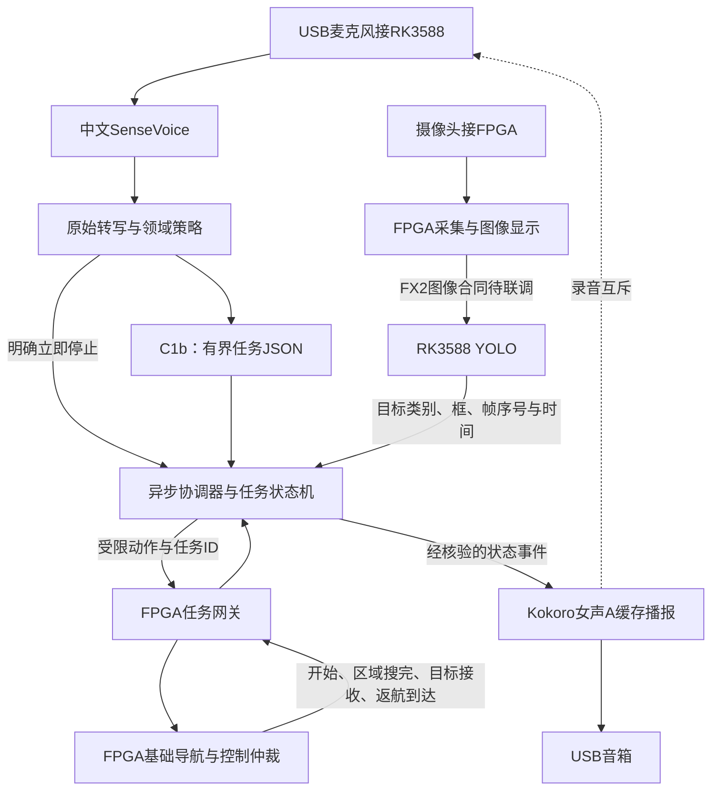

# 中文语音—视觉—FPGA任务链路：论文核验与整合方案

核验日期：2026-10-24。目的：在进一步整合既有模块之前，核对已经在机器人上运行过的链路、公开实现与本项目缺口。本轮为文献和代码只读核验，没有安装这些框架，没有启动板端模型、连接车辆或更改固件。论文作者报告的结果与FALCONS自己的结果分别记录。

## 结论

**已有成功的机器人链路，可以借鉴模块和接口设计。** 最接近语音交互与执行播报的是Dobby；最接近低成本边缘平台的是树莓派教育机器人；视觉到导航/操作的系统集成可参考OK-Robot。SayCan、Inner Monologue、ROS-LLM和SayPlan补充技能约束、执行反馈和分层规划依据。

本轮没有核验到同时满足“中文、Qwen3.5-0.8B、RK3588离线、FPGA采集与基础导航”的现成完整工程。这是本次检索范围内的证据缺口，不代表不存在。上述论文支持架构可行性，不能证明我们已经完成硬件闭环，也不能提供本板端到端速度保证。

## 1. 已核对的成功链路

| 来源 | 实际验证到哪里 | 可借鉴内容 | 使用边界与公开实现 |
| --- | --- | --- | --- |
| [Dobby](https://arxiv.org/abs/2310.06303)，2023预印本；[RO-MAN 2024作者页](https://www.cs.utexas.edu/~pstone/Papers/bib2html/b2hd-carson_stark_ROMAN2024.html) | 真机导览与人机交互研究；录音、转写、GPT-4、计划验证、动作执行、对话提示串联 | 动作开始/结束事件驱动播报；长动作异步；任务取消与替换 | 采用云端GPT-4；导览依赖已登记目的地。不能视为中文离线视觉找物实验。本轮核读arXiv v1第III-B至III-D节与正式发表元数据，未核验完整官方机器人代码 |
| [SayCan](https://say-can.github.io/)，CoRL 2022；[会议论文](https://proceedings.mlr.press/v205/ichter23a.html) | 真机移动操作，101个自然语言任务；项目页报告计划成功84%、执行成功74% | 根据机器人技能和当前可执行性约束语言建议 | 使用学习得到的技能价值函数；公开[代码](https://github.com/google-research/google-research/tree/master/saycan)为桌面环境版本，不能当成完整真机移植包 |
| [Inner Monologue](https://proceedings.mlr.press/v205/huang23c.html)，CoRL 2022 | 仿真与真机桌面任务、真机移动操作；利用成功检测和场景反馈修正后续计划 | 把失败、目标状态和执行结果纳入任务闭环 | [项目页](https://inner-monologue.github.io/)展示反馈与重规划；不等于要求Qwen无限生成思考，也不能把全部反馈统一当作零成本、自动可靠的传感器 |
| [OK-Robot](https://ok-robot.github.io/)，2024；[论文](https://arxiv.org/abs/2401.12202) | 10个真实家庭、171次开放词汇拾取放置；作者报告58.5%成功率 | 分开管理目标检索、导航、操作和硬件故障，按整条任务统计成功 | [官方源码](https://github.com/ok-robot/ok-robot)要求Stretch、环境扫描和GPU工作站；AnyGrasp另有授权。不是RK3588全离线语音方案 |
| [ROS-LLM](https://arxiv.org/abs/2406.19741)，2024预印本 | 真机原子动作组合、环境/人类反馈、远程监督控制 | agent_comm、behavior_executor、公共消息/服务的职责划分；行为返回成功/失败与解释 | 核读v1第3节。第3.3节仍将麦克风列为后续功能，不能称为已经验证的语音全链路。[源码README](https://github.com/huawei-noah/HEBO/blob/master/ROSLLM/README.md)目前声明仅支持ROS Noetic |
| [SayPlan](https://proceedings.mlr.press/v229/rana23a.html)，CoRL 2023 | 两个大场景的规划评估，项目页提供真机演示 | 语义目标与经典路径规划分工；用状态检查计划可行性 | 三维场景图及模拟器反馈是方法的重要部分。只借鉴分层原则，不能把其全部大场景评估都称为实车试验 |
| [低成本ROS2教育机器人](https://doi.org/10.3390/robotics15070131)，Robotics 2026 | 作者报告树莓派4B上的西班牙语交互、YOLOv8n、反应式导航和语音输出 | 各功能独立节点；按任务模式启停负载；已知问答减少模型调用 | [作者源码](https://github.com/SesSic/MobileRobotAssistantNLPROS2)包含Vosk、Piper、Qwen2.5-1.5B量化和可选云服务。教育/导航模式有切换，不能据此宣称所有模型始终并发。西班牙语指标不能转成中文指标 |

这些数字属于不同任务、场地和硬件，**不横向排名，也不作为FALCONS的预期成功率**。CoRL 2022的两篇论文在PMLR卷205中列为2023出版，会议年份与论文集出版年应区分。

## 2. 查到代码，不代表可以原样搬到板上

已读取ROS-LLM的README、执行器README和`behavior_tree_executor.cpp`，以及教育机器人README和在线/离线`voice_node`实际代码；不仅依据仓库名称判断。

- ROS-LLM将通信、行为执行和消息类型分开，适合参考；实际动作仍要开发者包装。它不能自动获得本项目FPGA导航能力。
- 教育机器人代码确实有视觉结果订阅、目标跟随请求、录音和播放入口；同时直接发布运动速度，并有平台专用进程管理和关机逻辑。FALCONS保持现有FPGA执行仲裁，不运行或整包移植这些脚本。
- 两个项目的依赖、摄像头连接方式和语言不同。本项目沿用既有CPU ASR、专项GGUF和RKNN runtime，不通过安装大型框架改变比赛环境。

参考实现源文件快照与SHA256存于工作区`ai部分/pipeline_research_20261024/`，只作研究证据，未导入运行。GitHub读取使用连接器，部分页面直接访问失败后以作者公开文件核验。网页存在和代码可读不等于我们已复现实验。

## 3. 新近论文线索的证据等级

| 线索 | 核验程度 | 本轮处理 |
| --- | --- | --- |
| [低成本Jetson语义导航](https://doi.org/10.3390/fi18080427)，Future Internet 2026 | 出版商检索内容可核对标题、作者与边缘感知＋云端语言规划；正文直接访问返回429。作者说明代码/试验日志需合理请求 | 作为补充架构线索，不引用精确时延或把它列作已复现模块 |
| [语音驱动建筑机器人](https://doi.org/10.1016/j.autcon.2026.106805)，Automation in Construction 2026 | 出版商检索内容与[作者预印本入口](https://papers.ssrn.com/sol3/papers.cfm?abstract_id=5771683)可交叉确认；本轮未取得可核读全文 | 只记录语音、结构化输出和导航命令层方向；不引用性能数字 |
| [RK3588意图分流与思考增强线索](https://journal.bit.edu.cn/zrb/ch/reader/view_abstract.aspx?file_no=202604210000002&flag=2&journal_id=bjlgzr) | 搜索命中北理工学报摘要，但直接打开为站点错误，未核对完整题名、作者、版本和正文 | **暂不作为设计/性能依据**；不采用搜索摘要的准确率、延迟数字 |

主表的教育机器人论文页面直接访问也曾返回429；已交叉核对出版商检索内容、DOI及作者仓库，实际代码可读。其性能数字未作为本轮结论依据。不能因检索摘要很贴近项目，就提升为经过独立复现的证据。

## 4. FALCONS的推荐结构

以下为结合论文与现有项目约束的工程判断。

语言模型负责“找谁、备选谁、是否返回”等意图；YOLO负责当前画面中可见目标的检测；协调器管理任务生命周期和证据；FPGA继续执行基础功能。当前四类与少量动作适合沿用有限状态机；没有必要为参考行为树论文而更换整个运行框架。

[BehaviorTree.CPP官方异步动作文档](https://www.behaviortree.dev/docs/guides/asynchronous_nodes/)可直接参考的是非阻塞启动、状态查询、结果获取与取消合同。我们复用这些接口语义，不宣称现有Python状态机就是BT.CPP实现。

**反馈闭环无需每帧调用语言模型。** 一次解析出受限任务，之后按视觉和FPGA事件推进；超出已支持任务就拒识或澄清。后续若引入模型重规划，应限定触发条件、次数和总时间。Inner Monologue支持反馈价值，不能直接证明关闭/开启本地CoT哪种在本任务上更优。

## 5. 对照现有代码后的实际缺口

本地基准提交为`a3cfcd80a3d63a049affcbbca4830187822aa0d0`，工作区包含尚未提交的既有模块，未覆盖它们。官方仓库连接器本轮返回404，因此本轮以本地既有代码核对，不宣称已同步GitHub最新内容。

| 连接 | 目前已有证据 | 整合时要补齐 |
| --- | --- | --- |
| 音频→ASR | SenseVoice、音频选择/重采样、合成中文回环、真人录音工具 | 到货后验证真实USB采集、噪声和停录/恢复；合成TTS不算真人 |
| ASR→任务解析 | Claude的C1b及42条中文验收；领域别名/guard已存在 | 协调器目前仍以早期专项模型和自己的parse流程运行。要统一模型、提示、原始文本guard、别名与schema，不能继承另一入口的成绩 |
| 任务→视觉 | 协调器有目标约束、异步worker、时效检查；v17解码合同已适配 | 本轮Nano候选仍未通过全部门槛；若最终换模型必须显式适配输出，不能把四路raw输出交给v17单输出解码器 |
| FPGA图像→视觉 | FIMG解析器、USB worker、RGB565转换 | FIMG是待对接合同；实物固件、数据流、缓存年龄/源时间未验证 |
| 协调器→FPGA→回执 | FAM1软件网关与伪终端/模拟回执测试 | FPGA目前未实现该任务协议。现有AA55视觉帧不含完整搜索/返航结果，不能代替任务回执 |
| 状态→播报→录音恢复 | zf_001缓存、队列取消、录音互斥和冷却软件测试 | 板端仍为log模式；USB音箱、实际回声和录音恢复待验收。半双工期间没有语音打断能力，硬件/遥控停止独立保留 |

特别检查两套停止策略：`host/voice_bridge/safety_rules.py`含停止词匹配；协调器`runtime.py`另有全句立即停止判断。连接时必须保留“现在停止”与“找到后停止”的区别，不能不加检查直接串联。原始转写与规范化文本都要留下，便于区分声学误识与任务解析错误。

## 6. 后续整合顺序与完成标准

1. **先完成已安排的YOLO小目标对照。** 不满足旧四类和小目标门槛的候选不替换v17，论文调研不改变既有验收结论。
2. **统一一个中文任务入口。** 接入C1b与明确版本的策略/提示/schema；先复用既有中文用例，再增加两入口差异回归，包括条件停止、提示注入、含糊物体、备选与返回。英文不运行。
3. **连接可复用的任务核心。** 把ASR结果、目标检测、FPGA请求/回执和播报挂在同一任务ID上；依次覆盖正常找到、区域搜完切备选、返回起点、取消、新任务替换、断连、旧回执和过期图像。
4. **做电脑端端到端回放。** 区分真实模型推理与注入结果；记录各阶段耗时、错误归因、任务状态和音频事件。模拟FPGA的完成始终标记为模拟，不能报实车任务成功率。
5. **板端分层交付。** 先独立目录、哈希和软件轻量检查；异常重启原因未查清前保持模型长测HOLD。之后按板端模型、FX2、FPGA状态、实车顺序验证，不升级现有环境。

“开始寻找”说明任务已准入；“已找到”须有有效视觉与FPGA接收回执；“返回完成”须有对应到达回执；“停止请求已发送”与“设备已停止”分开。任何模型文字、一次空图、串口发送成功都不能冒充执行完成。

全链路验收同时记录：任务严格正确率、误搜索、漏停止、实际完成率、无证据完成次数、拒识/取消表现，以及从说完话到任务准入、目标确认到设备接收的分阶段延迟。CPU/GPU电脑结果和RK3588结果分表。

## 7. 可检验的项目价值

可研究的是“FPGA保留基础自治，边缘AI可插拔地提供中文任务理解与视觉目标选择，并用执行回执约束播报”的可靠性与资源取舍。它与前述模块化、反馈闭环原则一致；仅把ASR、YOLO、LLM连起来本身不能称为新算法。

后续可以在固定中文任务、独立视频与真实录音上，对照固定规则/专项模型、无执行反馈/有执行反馈、串行阻塞/异步隔离，测量任务成功、错误成功播报、取消时延和资源占用。先落实指标与独立验收材料，再判断是否形成可展示的创新证据。

相关既有记录：[协调器研究](../host/ai_coordinator/RESEARCH.md)、[板端部署与验证](AI总协调器板端部署与验证_20261024.md)、[YOLO头部对照](YOLO头部修正对照_20261024.md)。本轮没有新增模型成绩、提交、推送或烧录。
