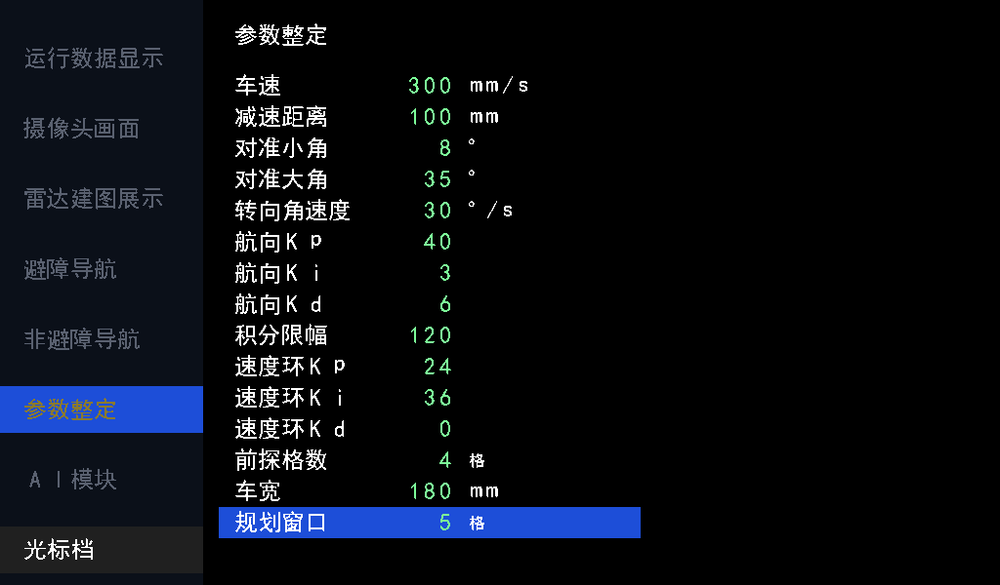

# 短段锁定与运行时规划窗口验证

在 `codex/ai-visual-inspection` 的 `233c0f2` 上完成；先提交本次修改，再迁移旧导航分支超前的提交。本记录对应本次提交内容，不填写尚未生成的自身 commit ID。

## 行为

- `nav_planner` 在居中之后按 `w_max−1` 格插入短段边界；`nav_segments` 改为一项寄存缓冲，只登记方向，保留所有短段，不再做同向合并。
- `nav_route` 的 RAM 保存全部短段。当前短段终点供后台规划使用；控制器目标独立向后查找，连续同方向时延伸，转向、折返、路线末尾结束。
- 例如 `A→B→C→D→E` 在 D 转弯：当前内部锁定 A→B，控制输出 D，后台从 B 规划。位置越过 B 或存在横向误差不改变这个起点。控制器确认完成 D 后，按当前路线中的 D 索引跳过已包含的短段，开始 D 后的下一短段。
- 发布可能改变点编号，按完成目标坐标对应当前路线索引；删除命令执行器中旧编号的输入、存储和回传。若完成发生在描述符读取期间、无法对应，完成握手后从实际位置重算，不使用失效的旧编号。
- 正常目标/急停四相握手、控制器自行转向、地图规则及 AI 图层语义不变。

## 参数与界面

新增正式运行输入 `w_max[7:0]`，沿 `radar_navigation → adapter → auto_navigation → nav_top → nav_planner` 连接整定页参数 14（`tune_p[455:448]`）。不保留编译期 `W_MAX` 参数。

默认 5，合法 2..64，步长 1；包含起点，因此默认短段端点最多相差 4 格，轴向 200 mm、45°约 283 mm。请求接受时锁存，当轮不随 UI 改值变化；已锁定短段不随配置伸缩。页内显示原值 5，不把它误记为 5 格位移。

整定页扩为 15 行，行高 32 px、文字偏移 4 px，最后一行止于 y=551，不覆盖 y=552 开始的状态栏。新增字段仍使用现有 128 字符 RAM；字库由 `tools/font_chars.txt` 重生成，未另加显示通路。预览读实际字模生成，像素测试检查新增标签、数值、单位和高亮；其余五页像素指纹不变。

## 时序实现

最远同向查找采用同步 RAM 读取与方向比较分拍，每点两拍，结束后增加一拍对齐毫米换算。查找完成才使能新描述符；已有控制器请求和目标保持。没有组合展开 MAX_WP 个点，没有额外路线 RAM，也没有新增兼容状态。

`w_max−1` 在请求接受时寄存；运行时正负位移由寄存步距选择，后续短段逐个产生。删除旧两点特判和同向合并的前看状态机，以及不再使用的命令索引链。

## 验证

运行 `sim/run_sim.ps1 -ModelSim D:/apps/modelsim/win64`，最新 AI 分支完整 **80 台 / 10614 项通过**。原始日志：`logs/short_lock_ai_final.log`，结果索引：`logs/short_lock_ai_results.json`。

| 测试 | 检查 | 周期 | 覆盖 |
| --- | ---: | ---: | --- |
| nav_lock | 12 | 2245363 | 真正规划到控制链：短段起点、最远目标、后台发布、位姿跨格/横向误差、运行改窗口、完成信任、索引变化、读取期间完成后重算 |
| nav_route | 42 | 378 | 八方向全部中继保留、首段/中途读出最远点、转弯独立、候选取消不改活动路线 |
| nav_planner_limit | 6 | 40499 | 窗口 5/2、请求后改为 64 不影响当轮、容量前缀截断、排空重入、起终点重合 |
| nav_planner | 465 | 21697391 | 58 图，两种居中配置；完整线段通行、斜向侧格、每短段最多 4 格、独立 Dijkstra 参考 |
| obstacle_motion | 15 | 152500034 | 原实时时间闭环、暂停/手动位移恢复、近障停车、清障、两趟多目标 |
| tune_ctrl | 89 | 原台未输出周期汇总 | 新参数默认、步长、上下界、复位及选行回绕；原整定行为 |
| tune_page | 69 | 原台未输出周期汇总 | 15 行标签/数值、新单位/高亮、未覆盖其他页面 |
| num_text | 117 | 原台未输出周期汇总 | 新字段 70..74 地址与原字段格式 |
| ui_pipeline | 6 | 4896384 | 六页完整 HDMI 像素；仅参数页指纹按新布局更新 |

`nav_lock` 首次命令 114831 拍（2.29662 ms @50 MHz）；实测最长最远目标查找 24 拍（0.48 μs），只是此用例的最大值，不是全部 MAX_WP 配置的上界。

首次回归在极端 2274 步多转弯通道中检出测试固定 512 航点容量不足。将完整路线台改为生产容量 1024 后，该图输出 635 个短段点并完整到达；另保留独立小容量截断台，未放宽 RTL 容量限制或路线正确性判据。其余首轮失败是测试仍按旧合并点数、旧 UI 几何/指纹及同拍读旧有效位判断，均已改为新规格并重新完整回归。

额外整车顶层语法检查：ModelSim 严格模式在基线和修改版均报告同一对既有 2388 错误（route_disp_x/y 在声明前引用形成隐式网线）。未改这处无关源代码；抑制该既有诊断后当前顶层编译通过。此检查不代表 Gowin 综合或布局布线。

本次未重新综合、布局布线或下载硬件，不给出新资源占用或 Fmax 结论。
