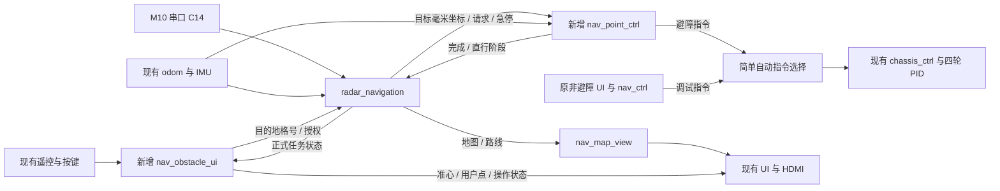

# 整车自动导航接入方案

日期：2026-10-21。代码审查基线：整车仓库 `28326ea`。本文已按“把原有无雷达选点和跟踪迁移成带雷达建图、规划路线显示的导航”修订，仅为接入方案，尚未修改 RTL 或执行验证。

## 1. 本次要完成的功能

**实施原则：先完成最小可验证闭环，禁止过度防御性编程，尽量简洁。** 最小方案包括已明确要求的多目标调度，以及地图、路线双缓冲；不以精简为由删除它们。优先复用现有逻辑，只增加打通实际接口所必需的寄存器、状态和存储。

**原非避障导航原样保留用于调试，另在避障导航页移植选点与跟踪功能，接入雷达建图、规划及路线显示。** 沿用现有遥控交互、定位、点位跟踪算法和四轮控制，选点页面改为在实际障碍地图上选点，并显示导航生成的路线。

```text
原来：空白坐标页选点 → 控制器直接跟踪用户点 → 到点停车
改后：障碍地图上选点 → 雷达导航规划路线 → 原控制器跟踪路线目标 → 到点停车
```

本次范围：

1. 接入 M10 雷达，由已交付 `radar_navigation` 完成解析、建图、规划和车前障碍检查。
2. 将原无雷达页面的准心、记点、撤销、清空、启动、暂停恢复等交互迁移到带地图的导航页。
3. 显示实际障碍、规划路线、车辆位置、准心和用户确认的目标点。
4. 将原跟踪控制器的目标来源改为导航输出，保留已有位置投影、CORDIC、航向 PID、减速和底盘闭环。
5. 补齐与导航对接所需的完成反馈、直行阶段反馈和紧急停车握手。

**本次不显示原始点云。** 不增加点云 FIFO、极坐标显示换算、点云位图或点云视图；三个 `cloud_*` 输出显式不连接，导航模块本身的正式接口保持不变。

原 `nav_free_ctrl`、`nav_ctrl` 及非避障页面保留原行为；新增 `nav_obstacle_ui`，复用原选点逻辑并加目标索引。避障控制用独立的点位执行器适配导航握手，不修改原非避障跟踪器。两条实际业务只在底盘自动指令入口做必要选择，不抽通用任务框架。

### 1.1 简化边界

| 保留的必要功能 | 不新增的机制 |
| --- | --- |
| 原有多目的地列表、依次到达、暂停恢复 | 额外任务框架、复制点表、并行任务队列、自动跳过失败目标 |
| 地图和路线各自双缓冲，完整后换图 | 第三张显示图、路线代号、多版本缓存、显示数据重传 |
| 导航要求的正常完成 / 急停握手 | 框架重复验收到点、第二套停稳检测、握手超时重试 |
| 坐标单位转换、显示跨域、同步清零 | 通用坐标变换框架、外部时间戳、传感器心跳与自愈状态机 |
| 现有 S1/S4、手动优先、堵转保护 | 本轮另建安全管理层、对内部可信信号重复检查 |

普通输入遵守既定接口协议，不为假设的乱序、非法信号组合增加通用容错。保留 RAM 容量边界、正确的跨时钟传输、取消后停车等实际正确性要求；这些不能用“信任输入”省略。

## 2. 迁移后用户如何操作

1. 上电完成定位初始化后，雷达持续建图；雷达浏览页和导航页读取同一份地图显示数据。
2. 进入导航页，看到实际障碍地图、车辆位置和坐标轴；确认后进入选点交互，菜单变暗、摇杆控制准心。
3. 选择“确认路径点”记录目的地；可以继续记录其他目的地，也可撤销或清空。
4. 选择“开始导航”后，冻结本次目的地列表，由导航依次规划到这些点的路线，控制器跟踪导航输出的目标。
5. 行驶时显示地图、当前规划路线和车辆轨迹位置；远处路线受阻时后台更新，近处危险时停车后重新规划。
6. 返回键或暂停操作撤销运动授权，地图和目的地保留；确认恢复时从当前实际位置重新起步。
7. 最后一个目的地到达后显示“已到达”；无路则停车并显示“无路”，不能自动跳过该目的地。

这里的“车辆轨迹位置”指持续更新车辆标记，不要求本次增加历史轨迹存储或回放。

### 2.1 选点页面迁移范围

| 原有内容 | 迁移后处理 |
| --- | --- |
| 摇杆移准心、坐标显示、车的位置标记 | 保留原操作和毫米坐标，在障碍底图上叠加 |
| 最多 16 个用户确认点、撤销、清空 | 保留；这些点是目的地，不是 BFS 的全部拐点 |
| 间断 / 非间断寻点菜单 | 原非避障页原样保留；新增避障页使用“开始导航 / 暂停任务” |
| 原控制器按点表直接切点 | 原非避障调试保留；新增避障执行器只读导航给出的路线目标 |
| 雷达 / 避障页占位图 | 替换为实际地图；导航页再叠加路线和原选点交互 |
| 避障 / 非避障两个入口 | 保留原六页编号；非避障用于原功能调试，避障页新增地图选点与规划导航 |
| 运行数据显示、摄像头、参数整定、手动驾驶 | 保持原功能与页面编号 |

不合并页面，不重排菜单编号或重写字库。已生成的 UI 资源通过现有生成工具更新，不直接手改自动生成的 ROM。

## 3. 现有代码与修改落点

| 位置 | 当前情况 | 本次计划 |
| --- | --- | --- |
| [整车顶层](../rtl/top/falcons_top.v) | 雷达 RX C14 仅接 `radar_rx_unused`；两页都连接 `nav_ctrl` | 例化一套 `radar_navigation`，连接新增避障链路；原非避障链路保留 |
| [选点状态控制](../rtl/ui/nav_free_ctrl.v) | 已有准心、列表和设置 / 运行 / 暂停；存在按页区分的辅助菜单 | 原文件不改；移植为 `nav_obstacle_ui`，内部完成多目标调度，不另建任务层 |
| [点位控制](../rtl/nav/nav_ctrl.v) | 直接读取准心 / 用户点表；完成是整趟末点单拍 | 原文件不改；新增 `nav_point_ctrl` 复用其控制计算，适配导航电平握手、急停和直行阶段反馈 |
| [界面绘制](../rtl/ui/ui_render.v) | 无雷达页有选点叠加，雷达和避障页主要为占位 | 将原选点叠加复用到避障页，接地图 / 路线图层；原非避障页保留 |
| `rtl/ui/nav_map_view.v`（新增） | 无地图 / 路线接收缓冲 | 接收地图、路线并形成显示图层，处理系统域到像素域的安全交接 |
| [定位](../rtl/odom/odom.v) | 毫米 x/y、连续 yaw、速度和编码器角速度已存在 | 复用，应用层补位姿成组寄存和有效电平，不重做定位 |
| [底盘](../rtl/motor/chassis_ctrl.v) | 已有手动优先、四路速度 PID、急停刹车、堵转 | 保留，接入导航停车请求，处理自动暂停 / 退出的停车过程 |
| [依赖清单](../deps/modules.list) | 雷达尚未启用，未列导航包 | 启用雷达与两个导航包，UART 保留现有一份 |
| [仿真入口](../sim/run_sim.ps1) | 显式源文件数组和现有 19 台组件测试 | 加入导航依赖，迁移选点 / 跟踪测试，补真实连线的集成测试 |

新增避障页面统一四项辅助菜单，消除原共用分支中清除项编号不一致的问题，不修改原非避障页面。

原跟踪器的 L2、点表索引与夹角判断保留用于非避障调试；新增避障执行器不包含这些逻辑。导航本身已经输出当前方向的动态最远目标，内部仍保留分段锁定；控制器不能再次跨拐角提前切点。

## 4. 迁移后的结构



每个页面只维护自己的目的地列表，避障页面沿用移植的点表结构，运行期间禁止编辑，只增加当前目的地索引、提交过程和导航状态处理，不再复制一张任务表，也不单独抽出任务框架。

新增 `nav_point_ctrl` 只执行导航给出的一个目标点请求。它保留原控制算法，但不再决定用户目的地进度，也不自行规划或合并路径。

## 5. 雷达与定位接入

### 5.1 接线与依赖

- `radar_navigation.clk` 接 `i_clk_50m`，固定 50 MHz。
- `radar_rx` 接现有 `i_radar_rx`，物理 C14，M10 TX → FPGA RX，460800 / 8N1。
- `reset_n` 接系统复位结合导航局部复位；局部复位用于坐标清零，不能代替整车停车。
- `deps/modules.list` 加入 `m10_radar`、`auto_navigation`、`radar_navigation`。当前构建按包枚举 RTL，不会递归解析包内 `files.f`，三个包需明确列出。
- `uart_byte_rx.v` 已存在，只编译一份。雷达接收和解析只例化在导航内部，不再例化独立雷达核心。

本次没有点云显示，不需要应用层例化 `polar_to_xy`、`point_bitmap`、`point_cloud_video` 或第二套 HDMI 输出。

### 5.2 位姿格式

| 导航输入 | 整车来源 | 约定 |
| --- | --- | --- |
| `pose_x_mm/pose_y_mm` | `odom_x_mm/odom_y_mm` 成组寄存 | signed 32 位毫米，不取显示用厘米 |
| `pose_yaw_cdeg` | 已归一方向的 `yaw_raw_s` 成组寄存 | signed 32 位 0.01°，范围 `[-18000,18000)`，+18000 转 -18000 |
| `pose_valid` | 应用层定位已准备好电平 | 校准成功并已有首份位置和航向后保持 1，清零 / 校准 / IMU 错误时撤销 |

不要把连续 `odom_yaw_cont` 直接送导航，也不要把 `yaw_valid` 或 `delta_valid` 脉冲当成 `pose_valid`。

`odom` 在 `delta_valid` 上升沿用非阻塞赋值更新位置，应用层应在其输出更新后采集整组位姿，当前可延迟一个系统拍捕获 x/y/yaw。若以后 odom 增加流水，则采集时刻相应跟随其完成输出，避免 x/y 混用更新前后的值。

起点为 `(0,0)`，初始车头 +x、车左 +y；左转逆时针为正。雷达 0° 朝车头，角度顺时针增加，方向差由导航内部处理。

导航在接收每个雷达距离字节时保存当时位姿，排队后的点仍用该份位姿。保持现有“信任雷达和定位持续更新”的设计，不加外部时间戳和复杂超时机制；不能宣称能检测 valid 始终为 1 的数据冻结。

### 5.3 安装参考点与清零

雷达位置与 odom 参考点尽量接近，首版按同一点对接并记录实测安装误差，`FRONT_OFFSET_MM` 从该点量到车前缘。本轮不新增通用安装偏置补偿；若实际偏置明显，先调整安装，再做坐标验证。

清零沿用现有 S2 / 串口入口，约定停车后操作，自动任务运行期间屏蔽清零。受理时同步清 odom、yaw、用户目标和导航地图；释放复位后沿用导航已有初始化过程。**不新增“收到清零请求后自动停车、等待、重建、自动续跑”的状态机。**

普通暂停、手动接管、切页面不清地图，也不重新定义原点。若 IMU 重新初始化导致航向基准改变，撤销自动任务并由操作人员停车、重新初始化后开始，不为此增加自动恢复流程。

## 6. 选点与规划模块如何连接

完整端口定义见 [radar_navigation 交接文档](../vendor/verilog-reusable-modules/modules/radar_navigation/docs/delivery_handoff.md)。应用层按下面连接。

| 端口组 | 接到哪里 |
| --- | --- |
| `map_enable` | 位姿可用后持续开启；不由当前显示页直接控制 |
| `plan_enable` | 当前有已提交目的地时开启，暂停期间可保持 |
| `motion_enable` | 当前任务运行、光标档、定位 / 遥控有效、未停机或故障时开启；不受规划忙影响 |
| `goal_valid/goal_x_cell/goal_y_cell` | 页面内当前已确认目的地，换算后持续保持；不是确认键单拍或实时准心 |
| `cmd_valid/target_x_mm/target_y_mm/emergency_stop` | 直接给新增 `nav_point_ctrl`；与原非避障自动指令在底盘入口选择 |
| `ctrl_done/ctrl_linear_active` | 控制器真实完成和直行阶段反馈 |
| `nav_state` | 页面处理当前目的地完成，并给状态栏显示 |
| `display_enable` | 雷达建图页或自动导航页显示地图时为 1，同时控制地图和路线输出 |
| `map_disp_*`、`route_disp_*` | 新显示接收模块 |
| 三个 `cloud_*` | 显式不接，不新增显示链路 |

### 6.1 保留原列表，依次规划

1. 设置时沿用原最多 16 点列表；没有已确认点时禁止开始。
2. 启动后禁止编辑列表，索引从 0 开始，当前点换成地图格号并提交。
3. `goal_valid` 和格号保持，导航自行寻找当前目的地的路线；车辆只跟踪导航输出的拐点。
4. 控制器每次 `ctrl_done` 只回给导航，不能让页面误以为整趟到达。`nav_state==3` 才表示当前用户目的地到达。
5. 还有下一目的地时先撤旧目标，等旧请求结束、`cmd_valid=0`、`emergency_stop=0`、`ctrl_done=0` 后提交下一点；目标无效至少经过一个完整系统时钟沿。
6. 最后一点完成才结束整趟；无路保留当前索引并停车，障碍清除后可继续规划，不跳过目的地。

不需要为“冻结列表”复制 RAM，只需禁止运行 / 暂停中编辑原列表。页面退出取消任务，下一次开始是否重新编辑按原交互处理。

多目标调度只需现有点数、一个当前索引，以及撤旧目标 / 提交新目标的必要过程。无需给每个点增加任务 ID、重试计数、到达验证状态或失败回退策略。等待 `cmd_valid/emergency_stop/ctrl_done` 撤销是现有接口的正常握手，不再叠加超时和重复确认。

### 6.2 坐标换算与选点显示

```text
有效范围：-12800 <= x_mm < 12800，y 同理
目标格号：gx = (x_mm + 12800) / 100
          gy = (y_mm + 12800) / 100
格中心：  x_mm = 100*gx - 12750
          y_mm = 100*gy - 12750
```

先检查范围，再对非负整数除以 100，最后取 8 位。转换在记点或提交目标时多拍完成，不放到逐像素或控制器的关键组合路径。

底层地图 256×256、100 mm / 格、25.6×25.6 m 不变。`(0,0)` 位于中央格线交点，属于 `(128,128)`；该格中心是 `(50,50)` mm，不能把两者混淆。

确认点显示建议吸附到最终提交的格中心，让屏幕圆点与导航目的地一致；准心移动仍按原毫米精度。量化误差每轴约不超过 50 mm。连续点落在同一格时不必重复提交。

## 7. 新增避障点位执行器

### 7.1 复用算法，原调试控制器不动

| 保留 | 替换 / 删除 |
| --- | --- |
| 位置误差投影、CORDIC、航向 PID、原地对准与直行减速 | 不再从 UI 准心 / 用户点表直接取控制目标 |
| 四轮闭环、编码器极性、参数整定页提供的控制参数 | 新避障执行器不移植点表索引、L2 和下一点夹角逻辑 |
| 已有 100 Hz 多拍计算流水 | 完成反馈由单拍改为保持电平，增加急停入口和直行阶段输出 |
| 到点容差与停稳判断归控制器负责 | 导航不再重复按位置 / 朝向验收到达，不额外要求格中心或 ±1° |

控制接口使用六个信号：输入 `cmd_valid`、`target_x_mm`、`target_y_mm`、`emergency_stop`；输出 `ctrl_done`、`ctrl_linear_active`。不增加独立转向指令。

### 7.2 正常目标点任务

```text
cmd_valid=1 → 控制器按需转向、直行到目标并停稳
            → ctrl_done=1 并保持
cmd_valid=0 → 控制器 ctrl_done=0
            → 等待下一请求
```

同一次任务内目标坐标可能沿当前方向变化，控制器持续读取并调整减速；不能只在请求上升沿锁存。方向变化由导航等待当前点位任务完成后下发，控制器不擅自延长或跨角合并。

即将或正在平移时 `ctrl_linear_active=1`，第一笔非零前进指令之前就应置位，让前探检查有机会抢占；减速中尚未停稳也保持 1。停稳后的原地转向 / 等待为 0，不能仅根据 center 当前为 0 就清除此位。

### 7.3 紧急停车

1. `emergency_stop=1` 优先取消原目标与未完成的计算，不等下一次 10 ms 决策拍。
2. 控制器先把旧 `ctrl_done` 清 0，让导航读到一次低电平；实际停稳后再置 1 并保持。
3. 导航未撤急停前继续停车；撤销后清 done，等待新的点位任务。
4. 即使车原本已静止，也完成这次新低→高确认；不能把 emergency_stop 组合接回 done。

急停置位只在新请求开始时初始化反馈过程，不能在急停的每一拍都强制清 done。复用控制器现有轮速与 IMU 角速度停稳判据，保证无目标或计算被取消时也能回应停车；框架不再增加第二套停稳检测、姿态验收或反馈超时重试。

复用底盘原有实际刹车接口：

```text
nav_brake       = 自动导航控制仍有效 & 非手动接管 & emergency_stop
chassis.i_estop = 原有全局急停 | nav_brake
```

`nav_brake` 不写入 S4 的 `estop_latch`，否则每次正常避障都要手动解锁。暂停 / 取消后继续连通这次停车握手，不能因为页面状态变成暂停就立即断开控制器。堵转与原有全局故障保护保留，故障不伪装成到点完成。

## 8. 地图与路线显示，迁移原选点页面

### 8.1 沿用原页面坐标窗口

优先保持原页面布局与操作尺度：内容区 x=208..1023、y=0..599，世界原点屏幕 `(412,300)`，比例约 0.06 px/mm，纵向约 ±5 m，x 向右、y 向上。

```text
屏幕 x = 412 + ((世界 x_mm * 3932) >>> 16)
屏幕 y = 300 - ((世界 y_mm * 3932) >>> 16)
```

地图、路线、用户目的地、准心和车辆标记全部使用同一组换算。确认点从地图格中心还原成毫米后也按这个公式显示。

底层地图仍完整保存 25.6×25.6 m，屏幕只显示原坐标窗口内的部分，不为接雷达就把原页面改成另一套比例的 512×512 小图。初版不增加缩放和拖动；超出当前窗口的地图 / 路线裁剪显示，选点继续限制在可见有效范围。

每格 100 mm 在现有尺度下约占 6×6 像素。原点在格线交点，不能把车辆 `(0,0)` 标记画到 `(128,128)` 的格中心。地图外禁止选点 / 显示为不可用，不和“地图内未发现障碍”混为一类。

### 8.2 地图数据接收

- 接收 `map_disp_valid`、`map_disp_occupied`、start、done 四信号。
- 一帧 65536 格，x 先递增再换 y；没有 x/y 输出，由 16 位地址计数恢复，低 8 位为 x、高 8 位为 y。
- start 当拍写地址 0，只在 valid 时前进；中间空拍不能当作结束。
- occupied=1 画实际障碍，occupied=0 也写入以清旧格。规划的障碍预留范围不显示。
- 新 start 中止未完整帧；done 后才发布完整后台图。

保留地图两张 256×256 单色位图：HDMI 读前台，新地图写后台，完整接收后在视频帧边界交换，避免更新时看到新旧地图混合。显示写后台不能覆盖像素域仍在使用的前台。

只需前后台选择、帧完成及必要的换图握手。导航重复刷新显示数据，换图尚未完成时可跳过一帧并等下一 start，不加显示 FIFO、重传、超时恢复或逐格校验。

### 8.3 路线数据接收

路线与地图是独立链路：start 清临时点表，valid 追加坐标，done 提交。同拍 start / valid / done 按这个顺序处理。

- 默认最多 1024 路线航点，与 UI 的 16 个目的地是两种容量。
- 空路线 `start=done=1, valid=0` 表示清旧路线，不能忽略。
- 新路线 start 可中断未完成旧输出，不能把两条路线混接。
- 在系统域按航点顺序将横纵线段画到路线位图，完成后交换显示；清旧图后再画，不只追加新点。

路线保留前后台两张地图格空间位图：后台清空、顺序画完，再换到前台。这样清旧路线时不会让正在显示的路线闪灭，也避免每个像素组合比较 1024 段。

航点临时接收表只需一份 1024×16 bit；接收完整路线后用于顺序画图。绘图期间不接收另一整条路线，等待后续 start 再收新帧；前台一直显示上一条完整路线，不额外堆叠两份航点表或候选显示队列。首版按格绘制，不增加平滑和轨迹回放。

建议图层为底色、坐标轴、实际障碍、规划路线、用户点、车辆、准心、菜单与文字。正常路线不应覆盖障碍；显示地图 / 路线并非同时快照，若变化时重叠，可优先让实际障碍可见。

### 8.4 跨域与像素时序

导航和显示接收在 50 MHz 系统域，HDMI 像素域约 49 MHz。显示存储采用双时钟双端口 RAM，帧交换用请求 / 确认交接；不得将坐标总线逐位两级同步来代替完整传输。

地图和路线各有独立完整帧边界，不要求同时交换。像素域同步读位图后，RGB、有效区、坐标、菜单叠加和摄像头选择一起对齐相同延迟，避免底图与光标相差一拍。

实现地址换算时可采用计数推进或拆拍，不把“像素坐标乘除 → RAM → 多层颜色选择”串进现有近临界的单拍像素路径。

## 9. 运行、暂停和正式状态

| 场景 | 目标与地图 | 行驶行为 |
| --- | --- | --- |
| 上电 / 选点 | 定位有效后持续建图，选点尚未提交 | 不授权自动运动 |
| 开始 | 保持当前目的地，开规划和运动 | 响应导航初次停车确认，再跟踪规划目标 |
| 后台规划 | 目标、地图持续有效 | 不以规划忙为由停车 |
| 暂停 / S1 | 保留地图、列表和当前索引，motion=0 | 控制器完成停车；暂停期间可继续建图与规划 |
| 确认恢复 | 保留目的地，重新 motion=1 | 确认停稳后从最新实际位置重新规划，不直接续旧动作 |
| 切手动 | 保留地图和目的地，自动任务落暂停 | 原底盘手动优先，导航普通刹车不压过手动驾驶 |
| 切回光标 | 保持暂停 | 必须再确认，不能自动起步 |
| 取消 / 退出 | 撤目标与运动，地图保留 | 完成停车握手后再释放自动控制 |
| 重新清零 | 停车后同步清位置、航向、地图和目的地 | 重新建图、重新选点 |

遥控仍是“接管车辆 / 控制光标”两档。自动运行由页面启动，不新增第三挡。S4、堵转、S1 和遥控失效不能被自动 `nav_auto_valid` 旁路；解除故障也不自动恢复任务。

`map_enable` 与 `display_enable` 分开：离开地图页仍可建图，关闭显示不取消任务。`plan_enable` 只决定是否开始规划，不能当停车开关；`motion_enable` 需要覆盖任务运行与整车授权，不包含 `!plan_busy`。

界面正式状态来自导航 `nav_state[3:0]`：0 关闭、1 运行中、2 暂停、3 已到达、4 无路。运行中包含规划、转向、避障停车等过程，不代表车辆正在移动。多目的地时单个目的地到达由页面先推进，最后一点才显示整趟完成。

页面原设置 / 运行 / 暂停状态与此不同，分别命名 `ui_nav_state` 和 `planner_nav_state`。控制器的错误仍作为错误处理，不假装成 BFS 无路。

## 10. 地图规则、资源和时序

保持现有导航配置：256×256 格、每格 100 mm、中心原点；未知默认通行，地图外不可越界；规划 `PLAN_INFLATE_CELLS=2`，当前为每侧横纵两格的方形预留范围；实际障碍与规划预留分开。

车宽 180 mm，前探 3 格，从车前缘向前约 300 mm，只按路线四方向读取原始障碍。停稳后允许原地转向，不增旋转区域判断。停车后局部接出保留，正常后台规划不放宽。

`FRONT_OFFSET_MM=150`、侧向余量 20 mm 仍是原仿真假设，需要按实车量测。实车首次可从 100 mm/s 验证，参数页现有 300 mm/s 在停车距离测定后再使用。此前 1 m/s 视频属于仿真速度，不作为本轮默认实车速度。

### 10.1 显示容量预算

| 显示存储 | 预计原始容量 |
| --- | --- |
| 地图 256×256×1 bit×2 | 16 KiB |
| 路线位图 256×256×1 bit×2 | 16 KiB |
| 1024 点×16 bit 路线临时接收表，一份 | 2 KiB |
| 合计 | 约 34 KiB，不含 RAM 端口组织带来的实际映射差异 |

不为本次预算加入原始点云的 64 KiB 位图及显示 FIFO。不新增 DDR 显示帧缓存，不复制导航内部的建图逻辑；显示缓冲只服务 HDMI。

交付来源的独立导航综合为 2940 Register、6356 LUT、46 BSRAM；内部测量顶层 PnR 为 55.851 MHz，见 [交付记录](../vendor/verilog-reusable-modules/modules/radar_navigation/ORIGIN.md)。这些数值不是本轮整车结果。

整车历史记录系统域 49.733 MHz、像素域 48.807 MHz，分别要求 50 / 49 MHz，已存在少量同域违例。因此先接控制闭环、再接显示，各阶段重新检查资源与布局布线；不能用导航独立 Fmax 推导整车主频。

格号转换、路线画线采用多拍处理；保留原控制器拆拍的投影、CORDIC、PID。最终资源以新综合报告为准，主频与 setup/hold 以新布局布线报告为准，不靠时序例外隐藏真实同域路径。

## 11. 实施顺序与验证

| 步骤 | 修改内容 | 对应验证 |
| --- | --- | --- |
| 1. 雷达建图接入 | 启用依赖、接 C14、公共位姿与统一清零；先不授权运动 | 真实格式 UART 报文 → 正确世界障碍格；四个朝向、清空重建、顶层实际展开 |
| 2. 原选点页面迁移 | 原非避障不改；新增避障准心、列表与四项菜单，在地图上选点 | 比例 / 原点一致，目标格转换、空表禁开始、撤销 / 清空 / 页面返回；尚不驱动车 |
| 3. 原跟踪器适配 | 新增点位执行器，目标来自导航，保持完成电平，补急停与直行阶段；原控制器不改 | 侧方起步先转向、动态目标变更、正常四相握手、旧 done 遇急停、计算途中抢占、转向 / 减速阶段 |
| 4. 路线显示与运行联调 | 路线接收与位图、目的地推进、状态显示、暂停 / 手动接管 / 恢复 | 地图清旧格、空路线、新帧中止、完整帧交换、逐点到达、无路不跳点、接管不自动恢复 |
| 5. 整体验证与上车 | 全应用必要回归、综合、布局布线、低速实车 | 新障碍远 / 近 / 车后、障碍清除、S1/S4、定位清零、最终到达及其他页面回归 |

这些步骤是实施顺序；第 1～4 步已实现并分别验证，第 5 步已完成软件回归与整车构建，时序未收敛；最终结果见接入验证记录，实车功能仍待验证。先用短路线打通完整链路，再验证多目的地和双缓冲；两者均属于本轮交付范围。沿用已有测试入口，不另搭一套通用验证框架。

最小集成台先覆盖：两目的地（至少一次转弯）到达、路线中出现障碍、暂停与恢复，以及地图清旧格 / 路线换图。上述通过后，再用现有回归覆盖手动接管、S1/S4、清零和其他页面；扩展大地图只在有新问题时增加，不把复杂极端场景作为首轮前置条件。

预计约 3～6 人日，取决于控制握手适配、显示跨域和时序收敛，不包含硬件故障排查。按步骤自检，阶段结束再做必要全回归，避免每个小改都跑慢速大地图。

原非避障测试与 L1/L2 行为原样保留；另增避障页面和跟踪测试，验证新链路的坐标、控制正负号、PID、暂停、急停及手动驾驶。补集成台验证真实 UI → 导航 → 控制器连线，不能只依靠现有组件台通过。

重点场景：

- 初次路线目标不在正前方：先转向再直行，不直接驶向准心。
- 远处出现障碍：安全当前段继续，后台换路，显示路线相应更新。
- 近处前探障碍：规划或控制计算期间也能停车，重新确认停稳后再起步。
- 障碍消失：雷达明确证实空闲后原始地图清除，显示 0 覆盖旧格。
- 已走 / 车后路段新障碍：不触发无关停车。
- 暂停、手动接管、恢复：目标保留，恢复从实际位置开始，不回格中心。
- 多目的地：中间拐点不结束页面任务，目的地逐个完成，无路不跳点。
- 清零与故障：旧地图不套用新坐标，S1/S4 和堵转不被自动使能绕过。
- 显示独立：关闭显示、图层切换和接收新帧不影响导航执行，摄像头等其他页面保持正常。

仿真中运动、雷达和定位在 BFS 计算期间持续推进；允许加速但必须将 RTL 周期计入运动时间，不能冻结车辆等待规划。视频统一速度，日志保留必要停车原因与规划周期，正式接口不新增详细调试输出。

## 12. 本次审查结论与完成标准

按最小可验证原则审查后，保留用户要求的多目标调度、地图 / 路线双缓冲，以及导航现有功能和必要控制握手。只简化实现方式：

- 原点表加索引完成多目标，不抽任务层、不复制列表、不增加每点重试和验收。
- 显示保留两张位图，但航点临时表减为一份，不加显示重传、第三缓冲或路线编号。
- 控制器复用现有停稳判据，不再由框架重复验收到点 / 停稳。
- 清零限定停车后操作，运行中屏蔽，不设计自动清零恢复流程。
- 不做全工程更名、通用坐标补偿、时间戳监控和额外故障自愈。
- 原非避障页原样保留；避障页复用相同选点窗口，叠加地图和路线，暂不显示原始点云；短场景先验证完整闭环。

完成标准是：在实际雷达建图上完成原有选点操作，确认启动后由导航规划路线，现有控制器跟踪其目标并响应急停；地图与路线正确显示，最终到达后停车；手动接管、暂停恢复和清零流程可用。

实施时同步 README、页面文字与资源、交接单、控制接口说明、参数表和测试入口。模块自身交接文档继续放在 `radar_navigation/docs/`，本方案放整车 `doc/`，两者职责不同。

实现已按本方案分步接入；实际进度、周期与验证结果见 [接入验证记录](自动导航接入验证.md)。未完成步骤仍按上文计划执行。
