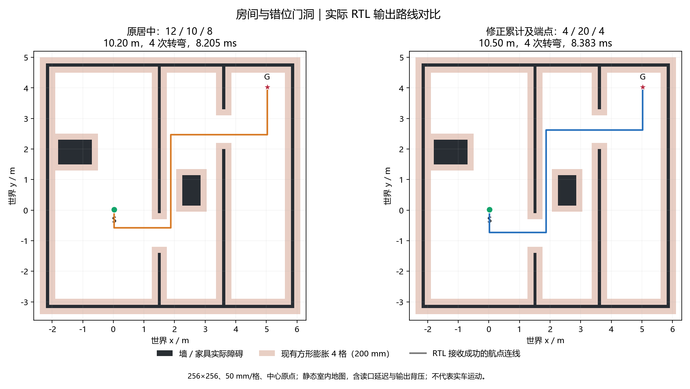

# 路线居中：最小间隙、端点与参数修正（2026-10-22）

参考用户提供的 `ROUTE_CENTERING_ANALYSIS.md` 修改前分析，仅实施用户明确选择的三项：累计最小间隙、探针包含两端点，以及 `L_MIN=4` / `PROBE_D=20` / `PROBE_STEP=4`。没有实施报告中另外提出的逐格法向测量或多次缩小偏移重试。

生产代码只修改 `nav_planner.v`，公开接口、BFS、地图、分段锁定及控制器握手不变。基线为 `d61136e`；本次代码、测试、文档一个中文提交，编号以本文件所在提交为准。

## 具体变化

| 项目 | 修改前 | 修改后 |
| --- | --- | --- |
| 每侧间隙 | 第一个发现阻挡的探针决定结果 | 每次阻挡都按较小距离更新，累计全部探针的最小值 |
| 沿段位置 | 8、16……，小于段长 | 0、4、8……、段长；尾部不足间距时补终点，终点只测一次 |
| `L_MIN` | 12 格 / 600 mm | 4 格 / 200 mm |
| `PROBE_D` | 10 格 / 每侧 500 mm | 20 格 / 每侧 1 m |
| `PROBE_STEP` | 8 格 / 400 mm | 4 格 / 200 mm |
| 未测到边界的间隙值 | 11 | 21 |
| 法向计数 | 5 位，单位置 20 次 | 6 位，单位置 40 次 |

例如长度 4 格时测位置 0、4；长度 7 格时测 0、4、7；长度 8 格时测 0、4、8。只有当前探针位置已经等于段长才结束，不再用“下一位置将超过段长”提前结束。

`probe_plus` 和 5 位 `probe_distance` 共用于地址与最小值比较，避免在多处重复计算距离。20 格距离及“无边界”值 21 仍适合现有 5 位间隙；扫描序号要覆盖 1……40，因此必须扩为 6 位，同时修正比较和递增常量，避免只改参数却在第 8 或 32 次提前结束 / 回绕。没有增加状态、RAM 或读口。

`CLEAR_TRIGGER=8`、`PATH_INC_MAX=20`、`OFF_MAX=16` 保持不变。首段和末段不做横向平移，中间段仍经过几何限制和完整逐格复核；失败时仍撤销本次平移。新配置扩大测量范围，不表示取消预算或允许穿过障碍，也不能保证几何意义上的全段中心。

## 自检与必要回归

沿用 256×256、50 mm/格、中心原点、方形膨胀 4 格的室内场景，增加两个净宽 0.75 m、长度约 3.5 m 的斜通道，专门形成 4～11 格短拐段。合计 30 个地图 / 请求，分别关闭与开启居中。

`nav_planner_tb` 从地图独立计算所有预期探针位置的最小值，不采用 DUT 已累计结果作为参考；同时核对端点序列、每位置全部 40 次读取、短段和尾部补点。地图模型同步正式 `nav_map`：探针读到图外时回答 raw/cost 阻挡，最终路线仍不得越界。

| 验证 | 结果 |
| --- | --- |
| 更新后专项自检 | **531 项通过**，5397185 周期 |
| 相同新自检对旧 RTL | 检出 49 项失败，5225304 周期；这是预期的缺陷检出，不算新版通过 |
| 累计完整测量段 | 104 段，其中短于 12 格 17 段，恰好 4 格 15 段 |
| 后续出现更近障碍 | 正侧 12 段、负侧 37 段 |
| 段长非 4 的倍数 | 59 段，覆盖最后不足间距的终点 |
| 端点参与限制最小间隙 | 99 段 |
| 每侧到达 20 格的扫描 | 正侧 / 负侧各 823 次 |
| 关闭居中 | 全部 30 个请求的路径 / 周期 / 队列指标与基线一致 |
| 完整整车回归 | **32 台 / 3186 项全部通过** |
| 运动闭环 | 98000033 周期、22 轮规划；暂停、恢复、前障停车及多目的地通过 |

首轮新增检查发现原有 28 场景没有 4～11 格可居中段，测试因短段覆盖不足失败；随后补充上述两种窄通道，新版完整通过，没有放宽检查。旧实现的双侧最小值、端点位置、深度和短段检查均能被当前测试检出。

## 路线与计算周期

以下为开启居中、`wp_limit=512` 的实际接收航点。两版均为相同的直行优先 BFS，不再混入上一步 BFS 枚举策略的收益。周期包括地图清理、BFS、居中、复核及读写等待，毫秒按标称 50 MHz 换算，不代表时序已通过。

| 室内场景 | 路长，前 / 后 | 转弯，前 / 后 | 周期，前 / 后 | 新版标称时间 |
| --- | --- | --- | --- | --- |
| 房间与错位门洞 | 10.20 / 10.50 m | 4 / 4 | 410246 / 419137 | 8.38274 ms |
| 斜走廊连接两间房 | 8.50 / 8.50 m | 6 / 6 | 163279 / 171973 | 3.43946 ms |
| 斜隔墙与家具 | 8.10 / 8.10 m | 2 / 2 | 452730 / 457300 | 9.14600 ms |

房间路线因测量结果变化采用了更大平移，增加 6 格 / 300 mm；相比原始 BFS 仍仅增加 16 格，没有超出已有 20 格预算。本次修正目标是间隙累计和采样准确，不保证路线长度下降或每个场景转弯减少。

30 场景的探针位置数由 280 增至 823，每位置读取由 20 增至 40，总法向读取 5600→32920。大段的采样工作量大致增加四倍，再加两端点及新增短段，不能只按深度翻倍估算；但整轮还包含 BFS 等阶段，三个主要场景的总周期增幅分别约 2.17%、5.32%、1.01%。



## 综合与布局布线

基线为 11:19 的 `d61136e`，只有规划器生产 RTL 改变，没有改约束。综合资源来自本轮 13:22 更新的 `impl/gwsynthesis/falcons_syn.rpt.html`：

| 综合资源（整车） | 基线 | 新版 | 差值 |
| --- | --- | --- | --- |
| Logic | 36607 | 36483 | -124 |
| LUT | 29732 | 29628 | -104 |
| ALU | 6875 | 6855 | -20 |
| Register | 17270 | 17272 | +2 |
| BSRAM | 123 | 123 | 0 |

完整构建于 13:34 完成，用时 990.5 s（16m30s），其中 PnR 11m33s。布线资源来自新 `impl/pnr/falcons.rpt.txt`，时序来自 13:34:19 更新的 `falcons_tr_content.html`，没有混用构建过程中残留的 11:19 时序报告。

| 布线后资源（整车） | 基线 | 新版 | 差值 |
| --- | --- | --- | --- |
| Logic | 36949 | 36839 | -110 |
| LUT / ALU | 29714 / 7235 | 29610 / 7229 | -104 / -6 |
| Register | 17270 | 17272 | +2 |
| BSRAM | 144 | 144 / 340 | 0 |
| DSP | 221 | 221 / 298 | 0 |

| 时钟 | 约束 | 基线 Fmax | 新版 Fmax | 同域 setup 违例，前 / 后 | 新版 TNS | 新版 hold |
| --- | --- | --- | --- | --- | --- | --- |
| i_clk_50m | 50 MHz | 50.000 MHz | **47.170 MHz** | 0 / 193 | -109.626 ns | 0 |
| clk_pixel | 49 MHz | 50.045 MHz | **46.449 MHz** | 0 / 22 | -12.693 ns | 0 |

**功能自检通过，但本轮系统和像素时序均未达标。** 全设计 setup 58→273、hold 18→18；原 DDR 相关时钟问题仍在。没有修改约束或将失败路径设为例外。

系统最差列出路径为 `u_reset_sync/key_stable_s0/Q` → `u_radar_navigation/u_adapter/u_navigation/u_nav/u_route/r_target_x_0_s1/CE`，slack -1.199 ns；像素最差列出路径为 `u_hdmi/u_disp_driver/vcount_r_0_s0/Q` → `u_ui/u_text_rom_lg/mem_mem_0_0_s/AD[10]`，slack -1.121 ns。它们不是新的最小间隙比较路径。此前系统余量只有 0.000 ns，本次输入变化后的重新映射和布局布线未能维持余量；探针数量增加直接影响的是计算周期，不能单凭探针数量解释 Fmax。后续应针对当前实际关键路径处理，本任务不扩大修改复位或显示模块。

位流为 38920103 字节，SHA256 `2C3A27BCC6841FB0320DD096F62002644AB3238FA1F8838F01BBFBD191447627`。93 个实际构建输入在开始和结束后逐项一致。资源、时钟、违例及产物指纹的摘要为 `logs/route_centering/build_result.json`，输入为 `production_inputs.json`。本轮不烧录，不把工具正常结束当作时序通过。

## 复核与文件范围

仓库根目录：

```powershell
powershell -NoProfile -ExecutionPolicy Bypass -File sim/run_sim.ps1 -ModelSim D:/apps/modelsim/win64 -Only nav_planner
powershell -NoProfile -ExecutionPolicy Bypass -File sim/run_sim.ps1 -ModelSim D:/apps/modelsim/win64
powershell -NoProfile -ExecutionPolicy Bypass -File tools/build.ps1 -Tcl build.tcl -GowinSh D:/Apps/Gowin/Gowin_V1.9.12.03_x64/IDE/bin/gw_sh.exe
python sim/plot_bfs_indoor.py --baseline logs/route_centering/baseline --current logs/bfs_straight/fixtures --output logs/route_centering --labels '原居中：12 / 10 / 8' '修正累计及端点：4 / 20 / 4'
```

`logs/route_centering/` 保存旧 RTL / 构建报告、同台缺陷检出、前后 CSV、完整回归、输入指纹及本轮构建；当前自检生成物仍在 `logs/bfs_straight/fixtures/`。测试库、地图、CSV、网表和位流不提交，只保留验证文档与一张报告插图。没有修改用户提供的原分析报告或两个 RC 示例脚本，均不纳入本任务提交。

提交前再次拉取，代码 / 测试 / 文档同一个中文提交；不自动推送或下载。板上 Flash 仍为 `11114a2` 雷达修复版。
