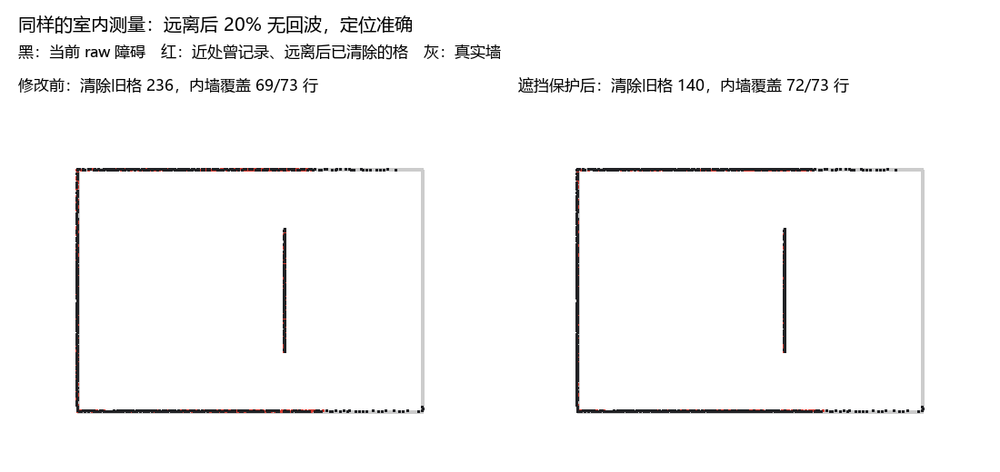
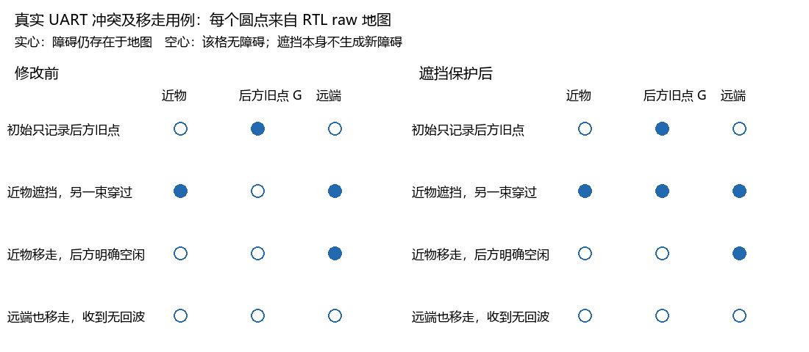

# 遮挡保护地图清理验证

## 实现范围

修改前基线为 `437b48d11365fd9943988fa33efa72856560578c` 的工作树生产 RTL；完整基线哈希见 `logs/map_shadow_20261026/baseline/sources.json`。问题分析见 [原报告](地图清理与历史障碍留存分析_20261026.md)。本次实现与说明、测试在同一个提交中交付，未增加旧方案开关。

命中后方也反对清空：

```text
采样位置 ── free ── 真实命中 ── shadow ── 10 m / 地图边界
                        │          │
                    立即写 raw   只置保护位，不写 raw
```

原 `hit0/hit1` 两张一位图同时记录真实命中与命中后的遮挡保护，原 `free0/free1` 不变。仍为两组保护/经过记录，共 262144 bit，即 32 KiB；raw/cost 地图、规划存储与外部交付接口不变。

同圈只要有一条射线命中本格，或命中更近物体后沿原方向经过本格，就禁止清空该格。命中前的射线仍登记 free。无回波没有遮挡物，继续登记 10 m 内 free；FFFF 等非法槽仍不生成射线。保护范围不扩大为扇形，也不使用规划膨胀图。

上一圈有 free、没有任何保护，且当前圈尚无保护时才清空。新命中仍立即生效；若当前圈的反对证据在清空已经完成之后才到达，遮挡保护本身不恢复 raw 旧点，不伪造新障碍。下一圈没有任何射线经过的格子继续保持。

近物消失后，只要后方在完整一圈内被明确测为空闲且没有其他反对，仍会清除。持续遮挡则继续保留，属于本次选择的保守规则；它不能修复持续定位偏差或所有射线一致漏测。

## RTL 和时序组织

生产修改仅限 `auto_navigation` 内部五个文件：

| 文件 | 修改 |
| --- | --- |
| nav_polar.v | 输出已有锁存有效距离的低 14 位，不增加距离寄存器 |
| auto_navigation.v / nav_top.v | 内部传递距离及遮挡标志；外部 radar_navigation 接口不变 |
| nav_scanner.v | 命中后继续 DDA 遍历，增加不写 raw 的遮挡事件，10 m / 图外截止 |
| nav_scan_accumulator.v | 遮挡复用 hit RAM，观测空隙中提交后台清空 |

扫描器内部 `wr_val=1` 为真实命中，`wr_shadow=1` 为命中后方；两者互斥。累计器只把 `wr_val=1` 直接送至 raw 写口，遮挡不占用 raw/cost 更新事务。

10 m 截止没有运行时除法或开方。对测距 `r`、原射线 Q16 分量 `dx`，到下一 x 格界的距离为 `g`，判断格界是否在量程内使用：

```text
g × r × 65536 ≤ abs(dx) × 10000
```

沿 y 同理。每推进一格减去 `CELL_MM × r × 65536`，保留当前射线方向；恰到量程格界时允许登记沿射线进入的那个接触格，绝不写成实际障碍。

各级安排：

- IDLE：锁存输入及距离，原坐标换算保留。
- GAPS：求第一格界距离，同时并行计算常数乘积与每格预算。
- PRODUCTS：并行计算 DDA 格界乘积、距离预算乘积。
- START：分别寄存 DDA 误差和 10 m 剩余预算，乘法之后有寄存器隔离。
- CHECK：寄存本格坐标和 free/hit/shadow 属性。
- SEND：握手后逐轴并行更新坐标、误差和预算；背压保持整个事件。

新增剩余预算使用 44 位有符号量；方向判断、x/y 更新不互相串接，不把常数乘、相减和输出握手闭合成一条组合链。

清空调度新增一个 6 位饱和空闲计数器：连续 64 拍没有观测事务才允许提交旧清空，50 MHz 下为 1.28 µs。这样避免在一串点尚在处理时反复启动较长的膨胀重算，并覆盖遮挡位写入后的同步 RAM 旧读值。计数器只影响提交时机，不影响清空条件；没有新增 FIFO 或地图 RAM。

## 同场景对比

基线与新版发送的每个 UART 报文、距离及采样位姿逐条核对相同；只对遮挡冲突结果使用不同的自检期望。场地及此前的近墙、远离、90° 转弯、定位误差、无回波假设不变；新增近物移走的完整过程。每阶段使用两圈，默认实验在包间等待结算，以隔离地图规则。

| 场景 | 修改前 | 修改后 |
| --- | ---: | ---: |
| 近处准确定位，内墙覆盖行 | 72/73 | 72/73 |
| 准确定位远离，删除旧格 | 107 | 105 |
| 准确定位原地转 90°，额外删除旧格 | 0 | 0 |
| 位置偏 +80/−40 mm、朝向偏 +1°，删除旧格 | 259 | 256 |
| 远离后 20% 无回波，删除旧格 | 236 | 140 |
| 同上，原内墙位置覆盖行 | 69/73 | 72/73 |
| 全部场景实际 raw 清空次数 | 608 | 507 |
| 用旧请求删除当前圈/上一圈保护的次数 | 0 | 0 |

无回波场景旧格删除减少约 40.7%。这是固定输入下的留存对比，不代表所有减少的删除都属于正确保留。位置偏差场景依然明显错位，不能靠遮挡保护解决。



### 遮挡与障碍移走

两束射线在同一个 50 mm 行内：一束在近处命中，另一束从略有差异的位置经过同格，命中更远处。

| 阶段 | 修改前后方旧格 G | 修改后后方旧格 G |
| --- | --- | --- |
| 初始发现 G | 保留 | 保留 |
| 近物挡住 G，同时另一束认为 G 空闲 | 删除 | 保留 |
| 近物移走，完整一圈明确经过 G 且无反对 | 无障碍 | 清除 |
| 更远的障碍也移走，收到无回波 | 远端清除 | 远端清除 |

同时检查保护经过的中间空格 raw 保持 0，排除把遮挡写成假障碍。用例中的换圈辅助射线另有侧向命中，因此最后检查的是主轴近物/G/远端三个格清除，不要求整张地图全为 0。



## 自检、周期与连续输入

ModelSim 10.6d，50 MHz。最终批量回归 `logs/map_shadow_full_final.log`：53 个测试台、9088 项检查全部通过。新增/扩展内容：

- `nav_scanner`：18 项，覆盖八方向、任意角度、起点格界、地图边缘、1 mm 命中、10 m 截止、无回波及背压；逐格与独立浮点求交参考核对。7235 周期，17 条射线，观测到的单射线最大 579 周期，含测试背压，约 11.58 µs，不是所有输入的最坏周期上界。
- `nav_scan_accumulator`：27 项，覆盖 free/保护两种顺序、保护不生成 raw、保护移走后清理、旧清空与新遮挡竞争、连续观测延后清空及空隙后恢复。总计 262149 周期，含并行完整地图测试；初始化 65536 拍，空圈扫描仍为 196608 拍，即 3.93216 ms。
- 真实 UART 地图对比：383 个报文、16086 槽、13465 条有效射线，18 项自检全部通过；新增保护事件 1063165 次，无保护误删。修改前 53545503 周期，新版 55257509 周期，增加约 3.20%。此时间包含初始化、地图重算与包间等待，不是车辆运动耗时。
- 连续 UART：同样 383 报文，不插入包间结算等待，18 项自检全部通过；16086 槽完整接收，UART/报文/溢出错误均为 0，总计 44858289 周期。修改前同样压力输入会丢 2 包；空闲提交调度使新版此场景不丢包。压力场景包含位姿突然偏移，结果仅对本批输入成立。

既有真实采集回放、显示、UI、多目标控制、动态规划、近障停车及障碍清除恢复等回归继续通过。总计最终批量 9088 项加两组 UART 各 18 项，合计 9124 项检查；修改前对照的 18 项另计。

## RAM 与资源

使用 Gowin V1.9.12.03 对同型号 GW5AT-138B 做默认参数的独立模块综合。依据各自 `*_syn_resource.html`，列的是综合报告字段，不是整车布局布线资源：

| 模块 | FF 修改前→后 | ALU 修改前→后 | LUT 修改前→后 | DSP 字段修改前→后 | BSRAM 修改前→后 |
| --- | ---: | ---: | ---: | ---: | ---: |
| nav_scan_accumulator | 54→60 | 8→8 | 266→276 | 0→0 | 16→16 |
| nav_scanner | 382→454 | 322→376 | 399→461 | 8→13 | 0→0 |

raw/cost 与规划 RAM 的 RTL 字节不变；本次没有新增地图存储。扫描器用少量寄存器和运算资源保存量程预算。

本次没有完成新的整车布局布线，不给出新 Fmax 或全工程时序收敛结论。已下载的位流仍为修改前版本；本次未进行下载。

## 复现及产物

```powershell
# 最终全量回归
./sim/run_sim.ps1 -ModelSim D:/apps/modelsim/win64

# 同输入地图效果及对照图（before 是保存的基线产物）
python tools/map_retention.py --out logs/map_shadow_20261026/after --compare logs/map_shadow_20261026/before

# 连续 UART 输入
python tools/map_retention.py --out logs/map_shadow_20261026/continuous_scheduled --continuous
```

`--baseline --rtl-root <保存源码目录>` 仅供仿真对照使用，不保留生产 RTL 旧实现或兼容参数。基线源码只位于忽略的 logs 目录，不随交付模块提交。

详细产物位于 `logs/map_shadow_20261026/`：before/after 的输入、快照、逐次清空日志、summary/comparison JSON、连续输入日志，以及 synthesis/before、synthesis/after 的独立综合报告。对照 PNG 同步保存在 `doc/img/`，不依赖临时基线源码即可查看。

## 迁入最新 AI 分支的复核（2026-10-29）

按用户指定顺序，先在 `codex/ai-visual-inspection` 的 `233c0f2` 上完成短段锁定和运行时规划窗口，提交为 `7a8f336`；随后只迁移原遮挡保护提交 `deb9e81`，不迁移 `a45eab0` 的任意角度规划参考。

本次两处文本冲突均经用户决定：测试清单保留 AI 分支已有测试及 `nav_lock_tb`，加入 `nav_scanner_tb`；自检说明保留 AI 分支总说明，追加遮挡保护说明。RTL 自动合并，保留最新 AI 图层/地图读仲裁和本次短段锁定、UI 参数。新增的两个导航测试台显式连接观测距离输入，未增加生产接口或旧方案兼容。

迁移后完整入口 `sim/run_sim.ps1` **81 台 / 10641 项通过**，日志 `logs/short_lock_shadow_final.log`、结果 `logs/short_lock_shadow_results.json`。其中 `nav_lock` 12 项 / 2245363 拍，`nav_route` 42 项 / 378 拍；最远目标查找实测最长 24 拍，原实时时间运动闭环继续通过。AI 视觉图层、地图仲裁、UI、巡检控制等沿完整入口回归。

另运行 `python tools/map_retention.py --out logs/short_lock_shadow_migration/continuous --continuous`：18 项通过，44858289 拍，383 包 / 16086 槽 / 13465 条有效射线，保护输出 1063165 次、实际清除 507 次、受保护格误清 0、errors=0，收到槽数完整。周期及统计与原遮挡保护实现相同；这不是所有输入的吞吐上界或实车定位证明。

本次迁移未重新综合、布局布线或烧录，上文旧资源/时序数据只对应原实现，不能作为本次组合版本结论。两次提交前均拉取对应远端分支，当前迁移提交的 ID 以 Git 历史为准。
