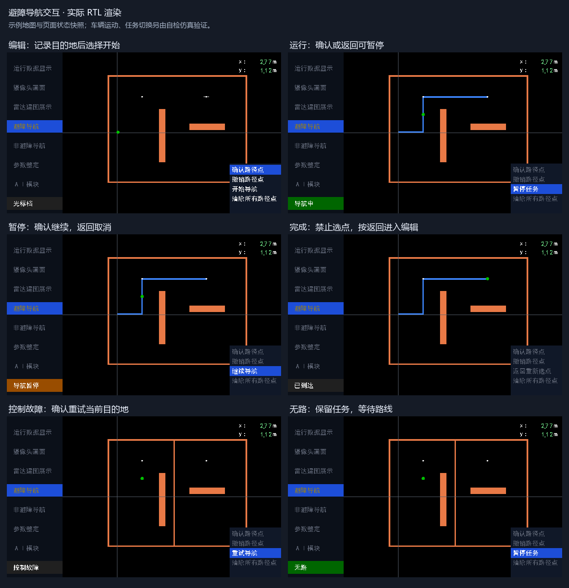

# 避障导航 UI 交互重构验证（2026-10-25）

基线 `e90a9e9`。用户操作见 [避障导航操作指南](避障导航操作指南.md)，交互设计见 [状态规范](避障导航UI交互审查与状态规范_20261025.md)。本次没有重新综合、布局布线或烧录；下面的周期为仿真统计，不是 Fmax 或实车制动结果。

## 修改结果

- 移除原来的三态加 ui_active 独立状态存储，使用统一的六种 UI 行为。3 位输出码的无路是运行中的显示分支，不另存一个行为状态。
- 最终到达后撤销目标及运动许可，保留完成状态和只读目的地点表。完成中不能选点或再次开始，按返回一次进入编辑，清旧任务、复位提交阶段，准心回到当前位置、辅助项回“确认路径点”。编辑再返回退出交互。
- 暂停保留目标和索引，解除手动或停机条件不会自行恢复。控制故障同样保留进度，重试继续当前目的地。取消/退出清任务，新进入不复用旧点或 START 高亮。
- 核心报无路继续保留目标并规划。地图、定位原点、多目标顺序、分段锁定和六信号控制器握手不变。
- 显示改为接 UI 状态，移除直接接核心状态的旧显示端口；暂停/故障/完成分别提示继续、重试、返回。编辑外隐藏准心，不可用辅助项变灰；完成及浏览无辅助高亮，手动档所有辅助项变灰。

新增状态编码在 `rtl/ui/nav_obstacle_states.vh`；对应 UI 输出与显示输入都为 3 位。`radar_navigation` 的正式接口未改。移除了顶层原本未使用的 nav_state 二选一线，不保留旧显示口。

## 时序处理

目的地点表连续保存，用 5 位寄存点数直接管理追加/撤销，16 位有效点掩码由并行比较派生；移除原逐位求和链和冗余有效位存储。状态与点数更新不串入车辆坐标乘法。目标仍先寄存非负偏移，下一拍换算格号；UI 状态先在系统域产生，再经现有两级同步到像素域。辅助文字的灰色标志与字形同步流水，避免把页面译码直接串入 RGB 选择。

以上为 RTL 结构依据，不声称新版本资源减少或 Fmax 提升，须另行综合和布局布线确认。

## 验证

1. 完整应用回归：52 台 / 9059 项全部通过，`logs/nav_ui_update/regression.log`。
2. 全回归后补充手动档灰色/高亮两项检查，最终受影响 UI 复核：5 台 / 121 项全部通过，`logs/nav_ui_update/final_ui_regression.log`。复核包含 obstacle_page、obstacle_display、ui_render、ui_layers、ui_pipeline；其余 RTL 未再改动。
3. 整车端口展开：93 个 RTL 文件通过，0 error / warning，`logs/nav_ui_update/top_elaboration.log`。摄像头/HDMI 使用端口桩，只证明连接，不代替生产 IP 构建。
4. 实际 RTL 页面渲染：15 帧导出完成，0 error / warning，`logs/nav_ui_update/preview/render.log`。示例地图及静态页面输入只用于显示检查，运动闭环另测。

| 测试 | 检查数 | 周期与覆盖 |
| --- | --- | --- |
| obstacle_page | 44 | 112855 拍；双次任务、完成只读/返回编辑、第二目标故障重试、手动与暂停、取消/重进、16 点容量、准心边界及清零 |
| obstacle_display | 20 | 56026 拍；继续/重试/返回文字、完成持久、禁用项灰色、完成及手动无高亮、非避障标签不受影响 |
| obstacle_motion | 15 | 152500034 拍，3.05000068 s @50 MHz；305 次位姿推进、33 轮规划 |
| obstacle_plan | 5 | UI 到真实导航核心的预规划、暂停保留目标和取消释放 |
| ui_pipeline | 6 | 4896384 拍；仅避障页指纹按新行为更新，另五页指纹保持不变 |
| ui_layers | 1 | 131072 组图层覆盖及配色组合，通过 |

运动台真实推进规划与车辆时间，包含运行暂停、近场障碍、清障恢复、多目标执行；手动以 750 mm/s 行驶 100 ms 跨格，定位持续更新，切回后不自动恢复，明确确认后从新位置重新规划。第一趟完成后测试确认无效、返回编辑，选择新目标，再完成第二趟并释放请求。底盘模型理想响应，手动接管守卫沿用已有独立回归；此台不代表实车停车性能。

`nav_free_ctrl.v`、`nav_ctrl.v`、`nav_point_ctrl.v`、导航核心 `nav_top.v` 和 `nav_command.v` 与基线逐字节相同。原非避障调试、规划和控制接口未改。

## 渲染预览

下图来自实际 RTL 输出，按编辑、运行、暂停、完成、控制故障、无路排列。

## 范围边界

S2 的物理停稳门禁仍是原实现，本次用户指南要求停稳退出任务后再清零；未把它扩展成新的控制状态。没有增加任务副本、兼容开关、超时重试或新的底盘健康接口。

本次中文提交包含上述实现、测试、用户指南和规范；提交号由 Git 及交付回复记录，不在版本内文档写入尚未生成的自身哈希。提交前再次拉取，冲突由用户决定；不自动推送。
