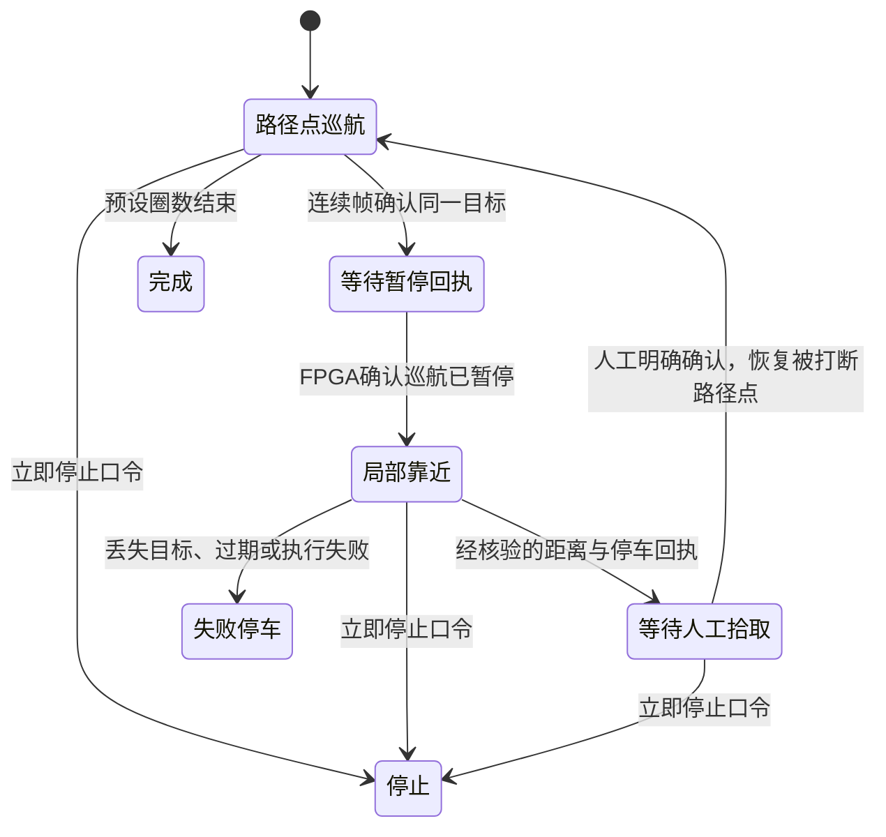

# 中文任务链路与巡航找物交付入口

2026-10-24发布状态：板上已激活v8 `fullstack_20261024_163101_ddf286`，Linux113/113协调器、36/36相机、11/11语义运动工具测试通过，4条实际服务文本预览冒烟通过；HOLD/shadow保留、worker空、mic/ASR超时保留、boot_id未变。v5/v6/v7数字为历史阶段。ASR转写→运动规则的代码已接，仍无真实电机执行/完成回执；尚缺真人新口令、真实相机、音箱及车辆验收。当前整车运动桥接入与所有模块发布见[统一交付入口](../../doc/全栈上板与队友下载_20261024.md)。

摄像头上传支路现已新增匹配的FPGA FIMG发送模块、隔离GitHub整车候选与板端libusb接收CLI，详见[摄像头传输实现与验收](../../doc/摄像头到FPGA再到RK3588实现与验收_20261024.md)。已完成RTL/主机交叉验证与候选综合，尚未烧录、取得并核对配套FX2固件或真实USB收图。协调器继续保持未核验采集时间的限制，不因收到CRC正确图像就授权运动。

## 当前功能分工

无相机语音运动候选新增统一文本/ASR入口，支持有界前后退、整数度左右转、顺逆时针一圈与巡航请求。当前仅规则/限值/MOT1协议预览，不开第二串口、不下发运动；详见`doc/无相机语音运动接入与验收_20261024.md`。距离请求不换算成定时运动，找物C1b schema保持原样。

- SenseVoice中文ASR；原始转写、领域归一化、确定性策略与C1b解析共用协调器入口。
- C1b负责四类目标、备选目标和返回意图；CPU/GPU只是运行配置，思考关闭、最多80输出token。
- v17视觉模型保留。电脑使用已校验的ONNX FP32，板端仍沿用原有RKNN FP16合同。Nano候选没有通过门槛，未替换。
- FAM1任务网关处理任务/目标/动作ID、回执、断线和取消；旧AA55视觉协议保持原样。`reference_peer.py`是协议参考和模拟器，**不是已经在FPGA运行的固件**。
- Kokoro女声A zf_001/sid3的48段缓存短句；任务状态驱动播报。离线缓存不在板端加载TTS模型；半双工只处理录音/播放互斥，不是AEC。
- 板端候选配置`model_loads_enabled=false`：阻止语音/视觉/语言模型及warmup加载，停止、状态和确定性拒识仍可工作。异常重启原因查明前不解除。

## 新场景：巡航→发现目标→靠近→确认拾取→恢复

巡航使用FPGA已经登记的路径点ID；靠近使用局部目标观测，**不要求检测目标先有全局地图坐标**。不会把检测框中心当成地图坐标，或把框面积当成测距。机器人应在已有可行驶区域内通过局部规划靠近，FPGA继续处理避障、减速、停车和执行仲裁。

`PatrolMission`新增`goto_waypoint`、`pause_patrol`、`approach_target`和带时效的`target_observation`请求。回执分别为`waypoint_arrived`、`patrol_paused`、`approach_arrived`。`approach_arrived`必须同时满足：同一任务/动作、最近仍看到目标、`stationary=true`、`metric_stop_verified=true`以及`clearance_m`处于经实车确定的`stop_band_m`。此处信任的是执行层经过验证的距离与停车判据，软件检查本身不能证明传感器正确。

当前没有机械拾取控制。到位后等待人工取走物品，CLI/API确认或语音说“物品已经拿走”，再恢复原路径点。状态明确记录`physical_pickup_verified=false`。不会播报“机械手已拾取成功”。已处理目标持续可见时会抑制同类再次触发，需要目标连续消失两帧才重新武装；该简化策略仍须用实车视频检查误合并/误重触发。

固定口令“开始巡航”“继续巡航”“拾取完成”“物品已经拿走”走预设操作入口，不让C1b猜路线或输出新的运动动作。当前任务仍在进行时，不能用“继续巡航”强行跳过到位/拾取确认。重新启动路线从首路径点开始；拾取确认才恢复被中断路径点。

接口：`POST /patrol {}`启动配置中的路线；`POST /pickup-confirmed {"task_id":"当前任务ID"}`确认人工处理；`POST /stop {}`请求停止。所有接口仍只绑定回环。路径点ID、目标、圈数与实测停车距离带由配置明确给出；板端候选配置默认关闭巡航，未填假地图或假标定。

## 可选：单目地面目标转地图坐标

如果螺丝刀确实位于平整地面，可标定相机内参、畸变和相机相对车体外参，将**去畸变后的真实地面接触像素**反投影为射线，与地平面求交，再结合采集时小车地图位姿转换。`ground_target.py`提供这条纯几何路径，拒绝未确认地面接触、地平线附近射线、错误旋转和超出标定范围。

检测框底边并不自动等于地面接触点。桌面目标、坡地、相机倾斜变化、目标悬空或标定漂移时不能直接套用。代码未给现有相机虚构高度、焦距、外参或误差范围。是否采用此方案，需要实测不同距离/姿态的定位误差；可先使用局部视觉引导与可靠测距闭环完成演示。

依据：[Chaumette/Hutchinson视觉伺服教程及作者介绍](https://faculty.cc.gatech.edu/~seth/res.php?u=vs)、[OpenCV平面投影与相机姿态教程](https://docs.opencv.org/4.10.0/d9/dab/tutorial_homography.html)。这些来源说明方法，不是本车完成导航的证据。

## 已完成的软件验证

| 项目 | 结果与范围 |
| --- | --- |
| 协调器软件回归 | 77项：Windows72通过、5项Linux伪终端跳过；本次未在板端重跑 |
| 统一C1b文本入口 | 46/46中文用例：原42条及4条新集成回归；不是新独立测试集 |
| 实际ASR链路 | 固定7条合成音频7/7；其余既有42条声学记录保留，未冒充本次全部重测 |
| 实际视觉入口 | 旧开发图片8/8检出对应目标；不代表新精度评估 |
| 找物/返回任务 | 两条真实模型回放通过，FAM1字节分片与FPGA回执模拟 |
| 巡航任务回放 | 真实ASR与YOLO，模拟暂停/测距停车/到达回执；语音确认后恢复P1，再到P2完成。未加载语言模型 |
| 地面几何 | 合成几何、视线平行/朝上、错误旋转与未验证接触点拒绝测试；无实车标定结果 |
| 女声缓存 | 48条PCM16/16kHz短句已生成并校验；无USB音箱实物播放结果 |

失败记录保留：Windows原生llama.cpp无法打开中文绝对模板路径，改成ASCII相对路径；worker输出GBK导致跨进程解码失败，明确设为UTF-8。新口令“拾取完成”被ASR听成“失去完成”时系统保持等待，不猜成已取走；改用另一个明确口令“物品已经拿走”，没有将“失去”加入纠错别名。早期巡航回放用两张不同场景图片，目标关联检查正确拒绝，后改为同一视频相邻帧；没有放宽关联阈值。

电脑证据位于`D:/HITSZ_FALCONS/ai部分/fullstack_pc_20261024/`，完整成功目录为`acceptance_r3/`与`patrol_replay_r5/`。旧失败目录保留；缺少完成标记的目录不算成功。场景中的“到达”“停车”和人工确认全部标明模拟，不能计入实物完成率。

## 复现与部署

电脑端使用已有Python环境，`computer_profile.py`创建新目录并固定权重/模板SHA256；`doctor.py --config ... --deep`只读校验，不加载模型。`acceptance.py`只接受显式电脑ONNX配置；`patrol_replay.py`单独复现巡航场景。两者都会回收自己的模型进程。

`package_release.py`打包源代码、测试、提示词/模板和缓存音频，记录每个文件长度与SHA256，不打包或安装系统依赖。`adb_deploy.py`要求明确物理设备序列号、Linux aarch64和既有orangepi目录，拒绝模拟器；不重启ADB服务器或板子，不修改网络。

板端安装器`deploy_board.py`在独立release目录验证哈希、运行软件测试和只读模型文件检查，通过后才更新自己的空闲服务。C1b权重必须匹配`b13e07d5a96cb05f2d949cf91192246c8a8d01436e340992bc83be2476fa278b`；不能因为与早期模型大小相同就混用。v5安装和激活已验证，v6独立暂存已验证；失败恢复旧配置/release/service的路径已实现，本轮没有主动制造失败验证回滚。

## 实物完成前仍需的工作

1. FIMG v2已在v5激活，Linux86项协调器、36项相机软件测试通过；保留Claude配置好的麦克风、30秒ASR超时与HOLD。物理USB ADB仍需排查，异常重启原因未明确前不做模型长测。USB/UVC统一入口作为后续独立候选，实物验收待相机到货。
2. 接上现有导航的AI任务来源、暂停/恢复与执行回执。后续只读核对GitHub最新`ec759b161f378fcf545a836fe8bed63295efe1a2`：已接路径点导航、雷达避障及自动控制输出，不能沿用本地旧基线“i_auto_valid为0”的判断。新增AI任务协议仍未接生产顶层；保留现有人工控制仲裁。
3. 联调FPGA→FX2图像流、源时效/相机标定和实际距离停车判据；回执必须由真实控制状态生成，不能由主机收到请求即伪造成功。
4. USB麦克风/音箱到货后，做真人、电机噪声、播放回声和录音恢复验收。没有机械执行器时，坚持“人工拾取确认”演示定义。

没有修改比赛系统包、NPU驱动、现有顶层控制或遥控映射；未提交、推送或烧录。本文件描述可交付的软件范围和剩余实物工作，不将它们合并成“全栈实车已完成”。

远端对接依据已固定为上述SHA的`doc/AI与整车联调开发指南_20261023.md`、顶层和导航模块，只读快照位于电脑证据目录`upstream_ec759b1/`。没有覆盖当前工作区或合并队友新提交。`navigation_goal.py`已对齐`navigation_origin`坐标、256×256/50mm栅格以及[-6400,6400)mm边界，输出物体旁停车候选点并保留`goal_valid=false`，由规划器检查可通行性后才能准入；不会把物体中心设为车心终点。

## 续推：统一相机入口与当前部署

v5已于2026-10-24激活为`fullstack_20261024_153642_f40ecc`。前文77/21是早期版本记录；当前版本板端86/86、36/36通过，真实RTL仿真FIMG v2线流离线回放1帧、0错误。前后boot_id一致、麦克风配置保留、模型HOLD/shadow、worker空。证据`claude_integration_review_20261024/activation_v5/receipt.json`；这是软件与离线协议证据，没有FX2实物传图。

新增`camera_sources.py`统一选择：不配置backend时兼容原FX2；`backend=v4l2`走显式USB/UVC设备。`camera.v4l2.example.json`保持关闭且设备/模式为空；真实probe后再填写。UVC持续读取但只保留一个最新帧，使用PNG文件接入现有v17预处理，读取失败/尺寸类型错误/格式协商回退均拒绝。源时间、设备帧ID仍未验证；主机计数与主机收帧时刻不能授权live运动。HOLD时不创建camera worker，也不自动触发视觉模型。

接入与验收说明见`doc/USB摄像头统一入口与周末验收_20261024.md`。新增代码先独立暂存；当前v5服务不因USB相机尚未到货而反复切换。既有周末工具与FPGA实验包保持独立。
