# RK3588 AI 总协调模块

2026-10-24后续整合：统一C1b中文入口、巡航发现目标后靠近/人工确认/恢复、电脑真实模型回放与ADB部署器见[全栈入口](FULLSTACK.md)。本次候选新包尚未部署：目标板ADB未出现；历史板端测试成绩与本次电脑结果分别保留。

负责 USB 麦克风／WAV → ASR → 任务语言模型 → 视觉检测 → FPGA 任务网关。摄像头继续由FPGA采集，FPGA保留基础导航、闭环控制和执行仲裁。

本模块使用现有语音处理与模型资产，新增异步协调与通信合同。设计前查阅SayCan、SayPlan、行为树文献及BehaviorTree.CPP、Nav2、Sherpa官方资料，映射与未复现部分见[研究记录](RESEARCH.md)。当前任务有限，使用标准库事件循环＋状态机，没有在板上安装ROS2/Nav2。

## 运行结构

```mermaid
flowchart TB
    M[USB麦克风或WAV] --> A[ASR独立进程]
    A --> L[领域纠错和语言模型独立进程]
    L --> C[任务协调器]
    F[FPGA摄像头图像或回放图片] --> V[视觉独立进程]
    C -->|任务目标| V
    V -->|带任务ID和时间的检测| C
    C <--> G[统一FPGA网关]
    G <--> P[FPGA任务动作和状态回执]
```



- 录音使用明确的ALSA设备，默认不录板载声卡。麦克风未到货，`microphone.device=null`时返回待接入。
- ASR为SenseVoiceSmall INT8，CPU两线程。`text`保留原始转写，`task_text`单独纠正“找交代”等，含糊表达拒识。
- 语言模型为单独部署的专项 `domain-Q8_0.gguf`，板端llama.cpp **CPU**运行，关闭思考，最大80输出token；这不是新权重的RKLLM W8A8部署。官方原版RKLLM及Claude Code的C1/C1b保留。
- 视觉使用板上已有v17 640 FP16 RKNN，NPU核心0，OpenCV RGB letterbox＋最佳类别及逐类NMS，原图固定输出`[1,8,8400]`。双输出版本须显式配置`decoded_probs`合同。没有替换模型、驱动或runtime。
- 协调器和通信循环不等待模型阻塞；模型在私有进程运行。超时终止自己的worker及模型server，不终止其他实验。
- 图像为“一个正在处理＋一个最新待处理”的邮箱，旧队列项明确标记丢弃；结果过期、任务被替换、序号倒退时拒绝。

## 板端入口

部署目录：`/home/orangepi/workspace/falcons_ai_coordinator_20261024_r1/`。代码快照在其`releases/`，依赖在独立`python/`，模型在`models/`，输出在`runs/`。运行根目录的`active_release.json`记录当前代码版本与哈希。

用户级服务名：`falcons-ai-coordinator.service`。默认 **shadow观察模式**，只记录任务下发意图，不打开串口，不发送车辆命令。服务的自动启动属于orangepi用户会话；没有设置系统级开机服务或更改用户linger配置。

```sh
export XDG_RUNTIME_DIR=/run/user/$(id -u)
systemctl --user status falcons-ai-coordinator.service
journalctl --user -u falcons-ai-coordinator.service -n 30 --no-pager
```

CLI可从当前版本的入口运行：

```sh
cd /home/orangepi/workspace/falcons_ai_coordinator_20261024_r1
CODE=$(python3 -c 'import json; print(json.load(open("active_release.json"))["release"])')
python3 "$CODE/host/ai_coordinator/main.py" --config config.json status
python3 "$CODE/host/ai_coordinator/main.py" --config config.json text --text '先找胶带，找不到再找螺丝刀，找到后返回起点。' --plan-only
python3 "$CODE/host/ai_coordinator/main.py" --config config.json audio --wav "$PWD/samples/audio/Microsoft_Huihui_Desktop_single_ad_calcium_milk.wav" --plan-only
python3 "$CODE/host/ai_coordinator/main.py" --config config.json stop
```

`--plan-only`只分析、不创建执行任务。去掉该参数，在shadow模式仍只有任务意图日志；缺少FPGA回执会失败，不自动补造成功。

HTTP仅绑定`127.0.0.1:18765`。`GET /status`、`GET /jobs/<id>`；`POST /text`、`/audio`、`/capture`、`/image`、`/stop`、`/warmup`。提交返回job_id，可继续查询；停止不依赖语言模型。只接受本地JSON客户端，拒绝浏览器Origin和过大输入。

## 任务执行规则

1. 合法任务仅`i/t/f/r`，目标固定四类；非法目标、截断回复、思考内容和未在转写中出现的物体被拒绝。
2. 只有全句明确停止直接处理；“找到胶带后停止搜索”不会被正则直接提升为当下停止。
3. 开始搜索先等`search_started`，视觉确认需要连续两帧同类合法检测，随后等`target_accepted`。
4. 空画面不等于搜索失败。只有同一任务／目标／动作的`region_exhausted`回执，且该阶段有新鲜视觉结果，才允许切换备选目标。
5. 超时和链路中断进入失败／取消，不冒充区域搜完。返回任务必须等对应`home_arrived`，不能只以指令已发送作为成功。
6. 每个阶段有session_id、task_id、goal_id、action_id；旧任务回执不能复活被停止或替换的任务。
7. 文件图片始终标为replay。live模式还要求相机源时间已验证和兼容FPGA网关；当前接收时间不能冒充曝光时间。

## FPGA控制协议：待固件对接

**新任务协议FAM1不是现有AA55视觉观察协议，也不是生产顶层已经支持的接口。没有修改应用RTL、引脚或基础控制。**

帧为：`FAM1`＋大端uint16 JSON长度＋UTF-8 JSON＋大端CRC32，校验覆盖长度与JSON，最大4096字节。JSON禁止重复键及非有限数。

串口仅允许显式`/dev/serial/by-id/...`，115200 8N1；独占打开，不切换DTR、不复位设备。在收到固件的`hello`之前不发任何数据。hello须包含v=1、boot_id、单调sequence、capabilities；此后状态回执须回传本会话session_id及任务／动作标识。重启、重复序号和断连撤销旧会话。

| 主机请求 | 所需固件能力 | 设备回执 |
| --- | --- | --- |
| `start_search` | `search_v1` | `search_started`、`region_exhausted`或`action_failed` |
| `target_found` | `target_accept_v1` | `target_accepted`或`action_failed` |
| `return_home` | `return_home_v1` | `home_arrived`或`action_failed` |
| `cancel` | `cancel_v1` | FPGA停止当前AI任务，基础仲裁仍独立有效 |

当前固件未实现这些任务回执，不能仅把串口线插上就开启自动运动。现有19字节AA55视觉观察工具仍在`host/vision_bridge/`，本模块没有改变它的格式或宣称其支持导航任务。

## FPGA图像输入：待真实USB联调

提供独立FX2 Bulk-IN worker，用系统已有libusb。必须配置核实的VID/PID、IN端点和接口号；不加载固件、不解绑内核驱动。默认关闭。

示例FIMG帧头为24字节小端`<4sBBHHHIII`：magic、版本1、格式1=RGB565、头长24、宽、高、uint32帧序号、payload长度、CRC32。校验覆盖前20字节头和像素；半包、错CRC、倒退序号拒绝，异常后重新找帧头。像素为小端RGB565，不是JPEG。宽×高×2须与长度相等，最大16MiB。

**该帧头是对接合同，需要FPGA发送端配套，不能直接套到厂家未知裸流。** 当前只验证解析器和RGB565转换。USB接收时间以`host_receipt_only`记录，`source_timestamp_verified=false`；在曝光时间／缓存年龄验证前，不能用于live动作确认。摄像头仍由FPGA采集，不启用RK3588直连摄像头替代方案。

## 验证与交接

```powershell
$voicePython = 'D:/HITSZ_FALCONS/ai部分/FALCONS_AI_Agent_24h_20261018/FALCONS_AI_Agent_24h_20261018/.venv/Scripts/python.exe'
& $voicePython -m unittest discover -s host/ai_coordinator/tests -v
```

加入语音播报后，Windows上46项通过、5项Linux伪终端测试跳过；板端51项全部通过。测试包括真实私有进程超时回收、模型慢响应时停止、旧结果、条件分支、返回缺回执、队列丢帧、CRC、视觉输出几何合同、播报/录音互斥与串口伪终端双向收发。伪终端不是实物FPGA验证。

`replay.py --simulate-fpga`会调用板端服务实际推理合成WAV和已有图片，用同一个任务核心模拟FPGA回执。输出始终`physical_task_completed=false`；与实机任务区别记录。已有3/3综合冒烟通过、8张图片检出对应目标；完整32条因板子重启中断，双方已暂停模型负载，不能宣称整轮通过。结果与恢复情况见[部署报告](../../doc/AI总协调器板端部署与验证_20261024.md)。回放工具对每阶段/每条证据fsync，未出现完成标记的目录不能作完整试验。

与Claude Code的重负载顺序通过工作区`ai部分/AI_板端协同_20261024.md`协调。板端不升级包、不替换系统库、不停止别人的实验。文件部署需校验哈希并显式fsync；本次发现根分区`commit=600`，异常重启会丢失近期未落盘文件，但本模块不修改该挂载参数。

## 中文播报

已加入[中文任务播报](SPEECH.md)：36段缓存短句、异步播放、任务替换/停止抢占、状态回执限制和录音互斥。板端默认 `announcements.mode=log`，不打开声卡。真实USB音箱尚未接入；当前继续暂停模型长测。声卡选择、资产生成和待硬件验收内容见上述说明。
