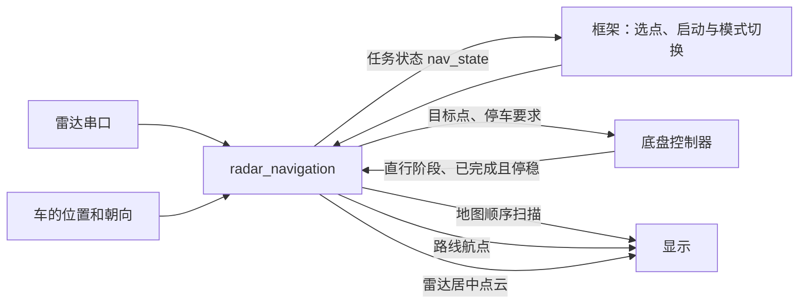

# 自动导航接入说明：radar_navigation

本文面向负责整车框架、定位、显示和底盘控制的队友，只说明实际使用的 `radar_navigation`。按本文连接后，可以完成“在雷达图上选点→确认→自动行驶→绕开障碍→到点停车”。

本文采用控制器完成反馈作为动作完成依据。控制器负责允许的位置、角度误差和停稳判断，导航不再重复验收。

车辆采用四轮差速，车宽 180 mm。行驶方式是沿地图的横向或纵向直行，在转弯处停稳后原地转向。导航只给出目标点和紧急停车要求；控制器自行判断是否先原地转向，再直行到点并停稳，负责轮速和减速。

寻找路线时，在最短栅格距离相同的选择中优先连续直行，减少斜墙变成阶梯状格子后产生的频繁小转弯；仍沿横向、纵向行走，不改成斜线行驶，也不保证所有地图的转弯次数都最少。路线仍会执行通道位置调整和障碍检查；控制器完成确认方式不变，对接不需要增加信号。

中间直线段长度达到 200 mm 时会尝试调整到通道较宽的位置；首段和末段不平移。测量包含该段两端，每隔 200 mm 向两侧各检查最多 1 m，并按这些位置中较小的间隙计算调整量。调整后仍逐格检查是否可通行；不能通过则撤销本次调整，不影响现有对接信号和操作流程。

## 1. 各部分需要做什么

| 负责部分 | 需要提供或完成的内容 |
| --- | --- |
| 整车框架 | 提供时钟和复位；选择手动或自动；确认选点；开启或关闭建图、规划、自动行驶和地图显示 |
| 定位 | 持续提供车的位置、朝向，以及定位是否可用 |
| 雷达 | 将 M10 GPS 雷达的串口发送端连接到 `radar_rx` |
| 导航模块 | 读取雷达、记录障碍、寻找路线、更新行驶目标，并在需要时要求停车 |
| 底盘控制器 | 按目标直行或原地转向；处理紧急停车；实际完成并停稳后通知导航 |
| 显示与选点 | 绘制导航给出的地图、路线或雷达障碍点；将用户选择的位置换算为目标格号 |



### 工程中加入哪些文件

将以下清单及依赖文件加入 FPGA 工程，共 19 个 RTL。清单中的相对文件名以清单所在目录为起点。公共雷达和 UART 已在本模块库内，使用对应文件，不另存一份。

| 清单或文件 | 用途 | 文件数 |
| --- | --- | --- |
| [导航文件清单](../../auto_navigation/rtl/files.f) | 建图、规划、控制指令及相关检查 | 14 |
| [m10_radar.v](../../m10_radar/rtl/m10_radar.v)、[m10_packet_parser.v](../../m10_radar/rtl/m10_packet_parser.v) | 带逐点位姿信息的 M10 GPS 读取和解析 | 2 |
| [uart_byte_rx.v](../../uart/rtl/uart_byte_rx.v) | 公共 UART 接收，整车已有时只编译一份 | 1 |
| [交付入口文件清单](../rtl/files.f) | 实际需要连接的顶层及其内部文件 | 2 |

在整车顶层中例化 [radar_navigation](../rtl/radar_navigation.v)。其余导航模块已经包含在内部，不需要再例化一套。`sim/` 中的文件只用于仿真；`examples/` 中的顶层只用于测量资源和时序，都不加入整车功能工程。

## 2. 实际需要连接的接口

方向均以导航模块为准：“输入”表示整车给导航，“输出”表示导航给整车。全部信号使用同一个 50 MHz 时钟。

### 2.1 自动导航所需的接线

| 信号 | 方向 | 接到哪里、用来做什么 |
| --- | --- | --- |
| `clk`、`reset_n` | 输入 | 整车时钟和复位 |
| `forward_check_cells`、`vehicle_width_mm` | 输入 | 配置页给出的前探格数和车宽；默认 4 格、180 mm，见第 4.3 节 |
| `radar_rx` | 输入 | 雷达的串口发送端，460800 波特率、8 数据位、无校验、1 停止位 |
| `pose_valid`、`pose_x_mm`、`pose_y_mm`、`pose_yaw_cdeg` | 输入 | 定位模块给出的当前位置和朝向 |
| `map_enable` | 输入 | 是否继续根据雷达更新地图 |
| `plan_enable` | 输入 | 是否继续寻找和更新路线 |
| `motion_enable` | 输入 | 是否允许导航接管车辆动作 |
| `goal_valid`、`goal_x_cell`、`goal_y_cell` | 输入 | 用户确认的目标是否有效，以及目标在地图中的格号 |
| `ctrl_done` | 输入 | 整个目标点任务完成且停稳，或者本次紧急停车已停稳 |
| `ctrl_linear_active` | 输入 | 控制器即将或正在直行时为 1，停稳后原地转向或等待时为 0 |
| `cmd_valid` | 输出 | 当前目标点任务是否有效，控制器自行决定转向和直行 |
| `target_x_mm`、`target_y_mm` | 输出 | 控制器读取：目标点的世界毫米坐标 |
| `emergency_stop` | 输出 | 控制器读取：立即取消原动作并停车，优先于其他动作 |
| `nav_state` | 输出 | 正式任务状态，给整车界面显示：关闭、运行中、暂停、已到达、无路；具体判定见第 5.5 节 |

### 2.2 显示按需连接

显示时连接 `display_enable` 和需要使用的输出组：地图用四个 `map_disp_*`，路线用五个 `route_disp_*`。两组同时输出，接收和绘图方法见第 8 节。要补画车辆到当前目标的线，还需读取 `cmd_valid`、当前位置、`target_x_mm/target_y_mm` 和 `target_line_dir`。

要画“雷达始终在中心、车头朝上”的精细点云，连接独立的 `cloud_valid`、`cloud_angle_cdeg`、`cloud_distance_mm`，见第 8.5 节。这组数据没有经过定位变换或地图格点量化，也不占用地图或路线显示接口，可以同时显示点云和地图。

不需要显示时，将 `display_enable` 明确接为 `1'b0`，两组共九个显示输出可以不接。其他不用的输出也可以不接；输入不能悬空。

本模块只引出整车运行和显示所需的接口，没有调试输出。任务状态读取 `nav_state`；控制器始终以动作、停车请求和完成确认为准。

## 3. 时间、位置和角度怎样约定

### 3.1 时钟与计时

`clk` 固定为 50 MHz，一个时钟周期为 20 ns。`reset_n=0` 表示复位，`reset_n=1` 表示运行。框架和控制器需要自行保证整车在复位期间停止；导航复位时不会发出有效动作或紧急停车要求。

框架只需提供 50 MHz 时钟和复位，不需要提供时间戳或公共计数器。导航内部自行控制车前检查、路线计算和显示刷新的周期；停车、暂停和手动期间也不能停掉这个时钟。

除雷达串口外，业务输入都在 `clk` 的上升沿读取。位置和朝向需要作为一组一起更新；来自其他时钟的业务信号，应由框架先完整传到这个时钟下，再交给导航。`radar_rx` 直接连接雷达串口，内部接收器负责同步和采样。

本版本按雷达、定位持续正常且及时更新设计，不检测长时间没有新数据或定位数值冻结。`pose_valid` 用于表示定位已准备好；仍可主动清零它来禁止使用定位。上电后要等收到连续完整的一圈雷达，才允许导航运行。

### 3.2 位置和朝向

建立定位坐标时，小车起点为 `(0,0)`，初始车头方向为 +x，初始车左侧为 +y。这个坐标方向固定在场地上，车转弯后坐标轴不跟着转。

```text
                    +y：初始车左
                     ↑
                     |
                     O ----→ +x：初始车头
```

| 输入或输出 | 单位与格式 | 例子 |
| --- | --- | --- |
| `pose_x_mm`、`pose_y_mm` | 32 位有符号整数，单位毫米 | x=1000 表示从起点沿 +x 走了 1 m；x=-1000 表示在反方向 1 m |
| `pose_yaw_cdeg` | 32 位有符号整数，每 1 表示 0.01°，逆时针为正 | 0 朝 +x；9000 朝 +y；-9000 朝 -y；-18000 朝 -x |
| `target_x_mm`、`target_y_mm` | 32 位有符号整数，单位毫米 | 与定位使用同一套坐标，不是相对小车的位移 |

有效位置范围为 x、y 都在 `[-6400,6400)` mm，即包含 -6400、不包含 +6400。有效朝向范围为 `[-18000,18000)`，+180° 应填写为 -18000。

定位模块报的位置应对应雷达所在的位置；导航按这个位置放置雷达测得的障碍，也按这个位置计算车前的检查区域。若定位报的是车体其他位置，应先换算到约定位置。雷达 0° 需要对准车头，模块不自动修正安装偏角或安装位置差。

### 3.3 雷达方向和测量含义

雷达的 0° 朝车头，角度顺时针增加；定位的朝向则逆时针增加。模块会在内部处理这两个方向的差别，对接者不用另送雷达角度或距离接口。

例如小车朝 +x 时，雷达正前方 1 m 的障碍在世界坐标 +x 方向；雷达右侧 1 m 的障碍在 -y 方向。车朝 +y 后，雷达正前方的障碍也应出现在世界坐标 +y 方向。

模块处理 10 m 范围内的雷达测量：1..9999 mm 作为障碍距离；0 或恰好 10000 mm 表示该方向没有测到障碍；超过 10000 mm 的值及无效填充值忽略。有效测量超出整张地图时，只更新地图内经过的部分。雷达量程仍为 10 m，地图起点距各边 6.4 m，不能把地图边界当作雷达量程边界。

### 3.4 定位需要持续更新

雷达接收某个距离时，会保存当时的位置和朝向，用它计算障碍位置。即使雷达点暂时排队，也使用这份已保存的位姿，不会套用出队时更新后的位置。框架应持续、及时地更新定位；导航不检查定位数据年龄。

这里记下的是串口接收到距离的时刻，雷达实际测量到串口发送之间的延迟没有额外校正。定位失效时，定位模块必须将 `pose_valid` 拉低；如果停止更新却一直保持有效，导航不能自行知道定位已经卡住。

## 4. 地图、选点和车前检查

### 4.1 地图格号与毫米坐标

地图是 256×256 格，每格 50 mm，即 5 cm，整张地图为 12.8×12.8 m。目标输入 `goal_x_cell`、`goal_y_cell` 是 0..255 的格号，不是毫米，也不是屏幕像素。

```text
格号 = floor((世界坐标毫米 + 6400) / 50)
某格中心的世界坐标毫米 = 50 × 格号 - 6375
```

`floor` 表示向下取整。x、y 两个方向分别按上述公式计算。

| 世界位置（某一轴） | 所属格号 | 该格中心位置 |
| --- | --- | --- |
| -6400 mm | 0 | -6375 mm |
| -1 mm | 127 | -25 mm |
| 0 mm | 128 | +25 mm |
| 6399 mm | 255 | +6375 mm |

起点 `(0,0)` 在地图正中间的两条格线交点上，属于 `(128,128)` 格；但这一格的中心是 `(25,25) mm`，不是 `(0,0)`。

屏幕通常向右为 x 增加、向下为 y 增加，而地图 y 向上增加。若用 256×256 像素显示完整地图，屏幕点 `(138,127)` 对应地图格 `(138,128)`。有缩放、拖动或其他分辨率时，显示模块需先换算回地图格号；超出地图的选点不能直接截成 8 位数。

### 4.2 障碍会怎样保留和清除

未测到的区域默认允许规划通过，地图外不能通过。雷达发现障碍后会保留记录；仅仅因为下一圈漏测或被其他物体遮挡，不会删除它。后续雷达明确测得该位置已经没有障碍时，才清掉对应记录。

同一圈内，任意射线命中过的格子都保留为障碍，其他射线经过该格时不会把它清掉，先后顺序不影响结果。新命中立即更新地图，车前检查不必等待整圈结束。

射线经过但未命中的格子先记为清空请求，到收到下一圈有效射线时再逐格处理：上一圈没有任何命中、且新一圈也尚未命中的格子，才清除旧障碍。完全没被射线经过的格子保持不变。清理期间仍接收新一圈射线；若到下一次换圈还未处理完，则按原有握手等待空闲，不覆盖尚未处理的数据。换圈根据报文起始角度回绕判断，首槽无效时标记会保留到下一条有效射线。

因此障碍出现仍立即生效，消失则需要一圈的观测结果，再加逐格处理时间。256×256 格在没有清空请求时，遍历需要 196608 拍，即 3.93216 ms；实际清理还取决于清空格数、膨胀重算和新命中写入。新增两组命中 / 经过记录共 32 KiB，与已有实际障碍和规划地图分开保存。显示接线与顺序不变。

为了给车留出距离，规划路线时会把每个障碍周围横纵各 `PLAN_INFLATE_CELLS` 格也当作不能走的区域。默认每侧 4 格，即 200 mm，包含障碍本身最多为 9×9 格。显示地图只画实际障碍，不画这部分预留距离。改变车宽不会自动改变规划预留距离，两者分别配置。

行驶中更新后续路线时严格遵守这些预留距离。停稳后重新起步时，如果车所在格没有真实障碍、只是落入预留范围，允许在起点横纵各 `PLAN_INFLATE_CELLS` 格以内经过没有真实障碍的格子，连接到外侧正常可走区域；真实障碍和地图边界仍不能穿越。这个范围内接不出去时保持停止，不继续扩大范围。

车前停车检查使用雷达实际记录的障碍，不把上述预留区域直接当作障碍。车辆停稳后允许原地转向，不额外检查转动所占空间。

### 4.3 配置前探距离和车宽

这两项改为运行时输入，整车参数整定页可直接修改，不需要重新综合。

| 输入 | 位宽 | UI 默认值 | UI 范围 / 步长 | 意义 |
| --- | --- | --- | --- | --- |
| `forward_check_cells` | 8 位，无符号 | 4 | 1..16 格，每次 1 格 | 从定位中心点向路线方向前探的距离，每格 50 mm；默认 200 mm |
| `vehicle_width_mm` | 16 位，无符号 | 180 | 50..500 mm，每次 10 mm | 检查区域的总宽度，不另加侧向余量 |

每次前探扫描开始时，同时锁存位置、方向和这两个输入。扫描过程中修改配置不改变本次扫描，下一次扫描使用新值，通常约 1 ms 内开始。输入由框架保证在上述范围内，本模块不另作限幅。单独使用模块时也必须明确连接这两个输入；默认值由整车配置页复位寄存器提供。页面按 CH2 上下选行、CH4 左右调值、CH5 下恢复该行默认值，手动档禁止修改。配置只保存在运行寄存器中，复位或重新上电恢复默认值。

例如车在 `(0,0)`，路线要求沿 +x 行驶，默认检查 x=0..200 mm、y=-90..90 mm。没有车前缘偏移，也没有额外横向余量。方向只取路线规定的八个方向；检查矩形随路线方向旋转，实际朝向略有偏差时交给控制器纠正。与检查矩形相交或相切的障碍格均纳入检查，因此显示为 50 mm 格子时，检查到的格子边缘可能超出毫米矩形；毫米尺寸不会再额外加宽。触及实际障碍格或地图边界会要求停车。

编译时只保留 `PLAN_INFLATE_CELLS` 参数，默认 4。它配置规划地图中障碍向横纵每侧扩展的格数，同时用于停车后局部接出和发布路线前的检查；修改后需要重新综合。车宽只控制前探检查，不自动改变规划膨胀格数。整套导航固定使用 50 MHz。

车前检查约每 1 ms 进行一次；如果 1 ms 内未完成，或最近检查结果已经达到 2 ms，也不允许继续直行。原地转向结束后，需要取得新路线方向的检查结果，才能开始直行。

## 5. 上电、选点与开始导航

### 5.1 上电后先准备数据

1. 复位导航和控制器，同时建立定位使用的起点和朝向。先令 `motion_enable=0`、`plan_enable=0`、`goal_valid=0`。控制器没有请求时保持 `ctrl_done=0`。
2. 释放复位并保持时钟运行；雷达开始发送数据。地图自动清空，约用 1.31 ms，不需要外部单独发“初始化完成”信号。
3. 定位准备好后，开始持续更新 `pose_x_mm`、`pose_y_mm`、`pose_yaw_cdeg`，并置 `pose_valid=1`。
4. 置 `map_enable=1`，开始记录障碍；显示模块按第 8 节接收需要的画面。
5. 等地图画面有足够信息后再选点。模块内部会等待雷达和定位满足运行条件，没有单独的“数据就绪”输出，框架无需额外等待这个信号。开机可能先收到半圈雷达数据，需要接收不止一圈；提前确认目标时，导航仍会保持停车，直到数据和路线准备好。

此阶段只建图和显示，不自动行驶。建议让用户在已经看清、没有障碍的区域选点；模块没有提供“这个格子是否已经被雷达看过”的单独输出。

### 5.2 确认选点后启动

1. 框架把选点换算为 `goal_x_cell`、`goal_y_cell`，与 `goal_valid=1` 一起送入并保持。`goal_valid` 不要只拉高一个时钟周期；没有“目标已接收”的返回信号。
2. 令 `plan_enable=1`，允许寻找路线；尚未授权运动时可以预先计算并显示。正常行驶的后台更新通常至少间隔 100 ms，首次接管、换目标或停后重新起步不额外等待这个节拍。
3. 框架将自动导航输出交给控制器，并令 `motion_enable=1`。这一步可以与上一步同时进行；路线没有准备好时，导航会保持停车。
4. 导航首先发出 `emergency_stop=1`。即使车原本已经停着，控制器也按第 6.3 节重新确认一次停车。确认后导航锁存实际位置，重新计算本次起步路线；之前的预先结果不能直接授权行驶。
5. 新路线准备好且数据有效后，导航撤销停车要求；控制器将完成信号清零。导航给出第一个目标点，控制器自行决定是否先转向，再直行到点。转向完成不单独确认；整个目标点任务完成且停稳后才确认。随后按第 6 节执行，直到到达目标。

框架只需要接好控制请求和完成反馈，不需要根据“正在算路线”另加一层停车控制。

### 5.3 四个开关分别控制什么

| 输入 | 为 1 时 | 改为 0 时 |
| --- | --- | --- |
| `map_enable` | 根据雷达更新地图 | 不再记录新测量，原有地图保留；已经开始的一次更新仍可能完成 |
| `plan_enable` | 继续寻找和更新路线 | 不再开始新的计算；已经开始的计算仍可能结束，原来的行驶动作不会因此取消 |
| `motion_enable` | 允许导航要求车辆动作 | 要求取消自动动作并完成停车确认；地图和规划是否继续由另外两个开关决定 |
| `display_enable` | 允许两路独立输出地图和路线 | 地图和路线均停止输出，两组有效和首尾标志都为 0；独立 `cloud_*` 始终输出测量事件 |

需要停止更新地图时，先关闭自动行驶并完成停车确认。关闭地图更新不会自动让雷达或定位显示为失效，因此不能一边保持行驶一边认为地图仍在更新。

### 5.4 暂停与恢复

暂停未完成的导航时，将 `motion_enable` 置 0，保留 `goal_valid=1` 和目标格号。控制器继续接收并完成本次停车确认，不能只切断导航输出。

暂停期间可保持 `map_enable=1`、`plan_enable=1`，继续更新地图和预先计算路线；定位和雷达持续更新，时钟持续运行。暂停不清地图、不重设原点，也不取消目标。

恢复时重新置 `motion_enable=1`。导航再次确认停稳，从最新实际位置重新规划到原目标；暂停前的动作和暂停期间计算的路线都不会直接恢复行驶。停车确认尚未结束就恢复授权时，也必须先完成确认。无需另加暂停端口。

### 5.5 给整车界面的正式任务状态

`nav_state[3:0]` 是正式输出。界面直接按下表显示，不需要从停车原因或内部动作拼出任务状态。数值按表使用；它不再表示以前的直行、转向等细分状态。

| 数值 | 显示文字 | 判定条件 |
| --- | --- | --- |
| 0 | 关闭 | 正在复位，或 `goal_valid=0`，没有有效目标 |
| 1 | 运行中 | 目标有效且 `motion_enable=1`，未到达、也没有无路结果 |
| 2 | 暂停 | 目标有效，但 `motion_enable=0` |
| 3 | 已到达 | 允许运动，控制器已完成最终目标的动作和停稳确认 |
| 4 | 无路 | 允许运动，本次规划未找到路线且没有可继续执行的路线 |

同时满足多个条件时，优先级为：关闭、暂停、已到达、无路、运行中。有目标但尚未授权运动的预先规划也显示“暂停”，不另外保存“以前是否启动过”。关闭 `plan_enable` 只影响新的规划，不改变任务状态。

“运行中”涵盖启动停车确认、等待数据、计算路线、直行、转向、障碍停车和重新起步。它表示任务仍由自动导航处理，不代表车当前正在移动或数据一定正常。规划失败但原路线仍可继续行驶时，也仍是“运行中”；确实无路时才显示“无路”。障碍清除后模块仍可继续尝试规划，成功后恢复“运行中”。

暂停后显示“暂停”，恢复后先显示“运行中”，重新确认停车并规划；到达后的任务若要关闭，应清除 `goal_valid`。这些状态不是“已经停稳”的反馈：取消目标或暂停后仍须处理 `emergency_stop` 和 `ctrl_done` 的停车确认，不能因为界面已经显示关闭或暂停就断开控制器。

## 6. 控制器收到指令后怎样回应

### 6.1 先看停车，再看动作

| 输入给控制器的信号组合 | 控制器要做的事 |
| --- | --- |
| `emergency_stop=1` | 优先取消原动作并停车，执行第 6.3 节的确认过程 |
| `emergency_stop=0`、`cmd_valid=1` | 执行目标点任务：按需原地转向，沿计划方向直行到 `target_x_mm/target_y_mm`，然后停稳 |
| `emergency_stop=0`、`cmd_valid=0` | 当前没有要求执行的动作；不能继续之前已经撤销的动作 |

导航不提供 v/ω、轮速或 PWM，也不接收速度反馈。这些由控制器负责。

### 6.2 正常完成一次目标点任务

1. 导航给出目标坐标，将 `cmd_valid` 置 1。
2. 控制器读取目标，自行决定是否原地转向；转向和等待期间 `ctrl_linear_active=0`，不产生平移。
3. 即将或正在直行时，控制器将 `ctrl_linear_active` 置 1。减速但仍有平移时也保持为 1；真正停稳后可清零。
4. **到目标点并停稳后**，控制器将 `ctrl_done` 置 1 并保持。仅转向完成时不确认完成。
5. 导航看到完成，将 `cmd_valid` 清为 0；控制器随后清零 `ctrl_done`，导航再发下一个目标点。

`ctrl_done` 表示整个目标点任务完成且停稳，不是收到指令，也不是转向完成，不要只发一个短脉冲。正常切换目标点方向要等这次完成握手；紧急停车可以随时打断任务。

**目标点需要持续读取。** 本次任务内，`target_x_mm/target_y_mm` 可能沿同一计划方向延长或缩短，控制器采用最新值并负责减速；不能只在请求上升沿锁存一次。方向变化的下一目标点只会在当前任务完成后下发。计划段只包含 0°、45°、90°、135°及其反向；控制器继续按目标坐标自行纠偏。

两个坐标都来自计划路线。例如目标格 `(138,128)` 对应 `(525,25) mm`，这两个值一同交给控制器。实际横向偏差、转向角度和到点误差由控制器处理；导航接受完成反馈，不再次核对实际位置或角度。

车前检查始终按路线规定的八个方向之一提前扫描，包括控制器转向期间。`ctrl_linear_active=1` 时，障碍、边界、未完成或过期的检查结果都会要求停车；为 0 时，不用车前检查限制原地转向。定位失效、撤销授权等停车条件与该阶段信号无关，仍可随时抢占。

有时模块暂时只找到到中间位置的路线，车到那里会停下等待后续路线，不会把中间位置当作最终目标。控制器不需要区分中间点和最终目标。

### 6.3 紧急停车与重新行驶

1. 导航把 `cmd_valid` 清为 0，同时把 `emergency_stop` 置 1。
2. 控制器取消旧动作，将 `ctrl_done` 清为 0，让导航确实读到一次低电平。
3. 确认车已停稳后，控制器再把 `ctrl_done` 置 1，并保持。
4. 如果雷达、定位或路线还不满足行驶条件，导航继续保持 `emergency_stop=1`。一次停车确认不会自动放行。
5. 满足继续执行条件后，导航清掉 `emergency_stop`；控制器随后清掉 `ctrl_done`。
6. 导航重新给出目标点任务，由控制器自行转向和直行。

即使旧动作刚完成、`ctrl_done` 原本已经为 1，这次停车也要先清为 0 再重新置 1。车已静止时也要完成这个过程，否则导航会一直等待本次停车确认。每一步都要保留到对方在时钟沿读到，不能用组合逻辑直接把请求接成完成信号。

初次进入自动导航、换目标、关闭或重新开启自动行驶、定位或雷达失效、车前有障碍时，都会用到这个过程。停稳后需要重新起步时，从实际位置计算新路线；地图中仍有旧路线不代表可以直接继续走。

### 6.4 哪些情况会要求停车

车前有实际障碍、检查范围碰到地图边界、没有及时得到车前检查结果、定位未准备好或超出范围、雷达报文错误或整圈序列不连续，都不会继续直行。本版本不因雷达静默或定位停止更新而自动停车，框架无需提供数据时间戳。

远处路线有新障碍时，导航会尝试换路；计算期间仍可沿当前安全的前方继续走。车后出现的障碍不直接要求当前直行停车。已停稳需要转向时，不因原朝向前方仍有障碍而禁止原地转向；转向期间提前检查计划方向，即将直行时使用检查结果。

正常后台保留内部当前这一段，只从它的终点计算后面的走法，不用行驶中的实际位置重新判断能否接回。连续同方向的中间点仍可保留在内部，但对控制器只输出这个方向最远的目标；输出变远不延长内部锁定的段。如果新障碍挡住当前锁定段本身，则在前探触发后停车，再从实际位置重算。

前探距离不会因快到转弯点而自动缩短。转弯点靠近墙时，可能先触发停车和重算；演示场地应给转弯处留出足够距离。

## 7. 到达、换目标和切回手动

| 场景 | 框架怎么操作、会看到什么 |
| --- | --- |
| 到达最终目标 | `nav_state=3`，车已完成到点和停稳确认；运动授权保持时持续显示已到达，暂停或取消任务时按第 5.5 节显示 |
| 临时没有找到路线 | `nav_state=4`；如果仍有当前可用路线，继续显示运行中。状态不作为控制器停稳反馈 |
| 行驶中换目标 | 一起更新两个目标格号并保持 `goal_valid=1`；导航取消旧目标的动作，先停车确认，再按新目标执行 |
| 取消目标 | 将 `goal_valid` 清为 0；正在执行的动作通过停车确认结束，地图仍保留 |
| 切回手动 | 将 `motion_enable` 清为 0；需要平顺交接时，先完成这次停车请求和反馈，再把控制权交给手动 |
| 再次进入自动 | 地图、定位起点不会自动清空或重置；重新授权后先确认停稳，再从实际位置重算 |
| 要重新从原点建图 | 重新复位导航；若同时把定位归零，地图与雷达接收也必须一起进入新的起点，不能保留旧地图只改位置 |

换目标时清除旧的无解提示。`nav_state=1` 本身不表示新路线已经准备好，也不能代替控制请求和停稳确认。到达后若想再次执行同一个格子目标，需要先结束当前任务再重新启动，重复送同值的短脉冲不会新建任务。

切手动本身不清地图。若在手动行驶期间继续保留地图，定位坐标也要保持同一个起点和方向；可以继续开着建图，以反映手动移动后看到的新障碍。

## 8. 显示接口：收到什么、怎样画

### 8.1 两路独立输出

地图和路线分别使用自己的端口，可以同拍输出；都由 `display_enable` 控制。两组均与 50 MHz 时钟同步，没有 ready，接收方必须接收每次事件。来自地图、路线的事件分别处理，不能写成互斥的 if/else。

`display_enable=0` 时，两路 valid、frame_start、frame_done 均为 0。关闭时导航继续正常工作，接收方保持已经显示的内容，放弃未收完整的临时内容。重新开启后，两路都从新的一组数据开始，不需要切换来源或丢弃开头的一整组数据。第 8.5 节的独立点云不受影响。

| 输出组 | 本拍数据 | 首尾标志 |
| --- | --- | --- |
| `map_disp_valid`、`map_disp_occupied` | 有效时表示一个地图格，1 有原始障碍、0 无原始障碍 | `map_disp_frame_start` 随第一个格输出，`map_disp_frame_done` 随最后一个格输出 |
| `route_disp_valid`、`route_disp_x_cell`、`route_disp_y_cell` | 有效时表示一个航点，坐标为 0..255 的地图格号 | 首点带 `route_disp_frame_start`，末点带 `route_disp_frame_done`；空路线只输出 start/done |

两路约每 100 ms 刷新，关闭后恢复会立即开始。路线更新或失效也会触发新的输出。时间比较先注册成刷新脉冲，再启动显示；地图读口忙时合并待刷新请求。

### 8.2 地图按固定顺序扫描

每轮输出 256×256 个格子，包含没有障碍的格子。x 先增加，到 255 后换下一行；y 从 0 增加到 255：

```text
(0,0) → (1,0) → … → (255,0)
(0,1) → (1,1) → … → (255,1)
…
(0,255) → … → (255,255)
```

因此地图输出不带 x/y。接收方用 16 位计数器恢复地址：x 为低 8 位，y 为高 8 位；收到 start 时，本拍写地址 0，以后仅在 valid=1 时推进地址。末格地址为 65535，与 done 同拍。

地图读口需要与规划和车前检查共享，有效数据之间可能有空拍。不能每个时钟都推进计数器，也不能把没有 valid 当成一轮结束。

例如第 32906 个格子的地址为 32906，即 x=138、y=128。occupied=1 时画障碍，下一轮同位置 occupied=0 时清除旧障碍。显示端按第 4.1 节处理缩放和屏幕 y 翻转。

同一轮中雷达仍能更新地图，各格不是同一时刻的快照。occupied=0 只表示当前没有原始障碍记录，也包含未扫描区域；此接口不显示规划预留距离。

规划允许水平、竖直和 45° 行走，直走一格记 2、斜走一格记 3，优先选择总代价较小的路线；到同一格的代价相同时，优先保留累计转弯较少的路线，再按直行优先的发现顺序选择。相比正斜一步等价，可以减少斜上后又斜下的绕行，但不保证实际米数最短或全局最少转弯。用于等代价排序的转弯数累计到 255 后不再增加；搜索队列容量为 2048，容量用尽时本次规划失败，不输出半条路线。斜向通行要求目标格和相邻两个侧格都允许通过；候选路线发布前再次逐格检查，实际障碍始终不能穿过。

路线会对较长的中间直线尝试横向居中：参考整段多个位置的两侧最小间隙，平移后仍只允许水平、竖直和45°，起点、目的地不移动。新增交点、方向、路程增长和所有受影响线段均检查通过才采用；失败时保持原段。该处理不改变目标坐标单位、控制器握手或分段锁定。

### 8.3 路线按航点顺序输出

坐标单位与目标输入相同，为 8 位地图格号，不是毫米或像素。相邻航点可以水平、竖直或45°连接；斜段显示时两轴同时步进，不能先画 x 再画 y。只输出路线实际具有的点，不扫满存储容量，也没有 flag。

- 一般路线：首点的 valid/start 同拍为 1，末点的 valid/done 同拍为 1。
- 单点路线：valid/start/done 同拍为 1。
- 无路线：valid=0，start/done 同拍为 1，表示清除旧路线；此时坐标忽略。

发布新路线会中止尚未完成的旧输出，重新从新路线首点开始。接收方收到 start 就重置临时航点列表，收到有效点便追加，收到 done 才替换正在显示的列表。开始、数据、完成同拍时，按这个顺序处理。被新 start 中止的临时列表直接放弃，正在显示的完整旧列表可保持到新列表完成。

一轮完整输出属于同一条路线，显示端只需按首尾标志接收，不需要路线编号。取消目标、换目标使旧路线失效或当前任务无路时输出空路线；后台候选失败但活动路线仍可使用时继续输出活动路线。

#### 补画车辆当前正在行驶的一段

航点流只提供各段终点，不包含实时车辆位置。仅连接航点时，车辆到第一个终点之间的一段可能没有显示。显示端可使用当前目标补画：

| `target_line_dir` | 直线类型 | 显示起点 |
| --- | --- | --- |
| 0 | 水平 | 保留车辆 x，使用目标 y |
| 1 | 正45° | 将车辆位置投影到穿过目标的 `y-x=常量` 直线 |
| 2 | 竖直 | 使用目标 x，保留车辆 y |
| 3 | 负45° | 将车辆位置投影到穿过目标的 `x+y=常量` 直线 |

`target_line_dir[1:0]` 来自当前控制任务保存的三位方向低两位，与输出目标对应；只有 `cmd_valid=1` 时使用。不连接控制器，不根据实际车头朝向重新推断。控制器接口仍为原六个信号。

这里使用当前给控制器的目标，可能是同方向上较远的终点；内部各段的锁定规则不变。补画线忽略横向偏差，车辆标记仍显示实际位置。这条线只用于显示，不是新计算或重新检查过的路线。

整车 `nav_map_view` 在收到一轮路线的 done 时同时锁存命令有效位、线型、位置和目标，按 `floor((mm+6400)/50)` 转为地图格号。斜段投影使用共同的整数步数更新两轴，并沿该直线裁剪到地图范围，不分别四舍五入两轴。坐标换算、差值、投影和裁剪在清后台期间分拍计算。先补画这条八方向直线，再连接原航点，复用原有路线位图和画线状态；使用与导航相同的地图范围。每轮重画清除旧线，完成后在像素帧边界切换。命令撤销后，在下一轮刷新去掉补画线；不保留行驶轨迹。刷新沿用约 100 ms 节拍和双缓冲，未增加独立刷新或控制握手。

### 8.4 接收、清旧画面和跨时钟

地图用新一轮格值覆盖显示位图，0 也要写入；路线用新的完整航点列表替换旧列表，空列表清掉旧线。若不希望逐格更新时画面撕裂，显示端可以准备前后两张位图，地图 done 后交换；导航不要求显示端必须采用两张位图。

**首尾标志要独立读取。** 空路线帧没有有效点，但仍须清除旧线。有效数据、start 和 done 都在时钟上升沿读取；valid=0 时忽略坐标或障碍位。

HDMI 与导航不是同一时钟时，由显示端使用各自的异步 FIFO，把有效数据和首尾标志作为完整记录一起传递，不能逐位独立同步。原始点云仍单独接收，不与这两路复用。

路线 FIFO 的写入条件为 `valid || frame_start || frame_done`，确保空路线也能传过去；不能只在 valid=1 时入队。地图首尾都伴随有效格，地图 FIFO 按 map_disp_valid 写入即可。

### 8.5 雷达居中的原始测量画面

使用独立的三个输出绘制雷达居中的精细点云，可以与地图、路线同时使用：

| 信号 | 格式 | 如何使用 |
| --- | --- | --- |
| `cloud_valid` | 1 位 | 为 1 的时钟上升沿接收一次测量；没有 ready，每次事件都要接收或存入 FIFO |
| `cloud_angle_cdeg` | 16 位无符号 | 雷达角度，0..35999，每 1 表示 0.01°；0°朝车头，顺时针增加 |
| `cloud_distance_mm` | 16 位无符号 | 解析后的毫米距离，未按地图量化或按导航 10 m 范围裁剪；0 和 FFFF 等槽值保留，由显示端过滤 |

这里“原始测量”是报文解析得到的角度和距离，不是逐字节报文。解析器已经去除距离的强度位、处理填充槽并分配角度；导航不会再加入位置、朝向或膨胀距离。每个通过报文检查的包有 42 个测量槽，包括 0 和 FFFF；坏包不输出。缓存排队可能使这些事件成批出现，不要按固定间隔采点。定位失效、关闭建图、规划、运动及地图显示时，仍可接收这组测量。

画面方向约定为 0°在上、90°在右、180°在下、270°在左。设屏幕中心为 `(cx,cy)`，比例为 `s` 毫米/像素，角度为 θ，距离为 d，则：

```text
屏幕 x = cx + d × sin(θ) / s
屏幕 y = cy - d × cos(θ) / s
```

可以复用模块库的 `polar_to_xy`、`zoom_control`、`point_cloud_video` 和 `point_bitmap`。其 `m10_point_cloud_core` 自带雷达接收器，这里已经接收并解析，不再例化该完整核心。显示端连接顺序是：

```text
radar_navigation 的 cloud_* → 显示 FIFO → polar_to_xy → point_cloud_video → HDMI
```

radar_navigation 使用 50 MHz，模块库 HDMI 示例使用 49 MHz；两者之间使用异步 FIFO，显示端按自己的 ready 消费。FIFO 还需容纳清后台图时积压的测量以及解析器双包积压的突发输出；显示的 ready 不能反接到导航。缩放只影响显示坐标和位图，不复位雷达接收或导航。

原显示模块支持 10/20/40/80 mm 每像素，默认 40 mm 每像素；半径分别约为 2.5/5/10/20 m。显示端忽略 0、FFFF 及超出当前画布的点。两幅 512×512 单色位图共保存 64 KiB 数据，由显示工程承担，不包含在导航模块中。

旧点按显示时间窗口清理：默认每 12 个视频帧，在视频帧开始时交换前后台，清空新后台后继续收点；约 60 Hz 时窗口约 200 ms。缩放后也要清图。**这组三个输出没有雷达圈标记，显示端按自己的视频帧窗口换图和清除旧点。**

车转向时，环境会围绕画面中心转动，这是雷达自身坐标的正常表现。需要在该画面选导航目标时，由框架将屏幕相对位置结合车辆位姿转换为世界坐标，再换算目标格号；不能直接把屏幕 x/y 当作世界格号。

## 9. 全部 36 个接口

下面按 Verilog 接口顺序列出全部 18 个输入和 18 个输出，依次为时钟复位、前探配置、运行授权、雷达和定位、目标、控制器握手、任务状态、地图/路线显示、原始点云。输入和输出按用途放在一起。“有符号”表示可以为负数；其余为无符号整数。`1 位`信号只取 0 或 1。

| 信号 | 方向 | 格式 | 用途 | 含义与使用方法 |
| --- | --- | --- | --- | --- |
| `clk` | 输入 | 1 位 | 运行 | 50 MHz 时钟；除雷达串口外，业务输入应已同步到这个时钟。 |
| `reset_n` | 输入 | 1 位 | 运行 | 0 复位、1 运行；复位会清地图和当前任务。复位停车由整车负责。 |
| `forward_check_cells` | 输入 | 8 位 | 运行配置 | 定位中心点开始前探的格数；UI 默认 4，范围 1..16，步长 1，每格 50 mm。 |
| `vehicle_width_mm` | 输入 | 16 位 | 运行配置 | 前探矩形总宽度，毫米；UI 默认 180，范围 50..500，步长 10，无额外横向余量。 |
| `map_enable` | 输入 | 1 位 | 运行 | 1 根据雷达更新地图；0 忽略新的地图测量，已有地图保留。 |
| `plan_enable` | 输入 | 1 位 | 运行 | 1 继续寻找路线；0 不开始新的计算，已经开始的计算仍可能结束。 |
| `motion_enable` | 输入 | 1 位 | 运行 | 1 允许自动动作；0 取消自动动作并要求完成停车确认。 |
| `radar_rx` | 输入 | 1 位 | 运行 | 连接 M10 GPS 雷达的串口发送端；460800、8N1，空闲时为 1。 |
| `pose_valid` | 输入 | 1 位 | 运行 | 1 表示当前位置和朝向可用；定位失效时必须清为 0。 |
| `pose_x_mm` | 输入 | 32 位，有符号 | 运行 | 当前世界 x 坐标，单位 mm；范围 [-6400,6400)，初始车头为 +x。 |
| `pose_y_mm` | 输入 | 32 位，有符号 | 运行 | 当前世界 y 坐标，单位 mm；范围 [-6400,6400)，初始车左为 +y。 |
| `pose_yaw_cdeg` | 输入 | 32 位，有符号 | 运行 | 当前绝对朝向，每 1 表示 0.01°，逆时针为正，范围 [-18000,18000)。 |
| `goal_valid` | 输入 | 1 位 | 运行 | 目标有效时持续保持 1；清 0 取消任务，不清地图。 |
| `goal_x_cell` | 输入 | 8 位 | 运行 | 目标所在地图格的 x 号，0..255；不是毫米或屏幕像素。 |
| `goal_y_cell` | 输入 | 8 位 | 运行 | 目标所在地图格的 y 号，0..255，向场地 +y 增加。 |
| `ctrl_done` | 输入 | 1 位 | 运行 | 整个目标点任务完成且已停稳后置 1，保持到请求撤销；急停仍需新的低→高停稳确认。 |
| `ctrl_linear_active` | 输入 | 1 位 | 运行 | 即将或正在直行时为 1；停稳后原地转向或等待时为 0。它只决定前探是否限制平移，不是速度反馈。 |
| `cmd_valid` | 输出 | 1 位 | 运行 | 1 表示执行当前目标点任务，控制器自行转向和直行；0 时没有有效任务要求。 |
| `emergency_stop` | 输出 | 1 位 | 运行 | 1 优先取消原动作并停车；按第 6.3 节返回一次新的停稳确认。 |
| `target_x_mm` | 输出 | 32 位，有符号 | 运行 | 直行目标的世界 x 坐标，单位 mm；行驶中可能沿当前方向更新。 |
| `target_y_mm` | 输出 | 32 位，有符号 | 运行 | 直行目标的世界 y 坐标，单位 mm；与当前方向垂直的坐标保持。 |
| `nav_state` | 输出 | 4 位 | 正式任务状态 | 0 关闭，1 运行中，2 暂停，3 已到达，4 无路；判定优先级和流程见第 5.5 节。控制器仍以动作和停车信号为准。 |
| `display_enable` | 输入 | 1 位 | 显示 | 1 同时允许地图和路线输出；0 时两路有效及首尾标志均为 0；不影响独立 cloud_* 测量流。 |
| `map_disp_valid` | 输出 | 1 位 | 显示 | 本拍有一个地图格；逐拍接收 occupied。 |
| `map_disp_occupied` | 输出 | 1 位 | 显示 | 1 有原始障碍，0 无原始障碍；接收方覆盖该格旧值。 |
| `map_disp_frame_start` | 输出 | 1 位 | 显示 | 与地图首格同拍，接收地址重置为 0。 |
| `map_disp_frame_done` | 输出 | 1 位 | 显示 | 与第 65536 个地图格同拍，本轮完成。 |
| `target_line_dir` | 输出 | 2 位 | 显示 | 当前控制任务的直线类型：0 水平、1 正45°、2 竖直、3 负45°。仅 cmd_valid=1 时使用，与当前目标配套；不受 display_enable 门控。 |
| `route_disp_valid` | 输出 | 1 位 | 显示 | 本拍有一个航点，按收到的顺序连接。 |
| `route_disp_x_cell` | 输出 | 8 位 | 显示 | 航点地图 x 格号，0..255。 |
| `route_disp_y_cell` | 输出 | 8 位 | 显示 | 航点地图 y 格号，向场地 +y 增加。 |
| `route_disp_frame_start` | 输出 | 1 位 | 显示 | 开始接收新路线，重置临时列表；也可表示空路线开始。 |
| `route_disp_frame_done` | 输出 | 1 位 | 显示 | 本条路线完成，提交临时列表；空路线时与 start 同拍、valid=0。 |
| `cloud_valid` | 输出 | 1 位 | 点云显示 | 本拍有一次新测量，无 ready；接收端逐拍接收或存入显示 FIFO。 |
| `cloud_angle_cdeg` | 输出 | 16 位 | 点云显示 | 雷达自身角度，单位 0.01°；0..35999，0°朝车头、顺时针增加。 |
| `cloud_distance_mm` | 输出 | 16 位 | 点云显示 | 未经地图量化的解析距离，单位 mm；保留 0/FFFF 等槽值，不受导航 10 m 过滤影响。 |

## 10. 联调时先检查这些现象

| 现象 | 先核对 |
| --- | --- |
| 雷达图左右相反或跟着车转 | 初始 +x/+y 方向、逆时针朝向、雷达 0° 是否朝前，以及屏幕 y 翻转 |
| 点落在地图角落而不是中心附近 | 是否将毫米误当格号；起点是否约定为 (0,0)；显示是否正确画 (128,128) 附近 |
| 一直等着不启动 | `motion_enable`、`goal_valid` 是否持续有效；雷达和定位是否可用；是否按要求先清 done 再确认停车 |
| 到了一个点却反复要求去同一点 | 控制器是否过早报完成；位置与目标是否同单位；是否持续读取更新后的终点 |
| 路线只画了一部分或偶尔混乱 | 是否按各自的 start 重置临时数据、done 提交；是否独立读取了空路线的首尾标志 |
| 障碍消失后画面仍保留旧颜色 | 地图 occupied=0 时是否也覆盖旧格值；路线是否用完整新列表替换旧列表 |

本次只交付 RTL、文件清单和交接说明，不携带仿真测试、临时文件、测量工程或媒体。来源版本、依赖变更和验证记录见 [交付来源](../ORIGIN.md)。本模块运行在 50 MHz，整车集成后需要重新验证资源、时序及实际控制效果。
